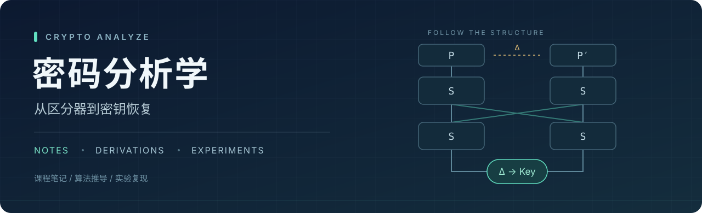

<p align="center">
  
</p>

<p align="center"><strong>课程笔记 · 推导与图解 · 四组实验 · 期末复习</strong></p>

<p align="center">
  <a href="#start">开始阅读</a> · <a href="#topics">课程地图</a> · <a href="#labs">实验复习</a> · <a href="#print">打印资料</a> · <a href="#run">运行示例</a>
</p>

把密码分析中的 **攻击条件、传播过程、概率计算和密钥恢复** 串起来。笔记结合课程图示与实验代码，记录公式怎样得到、程序怎样验证，以及不同攻击为什么有效。

**目录入口：** [专题笔记 · notes](notes/README.md) · [实验材料 · labs](labs/README.md) · [复习资料 · review](review/README.md)

<a id="start"></a>

## 从这里开始

| 你的目标 | 推荐入口 | 可以找到什么 |
| :--- | :--- | :--- |
| 建立全局认识 | [密码分析学概述](notes/01-基础与模型/密码分析学概述.md) → [攻击思想](notes/01-基础与模型/攻击思想.md) | 安全模型、区分器、密钥恢复与复杂度 |
| 按课程系统学习 | [下方课程地图](#topics) | 各章原理、逐步推导、课件图和例题 |
| 从实验理解公式 | [实验复习指南](review/实验复习/README.md) | Enigma、差分、线性分析和自动化建模 |
| 考前集中复习 | [期末复习总笔记](review/密码分析学期末复习总笔记.md) · [复习计划](review/11月18日密码分析学复习计划.md) | 知识框架、公式速查和练习安排 |

**建议学习顺序：** 安全模型 → 差分与线性分析 → 积分与中间相遇 → 杂凑函数与 MAC；读完一个方法，就用对应实验检查一遍传播和计数。

<a id="topics"></a>

## 课程地图

| 专题 | 笔记导航 | 重点问题 |
| :--- | :--- | :--- |
| **01 · 基础与模型** | [课程简介](notes/01-基础与模型/课程简介.md) · [概述](notes/01-基础与模型/密码分析学概述.md) · [基本假设](notes/01-基础与模型/基本假设.md) · [计算安全](notes/01-基础与模型/计算安全.md) · [穷举](notes/01-基础与模型/穷举攻击.md) · [攻击思想](notes/01-基础与模型/攻击思想.md) | 攻击者知道什么？时间、数据和存储怎样计量？ |
| **02 · 古典密码** | [古典密码分析](notes/02-古典密码/古典密码的安全性分析.md) · [Enigma](notes/02-古典密码/破解Enigma机.md) | 如何把语言信息和结构约束变成密钥筛选条件？ |
| **03 · 差分分析** | [差分攻击](notes/03-差分分析/差分攻击.md) · [截断差分](notes/03-差分分析/截断差分.md) · [不可能差分](notes/03-差分分析/不可能差分分析.md) · [飞去来器与矩形](notes/03-差分分析/飞去来器攻击.md) | 怎样追踪差分、计算概率、统计或排除子密钥？ |
| **04 · 线性分析** | [线性分析](notes/04-线性分析/线性分析.md) · [差分—线性分析](notes/04-线性分析/差分-线性分析.md) | 掩码怎样传播？偏差和数据量有什么关系？ |
| **05 · 积分分析** | [Square 攻击](notes/05-积分分析/Square攻击.md) | 一组明文的平衡性质怎样用于恢复密钥？ |
| **06 · 中间相遇** | [中间相遇攻击](notes/06-中间相遇/中间相遇攻击.md) | 分割密钥、拼切与集合映射怎样减少搜索？ |
| **07 · 杂凑函数** | [杂凑函数总览](notes/07-杂凑函数/杂凑函数.md) · [第二原像](notes/07-杂凑函数/第二原像攻击.md) · [生日与广义生日](notes/07-杂凑函数/生日攻击与广义生日攻击.md) · [具体碰撞攻击](notes/07-杂凑函数/具体杂凑函数的碰撞攻击.md) | 碰撞、第二原像与差分路径分别解决什么问题？ |
| **08 · 消息认证** | [消息认证码](notes/08-消息认证/消息认证码.md) | CBC-MAC、HMAC 与伪造攻击怎样分析？ |
| **工具与拓展** | [对称加密算法](notes/01-基础与模型/对称加密算法.md) · [自动化区分器搜索](notes/09-自动化与拓展/自动化区分器搜索.md) · [相关密钥攻击](notes/09-自动化与拓展/相关密钥攻击.md) | 怎样把密码结构和传播条件写成求解模型？ |

<a id="labs"></a>

## 从实验到理解

实验复习页把 **原理 → 代码 → 结果 → 易错点** 放在一起，附报告中的图、可核查的数值和源码入口。

| 实验 | 提炼出的复习内容 | 复习页 | 原始材料 |
| :--- | :--- | :--- | :--- |
| **Lab 1 · Enigma** | 信号路径、crib 对齐、menu 环与插线板约束 | [Enigma 与已知明文](review/实验复习/01-Enigma与已知明文.md) | [代码](labs/lab1/) · [报告源码](labs/lab1/report/main.tex) |
| **Lab 2 · 差分分析** | DDT、路径与差分、计数区分、末轮密钥恢复 | [差分路径与密钥恢复](review/实验复习/02-差分路径与密钥恢复.md) | [代码](labs/lab2/) · [报告](labs/lab2/report/main.pdf) |
| **Lab 3 · 线性分析** | LAT、相关系数、偏差累积、线性路径搜索 | [线性分析与自动化建模](review/实验复习/03-线性分析与自动化建模.md) | [代码](labs/lab3/code/) · [报告](labs/lab3/report/main.pdf) |
| **Lab 4 · 自动化搜索** | DDT/LAT 合法点集、四种编码、求解结果验证 | [线性分析与自动化建模](review/实验复习/03-线性分析与自动化建模.md) | [代码](labs/lab4/code/) · [报告](labs/lab4/report/main.pdf) |

> **复习时先做一遍小计算。** 手算一个 DDT 或 LAT 表项，再运行对应脚本，比只记住整张表更容易理解攻击过程。

<a id="print"></a>

## 可下载的打印资料

| 资料 | 内容 | 下载 |
| :--- | :--- | :--- |
| **期末复习总笔记** | 课程知识框架、公式和课件图 | [PDF](review/pdf/密码分析学期末复习总笔记.pdf) · [Markdown](review/密码分析学期末复习总笔记.md) |
| **期末模拟试卷** | 参考期中题型，按期末大纲分值安排；100 分、建议 120 分钟 | [PDF](review/pdf/密码分析学期末模拟试卷.pdf) · [题目源稿](review/模拟试卷/密码分析学期末模拟试卷.md) |
| **答案与评分要点** | 分步推导、图示答案与评分说明 | [PDF](review/pdf/密码分析学期末模拟试卷参考答案与评分要点.pdf) · [答案源稿](review/模拟试卷/密码分析学期末模拟试卷参考答案与评分要点.md) |

PDF 为打印快照，最新推导与实验补充见各专题 Markdown。

<a id="run"></a>

## 快速开始

### 阅读笔记

直接在 GitHub 点击目录，或克隆到本地：

```bash
git clone https://github.com/infinitepwn/crypto-analyze.git
cd crypto-analyze
```

使用 **Obsidian** 时，选择“打开文件夹作为仓库”，打开仓库根目录即可。笔记采用标准 Markdown 相对链接，公式使用 `$...$` 和 `$$...$$`，在 GitHub 和 Obsidian 中均可阅读。

### 运行三个小例子

在仓库根目录执行，以下脚本只需要 Python 3 标准库：

```bash
# CipherFour S 盒的差分分布表：每行计数之和为 16
python3 labs/lab2/task1/DDT.py

# 线性近似表：表项采用“成立次数减去 8”的定义
python3 labs/lab3/code/task1.py

# 实验四共用的 DDT / LAT 表
python3 -m labs.lab4.code.task1.ddt_lat
```

实验四的依赖配置要求 **Python 3.12+**。优化模型还使用 Gurobi 与 PyEDA，凸包生成使用 SageMath；环境配置见 [pyproject.toml](labs/lab4/code/task1/pyproject.toml) 和[实验四环境说明](labs/lab4/report/content/1environment.tex)。

<details>
<summary><strong>查看目录结构</strong></summary>

```text
crypto-analyze/
├── README.md                    # 课程与实验导航
├── notes/                       # 专题笔记，按学习顺序排列
│   ├── 01-基础与模型/
│   ├── 02-古典密码/
│   ├── 03-差分分析/
│   ├── 04-线性分析/
│   ├── 05-积分分析/
│   ├── 06-中间相遇/
│   ├── 07-杂凑函数/
│   ├── 08-消息认证/
│   └── 09-自动化与拓展/
├── labs/                        # 原始实验代码、数据与报告
│   ├── lab1/                    # Enigma
│   ├── lab2/                    # 差分分析
│   ├── lab3/                    # 线性分析
│   └── lab4/                    # 自动化区分器搜索
├── review/                      # 总复习笔记与复习计划
│   ├── 实验复习/                # 实验知识提炼与算例
│   ├── 模拟试卷/                # 试卷、答案源稿与配图
│   └── pdf/                     # 可下载的打印版本
└── assets/
    ├── course-slides/            # 笔记使用的课件图
    └── readme/                   # 首页视觉资源
```

</details>

## 一起完善

欢迎通过 [Issues](https://github.com/infinitepwn/crypto-analyze/issues) 反馈推导、公式或运行问题，也可以提交 Pull Request。补充实验结果时，请写清输入、参数、计数方式和复现入口。

- 笔记和图片使用相对路径，保持 GitHub 与 Obsidian 都能阅读。
- 专题内容放在 `notes/` 对应章节；实验实现与报告放在 `labs/`；复习提炼、试卷和打印资料放在 `review/`。
- 新增推导说明变量含义；给出概率时同时写明对应的事件。
- 图示优先使用已有课件或实验材料，并在正文标注来源。

---

<p align="center"><sub>理解结构 · 构造区分器 · 验证结果</sub></p>
