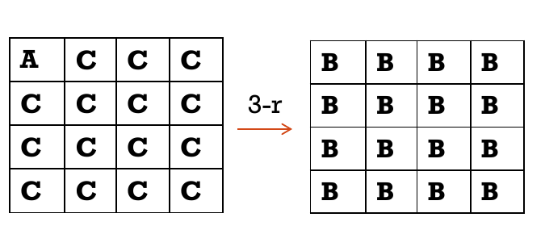

# Square 攻击

## 1. 从单对差分转向一组明文

Square 攻击是**积分攻击**的一种：选择一组具有特定结构的明文，追踪整组数据经过各轮后的性质，再用输出的异或和区分密码或筛选密钥。

差分分析通常观察两条文本之间的差异；这里观察一个结构体中 **256 条文本**在同一字节位置上的集合性质。这 256 个值按同一条明文的索引对应，不能任意重新配对后再分析运算。

## 2. 认识 $A$、$C$、$B$

对一个由 256 条文本组成的结构体，看其中某个固定字节位置上的 256 个值：

| 记号 | 含义 | 256 个值的异或和 |
| --- | --- | --- |
| $A$：活跃 | $0,\ldots,255$ 每个值恰好出现一次 | $0$ |
| $C$：常数 | 所有值都相同 | $0$，因为同一值出现偶数次 |
| $B$：平衡 | 所有值异或之和为 $0$ | $0$ |

$A$ 和 $C$ 都满足平衡，但 $B$ 只说明异或和为零，未必遍历所有值，也未必为常数。画状态图时通常填写最具体的可保证性质：遍历写 $A$，固定写 $C$，只能保证平衡写 $B$。

**看懂位置：** 图中一个 $A$ 表示“跨 256 条轨迹，在这个位置取遍全部字节值”，不是说一条 AES 状态里有 256 个字节。状态仍然只有 16 个字节。

### 2.1 各部件如何传播？

- **可逆字节 S 盒：** $A\to A$，因为双射把 256 个值重新排列；$C\to C$，因为相同输入始终映成相同输出。单凭 $B$，经过非线性 S 盒后无法保证仍平衡。
- **ShiftRows：** 只调整字节位置，$A,C,B$ 随对应字节移动。
- **AddRoundKey：** 同一位置在 256 条轨迹中异或同一密钥字节；遍历性和常数性保持，平衡性也保持，因为该密钥字节异或了偶数次。
- **MixColumns：** 是字节上的线性组合，输出异或和等于各输入异或和的对应线性组合。若输入都平衡，则输出也平衡；只有一个活动字节、其余常数时，由于 AES 列混合矩阵的系数非零，每个输出字节仍会取遍全部值。

例如按相同索引配对两个 $A$ 集合，若两者的每一项恰好相同，那么逐项异或的结果全为零，是 $C$ 而不是 $A$。所以不能仅凭“两个输入都是 $A$”就断言异或后仍是 $A$。

## 3. AES 三轮积分区分器：逐轮看传播

构造一个 256 个明文的结构体：左上角第 0 字节取遍 $00,01,\ldots,\mathrm{FF}$；其余 15 个字节在结构体内各自固定。状态矩阵按 AES 列优先编号，第 0 行在最上方。第 $i$ 条明文记作 $P_i$。

$$
\begin{pmatrix}
A&C&C&C\\
C&C&C&C\\
C&C&C&C\\
C&C&C&C
\end{pmatrix}
\xrightarrow{\text{初始轮密钥异或}}
\begin{pmatrix}
A&C&C&C\\
C&C&C&C\\
C&C&C&C\\
C&C&C&C
\end{pmatrix}.
$$

初始轮密钥异或不改变 $A,C$。下面三轮各按 **SB → SR → MC → ARK** 说明。

### 第 1 轮：一个 $A$ 扩散到一列

1. **SB：** 唯一的 $A$ 经 S 盒仍为 $A$，其他位置仍为 $C$。
2. **SR：** 活跃字节在第 0 行，第 0 行不移动，因此它仍在第一列。
3. **MC：** 第一列的一个 $A$ 与三个 $C$ 经线性混合，使这一列四个输出各为 $A$；其他列仍为 $C$。
4. **ARK：** 异或同一个轮密钥，不改变结果。

第一轮后：

$$
\begin{pmatrix}
A&C&C&C\\
A&C&C&C\\
A&C&C&C\\
A&C&C&C
\end{pmatrix}.
$$

**为什么一列的四个输出都是 $A$？** 每个输出都形如 $\lambda a\oplus c$，其中 $a$ 遍历 256 个字节、$c$ 固定，$\lambda$ 是 AES 列混合中的非零系数。有限域上乘以非零系数以及异或常数都是双射，所以输出仍遍历 256 个值。

### 第 2 轮：四个 $A$ 分散到四列

1. **SB：** 第一列的四个 $A$ 保持 $A$，其他位置仍为 $C$。
2. **SR：** 第 $r$ 行左移 $r$ 个字节。第一列的四个 $A$ 移到不同列，形成下图左侧的对角分布。
3. **MC：** 此时每一列恰有一个 $A$、三个 $C$，因此每列的四个输出均为 $A$。
4. **ARK：** 每个位置异或固定密钥字节，保持 $A$。

$$
\begin{pmatrix}
A&C&C&C\\
C&C&C&A\\
C&C&A&C\\
C&A&C&C
\end{pmatrix}
\xrightarrow{\mathrm{MC\ 和\ ARK}}
\begin{pmatrix}
A&A&A&A\\
A&A&A&A\\
A&A&A&A\\
A&A&A&A
\end{pmatrix}.
$$

所以第二轮后，每个字节位置都各自取遍 256 个值。它们是由同一个活动输入决定的，不能认为 16 个位置相互独立。

### 第 3 轮：从 $A$ 得到 $B$

SB 是双射，16 个位置各自仍为 $A$；SR 只换位置，因此进入 MC 时，每个字节的异或和均为零。设某列 4 个输入位置为 $a_i,b_i,c_i,d_i$（$i=0,\ldots,255$），MC 的某个输出为

$$
y_i=2a_i\oplus3b_i\oplus c_i\oplus d_i.
$$

对整个结构体求异或，并利用有限域乘法对异或的线性性：

$$
\bigoplus_i y_i
=2\left(\bigoplus_i a_i\right)
\oplus3\left(\bigoplus_i b_i\right)
\oplus\left(\bigoplus_i c_i\right)
\oplus\left(\bigoplus_i d_i\right)=0.
$$

轮密钥在同一位置被异或 256 次，也不会改变异或和。因此第 3 轮后 **16 个字节都能保证平衡 $B$**；一般不能再保证每个字节仍取遍。

$$
\begin{pmatrix}
B&B&B&B\\
B&B&B&B\\
B&B&B&B\\
B&B&B&B
\end{pmatrix}.
$$

*图源：第 5.1 节课件，第 9 页。*

### 如何区分？

若三轮输出为 $Y_i$，则每个字节位置 $j$ 满足

$$
\bigoplus_{i=0}^{255}Y_i[j]=0,\qquad j=0,\ldots,15.
$$

选择一个结构体，收集 256 个输出并逐位异或：三轮 AES 必然得到零；观察到非零，就排除该三轮结构。随机置换没有这个结构性保证。区分器本身给出的是不随机性质，还没有恢复密钥。

## 4. 末轮扩展一轮：恢复子密钥

### 4.1 为什么需要先逆 S 盒？

设在三轮区分器之后再接一轮，并明确末轮为 **SB → SR → ARK，没有 MC**。第三轮后的每个字节仍平衡，但通过第 4 轮的非线性 S 盒后，密文字节一般不再保证平衡。

因此猜一个末轮密钥字节，先逆 ARK，再逆 S 盒，尝试还原三轮后的字节。正确猜测恢复原来的平衡集合；错误猜测一般不满足。

### 4.2 位置怎样对应？

令 $Y_i[r,c]$ 为第 3 轮后的状态，令 $\pi(r,c)=(r,(c-r)\bmod4)$ 表示 ShiftRows 后的位置；$C_i$ 为密文。末轮有

$$
C_i[\pi(r,c)]
=S\bigl(Y_i[r,c]\bigr)\oplus K_4[\pi(r,c)].
$$

猜测对应的末轮密钥字节为 $\kappa$，对每条密文部分解密，并对 256 个结果求异或：

$$
T_{r,c}(\kappa)=
\bigoplus_{i=0}^{255}S^{-1}\bigl(C_i[\pi(r,c)]\oplus\kappa\bigr).
$$

当 $\kappa=K_4[\pi(r,c)]$ 时，每项正好恢复 $Y_i[r,c]$，故 $T_{r,c}(\kappa)=0$。若计算结果非零，就排除该候选；为零则保留，不能仅凭一个结构就认定它正确。

**位置例子：** 第 3 轮状态的 $(r,c)=(1,0)$ 经过 SR 到密文位置 $(1,3)$。要猜的是 $K_4[1,3]$，对 $C_i[1,3]$ 计算逆 S 盒；它对应平衡的 $Y_i[1,0]$。对于第 0 行的 $(0,0)$，SR 不移动，才直接比较密文的 $(0,0)$ 位置。

### 4.3 具体筛选流程

1. 构造结构体并查询 256 个密文。
2. 对某个密文字节位置，依次猜测 $\kappa=0,1,\ldots,255$。
3. 对每个 $\kappa$ 计算上面的 $T_{r,c}(\kappa)$，排除非零候选。
4. 对存活候选，用另一个结构体重复检验；仍存活者用其他数据验证。
5. 对 16 个密文字节位置分别进行，得到末轮密钥字节的候选，再结合 AES 密钥编排和其他明密文恢复、验证主密钥。

### 4.4 错误候选和工作量

在错误密钥随机化近似下，错误候选在一个结构上恰好使一个字节的异或和为零的概率为 $2^{-8}$。一个字节开始有 255 个错误候选：

$$
\begin{aligned}
\text{一个结构后的错误候选期望}&=255\cdot2^{-8}\approx1,\\
\text{两个独立结构后的错误候选期望}&=255\cdot2^{-16}\approx2^{-8}.
\end{aligned}
$$

正确密钥始终通过。第二个结构使错误候选大幅减少；期望很小仍需验证剩余候选。

若第一个结构对 16 个字节的 256 个候选都逐条处理，需

$$
16\times256\times256=2^{20}\quad\text{次逆 S 盒计算}.
$$

如果先淘汰错误候选，第二个结构只处理存活者，课件的整体运算量仍约为 $2^{20}$ 次逆 S 盒计算。若不提前淘汰，而是对两个结构的所有候选全部逐条计算，则为 $2^{21}$ 次。两种数字对应不同实现；比较完整加密次数时还要注明怎样折算。两个结构使用 $2\times256=2^9$ 条选择明文。

## 5. 扩展两轮：课件中的五轮攻击

### 5.1 方法一：三轮区分器后接两轮（3+2）

现在第 4 轮包含 MC，第 5 轮末轮没有 MC。要从密文恢复第三轮的一个字节，不能只猜一个末轮密钥字节：逆第 5 轮后，还要逆第 4 轮列混合，而一列的结果依赖 4 个字节。

以第三轮后的第 0 字节为例，密文需要第 $0,7,10,13$ 号位置的四个字节。先猜第 5 轮四个对应密钥字节，逆末轮 S 盒与位置，再做逆列混合；接着猜第 4 轮一个等效密钥字节，逆 S 盒，检验 256 个恢复值的异或和。

线性变换可以把第 4 轮的密钥异或移过逆 MC：

$$
\operatorname{MC}^{-1}(X\oplus K_4)
=\operatorname{MC}^{-1}(X)\oplus\operatorname{MC}^{-1}(K_4).
$$

因此只需猜 $\widetilde K_4=\operatorname{MC}^{-1}(K_4)$ 的一个对应字节，加上第 5 轮的四个字节，共 **5 字节，即 40 比特**。

> 逆运算顺序：先对密文异或所猜末轮密钥，再逆 S 盒并逆行移位，然后才逆 MC。不能直接对尚未逆 S 盒的密文进行逆列混合。

按每结构对错误候选的通过率 $2^{-8}$、不同结构近似独立估算，六个结构后，一组 40 比特候选的错误候选期望约为 $(2^{40}-1)2^{-48}\approx2^{-8}$。这说明为什么课件采用约六个结构，但存活结果仍需验证。

六个结构共需 $6\cdot2^8\approx2^{10.58}$ 条选择明文。课件采用提前淘汰、复用部分计算的方式，估计恢复所需末轮密钥的时间约为 $5\cdot2^{50}$ 次 S 盒计算，按五轮 AES 每次约 $16\cdot5$ 次 S 盒计算折算为约 $2^{46}$ 次五轮加密；这包括四组对应位置的处理，而不是把一次字节检验直接当成一次完整加密。

### 5.2 方法二：先构造四轮积分区分器，再接一轮（4+1）

选择 $2^{32}$ 个明文，让编号 $0,5,10,15$ 的 4 个字节取遍全部 $2^{32}$ 个组合，其余字节固定。经过初始密钥异或、SB、SR 和第一轮 MC 后，第一列取遍所有 4 字节组合，其他列固定。

把这一列中 3 个字节固定、另一个字节取遍 256 值，就得到一个三轮区分器要求的结构体；3 个固定字节共有 $2^{24}$ 种取值，因此这 $2^{32}$ 条轨迹可分成 $2^{24}$ 个各含 256 条的三轮结构体。

每个三轮结构体在后面三轮输出时都平衡，因此对所有 $2^{24}$ 组再异或，总体仍为零。这形成了一个**四轮积分区分器**。再向后扩一轮无 MC 的末轮，便可像第 4 节一样逐字节猜末轮密钥并检验平衡。

两种方法的侧重点不同：3+2 利用较小的结构体，但一次需要联合猜 40 比特；4+1 每次只猜末轮一个字节，但一个结构体需要 $2^{32}$ 个选择明文。课件中两种方案的数据、时间和存储需分别比较。

例如 4+1 使用两个结构时共需 $2^{33}$ 条选择明文。第一结构对 16 个位置、每位置 256 个候选各处理 $2^{32}$ 个密文，约需 $16\cdot2^8\cdot2^{32}=2^{44}$ 次逆 S 盒计算；提前筛选后第二结构只处理存活候选。若把 $2^{32}$ 个完整 128 比特密文都保存下来，需 $2^{39}$ 比特。课件还指出可以统计同一密文字节值出现次数的奇偶性：出现偶数次的值在异或时相互抵消。

## 6. 怎样自动搜索积分特性？

手推 AES 三轮时，我们不断判断每个位置是 $A$、$C$ 还是 $B$。自动搜索也是把这些性质和传播规则写成约束，再让程序逐轮连接：

1. **表示状态：** 为每轮、每个字节分配性质变量，记录它是取遍 $A$、常数 $C$、仅保证平衡 $B$，还是当前模型无法确定的状态。
2. **加入部件规则：** 根据 S 盒、字节置换、密钥异或和线性层，为相邻状态添加约束。例如双射 S 盒有 $A\to A$、$C\to C$；对只有 $B$ 的输入，不能直接要求输出仍为 $B$。
3. **设定边界：** 固定输入结构，如一个字节为 $A$、其他为 $C$；让程序搜索若干轮后哪些输出位置可以保证平衡。
4. **检查与验证：** 回看求出的每一步传播是否使用了正确规则，并用小规模枚举或实际选择明文集合检验；规则未能推出平衡，不代表已经证明该位置一定不平衡。

不同字节可能来自同一个活动输入，因此不能只凭各位置都标为 $A$ 就假设它们相互独立。建模时要让传播规则保留足够的信息；求解器只能保证所编码规则内的结论。

差分与线性分析也可以通过 DDT、LAT 把传播写为约束，完整的建模和验证流程见 [自动化区分器搜索](自动化区分器搜索.md)。

## 7. 考前对照

| 问题 | 应抓住的点 |
| --- | --- |
| $A,C,B$ 是一条明文内的性质吗？ | 是同一位置跨整个结构体的性质 |
| 第一轮为什么一列为 $A$？ | 一列仅有一个 $A$；非零线性系数乘它再加常数仍遍历 |
| 第二轮为什么全为 $A$？ | SR 把四个 $A$ 分散到四列，每列各一个 |
| 第三轮为什么只保证 $B$？ | 输入各位置平衡，MC 线性组合保持异或和为零 |
| 为什么猜末轮密钥？ | 逆去末轮 S 盒，恢复区分器末端的平衡性质 |
| 为什么两个结构还要验证？ | 错误密钥可能碰巧通过平衡检验 |

来源：第 5.1 节课件第 3–20 页。相关方法：[差分攻击](差分攻击.md)、[攻击思想](攻击思想.md)、[中间相遇攻击](中间相遇攻击.md)。
