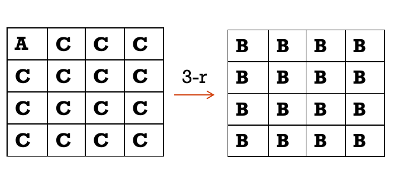

# Square 攻击

## 从单对差分转向一组明文

Square 攻击是一种**积分攻击**：选择具有特定结构的一组明文，观察加密后各位置的异或和。课件以 AES 的缩减轮数为例，不追踪某一对文本的固定差分，而追踪整个多重集在各轮的“遍历／常数／平衡”性质。

## 三类多重集

对 $256$ 个字节值组成的多重集，常用三种记号：

| 记号 | 含义 | 异或和 |
| --- | --- | --- |
| $A$（活跃） | 恰好遍历 $0,\ldots,255$，各出现一次 | $0$ |
| $C$（常数） | 所有值相同 | $0$（因为有偶数个） |
| $B$（平衡） | 全部值异或为 $0$，未必遍历或相同 | $0$ |

可逆字节 S 盒保持 $A$ 和 $C$：它把遍历集重新排列，把常数映为另一常数。**仅有 $B$ 性质时，经过非线性 S 盒后一般不再保证平衡。** 字节置换只移动位置；异或常数不改变偶数个元素的平衡性质；线性混合能把若干同索引字节的异或和线性地组合。单看两个输入都标成 $A$，并不能保证它们异或后仍为 $A$，通常只能推出平衡。

## AES 三轮积分区分器

构造一个包含 $2^8=256$ 个**选择明文**的结构：一个字节遍历全部可能值，其余 $15$ 个字节各固定为常数。因此输入状态是一个 $A$、十五个 $C$。沿 AES 的字节代换、行移位、列混合及轮密钥异或追踪性质，课件给出的三轮传播结果是：**每个输出字节都是 $B$**。

记三轮后第 $j$ 个输出字节为 $Y_{i,j}$，$i=0,\ldots,255$，则

$$
\bigoplus_{i=0}^{255}Y_{i,j}=0\qquad (j=0,\ldots,15).
$$

这就是三轮区分器。随机置换没有该轮结构带来的必然平衡性质。判断时要以随机置换为对照，并注意同一结构内的输出并非相互独立的随机字节。

## 扩展一轮并恢复子密钥

对课件中的四轮 AES 形式，末轮没有列混合。猜测末轮某个输出位置对应的子密钥字节 $\kappa$，对这一结构的 $256$ 个密文字节 $C_{i,j}$ 做一步部分逆运算，计算

$$
T_j(\kappa)=\bigoplus_{i=0}^{255}S^{-1}(C_{i,j}\oplus\kappa).
$$

正确的 $\kappa$ 使 $T_j(\kappa)=0$；错误猜测通常不会保持三轮前的平衡性质。在常用的错误密钥随机化近似下，一个结构让错误候选通过的概率约为 $2^{-8}$，因此通常还需第二个独立结构过滤。对各输出位置重复，可逐字节恢复末轮子密钥，再结合 AES 密钥编排或额外明密文验证。

> **读图提醒：** 图中的 $A,C,B$ 描述的是跨 $256$ 条加密轨迹、在同一字节位置上形成的多重集性质；不是一条明文内部各字节的取值类别。

来源：第5.1节课件第3—11页。相关方法：[差分攻击](差分攻击.md)、[攻击思想](攻击思想.md)。
