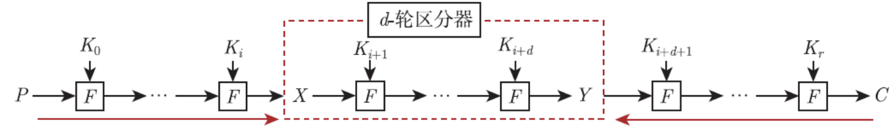

# 密码分析学概述

## 研究什么

密码学包括密码设计和密码分析。密码设计提出安全目标与算法，密码分析则在给定敌手能力和计算资源下，寻找算法与理想对象之间可利用的差异。本课程主要讨论对称密码、杂凑函数和消息认证码。

**安全属性**是希望算法具备的性质，**攻击目标**是分析者试图完成的任务。二者需要对应起来看：

| 对象 | 主要安全属性 | 常见攻击目标 |
| --- | --- | --- |
| 对称加密 | 机密性 | 区分、恢复部分或全部密钥 |
| 消息认证码 | 可认证性 | 伪造、恢复密钥 |
| 杂凑函数 | 原像、第二原像、碰撞抗性 | 找原像、第二原像或碰撞 |

“区分”是发现目标算法与随机函数或随机置换的行为不同。它通常是继续恢复密钥的起点，但区分成功本身不等于已经恢复密钥。具体攻击目标与敌手可获得的数据见[基本假设](基本假设.md)。

### 从安全属性反推攻击任务

分析一个算法时，先问“算法承诺什么”，再问“攻击者要破坏什么”。例如：

1. 分组密码声称对不知道密钥的人表现得像随机置换。若攻击者利用一个明显不同的输出规律判断黑盒类型，就得到一个**区分器**。
2. 加密算法保护密钥与明文；若攻击者通过明密文关系猜出部分子密钥，再恢复或验证完整密钥，就是**密钥恢复**。
3. MAC 使用秘密密钥认证消息；若攻击者能为一条未查询的新消息给出有效标签，就是**存在性伪造**。
4. 杂凑函数的输出是公开的；根据题目给定的是目标摘要、目标消息还是都未给定，分别寻找**原像、第二原像或碰撞**。

同一种方法能服务不同目标，但必须先说明任务。例如两个输出相同可能用于构造杂凑碰撞，并不自动给出分组密码密钥。

### 数据条件和攻击方法不是一回事

**攻击条件**描述敌手能取得哪些数据；**攻击方法**描述敌手如何利用数据。它们可以组合：

| 攻击条件 | 攻击者能做什么 | 例子 |
| --- | --- | --- |
| 已知明文 | 得到一些明文和对应密文 | 已知明文下的穷举密钥 |
| 选择明文 | 指定明文并获得密文 | 选择满足差分条件的明文对 |
| 选择密文 | 指定密文并获得解密结果 | 经典飞去来器构造密文对并逆向查询 |

例如“选择明文差分攻击”同时说明了能力是选择明文、方法是差分分析。各模型及自适应查询见[基本假设](基本假设.md)。

## 方法的三个层次

- **通用攻击：** 只依赖密钥长度、分组长度等参数，不利用内部结构，例如[穷举攻击](穷举攻击.md)、查表和时间—存储权衡。它们给出可达到的攻击复杂度上界。
- **结构分析：** 利用轮函数、S 盒和扩散层中的规律，例如[差分攻击](../03-差分分析/差分攻击.md)、[线性分析](../04-线性分析/线性分析.md)及[Square 攻击](../05-积分分析/Square攻击.md)。
- **实现分析：** 利用算法运行时的物理信息，例如时间、功耗或电磁泄漏。它针对具体实现。

评价一种方法时，要同时写清攻击目标、敌手能力、数据量、时间、存储和成功率；只报“需要多少次运算”不够。参见[计算安全](计算安全.md)。

## 区分器与密钥恢复

课件用“区分”和“分割”串起攻击设计：

1. 在若干轮中找到一个可观察的**不随机现象**，构造区分器。例如，某个差分传播概率明显大于随机置换的基线。
2. 从明文或密文向区分器的头尾做部分加密或解密，只猜测涉及的子密钥位，让区分器所需的中间状态变得可计算。
3. 对每个子密钥候选统计区分器是否成立。正确候选与错误候选的统计分布不同，据此筛选，再验证完整密钥。

*图源：第 1 章课件，第 36 页。两侧只需恢复与区分器头尾有关的状态。*

这个思路在[破解 Enigma 机](../02-古典密码/破解Enigma机.md)中表现为先用 crib 和环路筛转子，再确定接线板；在现代分组密码中则常表现为“中间若干轮区分器 + 两端部分密钥猜测”。

### 一次完整分析应写清楚什么？

以“用高概率差分攻击末轮子密钥”为例，答题时可以按以下顺序组织：

1. **目标和能力：** 说明要区分还是恢复密钥、可以使用已知明文还是选择明文。
2. **核心规律：** 给出输入输出差分、目标密码中的概率和随机对象的基准概率。
3. **数据与边界：** 说明如何收集明文对、区分器放在哪几轮、需要猜哪些首尾子密钥。
4. **筛选规则：** 部分加密或解密后，检查每个候选使目标事件出现多少次；概率性事件通过统计排序，确定性矛盾可以排除候选。
5. **结果与资源：** 用额外数据验证候选，并报告数据 $D$、时间 $T$、存储 $M$ 和成功率 $P_s$。

区别“攻击多少轮”和“完整算法多少轮”。例如得到五轮区分器，说明这五轮的行为可被区分，不能直接说完整轮数的算法已被破解。

## 相关笔记

- [基本假设](基本假设.md)
- [计算安全](计算安全.md)
- [攻击思想](攻击思想.md)
- [对称加密算法](对称加密算法.md)
- [杂凑函数](../07-杂凑函数/杂凑函数.md)
- [消息认证码](../08-消息认证/消息认证码.md)
