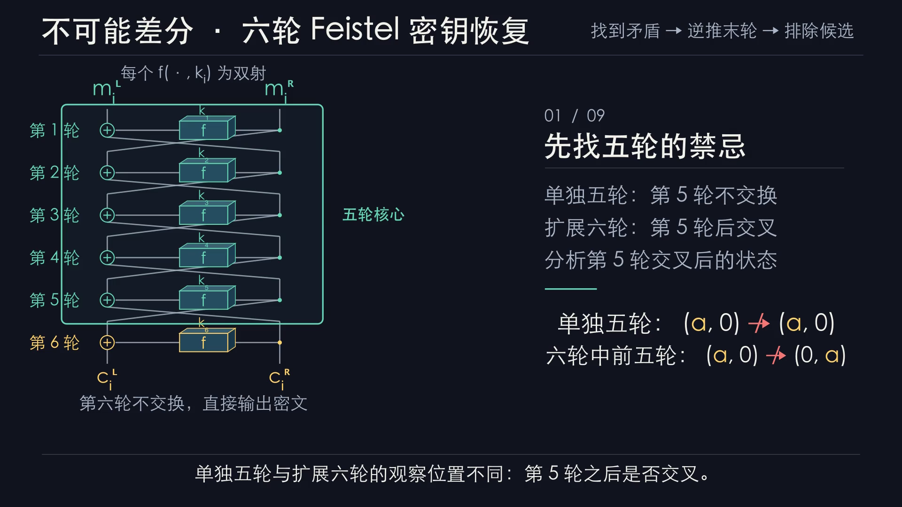

# 不可能差分分析

## 六轮 Feistel 密钥恢复动画

[播放立体图解动画](../../assets/animations/impossible-feistel-recovery.mp4) · [动画源码与数值例子](../../animations/impossible_feistel/README.md)

动画先用正向两轮、反向三轮证明五轮不可能差分，再展示密文对预筛、猜测第六轮子密钥、逆推末轮和排除候选。数值示例给出了可复算的明密文对与被排除的错误子密钥。

## 核心：用“绝不发生”排除错误密钥

[普通差分攻击](差分攻击.md)寻找发生概率较高的输入—输出差分，并给与它相符的候选密钥计数。不可能差分分析寻找**概率严格为零**的差分：在规定的轮数、算法结构与密钥条件下，输入差分 $\alpha$ 不可能产生输出差分 $\beta$，记为 $\alpha\not\to\beta$。

攻击时通常先在这个区分器的头部或尾部增加一轮，猜测少量子密钥。如果某个猜测把实际明密文对还原成了区分器所禁止的差分，这个猜测**一定错误**，可以直接删除。密钥恢复的判据就是这个可检验的矛盾。

## 如何构造：中间相错（Miss in the middle）

从输入差分正向传播，得到连接点处必然落入的集合 $\mathcal A$；从目标输出差分反向传播，得到同一连接点处必然落入的集合 $\mathcal B$。如果两段推导都以概率 $1$ 成立，而

$$
\mathcal A\cap\mathcal B=\varnothing,
$$

就不存在同时满足头尾条件的明密文对，因而得到不可能差分。

因为没有交集的话，肯定就没办法从左边走到右边了，所以是不可能差分

## 例子：五轮 Feistel 的不可能差分

课件采用左右半支各 $b/2$ 比特、每轮函数 $f_i(x)=f(x,k_i)$ 都是双射的 Feistel 结构。为明确左右顺序，先把轮内状态写为 $(L_i,R_i)$，一轮定义为

$$
(L_i,R_i)=(R_{i-1},\,L_{i-1}\oplus f_i(R_{i-1})).
$$

设输入差分为 $(\alpha,0)$，$\alpha\ne0$。正向走两轮，必得

$$
(\alpha,0)\xrightarrow{1R}(0,\alpha)
\xrightarrow{1R}(\alpha,\beta),\qquad \beta\ne0.
$$

假设五轮后的**轮内状态**差分为 $(0,\alpha)$，从该状态反向走三轮，依次得到

$$
(0,\alpha)\xrightarrow{R^{-1}}(\alpha,0)
\xrightarrow{R^{-1}}(\gamma,\alpha)
\xrightarrow{R^{-1}}(\alpha\oplus\delta,\gamma),
\qquad \gamma,\delta\ne0.
$$

两侧在第二轮边界相遇时，左半支必须既是 $\alpha$ 又是 $\alpha\oplus\delta$，矛盾。因此轮内顺序下

$$
\Pr[(\alpha,0)\xrightarrow{5R}(0,\alpha)]=0.
$$

课件中**单独的五轮密码**在第 5 轮不交换，故其输出端的禁忌差分写为 $(\alpha,0)\not\to(\alpha,0)$。扩展为六轮时，第 5 轮变成中间轮，需要交叉换位；交叉后的差分为 $(0,\alpha)$，正是第 6 轮的输入。第 6 轮不再交换，两条支路直接输出为密文。

$f_i$ 的双射性保证非零输入差分对应非零输出差分，因此上述 $\beta,\gamma,\delta$ 都非零。

### 每一步为什么成立？

由一轮定义，差分满足

$$
(\Delta L_i,\Delta R_i)
=\bigl(\Delta R_{i-1},\ \Delta L_{i-1}\oplus\Delta f_i\bigr).
$$

第 1 轮 $f_1$ 的输入差分是 0，因此输出差分也是 0，得到 $(0,\alpha)$；第 2 轮 $f_2$ 的输入差分为非零 $\alpha$，双射保证输出差分 $\beta\ne0$，所以得到 $(\alpha,\beta)$。

反推使用

$$
(\Delta L_{i-1},\Delta R_{i-1})
=\bigl(\Delta R_i\oplus\Delta f_i,\ \Delta L_i\bigr).
$$

从假定的第 5 轮输出 $(0,\alpha)$ 反推：第 5 轮函数的输入差分为 0，得到第 4 轮状态 $(\alpha,0)$；再反推第 4 轮，函数输入差分为 $\alpha$，输出记为非零 $\gamma$，得到第 3 轮状态 $(\gamma,\alpha)$；继续反推第 3 轮，输入差分为 $\gamma$，输出记为非零 $\delta$，得到第 2 轮状态 $(\alpha\oplus\delta,\gamma)$。

正推与反推说的是**同一个第 2 轮状态**：前者左支必须为 $\alpha$，后者左支必须为 $\alpha\oplus\delta$。由于 $\delta\ne0$，两者不相等，所以头尾差分不可能同时出现。

## 扩展一轮：六轮 Feistel 密钥恢复

按课件的结构，前五轮结束后都交叉，第六轮不交换，直接输出密文。用 $m_i,m_j$ 表示明文对，用 $c_i,c_j$ 表示对应密文对，用 $f(x,k_6)$ 表示第六轮函数；猜测的子密钥仍记为 $k_6$。

### 为什么能排除密钥？

选择明文对，使

$$
m_i^L\oplus m_j^L=\alpha\ne0,\qquad m_i^R\oplus m_j^R=0.
$$

五轮内部路径不能将输入差分 $(\alpha,0)$ 传播为第六轮输入差分 $(0,\alpha)$。猜测 $k_6$ 并逆去末轮后，如果得到的第五轮末状态差分恰好是 $(0,\alpha)$，就与这个禁忌差分矛盾，因而**删除该候选值**。正确的子密钥不会被删除；未删除的候选还需继续筛选、验证。

### 先筛选数据对

第六轮不交换。记进入第六轮的状态为 $(L_5,R_5)$，其输出为

$$
c_i^L=L_{5,i}\oplus f(R_{5,i},k_6),\qquad c_i^R=R_{5,i}.
$$

因此 $R_{5,i}\oplus R_{5,j}=c_i^R\oplus c_j^R$ 与密钥无关。要逆推出禁忌差分 $(0,\alpha)$，数据对必须满足

$$
c_i^R\oplus c_j^R=\alpha=m_i^L\oplus m_j^L.
$$

不满足该条件的明密文对直接丢弃；这一步筛选的是**数据对**，还没有删除密钥。

可以用选择明文结构体减少查询量：固定右半支 $c$，令左半支遍历全部 $b/2$ 比特值，取 $m_i=(i,c)$。一个结构体包含 $2^{b/2}$ 个明文、约 $2^{b-1}$ 个无序对。预筛条件为 $c_i^R\oplus c_j^R=i\oplus j$，等价于 $i\oplus c_i^R=j\oplus c_j^R$，因此可按 $i\oplus c_i^R$ 分组，再在组内配对。随机密文近似下，平均保留

$$
\binom{2^{b/2}}2\cdot2^{-b/2}\approx2^{b/2-1}\text{ 对}.
$$

### 再用“不可能”排除子密钥

对于通过预筛的每对密文，逐个猜测 $k_6$，逆去第六轮：

$$
(L_{5,i},R_{5,i})=\bigl(c_i^L\oplus f(c_i^R,k_6),\ c_i^R\bigr),
$$

对 $c_j$ 同理。预筛已经保证 $\Delta R_5=\alpha$；为了使 $\Delta L_5=0$，候选 $k_6$ 必须满足

$$
f(c_i^R,k_6)\oplus f(c_j^R,k_6)=c_i^L\oplus c_j^L.
$$

**满足方程就删除该候选**：此时逆推差分为 $(0,\alpha)$，与前五轮的不可能差分矛盾。对更多数据对重复筛选，最后结合其余密钥用完整加密验证剩余候选。

> **与高概率差分计数的方向相反：** 不可能差分删除满足禁忌方程的候选，其余候选继续参与后续检验。

### 课件的粗略复杂度模型

设第六轮待恢复子密钥有 $k$ 比特，并假设一个过滤后的对能以约 $2^{-b/2}$ 的概率排除任意错误候选。处理一个结构体后，错误候选的留存概率近似为

$$
\left(1-2^{-b/2}\right)^{2^{b/2-1}}\approx e^{-1/2}.
$$

处理 $s$ 个结构体后，剩余错误候选的**期望个数**约为 $(2^k-1)e^{-s/2}$。令期望值小于 $1$ 得到粗略条件 $s>2k\ln2\approx1.39k$。该阈值以近似独立模型下的期望剩余数为标准。数据量为约 $s2^{b/2}$ 个选择明文，标记已删除候选需要约 $2^k$ 个比特。

**把留存概率拆开看：** 一个筛后的对删除某个错误候选的概率是 $2^{-b/2}$，不删除的概率就是 $1-2^{-b/2}$；一个结构体有约 $2^{b/2-1}$ 个这样的对，所以将不删除的概率连乘，就得到上面的 $e^{-1/2}\approx0.607$。重复 $s$ 个结构体后约为 $(e^{-1/2})^s=e^{-s/2}$；再乘初始 $2^k-1$ 个错误候选，得到期望剩余数。这里是题设的随机化和近似独立模型；不同结构体要使用不同的固定右支，重复同一个结构体不会带来新信息。

例如 $b/2=k=16$，取 $s=24$ 个结构体，错误候选期望约为 $(2^{16}-1)e^{-12}\approx0.403$。即平均剩余约 0.403 个错误候选。

### 与直接穷举相比

课件第 26 页把每个保留消息对对一个候选所需的两次轮函数计算都计入，得到约

$$
T_{\mathrm{ID}}\approx
\left(2^k+2^ke^{-1/2}+2^ke^{-1}+\cdots\right)
2^{b/2-1}\cdot2
\approx2^{k+b/2+1.34}
$$

次轮函数计算。若一次六轮完整加密约等于六次轮函数计算，换算后约为 $2^{k+b/2-1.24}$ 次完整加密。这个结果**对 $k$ 呈指数增长**；额外的 $2^{b/2}$ 因子来自每个结构体中要处理的大量消息对。

比较时要分清 $k$ 与完整密钥长度 $K$：这里恢复的只是第六轮的 $k$ 比特子密钥。如果这 $k$ 位已经决定全部密钥，并且能直接验证，那么约 $2^k$ 次的直接穷举更便宜。若要比较完整密钥恢复，则应把剩余密钥的求解成本也计入，再与约 $2^K$ 次完整加密的穷举比较。特别当 $K\approx k+b/2$ 时，上式只比 $2^K$ 小一个常数因子，还需要约 $1.39k\,2^{b/2}$ 个选择明文，此时主要收益是常数级的时间缩减。完整密钥恢复的比较基准为 $2^K$ 次完整加密，同时列出数据和存储成本。

## 其他矛盾与自动搜索

除 Feistel 例子中的“两个不同的非零固定值”矛盾外，课件还讨论**零与非零**的矛盾，以及多个字节之间的关系矛盾。例如 AES 的列混合是分支数为 $5$ 的线性变换：对非零输入列差分 $a$，有 $W(a)+W(\mathrm{MC}(a))\ge5$，其中 $W$ 为非零字节数。因此若一侧确定输入仅有一个活跃字节，另一侧又要求输出少于四个活跃字节，就会形成结构性冲突。

自动搜索通常先定义轮运算和差分状态的表示，再分别枚举正向、反向的概率为 $1$ 的传播，最后检测连接点处的集合是否相交。表示越粗，搜索越快，但也越容易把有用的矛盾合并掉；固定非零值、零值及跨字节约束应在需要时保留。

**来源说明：** 用户提供的文件名写作“第3.3节”，课件内标题写作“第3.4节 不可能差分分析”；上文页码均按 PDF 页数计算。相关笔记：[差分攻击](差分攻击.md)、[截断差分](截断差分.md)、[攻击思想](../01-基础与模型/攻击思想.md)。
