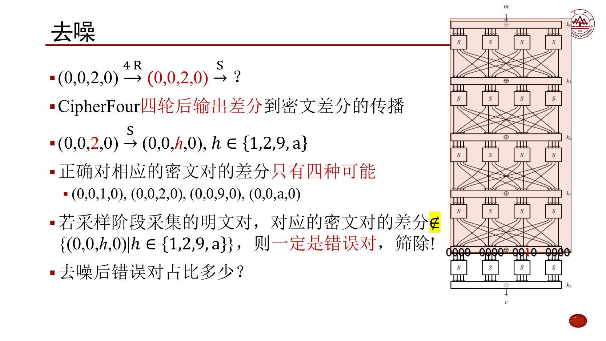
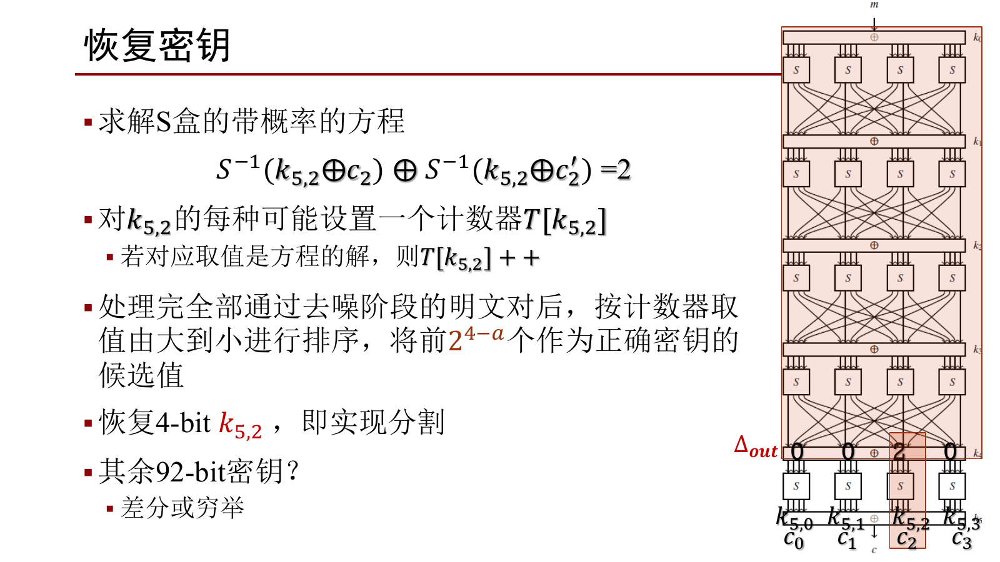

# 差分攻击
## 差分分析思维导图

图中按“差分性质 → 传播与判据 → 密钥恢复”整理。先读本篇的普通差分，再分别复习[截断差分](截断差分.md)、[不可能差分](不可能差分分析.md)、[飞去来器与矩形攻击](飞去来器攻击.md)和[差分—线性分析](../04-线性分析/差分-线性分析.md)。

普通差分的目标是通过多次命中**累计证据**；不可能差分是在候选密钥下出现禁忌差分时**排除候选**。截断差分中的概率为 1 和概率小于 1 对应的判据也分别标在图中。

如果是一轮算法，我们直接差分，就可以把k1消掉，实现对密钥空间的分割，用两个方程就可以分别求出密钥k0k,1

这里面没有概率的问题，满足方程的可能是正确密钥，不满足的一定不是
对于两轮的情况

我们可以消掉k2,然后这样就变成2的2n，但是还是比较大

我们可以利用u到v的高概率差分，直接爆破k2，先把k2出来
由于这个是概率事件，所以满足方程和不满足的都可能是正确密钥
但是正确的密钥的概率比较大，错误的密钥就是随机置换

这会导致不同的分布
我们就看对数T服从哪个分布，就能确定密钥是否正确了
三轮算法下

我们原先的一轮差分路线就不够用了，这样我们还是需要2的2n次方

我们需要找到两轮的差分
## 核心思路：统计“出现得特别多”的差分

选择许多具有**相同输入差分**的明文对，寻找经过若干轮后出现概率明显高于随机置换的输出差分。把这个高概率差分当作区分器，再猜少量轮密钥、做局部逆运算，统计各候选密钥使目标差分出现的次数。正确候选预期得分较高，最后还要用额外明密文验证。

这里采用**累计计数**：命中目标差分就加分，未命中则保持计数；处理足够数据后，按分数筛选候选。[不可能差分分析](不可能差分分析.md)利用概率严格为零的差分，判据和计数方向完全不同。

## 1. 差分与随机基准

对两个输入 $X,X'$，定义异或差分 $\Delta X=X\oplus X'$。选择 $P'=P\oplus\alpha$，观察 $r$ 轮后是否得到输出差分 $\beta$：

$$
DP_r(\alpha,\beta)
=\Pr_P\!\left[E_K^{(r)}(P)\oplus E_K^{(r)}(P\oplus\alpha)=\beta\right].
$$

此式对固定密钥 $K$、变化的明文 $P$ 而言。若用随机的 $n$ 比特置换代替算法，固定非零 $\alpha,\beta$ 时，平均命中概率为 $1/(2^n-1)$：不同输入对应不同输出，输出差分只能取 $2^n-1$ 个非零值。攻击需要找到明显高于该基准的差分概率。

异或差分适合课件中的轮结构，因为相同轮密钥会在一对状态中抵消：

$$
(X\oplus k)\oplus(X'\oplus k)=X\oplus X'.
$$

比特置换只重新排列差分的位置；非线性 S 盒使差分传播具有不均匀的概率。

## 2. 用 S 盒差分分布表找路线

对 $m$ 比特输入的 S 盒，差分分布表（DDT）的表项为

$$
N_S(a,b)=\#\{x:S(x)\oplus S(x\oplus a)=b\},
\qquad
DP_S(a,b)=\frac{N_S(a,b)}{2^m}.
$$

每行计数之和为 $2^m$。CipherFour 的 S 盒是 4 比特的：表中 $\texttt{2}\to\texttt{2}$ 的计数为 $6$，所以概率为 $6/16$；$\texttt{F}\to\texttt{D}$ 的计数为 $10$，概率为 $10/16$。表项为零只说明**该 S 盒的这一步传播**不可能；普通差分攻击主要选用较大的非零表项。

### 手算一行 DDT

下面用一个 3 比特教学 S 盒演示如何计数：

| 输入 $x$ | 0 | 1 | 2 | 3 | 4 | 5 | 6 | 7 |
| --- | --- | --- | --- | --- | --- | --- | --- | --- |
| $S(x)$ | 0 | 1 | 3 | 6 | 7 | 4 | 5 | 2 |

固定输入差分 $a=1$，依次取 $x=0,1,\ldots,7$，先算配对输入 $x\oplus1$，再算 $b=S(x)\oplus S(x\oplus1)$：

| $x$ | 0 | 1 | 2 | 3 | 4 | 5 | 6 | 7 |
| --- | --- | --- | --- | --- | --- | --- | --- | --- |
| $x\oplus1$ | 1 | 0 | 3 | 2 | 5 | 4 | 7 | 6 |
| 输出差分 $b$ | 1 | 1 | 5 | 5 | 3 | 3 | 7 | 7 |

输出差分 $5$ 出现两次，所以 $N_S(1,5)=2$，对应概率 $2/8=1/4$。DDT 按所有输入 $x$ 计数：$(2,3)$ 和 $(3,2)$ 是同一个无序输入对的两个方向，因此各算一次。

构造完整 DDT 时，对每个输入差分 $a$ 都重复这个过程。读取表格时先确定行 $a$ 和列 $b$，再用该计数除以 $2^m$，才能得到传播概率。

*图源：第 3.1 节《差分分析-1》，第 30 页。*

一条**差分路线**（差分特征）指定每一轮边界的差分，如 $\alpha\to\delta_1\to\delta_2\to\beta$。在课件采用的轮密钥独立、传播近似独立的模型下，路线概率为各轮活跃 S 盒传播概率的乘积。活跃 S 盒越多，乘积通常降得越快，因此找路线时要同时考虑 DDT 和比特置换。

一个 $r$ 轮**差分**只固定头尾 $\alpha\to\beta$，不限制中间经过哪条路线。同一头尾差分的概率，是各条互不重叠的中间差分路线概率之和。

### 迭代差分：让同一种差分在轮边界重复出现

如果一条经过 $r$ 轮的差分路线以 $\alpha$ 为输入，又回到相同差分 $\alpha$，就称它为 $r$ 轮迭代差分路线：

$$
\alpha\xrightarrow{\ r\text{ 轮}\ }\alpha.
$$

这使路线可以重复连接。例如课件中的 CipherFour 一轮存在

$$
(0,0,2,0)\xrightarrow{\ 1\text{ 轮}\ }(0,0,2,0),
$$

其活跃 S 盒的差分 $\mathtt 2\to\mathtt 2$ 的概率为 $6/16$；后续比特置换使差分仍落在同一位置。重复两次就得到

$$
(0,0,2,0)\xrightarrow{\ 1\text{ 轮}\ }(0,0,2,0)
\xrightarrow{\ 1\text{ 轮}\ }(0,0,2,0).
$$

在课件的独立轮密钥和差分传播近似模型下，这条两轮路线的概率为 $(6/16)^2$；同样重复四次得到一条概率约为 $(6/16)^4$ 的四轮路线。重复利用同一个短路线，减少了构造长路线时要寻找的不同连接条件。

相乘得到的是**这条指定的迭代路线**的概率。同一头尾差分还可能通过其他中间差分路线出现；总体差分概率应把这些互不重叠的路线贡献加起来。搜索时可以先利用 DDT 找高概率单轮传播，再检查线性层输出是否能回到输入差分，最后验证多轮统计结果。

### CipherFour 四轮例子

取 $\alpha=\beta=(0,0,2,0)$。课件找到至少四条不同路线，每条在上述近似下的概率都是 $(6/16)^4\approx0.0198$，因此

$$
DP_4(\alpha,\beta)\ge 4(6/16)^4\approx0.0791\approx0.08.
$$

对随机 16 比特置换，指定非零输出差分的基准约为 $1/(2^{16}-1)$。这就是四轮差分的非随机信号；实验测得的频率也在 $0.08$ 附近。

*图源：第 3.1 节《差分分析-2》，第 32 页；截取四条路线。*

## 3. 利用四轮差分攻击五轮 CipherFour

课件采用“4+1”：四轮区分器放在前面，末轮用于恢复局部子密钥。CipherFour 每轮处理四个 4 比特半字节；四轮后目标差分是 $(0,0,2,0)$，所以末轮只需重点检查第 3 个半字节（下标 $2$）的白化密钥 $k_{5,2}$，共 4 比特。

*图源：第 3.1 节《差分分析-3》，第 2 页；截取轮结构。*

### 采样：选明文对

选择 $m$ 个明文 $P_i$，令 $P'_i=P_i\oplus(0,0,2,0)$，查询两者的五轮密文 $C_i,C'_i$。每对都满足区分器的输入要求，但四轮后只有约 $0.08m$ 对预计满足目标输出差分；内部状态无法直接看到。

### 预筛：去掉显然无用的密文对

输入差分我们可以控制，但是最后输出的中间状态差分我们没办法控制，如果他满足0020，我们叫他正确对，否则就叫他错误对，正确对+正确密钥肯定是能得到正确差分，错误对+正确密钥得不到正确差分，但是吧，我们这个方程，只考虑哪个活跃的S盒，那它虽然得不到0020,但是可能的代ab2c，只要那个2是对的，那错误对加正确密钥也是可以满足这个方程的，然后错误的密钥的话，那就随机了

若四轮后的差分真是 $(0,0,2,0)$，末轮 S 盒的 DDT 要求密文差分属于

$$
\{(0,0,h,0):h\in\{1,2,9,\mathrm A\}\}.
$$

不在00h0里的肯定是错误对，但是你h倒退回去未必是2
不满足的对直接丢弃。预筛保留满足密文差分模式的对，其中混有错误对。课件实验中约 $11\%$ 的采样对通过，预筛因此减少了后续计数的噪声。

#### 课件例题：四种密文差分从哪里来？

*图源：《第3.1节 差分分析-3》，第 10 页。以下使用课件例题的 CipherFour S 盒。*

**第一步，确定正确对。** 明文对满足 $\Delta P=(0,0,2,0)$；如果它在第 4 轮结束时的内部差分也是

$$
\Delta X_4=(0,0,2,0),
$$

就叫**正确对**。四轮后不是这个差分的叫错误对。内部状态 $X_4$ 不能直接看到，我们只能利用密文进一步筛选。

**第二步，追踪末轮 S 盒。** 本例末轮是并行 S 盒加末尾密钥异或，没有末轮 P 置换。同一轮密钥异或在差分中抵消，四个半字节的输出差分仍按相应 S 盒分别计算。

输入差分为 0 的三个位置，两个 S 盒输入相同，因此输出差分都是 0。活跃位置输入差分为 $\mathtt2$；查课件的 DDT 第 2 行：

| 输出差分 $h$ | $\mathtt1$ | $\mathtt2$ | $\mathtt9$ | $\mathtt A$ |
| --- | ---: | ---: | ---: | ---: |
| DDT 计数 | 6 | 6 | 2 | 2 |
| 概率 | $6/16$ | $6/16$ | $2/16$ | $2/16$ |

四项计数合计 16，说明输入差分为 $\mathtt2$ 时，S 盒输出差分只有这四种可能。因此

$$
\Delta X_4=(0,0,2,0)
\quad\Longrightarrow\quad
\Delta C\in\{(0,0,h,0):h\in\{1,2,9,\mathtt A\}\}.
$$

这里 $\mathtt A$ 是十六进制 10，四个位置按从左到右的半字节书写。例如 $\Delta C=\mathtt{0090}$ 通过；$\mathtt{0030}$ 的活跃位置不是四种允许值，直接丢弃；$\mathtt{1020}$ 的第一个半字节非零，也直接丢弃。

**第三步，理解“通过”和“正确”的关系。** 每个正确对都通过筛选，因此不通过的对一定是错误对；通过的对只是**可能**正确。比如课件 DDT 中输入差分 $\mathtt4$ 也可能产生输出差分 $\mathtt9$，所以从局部 S 盒传播看，输出 $\mathtt9$ 并不能唯一确定输入差分是 $\mathtt2$。还要猜末轮子密钥、逆过 S 盒并统计，才能继续筛选。

#### 去噪后错误对占多少？

记采样对数为 $m$，四轮目标差分的概率估计为 $p\approx0.08$，经过密文筛选的比例为 $\epsilon$。所有正确对都保留，因此

$$
\begin{aligned}
\text{正确对数}&\approx mp,\\
\text{保留总对数}&\approx m\epsilon,\\
\text{保留的错误对数}&\approx m\epsilon-mp,\\
\text{去噪后错误对比例}&\approx\frac{\epsilon-p}{\epsilon}.
\end{aligned}
$$

课件对多个密钥测试后，平均每 $2^{16}$ 个**有序**采样对保留约 7387 对；以 $p\approx0.08$ 估算正确对数：

$$
\begin{aligned}
\text{正确对}&\approx65536\times0.08\approx5243,\\
\text{错误对}&\approx7387-5243=2144,\\
\text{正确对占比}&\approx5243/7387\approx71\%,\\
\text{错误对占比}&\approx2144/7387\approx29\%.
\end{aligned}
$$

所以这次去噪让正确对占比从约 $8\%$ 提高到约 $71\%$，去噪后仍有约 $29\%$ 是错误对。课件的 7387 是多组密钥的平均保留数；5243 是用 $p\approx0.08$ 估算的正确对数，并非每组密钥都恰好测得该数。

课件还用随机 16 比特置换作基准：固定非零输入差分后，四种目标密文差分的概率为 $4/(2^{16}-1)\approx2^{-14}$；$2^{16}$ 个有序对对应期望约 4 个通过。它是**随机置换基准**，不是本例去噪后错误对的 $29\%$。将有序对去重后，各计数减半，比例不变。

### 计数：猜末轮 4 比特子密钥

对每个保留的密文对和每个候选 $\kappa\in\{0,\ldots,15\}$，检查

$$
S^{-1}(C_{i,2}\oplus\kappa)
\oplus S^{-1}(C'_{i,2}\oplus\kappa)
=\texttt{2}.
$$

若成立，就给 $T[\kappa]$ 加一。因为末轮 S 盒之前的密钥异或不改变差分，正确的 $k_{5,2}$ 会让真正满足四轮差分的明文对命中方程。处理全部数据后，按 $T[\kappa]$ 排序，再用更多明密文验证高分候选，排除偶然命中的错误密钥。

#### 课件例题：末轮子密钥如何恢复？

*图源：《第3.1节 差分分析-3》，第 13 页。这里接着上面的四轮差分与去噪结果。*

**目标：**只猜第 3 个半字节的末尾白化密钥 $k_{5,2}$。它有 4 比特，共有 $2^4=16$ 个候选 $\kappa\in\{\mathtt0,\ldots,\mathtt F\}$。最后一轮没有 P 置换，所以该密文字节位置只需要这 4 位密钥就能逆过 S 盒。

**为什么先异或密钥再逆 S 盒？** 记第四轮输出第 3 个半字节为 $X_{4,2}$，末轮 S 盒前后还有密钥异或，则

$$
C_2=S(X_{4,2}\oplus k_{4,2})\oplus k_{5,2}.
$$

给定末尾密钥猜测 $\kappa$，按照加密的相反顺序处理密文：

$$
\begin{aligned}
C_2&\xrightarrow{\ \oplus\kappa\ }S(X_{4,2}\oplus k_{4,2})
\xrightarrow{\ S^{-1}\ }X_{4,2}\oplus k_{4,2}
\quad(\kappa=k_{5,2}).
\end{aligned}
$$

对另一条密文做同样计算，再异或两个结果。若猜测正确，相同的 $k_{4,2}$ 被抵消，因此

$$
S^{-1}(C_2\oplus\kappa)\oplus S^{-1}(C'_2\oplus\kappa)
=X_{4,2}\oplus X'_{4,2}.
$$

正确对的第 4 轮输出差分为 $(0,0,2,0)$，因此课件使用的检验方程就是

$$
\boxed{S^{-1}(C_2\oplus\kappa)\oplus S^{-1}(C'_2\oplus\kappa)=\mathtt2.}
$$

**为什么只猜 $k_{5,2}$，不用猜 $k_{4,2}$？** $k_{5,2}$ 在末轮 S 盒之后，需要猜它才能把密文送进逆 S 盒；$k_{4,2}$ 在 S 盒之前，正确逆运算后对两边作异或时自动抵消。

#### 一个密文对怎样给候选计数？

1. 设置 16 个计数器 $T[\mathtt0],\ldots,T[\mathtt F]$，初值全为 0。
2. 对一个**通过去噪**的密文对，取其第 3 个半字节 $C_2,C'_2$。
3. 依次代入 16 个 $\kappa$；方程成立时令 $T[\kappa]\leftarrow T[\kappa]+1$。
4. 对每个保留密文对重复，最后按计数由大到小排列。

例如某对的 $C_2=\mathtt3$、$C'_2=\mathtt2$，密文差分是 $\mathtt1$，通过末轮活跃位置的去噪条件。对每个猜测检验

$$
S^{-1}(\mathtt3\oplus\kappa)\oplus S^{-1}(\mathtt2\oplus\kappa)=\mathtt2.
$$

课件的 S 盒从输入 $\mathtt0$ 到 $\mathtt F$ 依次为 `6 4 C 5 0 7 2 E 1 F 3 D 8 A 9 B`。按逆表代入，三个候选例如：

| $\kappa$ | $S^{-1}(\mathtt3\oplus\kappa)$ | $S^{-1}(\mathtt2\oplus\kappa)$ | 异或结果 | 操作 |
| --- | --- | --- | --- | --- |
| $\mathtt0$ | $\mathtt A$ | $\mathtt6$ | $\mathtt C$ | 不加分 |
| $\mathtt6$ | $\mathtt3$ | $\mathtt1$ | $\mathtt2$ | $T[\mathtt6]$ 加 1 |
| $\mathtt7$ | $\mathtt1$ | $\mathtt3$ | $\mathtt2$ | $T[\mathtt7]$ 加 1 |

枚举 16 个候选，全部解为 $\{\mathtt6,\mathtt7,\mathtt8,\mathtt9,\mathtt A,\mathtt B\}$，共 6 个，与课件 DDT 中 $\mathtt2\to\mathtt1$ 的计数一致。这一个密文对会给 6 个计数器各加 1；不同密文对提供不同的候选集合，累计后用于排序。这里演示的是一个局部方程的求解。

对一个保留对，若密文活跃半字节差分分别是 $\mathtt1,\mathtt2,\mathtt9,\mathtt A$，课件 DDT 对应的方程解数分别为 $6,6,2,2$。课件把四种情况等权平均，得到 $\eta=(6+6+2+2)/4=4$；实际保留对的四种差分出现频率不同时，平均解数应按其实际频率加权。

#### 为什么计数高的候选更值得检查？

本例采用上节的**完整去噪条件**：三个非活跃密文半字节的差分均为 0，活跃半字节差分属于 $\{1,2,9,\mathtt A\}$。当 $\kappa$ 是正确的 $k_{5,2}$ 时，逆 S 盒方程的左侧就是真实的第 4 轮活跃位置差分：

- **正确对**的真实差分为 $\mathtt2$，一定给正确密钥计数器加 1。
- 通过完整去噪后，其他三个位置的真实差分为 0；因此**错误对**的活跃位置差分不能是 $\mathtt2$，不会给正确密钥计数器加分。
- 对**错误密钥猜测**，部分解密结果只是候选值，正确对或错误对都可能让方程偶然成立，产生其他计数。

大量对累计后，正确候选得到正确对提供的信号，错误候选也会得到偶然命中的计数。因此按计数排序，保留高分候选，再验证。

#### 前 $2^{4-a}$ 个候选是什么意思？

16 个候选按照 $T[\kappa]$ 降序排列。课件用 $a$ 表示期望的**排序优势**：把候选数量从 $2^4$ 减少到 $2^{4-a}$，再继续验证。例如：

| 优势 $a$ | 保留候选数 $2^{4-a}$ | 含义 |
| ---: | ---: | --- |
| 1 | 8 | 16 个候选中保留前 8 个 |
| 2 | 4 | 保留前 4 个 |
| 3 | 2 | 保留前 2 个 |
| 4 | 1 | 只保留第 1 个 |

这里 $a$ 是**候选规模缩减了多少比特**，具体取多大要结合数据量、排序成功率和后续验证成本。保留多个候选时，应逐一进行后续验证。

#### 课件的“其余 92 位密钥”

课件将 $k_0,\ldots,k_5$ 六个 16 位轮密钥作为独立未知量，共 $6\times16=96$ 位；如果已确定 $k_{5,2}$ 的 4 位，就还剩 $96-4=92$ 位，可继续使用差分分析或穷举。若排序后保留 $2^{4-a}$ 个该半字节候选，直接搭配剩余独立 92 位枚举的规模约为 $2^{4-a}\cdot2^{92}=2^{96-a}$。具体算法有密钥编排关系时，应按实际独立密钥位数计算。

课件用信噪比粗估排序效果：若目标差分概率为 $p$，预筛保留比例为 $\epsilon$，每个保留对平均给 $\eta$ 个候选加分，$2^k$ 个计数器的平均噪声约为 $m\epsilon\eta/2^k$，真正符合四轮差分的信号贡献约为 $mp$。本例 $p\approx0.08$、$\epsilon\approx0.11$、$\eta\approx4$、$k=4$，信噪比约为 $0.08\times16/(0.11\times4)\approx2.9$。这是近似指标，实际成功率还取决于样本数及相关性。

这里只恢复了末轮白化密钥中的 **4 比特**，仍需恢复其余密钥。若不复用明文，采样约需 $2m$ 次选择明文查询；时间还要计算预筛和局部逆运算。

## 与不可能差分的关键区别

| | 普通差分攻击 | 不可能差分分析 |
| --- | --- | --- |
| 利用的事件 | 指定头尾差分出现得**偏多**，概率明显高于随机基准 | 指定头尾差分**绝不出现**，$p=0$ |
| 候选密钥满足检验时 | 给候选**加分**，多对累计后排序 | 触发禁忌矛盾，**删除**候选 |
| 候选密钥未满足检验时 | 保持计数，继续统计其他数据对 | 保留候选，继续检查其他数据对 |

相关笔记：[攻击思想](../01-基础与模型/攻击思想.md)、[截断差分](截断差分.md)、[飞去来器攻击](飞去来器攻击.md)、[不可能差分分析](不可能差分分析.md)。

## 从实验理解差分攻击

[实验二：差分路径与密钥恢复](../../review/实验复习/02-差分路径与密钥恢复.md) 将 DDT、路线概率求和、固定密钥频率、末轮去噪与候选计数串成完整实例，并解释了 `0x8` 与 `0x9` 为什么严格同分，以及有序配对为何没有把实际明文数翻倍。
