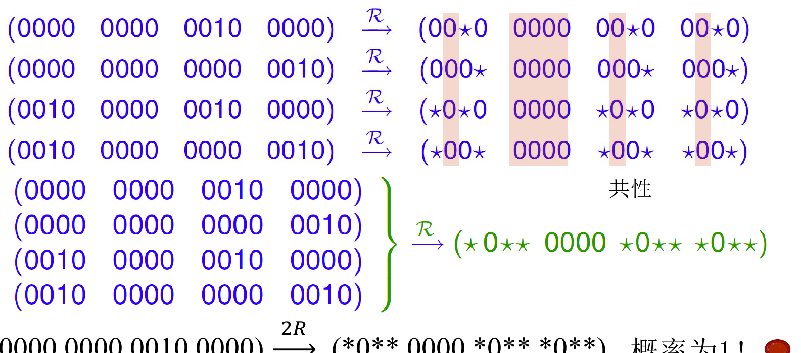

# 截断差分

## 为什么只跟踪部分比特

普通[差分攻击](差分攻击.md)指定完整的输入、输出差分；轮数增加后，单个完整差分的概率可能太低。

但有时候吧，虽然全部的差分的概率比较小

但是有可能某一位的差分是确定的，比如这里2过S盒会得到1，2，9，a，他们的第二位bit都是0，这个又是一个非随机现象

截断差分只要求某些位置取固定值，其他位置用 $*$ 表示“可为 0 或 1”。例如，$*0**$ 表示一个 4 比特差分的第二位为 0，其余位任意；它代表 8 个具体差分，而不是一个新比特值。

### 从单个差分到差分集合

用 $\mathcal D_{\mathrm{out}}$ 表示满足输出模式的所有具体差分。对固定输入差分 $a$，截断差分的概率是各个符合模式的输出差分概率之和：

$$
\Pr[a\to\mathcal D_{\mathrm{out}}]
=\sum_{d\in\mathcal D_{\mathrm{out}}}\Pr[a\to d].
$$

之所以相加，是因为一次输出只能取一个具体差分，这些事件互不重叠。例如课件里输入差分 $\mathtt 2$ 的四种可能输出为 $\mathtt 1,\mathtt 2,\mathtt 9,\mathtt A$，它们分别是 $0001,0010,1001,1010$，都满足 $*0**$；而且没有其他输出，所以截断差分 $\mathtt 2\to*0**$ 的概率为 $1$。单个输出 $\mathtt 2\to\mathtt 2$ 的概率只有 $6/16$：两者研究的输出事件不同。

若输入也是一个差分集合，先分别求每个具体输入差分到输出集合的概率，再按实际输入对产生各差分的概率加权平均；只有输入差分均匀分布时，才是简单的算术平均。

### 与随机置换比较

假设 $n$ 比特随机置换的输入对不同，则其输出差分在 $2^n-1$ 个非零值中均匀分布。如果截断模式有 $r$ 个固定为零的比特，其余 $n-r$ 个比特任意，那么满足模式的非零差分有 $2^{n-r}-1$ 个，随机基准为

$$
p_{\mathrm{随机}}=\frac{2^{n-r}-1}{2^n-1}\approx 2^{-r}.
$$

例如课件三轮输出 $(*0**\ *0**\ *0**\ *0**)$ 固定了 4 个零位，随机置换的基准为 $(2^{12}-1)/(2^{16}-1)\approx2^{-4}$；课件区分器的对应概率为 $1$。两者差异就是区分依据。

比如这个例子，0010过完S盒，除了第二个bit永远为0，其他都有可能为1，而其他位置都会被扩散到各个块的第三个bit，所以要截断每块的第三个bit
那我们可以继续这样下一轮吗

理论上来说是可以的，但是这样就截断的太多了
> **延长时不要过早截断。** 在某一轮得到模式后，下一轮应先枚举与它兼容的具体差分，经过 S 盒和线性层，再合并共同约束。直接把所有 $*$ 当作独立随机位传播，可能丢掉原本存在的相关性，也可能错误估计概率。
## CipherFour 中的传播

课件的 CipherFour S 盒满足：输入差分 $\texttt{2}$ 时，输出差分只可能是 $\texttt{1},\texttt{2},\texttt{9},\texttt{A}$。
那就是4种情况，就是图下这四种，2是第一行，1是第二行(0001的1传播到第四块的第3bit)，A是(1010,第三行),9就是（1001，第四行)
然后下一轮我们发现这四种情况，有相同的地方，提取出来

*图源：第 3.2 节课件，第 10 页。$*$ 是未固定的比特，蓝色各行的共同约束形成绿色模式。*

图中的例子在课件给定的轮结构下得到

$$
(0000\ 0000\ 0010\ 0000)
\xrightarrow{2R}
(*0**\ 0000\ *0**\ *0**),
$$

概率为 1。其中 $0$ 表示确定为零的位置，$*$ 表示任意差分值。

## 从区分器到密钥恢复
如果我们只有3轮的截断差分，怎么用来恢复5轮的cipherfour算法呢

我们可以把头尾都分开，头尾爆破k就行了

1. 选择符合输入集合的明文对或明文结构体，取得相应密文。

我们选择明文的时候，一般就搞一个活跃的半字节
比如这里让第三个半字节遍历全部，得到16个明文
然后任意两个明文差分，除了第三个半字节，其他就都是0
任意两个组对就是120对

2. 用若干轮后仍满足的截断模式构造区分器；必要时在头尾各扩展一轮。

计算筛选，要求过了一轮S盒之后差分为0010

理论上来说末尾这边也可以进行一波过滤，但是*0**的差分遍历所有
那就没办法

3. 猜测只影响被观察比特的子密钥，做部分加密或逆运算，检查候选能否使中间差分落在目标集合。

如果k0,2猜对了，那得到s对，然后我们从密文反推，经过一个S逆，得到的截断差分尾部，如果也是s对满足，对上了，那就都猜对了，就作为候选
但是如果k0,2猜错了，那就都有可能，也有可能被弄进候选

4. 对通过检验的候选继续使用其他结构体或明密文对验证。

课件中还用明文**结构体**一次产生多对可比较的明文，并在头部猜测少量密钥位筛出目标输入差分。结构体提高了可用对数；同一结构体内的明文对共享数据，成功率模型需计入这种相关性。

### 把课件的 $1+3+1$ 步骤写成方程

中间三轮使用概率为 $1$ 的截断差分，两端各增加一段以连接明文和密文。按课件的边界，目标头部差分为 $(0,0,2,0)$，尾部模式为 $(*0**,*0**,*0**,*0**)$。

**第一步：构造明文池。** 固定三个半字节，令第 $2$ 个半字节遍历 $0,\ldots,15$，共 $16$ 个明文；任意两个不同明文组成 $\binom{16}{2}=120$ 个无序对。课件写作约 $2^7$ 对，是数量级近似。

**第二步：猜头部密钥并筛选。** 对 4 比特候选 $\kappa_0$，检查每对明文是否满足

$$
S(P_{i,2}\oplus\kappa_0)\oplus S(P_{j,2}\oplus\kappa_0)=\mathtt 2.
$$

如果 $\kappa_0$ 是真正的 $k_{0,2}$，满足等式的对就具有中间三轮需要的输入差分；其他三个半字节的差分为零。对每个 $\kappa_0$，由于 4 比特 S 盒是双射，16 个 S 盒输出遍历全部值，每个输出与异或 $\mathtt2$ 的另一个输出组成一对，所以恰好有 $16/2=8$ 个无序对通过头部筛选。这 8 对具体是哪几对取决于 $\kappa_0$。

**第三步：猜末轮密钥并逆推。** 对候选 $\kappa_{5,j}$，计算每个密文对的第 $j$ 个半字节逆 S 盒差分：

$$
\Delta U_j=S^{-1}(C_{i,j}\oplus\kappa_{5,j})
\oplus S^{-1}(C_{j,j}\oplus\kappa_{5,j}),\qquad j=0,1,2,3.
$$

对选中的每个对，检查四个 $\Delta U_j$ 是否都满足 $*0**$，也就是各自从左数第二位为 0。若头、尾候选都正确，三轮传播概率为 $1$，8 对全部通过；错误候选也可能通过，需要多个结构体筛选。课件按末轮四个半字节分别检查，因此涉及头部 4 比特和末尾 16 比特候选。

这个例子中，尾部的 $*0**$ 经过末轮 S 盒之后，可能输出差分覆盖全部 16 个值；所以仅看密文差分无法先做有效的无密钥过滤。猜测末轮密钥并逆过 S 盒后，才能检查内部的四个零位。

**与不可能差分的判定方向：** 这里用的是概率为 $1$ 的允许模式：若头尾候选使选中的对有一次不符合模式，就可排除这个联合候选。不可能差分则是出现禁忌差分时排除。若截断差分概率小于 $1$，则按命中次数累计统计、排序候选。

## 相关笔记

- [差分攻击](差分攻击.md)
- [不可能差分分析](不可能差分分析.md)
- [飞去来器攻击](飞去来器攻击.md)
- [差分-线性分析](../04-线性分析/差分-线性分析.md)
