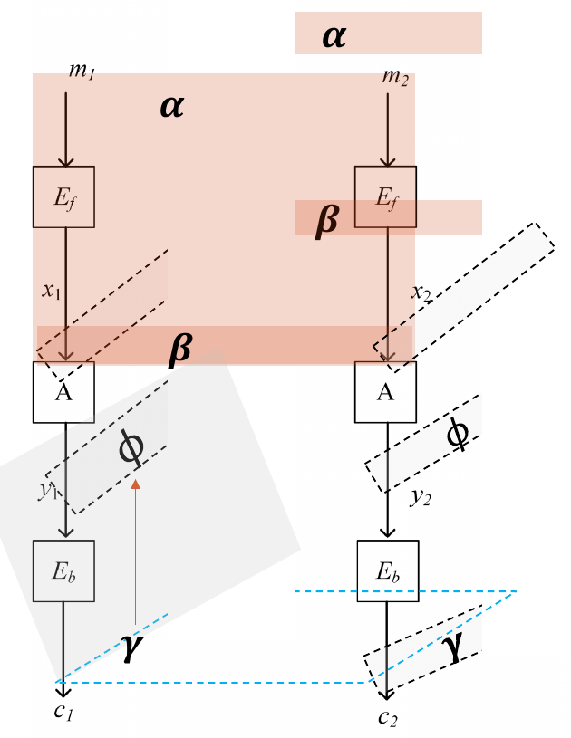

# 飞去来器攻击与矩形攻击

非线性变换的差分传播通常有多种可能；线性变换则按确定的线性规则传播差分，即 $\Delta(L(x))=L(\Delta x)$。
那我们可能在第一个非线性变换有非常好的一个差分路线
在后面的非线性变换又有一个好的差分路线

但是连接处的差分不一样，连不起来，比如前面的是从$\alpha$到$\beta$,后面是从$\phi$到$\gamma$,那这两条路线合不在一起
那怎么充分利用呢
课件在中间使用线性层，可以利用四个状态的异或关系连接两段差分。
## 为什么要把两段短差分“错位”连接

普通[差分攻击](差分攻击.md)要沿同一对文本串接差分；如果前、后两段各有高概率差分，但它们在连接处的差分不相同，就无法直接串接。

飞去来器攻击改用**四个文本构成的四元组**：上段差分走横向，下段差分走纵向，让连接处形成平行四边形。课件把密码写成 $E=E_b\circ A\circ E_f$，其中连接层 $A(x)=L(x)\oplus a$ 的线性部分 $L$ 可逆；线性变换是 $a=0$ 的特殊情况。

后文用 $P_i$ 表示明文、$C_i$ 表示对应密文，记 $x_i=E_f(P_i)$、$y_i=A(x_i)$。四元组的四个位置可以排成：

$$
\begin{matrix}
P_1&\xleftrightarrow{\ \alpha\ }&P_2\\
\updownarrow&&\updownarrow\\
P_3&\xleftrightarrow{\ \alpha\ }&P_4
\end{matrix}
\qquad
\begin{matrix}
C_1&\longleftrightarrow&C_2\\
\updownarrow\scriptstyle\gamma&&\updownarrow\scriptstyle\gamma\\
C_3&\longleftrightarrow&C_4
\end{matrix}
$$

图上标的是目标关系：明文侧的横边差分记作 $\alpha$，密文侧的竖边差分记作 $\gamma$。经典攻击主动构造右侧两条竖边、检查左侧下边；增强攻击先构造左侧两条横边、检查右侧两条竖边。

## 经典飞去来器区分器

设前半部分存在 $\alpha\xrightarrow{E_f}\beta$，正向概率为 $p_1$；后续需要的反向差分 $\beta\xrightarrow{E_f^{-1}}\alpha$ 概率为 $p_2$。后半部分存在 $\gamma\xrightarrow{E_b^{-1}}\phi$，概率为 $q$。
构造过程如下：

1. 选择 $m_1,m_2$，使 $m_1\oplus m_2=\alpha$，并取得 $C_1=E(m_1),C_2=E(m_2)$。

我们确实构造了一组输入差分，这样用到了第一个差分，但是问题是，我们没办法控制他们的输出啊，输出差分又不一定是$\gamma$,那咋办呢，那就杀一个回马枪，
没错$c_1,c_2$的差分不是$\gamma$
你不是要和$c_1$差分为$\gamma$的输出吗，那我直接造一个
2. 选择新的密文 $C_3=C_1\oplus\gamma$、$C_4=C_2\oplus\gamma$
诶。我直接回头强行造一个$c_3$出来，那回头这条路线，就可以用输出那个差分路线了啊
同样$c_4$也是一样
然后我们都解密一下，这样就到了上一层

我们前面构造的输出差分都是$\gamma$,那么这边回到y，差分也应该都是$\phi$,当然这不是必然的，这是高概率的差分
诶，那我们发现这就构成了一个平行四边形，四个y异或起来等于0
那这一层是线性层，x异或起来也是0
那么也就是说，$x_3 \oplus x_4 = x_1 \oplus x_2$,那么也就是说，有很大的概率$m_3 \oplus m_4 =\alpha$,这可以作为一个区分器
3. 检查 $m_3\oplus m_4=\alpha$ 是否明显比随机置换更常发生。

若第一条上段差分、两条下段差分和返回时的上段差分均成立，连接处的四个状态就满足异或和为 $0$。线性或仿射层保持这一四元组关系，于是 $P_3\oplus P_4=\alpha$。在课件采用的独立性近似下，成功概率约为

$$
P_{\mathrm{boom}}\approx p_1p_2q^2.
$$

若两个方向的上段概率同为 $p$，即为 $p^2q^2$。对 $n$ 比特随机置换，检查非零指定差分的基准概率约为 $2^{-n}$；因此 $p^2q^2>2^{-n}$，等价于 $pq>2^{-n/2}$，是该独立近似模型下区分器优于随机基准的条件。

所以这个p和q都有提升空间

咱们可以把多条路线都用上

### 经典攻击为什么能回到 $\alpha$？

按四元组逐步看每个条件：

1. **明文到中间：** 主动设置 $P_1\oplus P_2=\alpha$。当第一条上段差分命中时，$x_1\oplus x_2=\beta$，概率为 $p_1$。
2. **密文回到中间：** 主动设置 $C_3=C_1\oplus\gamma$、$C_4=C_2\oplus\gamma$，并查询两次解密。若两条下段逆向差分均命中，则 $y_1\oplus y_3=y_2\oplus y_4=\phi$，按独立近似概率为 $q^2$。
3. **利用四元组关系：** 两式异或得到 $y_1\oplus y_2\oplus y_3\oplus y_4=0$。设仿射层为 $A(x)=L(x)\oplus a$，四份常量 $a$ 相互抵消，所以也有 $x_1\oplus x_2\oplus x_3\oplus x_4=0$。因此 $x_3\oplus x_4=x_1\oplus x_2=\beta$。
4. **回到明文：** 第三、第四个状态经过上段逆运算，若 $\beta\to\alpha$ 也命中，就得到 $P_3\oplus P_4=\alpha$，概率记为 $p_2$。

于是单个四元组的这条成功路线概率估计为 $p_1p_2q^2$。取非零 $\alpha,\gamma$ 并排除重复文本等退化四元组后，随机置换的基准约为 $2^{-n}$。一次四元组测试使用两次加密和两次解密查询；命中次数需要在多次测试中与随机基准比较。

## 增强飞去来器与矩形攻击
那前面飞去来器是有反向的，我能不能直接选择明文呢，这样只有正向的，也可以，我们直接选择两组

这时候平行四边形是自上而下的，前面是从下往上的

但是有个区别就是，最后我们是要分开的，所以这里有个随机的$2^{-n}$

前面为啥没有呢，因为前面$x_1 \oplus x_2$是已知的，但是在这里$y_1\oplus y_3$是不知道的

增强飞去来器把构造改成只选择明文：准备两对满足 $P_1\oplus P_2=P_3\oplus P_4=\alpha$ 的明文，观察密文中是否同时出现 $C_1\oplus C_3=\gamma$、$C_2\oplus C_4=\gamma$。中间四元组关系需要偶然对齐，所以在课件的简化模型下，具体密码的概率约为 $p^2q^2 2^{-n}$，随机置换约为 $2^{-2n}$。可通过准备许多明文对、寻找满足条件的四元组来放大信号。

两种公式都有 $p^2q^2$，但**每个四元组的原始成功概率不同**。经典攻击主动设定 $C_3=C_1\oplus\gamma$、$C_4=C_2\oplus\gamma$，使密文侧的两条竖边必然具有差分 $\gamma$；增强攻击只能选择两对明文，连接处的一条跨对差分还需偶然取到指定值 $\phi$，在课件的 $n$ 比特均匀近似下多出一次约 $2^{-n}$ 的代价。另一条跨对差分由平行四边形关系随之确定，因此不是再乘一次 $2^{-n}$。下表取 $p_1=p_2=p$。

| 对一个已选四元组 | 具体密码下 | 随机置换下 | 两者概率之比 |
| --- | ---: | ---: | ---: |
| 经典飞去来器 | $p^2q^2$ | $2^{-n}$ | $2^np^2q^2$ |
| 增强飞去来器 | $2^{-n}p^2q^2$ | $2^{-2n}$ | $2^np^2q^2$ |

所以它们在这个简化模型中有**相同的概率比与有用性门槛** $pq>2^{-n/2}$，但增强版单个四元组的命中概率、与随机置换的概率差，都低 $2^n$ 倍。增强版的优势在于只需选择明文，并能从大量明文对组织候选四元组。

**为什么还叫“增强”？** 取 $N$ 对输入差分为 $\alpha$ 的选择明文，可以从中选出约 $\binom N2$ 组“两对明文”，形成候选四元组。按上述近似，具体密码下期望命中数约为 $\binom N2p^2q^2 2^{-n}$，随机置换下约为 $\binom N2 2^{-2n}$。候选数随 $N$ 近似平方增长，使偶然发生的中间跨对匹配积累成可检测的信号；例如 $p=q=1$、$n=128$ 时，原论文用约 $2^{65}$ 对选择明文，预期得到约 $2$ 个中间匹配。“增强”指**放大罕见事件的可检测性**，并将攻击改为只需选择明文。上述期望值采用课件的均匀与差分独立近似。[原论文：Amplified Boomerang Attacks](https://www.schneier.com/wp-content/uploads/2016/02/paper-boomerang.pdf)

矩形攻击进一步**汇总多条可兼容差分路径**。例如上段不只允许一个 $\beta$，下段也不只允许一个 $\phi$；只要四元组在连接处满足所需的异或关系，它们都可能贡献成功概率。课件第13、18、20页通过汇总满足连接条件的路径，计算这些路径共同贡献的区分能力。

矩形攻击可以允许两条上段路径的输出差分不一样，再根据它们的关系调整下段的跨对差分。

### 增强攻击怎样组织四元组？

1. 构造 $N$ 对明文，每对差分都是 $\alpha$，共提交 $2N$ 个明文给加密接口。确保各对和四元组不重复。
2. 从 $N$ 对中任取两对，按固定的配对方向记作 $(P_1,P_2)$ 和 $(P_3,P_4)$。共有 $\binom N2$ 个候选四元组；若另外检查交换方向，需要另外计数。
3. 对每个候选计算 $C_1\oplus C_3$、$C_2\oplus C_4$，检查它们是否都等于 $\gamma$。
4. 统计命中个数，与同样数据条件下随机置换的预期比较。

增强版只查询加密，再从密文中筛选目标差分。$\binom N2$ 计量**候选四元组数**；共享明文的四元组之间存在相关性。

### 数值例子：单个概率、数据和候选数分别是多少？

设 $n=16$，在课件的均匀和独立近似下，取 $p=q=2^{-2}=1/4$，并只统计非退化四元组。下面是用于理解数量关系的假设参数。

| 一个候选四元组 | 目标密码 | 随机置换 | 目标／随机概率比 |
| --- | --- | --- | --- |
| 经典 | $p^2q^2=2^{-8}$ | 约 $2^{-16}$ | 约 $2^8$ |
| 增强 | $2^{-16}p^2q^2=2^{-24}$ | 约 $2^{-32}$ | 约 $2^8$ |

如果增强攻击选择 $N=2^{13}$ 对明文，共查询 $2^{14}$ 个明文，候选四元组数量为

$$
\binom{2^{13}}2\approx2^{25}.
$$

因此目标密码的命中数期望约为 $2^{25}\cdot2^{-24}=2$；随机置换的命中数期望约为 $2^{25}\cdot2^{-32}=2^{-7}$。这些数值是**命中次数的期望**；区分成功率由候选四元组的相关性和判决阈值共同确定。

经典攻击在同样参数下，每个四元组命中概率更高，但要查询解密。增强攻击用更多候选四元组和选择明文来积累信号；数据量、计算量和查询接口都要一起比较。若直接检查所有候选，处理量可达 $\binom N2$；利用密文索引和筛选可以减少枚举开销，但仍需要计入建表与输出候选的成本。

### 多条差分怎样汇总？

先设 $p_\beta=\Pr[\alpha\xrightarrow{E_f}\beta]$、$q_\phi=\Pr[\phi\xrightarrow{E_b}\gamma]$。在增强模型中，如果仍要求两条上段输出同一个 $\beta$、两条下段输入同一个 $\phi$，但允许 $\beta,\phi$ 分别取多种值，那么课件将单个四元组概率估为

$$
2^{-n}\left(\sum_\beta p_\beta^2\right)
\left(\sum_\phi q_\phi^2\right).
$$

例如只有两个允许的上段输出差分，其概率分别为 $1/4$ 和 $1/8$，那么两条上段差分匹配同一个值的概率贡献是

$$
(1/4)^2+(1/8)^2=5/64,
$$

比只算其中一个 $\beta$ 的 $(1/4)^2=4/64$ 多。这里先对**同一差分的概率平方**，再对可能取值求和；不能写成 $(1/4+1/8)^2$，因为后者还包含两条上段走到不同差分的交叉项。

### 矩形攻击怎样允许两条差分不同？

记两条上段输出差分分别为

$$
x_1\oplus x_2=\beta,\qquad x_3\oplus x_4=\beta'.
$$

它们可以不同。令连接层 $A(x)=L(x)\oplus a$，其中 $L$ 是线性部分。四个状态的异或关系为

$$
\begin{aligned}
y_1\oplus y_3\oplus y_2\oplus y_4
&=L(x_1\oplus x_3\oplus x_2\oplus x_4)\\
&=L(\beta\oplus\beta').
\end{aligned}
$$

如果第一条下段输入差分为 $\phi=y_1\oplus y_3$，则另一条必须是

$$
\phi'=y_2\oplus y_4=\phi\oplus L(\beta\oplus\beta').
$$

所以 $\beta\ne\beta'$ 并不妨碍构造矩形，但两条下段必须按上式匹配。按课件的独立和均匀近似，矩形成功概率估计为

$$
2^{-n}\sum_{\beta,\beta'} p_\beta p_{\beta'}
\sum_\phi q_\phi\,q_{\phi\oplus L(\beta\oplus\beta')}.
$$

当 $\beta=\beta'$ 时，$L(\beta\oplus\beta')=0$，因此 $\phi'=\phi$，公式退回上一节的同差分求和形式。矩形方法的概率收益来自加入满足连接关系的不同差分组合，时间成本包括四元组的寻找、筛选和后续密钥恢复。

## 与普通差分攻击的关系

| 方法 | 使用的文本 | 连接两段的方法 |
| --- | --- | --- |
| 普通差分 | 一对明密文 | 前段输出差分与后段输入差分相同 |
| 经典飞去来器 | 四个文本；可选择明文和密文 | 四元组在中间形成平行四边形 |
| 增强飞去来器／矩形 | 大量选择明文对，寻找四元组 | 利用偶然对齐，并汇总多条差分路径 |

延伸阅读：[截断差分](截断差分.md)、[不可能差分分析](不可能差分分析.md)、[差分—线性分析](../04-线性分析/差分-线性分析.md)。
