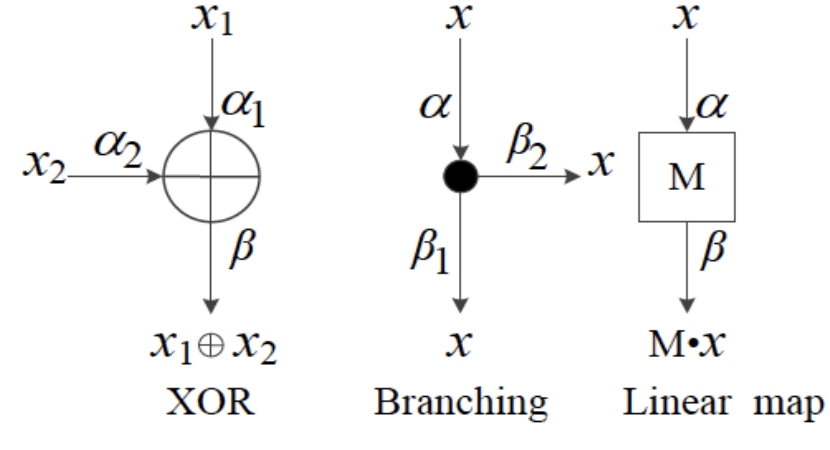

# 线性分析

## 核心问题

寻找明文、中间状态、密文和密钥比特之间有偏差的线性关系。若这种关系成立的概率明显偏离 $1/2$，就可以利用已知明密文对进行区分或密钥恢复。这里的“线性”指比特的异或关系，并不要求密码算法本身是线性的。

## 线性逼近、掩码与偏差

对比特向量 $a$ 和 $x$，定义二元域上的内积 $a\cdot x=\bigoplus_i a_i x_i$。掩码中为 $1$ 的位置表示选取相应比特参与异或。例如，$a=(1,0,1)$ 时，$a\cdot x=x_1\oplus x_3$。

设 $F:\mathbb F_2^m\to\mathbb F_2^n$，输入掩码为 $\alpha\in\mathbb F_2^m$，输出掩码为 $\beta\in\mathbb F_2^n$。研究的线性近似为

$$
\alpha\cdot x\oplus\beta\cdot F(x)=0.
$$

令 $p_{\alpha,\beta}=\Pr_x[\alpha\cdot x\oplus\beta\cdot F(x)=0]$，其中 $x$ 均匀取值。**带符号偏差**为 $\varepsilon_{\alpha,\beta}=p_{\alpha,\beta}-1/2$；衡量可利用程度时看 $|\varepsilon_{\alpha,\beta}|$。正偏差表示等式更常成立，负偏差表示更常不成立。

例如概率 $p=3/8$，偏差是 $3/8-1/2=-1/8$。这并不是负概率，而是说“等式为零”出现得比一半少。用相关度表示同一性质时，

$$
c=\Pr[\text{等式为零}]-\Pr[\text{等式为一}]=2p-1=2\varepsilon.
$$

本例的 $c=-1/4$；$\lvert\varepsilon\rvert$ 越大，观察值越容易与随机时的 $1/2$ 区分。

### 线性近似表（线性分布表，LAT）

对 S 盒 $S:\mathbb F_2^m\to\mathbb F_2^n$，先数使近似式为 $0$ 的**输入**个数：

$$
N_S(\alpha,\beta)
=\#\{x\in\mathbb F_2^m:\alpha\cdot x\oplus\beta\cdot S(x)=0\}.
$$

定义LAT

$$
\operatorname{LAT}_S(\alpha,\beta)
=N_S(\alpha,\beta)-2^{m-1},\qquad
\varepsilon_{\alpha,\beta}
=\frac{\operatorname{LAT}_S(\alpha,\beta)}{2^m}.
$$

### 手算一项 LAT：先列输入，再数等式为零的次数

考虑如下 3 比特 S 盒，输入、输出按二进制三位表示：

| $x$ | $000$ | $001$ | $010$ | $011$ | $100$ | $101$ | $110$ | $111$ |
| --- | --- | --- | --- | --- | --- | --- | --- | --- |
| $S(x)$ | $000$ | $001$ | $011$ | $110$ | $111$ | $100$ | $101$ | $010$ |

取输入掩码 $\alpha=001$、输出掩码 $\beta=001$。这两个掩码分别选取 $x$ 和 $S(x)$ 的最低位；将八个输入依次代入：

| $x$ | $S(x)$ | $\alpha\cdot x$ | $\beta\cdot S(x)$ | 两者异或 |
| --- | --- | --- | --- | --- |
| $000$ | $000$ | 0 | 0 | 0 |
| $001$ | $001$ | 1 | 1 | 0 |
| $010$ | $011$ | 0 | 1 | 1 |
| $011$ | $110$ | 1 | 0 | 1 |
| $100$ | $111$ | 0 | 1 | 1 |
| $101$ | $100$ | 1 | 0 | 1 |
| $110$ | $101$ | 0 | 1 | 1 |
| $111$ | $010$ | 1 | 0 | 1 |

为零的输入有 2 个，因此 $N_S(001,001)=2$。这个 S 盒有 $2^3=8$ 个输入，于是

$$
\operatorname{LAT}(001,001)=2-4=-2,\qquad
p=\frac28=\frac14,\qquad
\varepsilon=-\frac14,\qquad c=-\frac12.
$$

表项 $-2$ 不能当作概率；它是减去一半输入数后的**计数**。负号说明“异或等于零”比较少，但绝对偏差不为零，所以它仍然是一条有效近似。

**构造整张表：** 枚举每个输入掩码 $\alpha$ 和输出掩码 $\beta$，对每个掩码对遍历 $2^m$ 个输入并累计 $N_S$。不同教材也可能把 $N_S$ 或 $2N_S-2^m$ 称作表项，使用公式前先确认采用哪一种定义；本笔记使用 $N_S-2^{m-1}$。

> **为什么双射 S 盒的 LAT 元素是偶数？**

这个结论需要 $S:\mathbb F_2^m\to\mathbb F_2^m$ 为双射且 $m\ge 2$。

记 $f(x)=\alpha\cdot x\oplus\beta\cdot S(x)$。
LAT的每一项就是$N_s(\alpha,\beta)-2^{m-1}$，那他的奇偶性就取决于$N_s(\alpha,\beta)$的奇偶性，而它就是$f(x)=0$的x的个数，那这个个数很难判断，不过我们不需要知道他具体的个数，只要判定奇偶性，那我们知$f(x)$一共有$2^m$个，要么是0，要么是1，我们知道异或一个很好的性质就是可以检测里面1的个数的奇偶性，奇数个就是1，偶数个就是0

所以说这里的trick就是把所有$f(x)$异或起来
$$
\bigoplus_{x\in\mathbb F_2^m}f(x)
=\left(\bigoplus_x\alpha\cdot x\right)
\oplus\left(\bigoplus_x\beta\cdot S(x)\right).
$$
注意这里利用一个性质$\bigoplus_{x} x = 0$
因为总共有偶数个1
当 $\alpha\ne0$ 时，$\alpha\cdot x$ 中$x$恰有 $2^{m-1}$ 个 $1$；
$$
\bigoplus_x(\alpha\cdot x) = \alpha\cdot\left(\bigoplus_x x\right) = 0
$$
由于 $S$ 是双射，$\beta\cdot S(x)$ 在 $\beta\ne0$ 时也恰有 $2^{m-1}$ 个 $1$，在 $\beta=0$ 时有 $0$ 个。
所以
$$
\left(\bigoplus_x\beta\cdot S(x)\right) = \beta\cdot\left(\bigoplus_x S(x)\right) = 0
$$
所以式子右边为 $0$。
因此取值为 $1$ 的输入数为偶数；总输入数 $2^m$ 也是偶数，于是 $N_S(\alpha,\beta)$ 为偶数。再减去同样为偶数的 $2^{m-1}$，就得到 $\operatorname{LAT}_S(\alpha,\beta)$ 为偶数。

如果 $S$ 不是双射，LAT 元素就有可能是奇数。

## 多轮线性掩码如何传播

从一个 S 盒的 LAT 中选取有偏差的输入、输出掩码，再让相邻轮的掩码相容，便得到一条**线性路径**。

- **线性层：** 若 $y=Lx$，则 $\beta\cdot y=(L^{\mathsf T}\beta)\cdot x$，因此输出掩码 $\beta$ 对应的输入掩码是 $L^{\mathsf T}\beta$。这一关系精确成立。
- **轮密钥异或：** 若 $y=x\oplus k$，则 $\beta\cdot y=\beta\cdot x\oplus\beta\cdot k$。密钥贡献一个固定的奇偶项，不改变偏差的绝对值。
- **S 盒：** 选择非平凡且 $\operatorname{LAT}_S(\alpha,\beta)\ne0$ 的掩码对；$(\alpha,\beta)=(0,0)$ 虽有最大表值，却不给出可利用的关系。其余掩码对的偏差决定这一步的统计强度。经过多个 S 盒和轮后，要把中间状态的掩码配对，使它们在异或相加时抵消。

图中的局部规则可用内积直接检查：若 $y=x_1\oplus x_2$，输出掩码为 $\beta$，两个输入分支都承接 $\beta$；若把 $x$ 复制为两个分支，它们的输出掩码分别为 $\beta_1,\beta_2$，输入掩码就是 $\beta_1\oplus\beta_2$。这些是精确的线性关系，统计偏差只来自 S 盒等非线性部分。

### 线性层反向传播例子

设 $y_2=x_2\oplus x_0,\ y_1=x_1,\ y_0=x_0$，输出掩码为 $(1,1,0)$。把它选中的输出位展开：

$$
\beta\cdot y=y_2\oplus y_1
=x_2\oplus x_1\oplus x_0.
$$

因此输入掩码是 $(1,1,1)$。这里的反向传播是对**掩码**反向推导，不是对数据进行解密；直接展开奇偶式即可检查结果。

### 线性路线、线性包和密钥项

多轮路线通过匹配相邻部件的掩码，让中间状态项在异或时消去，得到明文、密文以及密钥的关系。对相同首尾掩码，可能有多条中间路线；这些路线共同形成**线性包**。完整近似的相关度受各路线及密钥影响，不能总把单条路线的偏差当成精确值；实际分析常用有代表性的高偏差路线作估计。

轮密钥异或本身就会在线性关系中引入固定的密钥奇偶项，例如 $y=x\oplus k$ 时，$\beta\cdot y=\beta\cdot x\oplus\beta\cdot k$。这与是否额外扩展一轮无关；扩展一轮猜末轮密钥则是为了通过密文得到近似式所需的内部状态。对固定密钥，异或一个固定的密钥比特会改变等式为零时偏差的符号，但不改变其绝对值。

### 堆积引理

设 $X_1,\ldots,X_s$ 是**相互独立**的二值随机变量，$p_i=\Pr(X_i=0)$，带符号偏差为 $\varepsilon_i=p_i-1/2$。则

$$
\Pr(X_1\oplus\cdots\oplus X_s=0)
=\frac12+2^{s-1}\prod_{i=1}^s\varepsilon_i.
$$

### 两个误差的例子

若 $\varepsilon_1=1/4$、$\varepsilon_2=-1/8$，则它们异或后的偏差为

$$
\varepsilon=2\varepsilon_1\varepsilon_2
=2\cdot\frac14\cdot\left(-\frac18\right)=-\frac1{16},
\qquad
\Pr(X_1\oplus X_2=0)=\frac12-\frac1{16}=\frac7{16}.
$$

也可以先计算相关度：$c_i=2\varepsilon_i$，独立时异或后的相关度为 $c_1c_2$，再除以 2 得到偏差。必须保留符号；概率最后仍是 $0$ 到 $1$ 之间的数。

## 从区分到密钥恢复

### Matsui 算法 1

我们就考虑一轮的线性近似式
$\alpha \cdot u \oplus \beta \cdot v$
但是中间状态我们不知道，我们拿到的是一组明密文，所以需要消除掉中间状态
$m\oplus k_0 = u$
$c \oplus k_1 = v$
那么代入就得到
$$
\alpha \cdot m \oplus \beta \cdot c = \alpha \cdot k_0 \oplus \beta \cdot k_1
$$
如果这个等式以概率p成立
那我们可以用极大似然法来得到一个密钥比特线性组合的信息
设对 $N$ 组已知明密文对，先初始化一个计数器$T_0 = 0$
对于每个密文，都计算
$b_i = \alpha \cdot m_i \oplus \beta \cdot c_i$
如果$b_i=0,T_0++$

若 $p>\frac{1}{2}$，线性近似式倾向于成立
如果$T_0>N/2$ ，那么猜测$\alpha \cdot k_0 \oplus \beta \cdot k_1 =0$
如果$T_0<N/2$，则猜测为1；相等时无法据此区分。

这里实际上T0应该是在pN附近，不过为了方便我们直接用$\frac{1}{2}$做判定条件就行了，因为肯定是一个大于1/2，一个小于1/2，不然的话你要判断离pN和(1-p)N哪个更近，这就太麻烦了

若 $p<\frac{1}{2}$，线性近似式倾向于不成立
$T_0<N/2$ ，那么猜测$\alpha \cdot k_0 \oplus \beta \cdot k_1 =0$
如果$T_0>N/2$，则猜测为1；相等时无法据此区分。

统一记法：令 $\varepsilon=p-1/2$，当 $(T_0-N/2)\varepsilon>0$ 时猜测该密钥奇偶值为0，小于0时猜测为1。

### 用数字看正、负偏差的判定方向

设 $N=1000$，观察到左侧为零的次数 $T_0=430<500$。

- 若近似概率 $p=3/8$，即偏差为 $-1/8$：密钥奇偶值为 0 时，左侧等于 0 的概率是 $3/8$；为 1 时，左侧等于 0 的概率是 $5/8$。观察频率小于一半，因此猜 **密钥奇偶值为 0**。
- 若近似概率改为 $p=5/8$，即偏差为 $+1/8$：密钥奇偶值为 0 时左侧为零的概率是 $5/8$，为 1 时是 $3/8$。相同的 $T_0=430$ 此时应猜 **密钥奇偶值为 1**。

计数存在抽样波动，所以这里只是最可能的统计猜测。一条近似式得到的是密钥的一位**异或组合**，例如 $k_0[1]\oplus k_1[3]$；并不直接得到这两个密钥位各自的值。

### 算法 1 的成功率怎样计算？

假设 $N$ 组样本独立，线性近似的带符号偏差为 $\varepsilon$，令 $p_+=1/2+|\varepsilon|$。把统计方向调整到正确一侧：当正确密钥奇偶值对应事件的概率为 $p_+$ 时，计数 $T$ 满足

$$
T\sim\operatorname{Bin}(N,p_+).
$$

按 $N/2$ 作门限，超过门限就判对；若恰好相等，则随机猜测，按一半成功计算。因此**偶数 $N$** 时精确成功率为

$$
P_s=\sum_{t=N/2+1}^{N}\binom Nt p_+^t(1-p_+)^{N-t}
+\frac12\binom N{N/2}p_+^{N/2}(1-p_+)^{N/2}.
$$

这不是无论偏差正负都机械地“计数大于一半猜 0”：偏差为负时应先按上面的判定表反转方向。两种正确密钥奇偶值的计数分布互为镜像，所以按对应方向判断时成功率相同。

当 $N$ 足够大，二项分布可用正态分布估算；令 $\Phi$ 为标准正态分布的累积分布函数，忽略连续性修正时：

$$
P_s\approx\Phi\!\left(
\frac{N|\varepsilon|}{\sqrt{N(1/4-\varepsilon^2)}}
\right)
=\Phi\!\left(\frac{2\sqrt N\,|\varepsilon|}{\sqrt{1-4\varepsilon^2}}\right).
$$

**例子：** 若 $N=64$、$|\varepsilon|=1/8$，则 $p_+=5/8$。按上面的二项式求和，成功率约为 $97.85\%$；按正态式估算，$P_s\approx\Phi(2.066)\approx98.06\%$。增加数据可提高成功率，而固定成功率时所需数据量随 $|\varepsilon|^{-2}$ 增长。

### 偏差与数据量

用 $N$ 组明密文对估计一个近似式成立的频率，抽样波动通常是 $O(N^{-1/2})$。要辨认量级为 $|\varepsilon|$ 的偏差，通常需要

$$
N\asymp|\varepsilon|^{-2}.
$$

这是固定区分成功率下的数量级估计；具体所需数据还受目标成功率、候选密钥数量以及近似模型影响。

### Matsui 算法 2：猜测末轮子密钥

通常情况下太长的轮数可能会导致偏差变小，我们可以拆成r+1轮，最后一轮爆破密钥，这样就可以得到少一轮的线性路线，这可能会有更大的偏差
假设我们得到一个路线
$$
\alpha \cdot m \oplus \beta \cdot y = \gamma \cdot k
$$
以概率$\frac{1}{2}+\frac{9}{32}$成立，这个y需要我们猜测k3来恢复
已知N个明密文，$d∙k_0⨁d∙k_1⨁d∙k_2$未知，但取值确定

用$T_0^i$记录每一个猜测$k_3^i$，求解出的N个$\alpha \cdot m \oplus \beta \cdot y = 0$的个数

如果$k_3^i$是正确的, $T_0^i取值趋近(1/2+9/32) N或(1/2−9/32)N$，如果$\gamma \cdot k= 0$,那就是前者，否则就是后者

$k_3$ 猜错时得到错误的中间状态 $y^i$；常用的错误密钥随机化模型把对应计数近似看作集中在 $N/2$ 附近。

我们统计所有候选 $k_3^i$ 对应的 $T_0^i$。正确候选的期望计数偏向 $(1/2+9/32)N$ 或 $(1/2-9/32)N$，具体取哪一边由未知密钥奇偶值决定。按 $|T_0^i-N/2|$ 给候选排序：偏离越大，越值得优先验证；正偏差下可由偏离方向推测密钥奇偶值，负偏差下方向相反。

**计数排序例子：** $N=1000$，三个末轮候选的计数分别为 $430,570,495$，相对 $500$ 的偏离量分别为 $70,70,5$。前两个候选并列领先，第三个靠后；不能仅凭这次统计唯一确定正确密钥。还要用更多数据、其他线性近似或完整明密文验证。

### 算法 2 的操作顺序

1. 找一条到末轮**之前**的有效线性近似，确定它需要哪些内部状态位。
2. 对每个相关末轮子密钥候选，部分解密密文，得到这些中间状态位。
3. 把对应明文和恢复出的中间状态代入近似式，统计结果为零的次数 $T_\kappa$。
4. 对候选按 $|T_\kappa-N/2|$ 排序，优先验证偏离大的候选。

例如只用到一个末轮 S 盒输出的部分比特时，只需猜恢复这些比特必需的子密钥位，不必对每个样本枚举完整主密钥。候选能否可靠区分取决于偏差、样本量及错误密钥的实际统计分布。

两种算法都利用偏差：算法 1 直接推断密钥奇偶值；算法 2 将近似延伸到末轮之前，猜测末轮所需的部分子密钥并比较统计量。

## 相关笔记

- [攻击思想](../01-基础与模型/攻击思想.md)
- [对称加密算法](../01-基础与模型/对称加密算法.md)
- [差分攻击](../03-差分分析/差分攻击.md)
- [差分—线性分析](差分-线性分析.md)

## 参考资料

- [Mitsuru Matsui, Linear Cryptanalysis Method for DES Cipher（EUROCRYPT 1993）](https://doi.org/10.1007/3-540-48285-7_33)
- [Howard M. Heys, A Tutorial on Linear and Differential Cryptanalysis](https://www.engr.mun.ca/~howard/PAPERS/ldc_tutorial.pdf)
- [Tomer Ashur 与 Vincent Rijmen, On Linear Hulls and Trails](https://eprint.iacr.org/2016/088)

## 实验中的具体计算

[实验三、四：线性分析与自动化建模](../../review/实验复习/03-线性分析与自动化建模.md) 补充了实验 S 盒的负 LAT 表项、四轮迭代路线偏差 $1/32$、PHILOX 的掩码消元，以及六轮路线中整数化权重与精确相关度的区别，附原报告截图和可复现代码。
