# 中间相遇攻击

中间相遇攻击（Meet-in-the-Middle，MITM）的核心是把计算切成两边：从明文向前算，从密文向后算，让两边在中间状态或其性质上相遇。正确密钥必须满足相遇条件；不满足的候选密钥可以排除。

攻击能否省时间，关键在于**两边所需的密钥能否分开猜测**，以及中间条件能排除多少错误候选。它通常用存储空间换取计算时间；相遇并不自动证明密钥正确，仍要用其他明密文对验证。

## 相遇函数是什么

相遇函数是用来检查：**从明文向前算出的一份中间信息，与从密文向后算出的另一份中间信息，是否满足密码结构所要求的关系**。课件用

$$
G\bigl(\operatorname{info}(x),\operatorname{info}(y)\bigr)
$$

表示这种检验。
这里 $\operatorname{info}(x)$ 是猜测相关密钥、从明文向前计算得到的信息；$\operatorname{info}(y)$ 是猜测相关密钥、从密文向后计算得到的信息

**双重 DES 的值相遇：** 对已知明密文 $(P,C)$，设 $x=E_{K_1}(P)$、$y=D_{K_2}(C)$。
正确密钥必然使 $x=y$，因此可以定义 $G(x,y)=x\oplus y$，以 $G(x,y)=0$ 为匹配条件。
这里也可以直接把 $x=y$ 写作相遇条件。

**集合映射相遇：** 在约简轮 AES 的例子中，可以把一组输入到输出的对应关系作为相遇信息。检验时判断构造出的映射是否属于中间几轮可能产生的映射集合，而不是只比较一个中间值；详见本页的“集合映射相遇”一节。

对必然成立的相遇条件，不匹配即可排除候选；匹配只说明候选通过初筛，还需复筛。

## 双重 DES：中间状态值相遇

双重加密使用两个独立的 56 位密钥：

$$
C=E_{K_2}(E_{K_1}(P)),\qquad E_{K_1}(P)=X=D_{K_2}(C).
$$

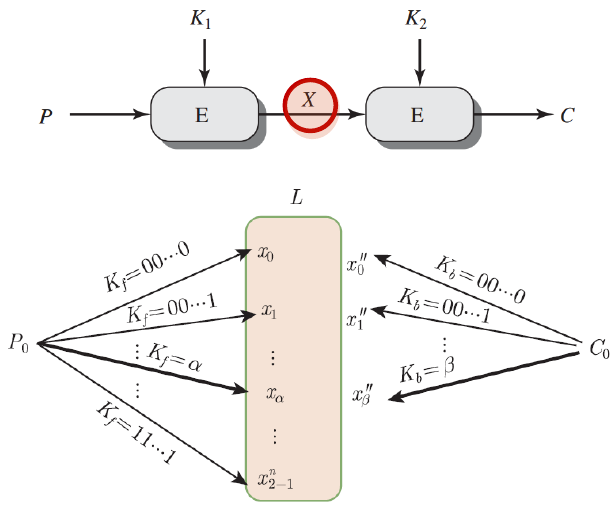

上图来自第 6 章课件第 7 页。原笔记中的示意图：

K1,K2独立的情况下
已知一对 $(P,C)$ 时，攻击者：

1. 穷举 $K_1$，计算 $X=E_{K_1}(P)$，将 $(X,K_1)$ 存表，按 $X$ 索引。相同 $X$ 对应的所有密钥都要保留。
2. 穷举 $K_2$，计算 $D_{K_2}(C)$ 并查表；每次相等都得到一个候选密钥对。
3. 用另一对不同明密文验证候选；若还有多个候选，继续验证。

为什么第一次相遇仍有很多候选？密钥对约 $2^{112}$ 个；
在理想化随机模型中，错误密钥对在一个 64 位中间值上匹配的概率约为 $2^{-64}$。因此错误候选期望数约为

$$
2^{112}\cdot 2^{-64}=2^{48}.
$$

第二对明密文进一步过滤后，错误候选期望数约为 $2^{48}2^{-64}=2^{-16}$；正确密钥仍会通过。因此两对一般足够，但这是概率估算，不保证每次只剩一个候选。

- **数据**：约两对已知明密文。
- **时间**：首次枚举需要 $2^{56}$ 次 DES 加密和 $2^{56}$ 次 DES 解密，合计 $2^{57}$ 次单 DES 运算；复筛约需 $2\cdot2^{48}$ 次单 DES 运算。另有约 $2^{56}$ 次表项插入、$2^{56}$ 次查表，以及处理匹配项的开销。若使用理想散列表、每次插入和查表的期望开销为 $O(1)$，这些表操作总数也是 $O(2^{56})$，不改变总时间的指数级量级。只统计 DES 调用时，主项是 $2^{57}$ 次单 DES 运算，约相当于 $2^{56}$ 次双重 DES 运算。
- **存储**：约 $2^{56}$ 条表项。仅计算 64 位中间值约为 $2^{62}$ bit；实际还要存储对应密钥及索引。

> [!question] 查表时间为什么没有单独加进 $2^{57}$？
> $2^{57}$ 是**单 DES 运算次数**，这里的 $2^{56}$ 次查表如果用哈希表实现的话，它与 $2^{56}$ 次加密、解密属于相同指数级，通常合并进 $O(2^{56})$ 的总量级，

虽然双重 DES 的密钥对有 112 位，攻击的主要计算量只有约 $2^{57}$ 次单 DES 运算，代价是巨大的存储。这里使用的是独立密钥和随机匹配近似，不能将其直接套到所有多重加密方案。

## 一般的值相遇与部分匹配

将算法分为 $C=E_1(E_0(P))$。

把猜测的密钥位划分为：向前专用 $K_f$、向后专用 $K_b$、两边共同使用 $K_j$；三组按其不同密钥位计数。对每个 $K_j$，分别枚举 $K_f$ 和 $K_b$，计算并匹配中间值

### 两边密钥不独立时怎样理解这三个部分？

如果正向和反向计算用到的密钥有共同部分，就不能把两边的完整密钥各自当作独立的自由变量任意组合。$K_j$ 就是这种共同部分；先固定它，再分别猜两侧各自专用的 $K_f$、$K_b$。

例如，假设两侧用到的密钥分别为 $K_1=(u,v)$、$K_2=(u,w)$，且 $u,v,w$ 是可独立枚举的密钥位，则

$$
K_j=u,\qquad K_f=v,\qquad K_b=w.
$$

对每个固定的 $u$，枚举所有 $v$ 计算正向结果并建表，再枚举所有 $w$ 计算反向结果并匹配；然后换一个 $u$ 重复。这样两侧始终使用同一个 $u$。

独立密钥的双重 DES 是特殊情况：$K_j$ 为空，$K_f=K_1$，$K_b=K_2$

复杂密钥编排可能带来额外约束，划分时要按实际密钥关系计数和枚举。

若中间状态为 $n$ 位，匹配全部 $n$ 位时，错误候选数近似为 $2^{k-n}$，其中 $k=|K_f|+|K_b|+|K_j|$。如果只能比较其中 $\ell<n$ 位，首次错误候选数近似为 $2^{k-\ell}$。部分匹配降低了两边计算相遇信息的要求，但过滤能力也下降；后续明密文对需要能独立提供新的有效约束。

### 初筛复杂度中的 $r_f/r$ 是什么？

这里把**一次完整算法的加密**作为时间单位。设完整算法有 $r$ 轮，向前计算需要 $r_f$ 轮，向后计算需要 $r_b$ 轮。按每轮计算成本相近来估算：

- 一次完整加密：$r$ 轮，记作 **1 次完整加密**。
- 一次向前计算：$r_f$ 轮，折算为 $r_f/r$ 次完整加密。
- 一次向后计算：$r_b$ 轮，折算为 $r_b/r$ 次完整加密。

例如完整算法有 10 轮，正向算 3 轮的成本就记为 $3/10$ 次完整加密；反向算 7 轮的成本记为 $7/10$ 次完整加密。**这个比例是一次局部计算的成本，不是概率，也不是密钥数量。**

固定一个 $K_j$ 后，向前需要枚举 $2^{|K_f|}$ 个密钥，每次算 $r_f$ 轮；向后需要枚举 $2^{|K_b|}$ 个密钥，每次算 $r_b$ 轮。因此固定一个 $K_j$ 的计算量为

$$
\underbrace{2^{|K_f|}\frac{r_f}{r}}_{\text{向前计算}}
+\underbrace{2^{|K_b|}\frac{r_b}{r}}_{\text{向后计算}}.
$$

共同部分 $K_j$ 一共有 $2^{|K_j|}$ 种取值，每一种都要做一遍上面的计算，所以初筛的部分加解密量为

$$
T_{\mathrm{初筛}}\approx
2^{|K_j|}\left(2^{|K_f|}\frac{r_f}{r}+2^{|K_b|}\frac{r_b}{r}\right)
\quad\text{次完整加密}.
$$

**双重 DES 例子：** 两次 DES 合起来是 32 轮，记作一次完整双重 DES 加密；向前加密一次 DES 是 16 轮，向后解密一次 DES 也是 16 轮。所以 $r=32$、$r_f=r_b=16$，两侧每次局部计算都相当于 $1/2$ 次双重 DES。又因为 $|K_j|=0$、$|K_f|=|K_b|=56$，代入可得

$$
T_{\mathrm{初筛}}\approx
2^{56}\cdot\frac12+2^{56}\cdot\frac12
=2^{56}\quad\text{次双重 DES}.
$$

这与前面写的 $2^{57}$ 次**单 DES**一致：一次双重 DES 包含两次单 DES，所以 $2^{56}$ 次双重 DES 对应 $2^{57}$ 次单 DES。只是计量单位不同。

如果直接用“单轮运算”计数，就先算 $2^{|K_j|}(2^{|K_f|}r_f+2^{|K_b|}r_b)$；除以 $r$ 后，才换成上面的“完整加密次数”。

复筛和最终验证另计；

存储较小一侧的表时，表项数约为 $\min(2^{|K_f|},2^{|K_b|})$

这些表达式依赖密钥划分、匹配值分布和计算代价模型；相关子密钥不能当作独立密钥位重复计数

## 拼切技术：2K3DES

2K3DES 使用两个 56 位密钥，首尾两层都使用 $K_1$：

$$
C=E_{K_1}(D_{K_2}(E_{K_1}(P))).
$$

把两处中间状态记为 $A,B$，加密过程是：

$$
P\xrightarrow{E_{K_1}}A
\xrightarrow{D_{K_2}}B
\xrightarrow{E_{K_1}}C.
$$

### 1. 为什么不能像双重 DES 那样直接切？

例如在 $A$ 处切开，用一组已知明密文 $(P,C)$，从两边计算 $A$：

$$
\underbrace{E_{K_1}(P)}_{\text{从明文向前}}
=
\underbrace{E_{K_2}\bigl(D_{K_1}(C)\bigr)}_{\text{从密文向后}}.
$$

左边需要 $K_1$，右边也需要 $K_1$ 和 $K_2$。先固定一个 $K_1$ 时，可以计算左边，但右边仍要枚举 $2^{56}$ 个 $K_2$；换一个 $K_1$ 后，$D_{K_1}(C)$ 也改变，右边需要重新计算。总共要处理约 $2^{56}\times2^{56}=2^{112}$ 个密钥组合，没有取得双重 DES 那种直接分表相遇的节省。

拼切的思路是：**先把内部状态 $A$ 固定，再利用选择明文把明文端和密文端接起来，换一个地方做相遇。**

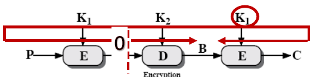

### 2. 固定 $A=0$，怎样得到对应明文？

为了让第一层输出 $A=0$，需要明文满足

$$
E_{K_1}(P)=0
\quad\Longleftrightarrow\quad
P=D_{K_1}(0).
$$

攻击者不知道真实的 $K_1$，所以对每个候选 $\kappa_1$ 都计算一个明文：

$$
P_{\kappa_1}=D_{\kappa_1}(0).
$$

把这个明文提交给真实的 2K3DES 加密接口，得到密文 $C_{\kappa_1}$。**只有当 $\kappa_1$ 恰好等于真实 $K_1$ 时，才能确定真实加密的第一层输出就是 $0$。**

### 3. 为什么可以在 $B$ 处相遇？

先看猜对 $K_1$ 的那次查询。因为 $A=0$，从中间层得到

$$
B=D_{K_2}(A)=D_{K_2}(0).
$$

另一方面，从得到的密文逆最后一层，可以算出同一个 $B$：

$$
B=D_{K_1}(C).
$$

于是正确密钥满足相遇条件

$$
\boxed{D_{K_1}(C)=D_{K_2}(0)}.
$$

等式左边需要候选 $K_1$ 和对应查询得到的密文；右边只需要候选 $K_2$ 和固定值 $0$。两边可以分别枚举，再比较结果。

### 4. 实际攻击步骤

**先建表：** 枚举每个候选 $\kappa_2$，计算 $D_{\kappa_2}(0)$，把 $(D_{\kappa_2}(0),\kappa_2)$ 存入表中。同一个中间值若对应多个密钥，全部保留。

**再查询并查表：** 对每个候选 $\kappa_1$：

1. 计算 $P_{\kappa_1}=D_{\kappa_1}(0)$。
2. 查询该明文的真实密文 $C_{\kappa_1}$。
3. 计算 $D_{\kappa_1}(C_{\kappa_1})$，用它查预计算表。
4. 每个匹配项给出一组候选 $(\kappa_1,\kappa_2)$，再用其他明密文对验证。

表中右侧结果可以提前按 $K_2$ 枚举；左侧则是每猜一个 $K_1$，先通过加密接口获得对应密文，再算出查表值。

**拼切的好处：** 原来反向式的 $E_{K_2}(D_{K_1}(C))$ 同时依赖两个密钥，每换一个 $K_1$ 就要重新枚举 $K_2$。拼切后，右边 $D_{K_2}(0)$ 只依赖 $K_2$，可以一次性建表，供所有 $K_1$ 猜测复用；左边 $D_{K_1}(C)$ 则通过对应的选择明文查询得到。于是两侧各枚举约 $2^{56}$ 次，而不需要重复处理 $2^{112}$ 个密钥组合。代价是需要大量表项和选择明文查询。

也可以先猜一个 $K_1$、构造并查询明文、算出左边的值，再去猜 $K_2$ 检查等式；预先建表只是把每次重复枚举 $K_2$ 的工作合并成一次。

### 5. 复杂度怎么计算？

- **预计算：** 枚举 $2^{56}$ 个 $K_2$，做 $2^{56}$ 次单 DES 解密，存储 $2^{56}$ 条表项。
- **在线阶段：** 枚举 $2^{56}$ 个 $K_1$；每个候选做两次单 DES 解密、一次选择明文查询和一次查表。选择明文查询总数至多为 $2^{56}$。
- **错误候选：** 在随机匹配近似下，两边各有 $2^{56}$ 个结果，匹配的是 64 位 $B$，错误匹配约有 $2^{56+56-64}=2^{48}$ 个，随后用其他明密文复筛。

因此，按常数时间查表估算，攻击者的计算和存储都是 $O(2^{56})$ 量级，并需要 $O(2^{56})$ 次选择明文查询。这里的“选择明文”很重要：攻击者必须能提交自己构造的 $P_{\kappa_1}$，而不是只拿到现成的已知明文。

### 6. 与双重 DES 的数据条件对比

- **双重 DES 的普通中间相遇：** 用已知的明密文 $(P,C)$ 建表、查表，再用其他已知明密文验证候选。
- **这里的 2K3DES 拼切：** 对每个 $\kappa_1$ 构造 $P_{\kappa_1}=D_{\kappa_1}(0)$，必须向真实加密接口提交该明文并取得对应密文，因此是选择明文攻击。

这是两个具体例子的数据条件：拼切和中间相遇各自还可以用于其他攻击模型。

## 集合映射相遇：约简轮 AES 的例子

这一节按课件的顺序，先推导 **4 轮 AES 的集合映射区分器**，再把它用于 7 轮 AES-256 的密钥恢复。这里的相遇对象是一整张有序映射表。

### 1. 初始集合和记号

取 256 个 AES 状态组成集合。第 0 字节 $X_0[0]$ 遍历 $0,1,\ldots,255$，其余 15 个字节各自固定。状态字节按课件的列优先方式编号：

$$
\begin{pmatrix}
0&4&8&12\\
1&5&9&13\\
2&6&10&14\\
3&7&11&15
\end{pmatrix},
\qquad
X_0:\begin{pmatrix}
A&C&C&C\\
C&C&C&C\\
C&C&C&C\\
C&C&C&C
\end{pmatrix}.
$$

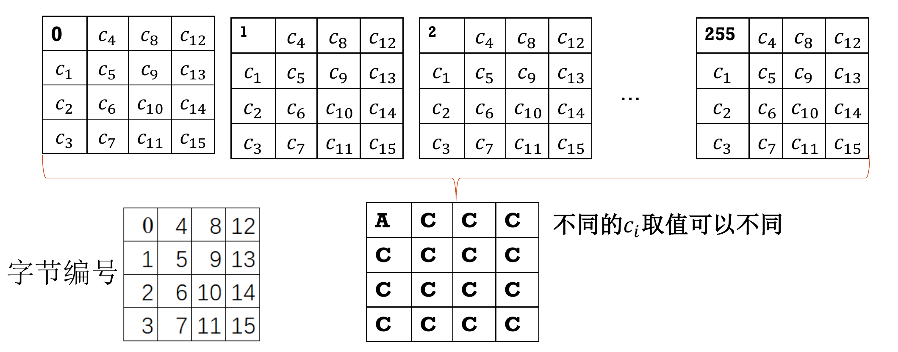

*图源：第 6 章课件，第 17 页。*

其中 $A$ 表示该位置遍历全部 256 个字节值，$C$ 表示该位置在这个集合中固定。课件图中初始状态的 $c_i$ 是固定输入字节，下面各轮公式的 $c_i$ 重新用于表示合并后的常量。用 $X_i[j]$ 表示第 $i$ 轮结束后编号 $j$ 的字节；每轮依次经过 SB、SR、MC、轮密钥异或。课件的四轮区分器从这里的 $X_0$ 开始，不另外计算初始轮密钥异或。

我们一直追踪同一个映射：

$$
X_0[0]\longmapsto X_i[0].
$$

把输入按 $0,1,\ldots,255$ 排序，记录每个输入对应的输出，就得到一张含 256 个字节的**有序映射表**。顺序很重要：表中的每个输出都要对应同一个输入。

下文 $S$ 是 AES S 盒；$2t$、$3t$ 等乘法是 AES 的 $GF(2^8)$ 乘法。$c_0,c_1,\ldots$ 表示对同一个集合固定的字节，用来合并其他固定输入和轮密钥的贡献；不同的 $c_i$ 可以取不同的值。

### 2. 第一轮：1 个常数字节决定一张映射表

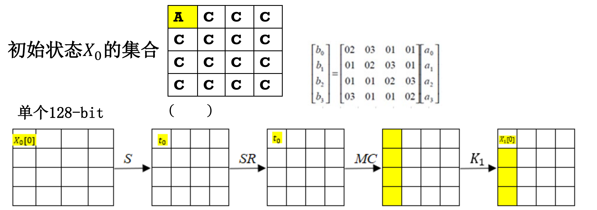

*图源：第 6 章课件，第 18 页。*

令活动字节输入为 $a=X_0[0]$，记 $t=S(a)$。经过第一轮后，活动字节扩散到第一列，课件将它们写成

$$
\begin{aligned}
X_1[0]&=2t\oplus c_0, &X_1[1]&=t\oplus c_1,\\
X_1[2]&=t\oplus c_2, &X_1[3]&=3t\oplus c_3.
\end{aligned}
$$

其他位置对于该集合仍为常数。之所以是第一列：原来的活动字节在第 0 行，经 SB 后仍活动，SR 不移动第 0 行，MC 再把它扩散到这一列的四个位置。

只看第 0 个输出字节：

$$
a\longmapsto X_1[0]=2S(a)\oplus c_0.
$$

$S$ 和乘以 $2$ 都是已知运算，所以固定 $c_0$ 后，256 个输入各自对应的输出就全确定了。$c_0$ 有 $2^8$ 种取值，故这类一轮映射**至多 $2^8$ 张表**。例如 $c_0=0$ 和 $c_0=1$ 分别给出 $a\mapsto2S(a)$ 和 $a\mapsto2S(a)\oplus1$。

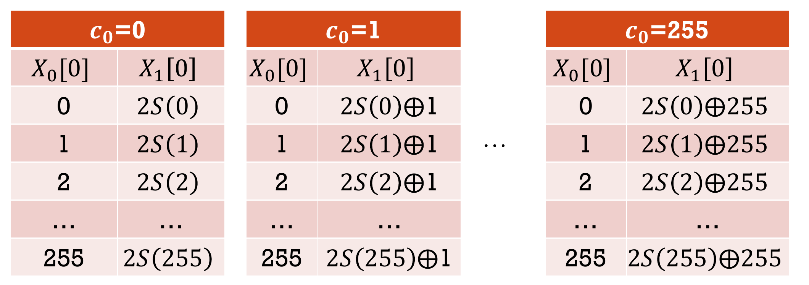

*图源：第 6 章课件，第 19 页。*

注意：决定这张映射的是 **1 个常数字节 $c_0$**，不是说整轮状态只涉及一个常数。其他常数只是没有进入当前观察的 $X_1[0]$。

### 3. 第二轮：观察 $X_2[0]$，需要 2 个常数字节

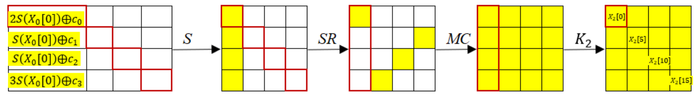

*图源：第 6 章课件，第 20 页。*

第 0 行经 SR 仍在原列；第 1、2、3 行的活动字节则分散到不同列。对 $X_2[0]$，其 MC 输入来自上一轮的 $X_1[0],X_1[5],X_1[10],X_1[15]$；其中只有 $X_1[0]$ 随 $a$ 变化，其余三项固定。所以

$$
\begin{aligned}
X_2[0]
&=2S\bigl(X_1[0]\bigr)
 \oplus3S\bigl(X_1[5]\bigr)
 \oplus S\bigl(X_1[10]\bigr)
 \oplus S\bigl(X_1[15]\bigr)\oplus K_2[0]\\
&=2S(2t\oplus c_0)\oplus c_4.
\end{aligned}
$$

这里 $c_4$ 把后三个常量项和 $K_2[0]$ 合并了。因此映射 $a\mapsto X_2[0]$ 由 $c_0,c_4$ 两个字节决定，至多有 $2^{16}$ 张表。

为了继续推第三轮的 $X_3[0]$，还需要追踪另外三个第二轮状态字节。课件给出：

$$
\begin{aligned}
X_2[0] &=2S(2t\oplus c_0)\oplus c_4,\\
X_2[5] &=S(3t\oplus c_3)\oplus c_5,\\
X_2[10]&=2S(t\oplus c_2)\oplus c_6,\\
X_2[15]&=S(t\oplus c_1)\oplus c_7.
\end{aligned}
$$

这里每个 $X_2[\cdot]$ 都随同一个 $a$ 变化；$c_0,\ldots,c_7$ 在整个 256 元集合里固定。

### 4. 第三轮：4 条输入汇合，得到 9 个字节

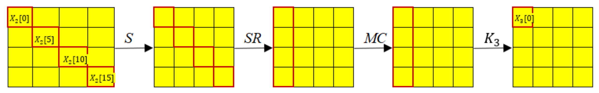

*图源：第 6 章课件，第 21 页。*

第三轮中，经过 SR 后，$X_2[0],X_2[5],X_2[10],X_2[15]$ 恰好进入同一列，再由 MC 合成 $X_3[0]$：

$$
\begin{aligned}
X_3[0]={}&2S\bigl(X_2[0]\bigr)\oplus3S\bigl(X_2[5]\bigr)\\
&\oplus S\bigl(X_2[10]\bigr)\oplus S\bigl(X_2[15]\bigr)\oplus K_3[0].
\end{aligned}
$$

把上一轮四个表达式代入，就得到 $X_3[0]$ 关于 $a$ 的完整表达式。四个输入合起来由 $c_0,\ldots,c_7$ 决定，再加上末尾的 $K_3[0]$，所以课件用 **9 个字节**描述映射 $X_0[0]\mapsto X_3[0]$：

$$
c_0,c_1,\ldots,c_7,\ K_3[0].
$$

这些参数固定之后，依次代入 256 个 $a$，就能算出整张三轮映射表；因此表的数量至多为 $2^{72}$。

### 5. 第四轮：追踪四个第三轮字节，得到 25 个字节

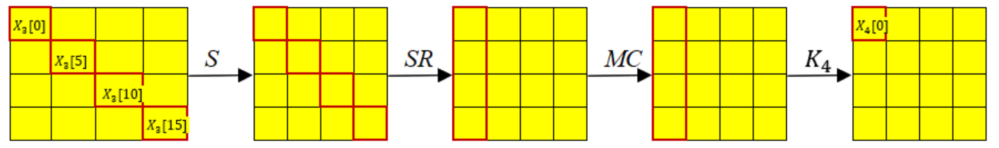

*图源：第 6 章课件，第 22 页。*

第四轮的 $X_4[0]$ 由第三轮的四个对角字节经过 SB、SR、MC 和密钥异或得到：

$$
\begin{aligned}
X_4[0]={}&2S\bigl(X_3[0]\bigr)\oplus3S\bigl(X_3[5]\bigr)\\
&\oplus S\bigl(X_3[10]\bigr)\oplus S\bigl(X_3[15]\bigr)\oplus K_4[0].
\end{aligned}
$$

因此，不能只知道上一小节的 $X_3[0]$，还要同时描述 $X_3[5],X_3[10],X_3[15]$。课件逐项展开这四个第三轮字节后，得到如下参数计数：

| 来源 | 参数 | 字节数 |
| --- | --- | ---: |
| 第一轮第一列的固定贡献 | $c_0,c_1,c_2,c_3$ | 4 |
| 第二轮 16 个字节各自合并出的固定贡献 | $c_4,\ldots,c_{19}$ | 16 |
| 第三轮四个对角字节的轮密钥 | $K_3[0],K_3[5],K_3[10],K_3[15]$ | 4 |
| 第四轮输出字节的轮密钥 | $K_4[0]$ | 1 |
| **合计** | | **25** |

其中，第三轮只观察 $X_3[0]$ 时只需要第二轮的 $c_4,\ldots,c_7$；为了再算出 $X_3[5],X_3[10],X_3[15]$，还要补上其余的 $c_8,\ldots,c_{19}$。所以不是把第三轮的 9 个字节简单乘以 4：四条表达式共享 $c_0,\ldots,c_3$。

固定这 25 个字节后，$a\mapsto X_4[0]$ 的 256 项就确定，因此这样的四轮映射**至多**有

$$
(2^8)^{25}=2^{200}\text{ 张}.
$$

梳理计数：观察每轮的第 0 个输出字节时，课件给出 $1\to2\to9\to25$ 个字节。25 个参数的不同取值也可能产生同一张表，所以这是表数量的上界。

### 6. 用四轮映射构造区分器

一般从 256 个输入到 1 字节输出的有序映射，每个输出有 256 种可能，共有

$$
256^{256}=2^{2048}\text{ 张表}.
$$

而上述四轮 AES 的表至多 $2^{200}$ 张。攻击分两步：

1. **预计算：** 枚举 25 个参数的所有可能，计算并保存对应的四轮映射表。
2. **在线判断：** 选择一个符合初始条件的 256 元明文集合，取得对应输出，按输入 $X_0[0]$ 的顺序组成映射表 $T$；若 $T$ 在预计算集合中，判断为目标四轮结构，否则判断为随机函数。

目标四轮结构产生的表一定包含在预计算集合中；若参照对象是均匀随机函数，它的表落入该集合的概率至多

$$
\frac{2^{200}}{2^{2048}}=2^{-1848}.
$$

**为什么叫集合映射相遇？** 预计算一边列出中间四轮结构允许的映射，实际数据一边构造出观察到的映射；查表时比较的是两张完整的有序映射表，而不是比较一个 128 位中间状态。

### 7. 扩展到七轮 AES-256：$1+4+2$

在四轮区分器前接一轮、后接两轮：

$$
\underbrace{1\text{ 轮}}_{\text{构造区分器输入}}
+\underbrace{4\text{ 轮}}_{\text{集合映射}}
+\underbrace{2\text{ 轮}}_{\text{从密文部分解密}}.
$$

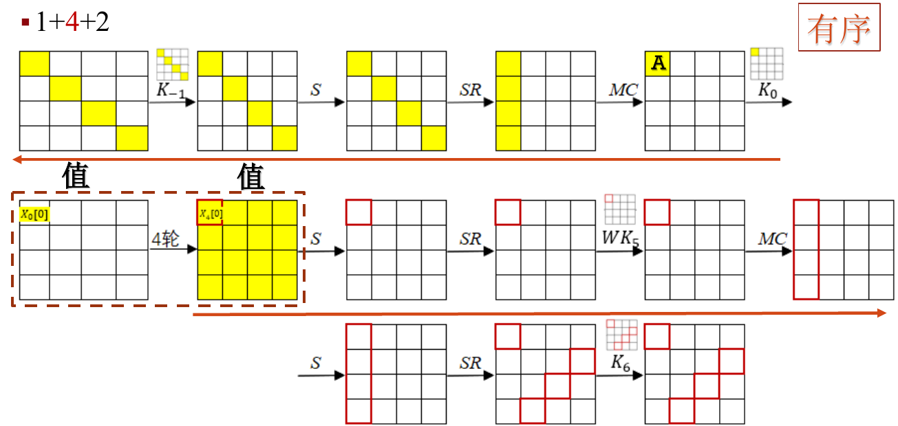

课件第 27 页。这里四轮区分器的 $X_0$ 和 $X_4$ 是这四轮的入口与出口，不是整个七轮密码的明文和密文。

1. **预计算映射库。** 按上述 25 个参数枚举四轮映射表并保存。每张表含 $2^8$ 个输出字节，最多 $2^{200}$ 张，所以课件估算预计算为 $2^{200}\cdot2^8=2^{208}$ 次目标字节计算，存储约 $2^{208}$ 字节。
2. **连接前一轮。** 按课件记号，猜测首轮所需的 $K_{-1}[0,5,10,15]$ 四个字节，构造 256 个明文。猜测正确时，附加轮的 MC 输出第一列为 $(A,x,y,z)^T$：$A$ 遍历 256 个值，$x,y,z$ 固定；其余列也固定。经过相同的轮密钥异或后，进入中间四轮的状态便只有第 0 字节遍历。查询真实加密，取得密文集合。
3. **确定输入顺序。** 再猜入口密钥字节 $K_0[0]$，由 $X_0[0]=A\oplus K_0[0]$ 算出每个明文对应的 $X_0[0]$，并按它排序，使输入顺序与预计算表一致。
4. **连接后两轮。** 猜测末两轮涉及的五个密钥字节 $WK_5[0]$ 和 $K_6[0,7,10,13]$，对 256 个密文做部分解密，得到对应的 $X_4[0]$，构造 $X_0[0]\mapsto X_4[0]$ 的有序表 $T$。其中 $WK_5[0]$ 是课件将轮密钥异或与逆列混合交换位置后得到的等效密钥字节。
5. **相遇并复筛。** $T$ 不在预计算表中，就排除该组首尾密钥猜测；$T$ 在表中，就保留候选，再结合其他映射、密钥关系和明密文恢复并验证剩余密钥。

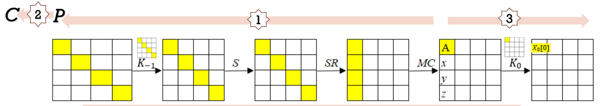

*图源：第 6 章课件，第 28 页。*

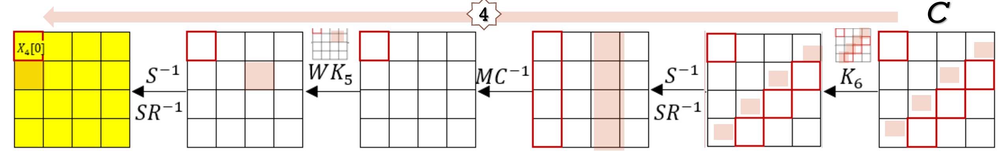

*图源：第 6 章课件，第 29 页。*

课件对一个映射给出的估计是：$2^{32}$ 个选择明文；在线约 $2^{80}\cdot2^8=2^{88}$ 次部分解密；预计算和存储量如上。在线的 $2^{80}$ 对应所猜的 10 个字节，$2^8$ 对应每次构造映射所需的 256 个输入。这是课件的约简七轮 AES-256 示例，计算单位需与完整加密区分。

**为什么数据量是 $2^{32}$，而不是每次猜测都再查询 256 个新明文？** 可以固定其余 12 个明文字节，让位置 $0,5,10,15$ 的四个字节遍历所有组合，先取得 $2^{32}$ 个明文及其密文。各个首轮密钥猜测所构造的 256 元集合都是这个明文池的子集，可以复用已经取得的密文。

### 8. 课件中的一个改进：用输出差分消去 $K_4[0]$

第四轮输出可写成 $X_4[0]=F(a)\oplus K_4[0]$。选输入 $a=0$ 对应的输出为基准，对同一集合内的每个输出求异或：

$$
X_4^{(a)}[0]\oplus X_4^{(0)}[0]
=F(a)\oplus F(0).
$$

两个 $K_4[0]$ 抵消，差分映射不再依赖这个字节，描述参数从 25 个降到 24 个，预计算规模减少一个 $2^8$ 因子。课件还讨论调整相遇位置、无序映射和利用密钥编排；相关集合性质可参照 [Square 攻击](../05-积分分析/Square攻击.md)。

## 资料

- 课程课件《第 6 章 中间相遇攻击》，第 3、6–14、17–34 页。
- 相关笔记：[穷举攻击](../01-基础与模型/穷举攻击.md)、[攻击思想](../01-基础与模型/攻击思想.md)。
