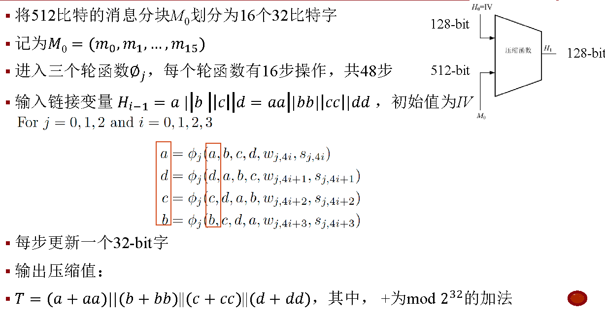
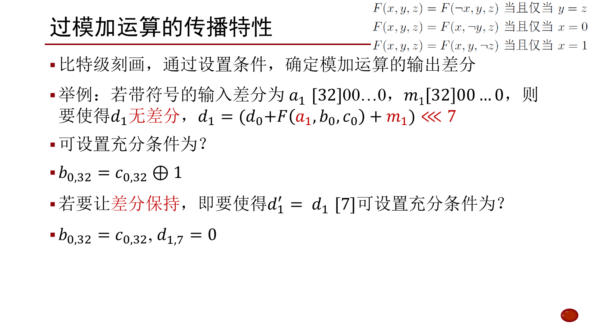
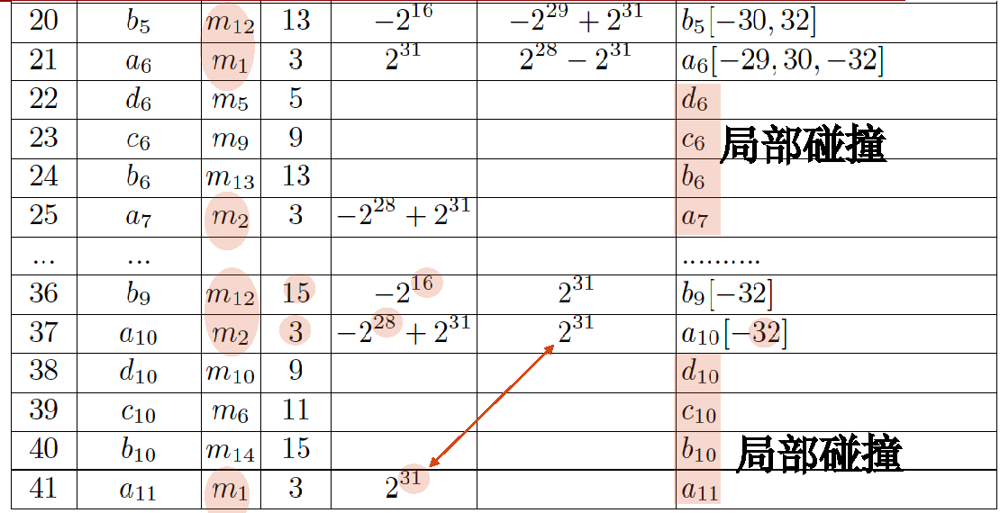
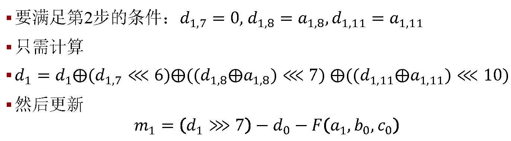

# 具体杂凑函数的碰撞攻击

## 1. 利用结构寻找碰撞

[生日攻击](生日攻击与广义生日攻击.md)把杂凑函数视为随机映射，寻找任意碰撞需要约 $2^{n/2}$ 次计算。针对具体算法时，还可以研究压缩函数的布尔运算、模加、循环移位与消息调度，主动构造一对差分沿预定路线传播的消息，使最终输出相同。课件以 **MD4** 为例，介绍比特追踪、充分条件与消息修改。

## 2. MD4 结构和碰撞目标

MD4 填充消息并附加长度，再以 512 比特为一块迭代压缩；链接状态为 128 比特，拆成四个 32 比特字 $(a,b,c,d)$。每块消息拆为 $m_0,\ldots,m_{15}$，压缩函数有三轮、每轮 16 步，共 48 步。每步用一个消息字、布尔函数、模 $2^{32}$ 加法和循环移位更新一个状态字。[RFC 1320](https://www.rfc-editor.org/rfc/rfc1320) 给出了完整算法。



*图源：第 12.3.2 节，第 3 页。*

### 链接变量是什么？

**链接变量**也叫**链值**，是消息块之间传递的中间状态。它记录前面各块的处理结果，并作为下一块压缩函数的输入。将填充后的消息分为 $M_1,\ldots,M_t$，记压缩函数为 $f$：

$$
H_0=IV,\qquad H_1=f(H_0,M_1),\qquad H_2=f(H_1,M_2),\quad\ldots,\quad H_t=f(H_{t-1},M_t).
$$

这里 $IV$ 是固定初始值，$H_i$ 是处理完第 $i$ 块后的 128 比特链值。每处理一块，就将输出链值交给下一块；处理完最后一块后，$H_t$ 的四个字按 MD4 规定的字节序输出为摘要。

```text
初始链值 IV ──┐
              ▼
消息块 M₁ ──→ 压缩函数 ──→ 链值 H₁ ──┐
                                     ▼
                     消息块 M₂ ──→ 压缩函数 ──→ 链值 H₂ ──→ …
```

### aa、bb、cc、dd 是什么？

MD4 的链值由四个 32 比特字组成。处理当前消息块时，先把输入链值赋给工作变量 $(a,b,c,d)$，并分别保存一份：

$$
aa=a,\qquad bb=b,\qquad cc=c,\qquad dd=d.
$$

随后用当前消息块更新 $(a,b,c,d)$，共做 48 步；备份 $(aa,bb,cc,dd)$ 保持不变。48 步结束后，将更新后的工作变量与各自的备份逐字相加，得到输出链值。这一步叫**前馈**：

$$
T=(a+aa)\parallel(b+bb)\parallel(c+cc)\parallel(d+dd),
$$

其中每个加法都按 $2^{32}$ 取模。$aa$ 是这一块开始时 $a$ 的旧值，公式中的 $a$ 是经过 48 步更新后的值；其他三组同理。

**小例子：** 如果开始时 $a=5$，先保存 $aa=5$；假设 48 步之后 $a=12$，则输出链值的第一个字为 $12+5=17$。四个字合在一起，就成为下一块的输入链值。

**与碰撞攻击的关系：** 若两个不同消息块从同一个链接值开始，它们的备份 $(aa,bb,cc,dd)$ 相同。因此，只要两条计算在 48 步后得到相同的 $(a,b,c,d)$，前馈相加后的输出链值也相同。对同长度的两条消息，若它们在同一位置产生相同链接值、之后的块及填充相同，最终杂凑值也相同。

MD4 输出为 128 比特，随机映射的生日攻击基准约为 $2^{64}$ 次求值。下面构造差分路线的目的，是利用 MD4 的结构降低找碰撞的工作量。

### 三轮函数和一步运算

MD4 的三个布尔函数逐位作用于 32 位字：

$$
\begin{aligned}
F(X,Y,Z)&=(X\land Y)\lor(\neg X\land Z),\\
G(X,Y,Z)&=(X\land Y)\lor(X\land Z)\lor(Y\land Z),\\
H(X,Y,Z)&=X\oplus Y\oplus Z.
\end{aligned}
$$

$F$ 是选择函数：该位 $X=1$ 时输出 $Y$，$X=0$ 时输出 $Z$；$G$ 输出三个输入中占多数的比特；$H$ 输出三个输入的异或。第一、二、三轮分别使用 $F,G,H$。每一步只更新一个状态字，其他三个状态字参与计算；随后轮流更新 $a,d,c,b$。

### 课件中的 $w$ 和 $s$

把当前的 512 比特消息块按 MD4 的小端字节序拆成 16 个 32 比特消息字 $m_0,\ldots,m_{15}$。课件以 $j=0,1,2$ 编号三轮，每轮的步骤以 $t=0,\ldots,15$ 编号：

- $w_{j,t}$ 是第 $j$ 轮第 $t$ 步**选用的消息字**，它直接取自 $m_0,\ldots,m_{15}$。
- $s_{j,t}$ 是该步**循环左移的位数**。它由算法固定，按轮次和步数查表。

每轮都将 16 个消息字各使用一次，三轮的顺序分别是：

| 步数 $t$ | 第 0 轮 $w_{0,t}$ | 第 1 轮 $w_{1,t}$ | 第 2 轮 $w_{2,t}$ |
| ---: | ---: | ---: | ---: |
| 0 | $m_0$ | $m_0$ | $m_0$ |
| 1 | $m_1$ | $m_4$ | $m_8$ |
| 2 | $m_2$ | $m_8$ | $m_4$ |
| 3 | $m_3$ | $m_{12}$ | $m_{12}$ |
| 4 | $m_4$ | $m_1$ | $m_2$ |
| 5 | $m_5$ | $m_5$ | $m_{10}$ |
| 6 | $m_6$ | $m_9$ | $m_6$ |
| 7 | $m_7$ | $m_{13}$ | $m_{14}$ |
| 8 | $m_8$ | $m_2$ | $m_1$ |
| 9 | $m_9$ | $m_6$ | $m_9$ |
| 10 | $m_{10}$ | $m_{10}$ | $m_5$ |
| 11 | $m_{11}$ | $m_{14}$ | $m_{13}$ |
| 12 | $m_{12}$ | $m_3$ | $m_3$ |
| 13 | $m_{13}$ | $m_7$ | $m_{11}$ |
| 14 | $m_{14}$ | $m_{11}$ | $m_7$ |
| 15 | $m_{15}$ | $m_{15}$ | $m_{15}$ |

移位数每四步循环一次：

| 轮次 | $t\bmod4=0$ | $t\bmod4=1$ | $t\bmod4=2$ | $t\bmod4=3$ |
| --- | ---: | ---: | ---: | ---: |
| 第 0 轮（第一轮） | 3 | 7 | 11 | 19 |
| 第 1 轮（第二轮） | 3 | 5 | 9 | 13 |
| 第 2 轮（第三轮） | 3 | 9 | 11 | 15 |

例如 $w_{1,2}=m_8$、$s_{1,2}=9$：第二轮第三步使用 $m_8$，将模加结果循环左移 9 位。第一轮前两步分别使用 $(w_{0,0},s_{0,0})=(m_0,3)$ 和 $(w_{0,1},s_{0,1})=(m_1,7)$。

循环左移时，左端移出的位接回右端。例如用 8 位数示意：$\mathtt{10110001}\lll3=\mathtt{10001101}$；MD4 实际移位的对象是 32 比特字。修改一个消息字会影响它在三轮中参与的计算，因此消息修改时还要检查后续步骤。

以第一轮前四步为例，$\lll s$ 表示 32 位循环左移 $s$ 位，所有加法都模 $2^{32}$：

$$
\begin{aligned}
a_1&=(a_0+F(b_0,c_0,d_0)+m_0)\lll3,\\
d_1&=(d_0+F(a_1,b_0,c_0)+m_1)\lll7,\\
c_1&=(c_0+F(d_1,a_1,b_0)+m_2)\lll11,\\
b_1&=(b_0+F(c_1,d_1,a_1)+m_3)\lll19.
\end{aligned}
$$

注意每一步使用最新更新的状态。例如第二步的 $F$ 输入是刚算出的 $a_1$，而不是旧的 $a_0$。第 2、3 轮还分别有固定的轮常数，消息字使用顺序也会变化。

## 3. 用带符号比特差分描述传播

对同一状态字 $s,s'$，模减差分记为 $\Delta s=s'-s\pmod{2^{32}}$。模减差分没有直接记录每一位的变化：不同的位变化和进借位可能得到同一个模减差分。

课件还用带符号的比特差分：$s[j]$ 表示第 $j$ 位由 $0$ 变 $1$，$s[-j]$ 表示由 $1$ 变 $0$（课件位序为 1 至 32）。例如 $s[3,-1]$ 的模减差分为 $2^2-2^0$。已知所有带符号位差分可以计算模减差分；反过来通常不能唯一确定带符号位差分。

### 从两条计算读出比特差分

碰撞攻击同时计算两条消息的状态。用 $x$ 表示第一条计算中的一个状态字，用 $x'$ 表示第二条计算中对应的状态字。**差分方向统一取第二条减第一条**：

$$
\Delta x=x'-x\pmod{2^{32}}.
$$

课件从最低位开始编号，最低位为第 1 位，最高位为第 32 位。逐位比较 $x\to x'$：

| 原来的位 | 新的位 | 位的变化 | 记号 | 对模减差分的贡献 |
| --- | --- | --- | --- | --- |
| 0 | 0 | 不变 | 不写 | 0 |
| 1 | 1 | 不变 | 不写 | 0 |
| 0 | 1 | 增加 | $[j]$ | $+2^{j-1}$ |
| 1 | 0 | 减少 | $[-j]$ | $-2^{j-1}$ |

**$j$ 是位置，正负号是变化方向**；例如 $[-3]$ 表示第 3 位从 1 变成 0。没有写出的位在两条计算中相同，但可能都是 0，也可能都是 1。

#### 例 1：一步步读 $[3,-1]$

用 4 位状态字演示，最低位仍从 1 开始编号：

```text
位号：   4 3 2 1
第一条： 0 0 1 1   x  = 3
第二条： 0 1 1 0   x' = 6
变化：   不变 0→1 不变 1→0
```

第 3 位 $0\to1$，记作 $[3]$；第 1 位 $1\to0$，记作 $[-1]$。合起来写 $x[3,-1]$，也就是状态字 $x$ 的差分形式为 $[3,-1]$。用位权计算：

$$
\Delta x=+2^{3-1}-2^{1-1}=4-1=3\pmod{16}.
$$

直接相减也得到 $6-3=3$；异或差分则是 $0011\oplus0110=0101$。三者描述的是同一对值，只是记录的信息不同。

#### 例 2：为什么同一个数值差分能对应不同位变化？

下面两对 4 位数都有 $\Delta x=+1$：

| $x$ | $x'$ | 比特差分 | 按位权计算 | 异或差分 |
| --- | --- | --- | --- | --- |
| `0010` | `0011` | $[1]$ | $+1$ | `0001` |
| `0111` | `1000` | $[4,-3,-2,-1]$ | $8-4-2-1=1$ | `1111` |

第二对相当于把 `0111` 加 1：最低位进位连续传到最高位，因此四个位都改变。虽然两对的模减差分相同，MD4 的布尔函数接收到的具体位变化却不同，后续传播也不同。这就是课件要进一步记录**哪些位变了、各自朝哪个方向变**的原因。

**课件中的例子：** 同一个模减差分 $2^{21}-2^{18}$，可以由两种比特变化得到：

$$
[-19,22]\quad\longrightarrow\quad-2^{18}+2^{21},
$$

$$
[19,20,-21,22]\quad\longrightarrow\quad2^{18}+2^{19}-2^{20}+2^{21}=2^{21}-2^{18}.
$$

只看第 22 至 19 位，前一种可以是 `0001 → 1000`，后一种可以是 `0100 → 1011`，其他位相同。前者有两位改变，后者有四位改变，但按各位权重相加，模减差分相同。

反过来，异或差分只标记变化位置。例如 `0010 → 0011` 与 `0011 → 0010` 的异或差分均为 `0001`，但带符号差分分别为 $[1]$ 和 $[-1]$，模减差分分别为 $+1$ 和 $-1\equiv15\pmod{16}$。

### 从比特差分换算模减差分

把所有变化位的贡献相加，再按字长取模。设正向变化的位置集合为 $P$，反向变化的位置集合为 $N$，对 $n$ 位字有

$$
\Delta x=\sum_{j\in P}2^{j-1}-\sum_{j\in N}2^{j-1}\pmod{2^n}.
$$

例如 4 位差分 $[-1]$ 对应 $-1\equiv15\pmod{16}$；MD4 使用 32 位字时，$[-1]$ 对应 $-1\equiv2^{32}-1\pmod{2^{32}}$。模减差分是字长内的数值关系，带符号比特差分则进一步指定每个变化位的方向。

**连接课件里的消息差分：** $\Delta m_1=2^{31}$ 意味着两个 32 位消息字只在第 32 位不同。如果 $m_1$ 的最高位是 0，变化记为 $m_1[32]$；如果最高位是 1，则记为 $m_1[-32]$。两种方向对应的整数差分别为 $+2^{31}$ 和 $-2^{31}$，模 $2^{32}$ 后相同。

### 实际追踪时怎么用？

1. **列出两条计算：** 固定差分方向 $x'-x$，标清位序，逐位写出输入差分。
2. **过布尔函数：** 同时检查两条计算的输入位，求出输出位是否改变以及改变方向。
3. **过模加：** 分别计算两条加法的进位，再比较结果；一个输入位变化可能影响多个输出位。
4. **过循环移位：** 将每个带符号的变化位按移位规则搬到新位置，方向保持不变。
5. **检查路线：** 将得到的差分与预定的下一步差分比较；通过约束状态位，让所需变化成立。

例如过选择函数 $F(X,Y,Z)$ 的某一位：两条计算都取 $X=0$，$Z$ 都为 1，而 $Y$ 从 0 变到 1。两次输出都取 $Z=1$，所以 $Y$ 的差分在这一位被消除；如果两条计算都取 $X=1$，输出随 $Y$ 从 0 变为 1，差分便传出。对模加则需要另外跟踪进位。

差分通过每一步时需要分别考虑：

- 布尔函数的输出差分：通过限制输入位，可让某些差分被消除，或让它们保持。
- 模加：进位可能把差分传到更高位，所以要约束参与运算的状态位。
- 循环移位：把差分的位置一起移动。

这些约束用来描述一条可行路线，而不是说任意消息对都会沿此路线传播。

### 3.1 为什么要记录差分的符号？

以 4 位数为例，$s=0010$、$s'=0011$，只有最低位从 $0$ 变 $1$，所以 $\Delta s=+1$；如果交换两条计算，则是最低位从 $1$ 变 $0$，差分为 $-1\equiv15\pmod{16}$。异或差分两种情况都是 $0001$，却看不出改变方向。

又如 $s=0111$、$s'=1000$，模减差分仍为 $+1$，但四个位全发生变化：最高位 $0\to1$，低三位 $1\to0$。它与 $0010\to0011$ 的模减差分相同，位变化方式却不同，后续经过布尔函数时可能产生不同效果。位序从低到高记为 $1,2,3,4$，后一例的带符号差分可写作 $[4,-3,-2,-1]$。

### 3.2 经过布尔函数：消除或保留差分

看 $F(X,Y,Z)$ 的某一位：

| 条件 | 输出 | 对差分的影响 |
| --- | --- | --- |
| 两条计算的 $X$ 都为 $1$ | 取 $Y$ | 该位的 $Z$ 差分不影响输出，$Y$ 的差分会传出 |
| 两条计算的 $X$ 都为 $0$ | 取 $Z$ | 该位的 $Y$ 差分不影响输出，$Z$ 的差分会传出 |
| $X$ 从 $0$ 变 $1$，而 $Y,Z$ 不变 | 从 $Z$ 换成 $Y$ | 若 $Y=Z$ 则输出不变；若 $Y\ne Z$ 则输出改变 |

例如固定 $X=0$、$Z=1$，即使 $Y$ 从 $0$ 变到 $1$，输出两次都等于 $1$，$Y$ 的差分被消除。相反，若 $X=1$，同样的 $Y$ 变化就会传到输出。这就是通过设置位条件控制传播的意思。

$G$ 是多数函数：如果两个未变化的输入位相同，输出被它们决定，第三个输入位变化不会影响输出；如果这两位不同，输出就随第三个输入位变化。$H$ 是异或函数：若三个输入的异或差分为 $\Delta X,\Delta Y,\Delta Z$，则 $\Delta H=\Delta X\oplus\Delta Y\oplus\Delta Z$，无需额外的输入位条件。

### 3.3 经过模加与循环移位

仍用 4 位模加，比较两条计算：

$$
0010+0001=0011,\qquad 0011+0001=0100.
$$

两个第一输入的异或差分只有最低位 $0001$，但输出差分是 $0011\oplus0100=0111$：最低位产生的进位一路影响到更高位。这个例子说明，分析模加时必须跟踪输入位和进位；不能把输出异或差分直接写成输入异或差分之和。

循环移位只是重新排列位。例如 4 位的 $1000\lll1=0001$，最高位移回最低位；对一对状态同时移位时，各位差分也随位置移动。MD4 的 32 位运算同理，移位位数和比特编号要一起核对。

### 3.4 课件例题：让 $d_1$ 的差分消失或保留



*图源：《第12.3.2节 具体杂凑函数的碰撞攻击》，第 10 页。*

这道题比较两条计算，第一条的第二步是

$$
d_1=\bigl(d_0+F(a_1,b_0,c_0)+m_1\bigr)\lll7,
$$

其中 $F(X,Y,Z)=(X\land Y)\lor(\neg X\land Z)$，加法按 $2^{32}$ 取模。第二条计算用撇号表示；两条计算的 $d_0,b_0,c_0$ 相同，输入差分为

$$
a_1[32],\qquad m_1[32].
$$

这里 $[32]$ 表示**第 32 位从 0 变为 1，其余位不变**。第 32 位是最高位，权重为 $2^{31}$，所以 $\Delta m_1=m'_1-m_1=2^{31}$。题目要通过设置条件，分别实现 $d'_1=d_1$ 和 $d'_1=d_1[7]$。

#### 第一步：先看 $F$ 的最高位

$F$ 每一位都由第一个输入选择：选择位为 0 时取第三个输入，选择位为 1 时取第二个输入。因为 $a_{1,32}=0$、$a'_{1,32}=1$，所以

$$
F(a_1,b_0,c_0)_{32}=c_{0,32},\qquad
F(a'_1,b_0,c_0)_{32}=b_{0,32}.
$$

其他位的输入相同，因此 $F$ 的变化只可能发生在第 32 位：

| $c_{0,32}$ | $b_{0,32}$ | $F$ 的最高位变化 | $\Delta F$（模 $2^{32}$） |
| ---: | ---: | --- | --- |
| 0 | 0 | $0\to0$ | $0$ |
| 1 | 1 | $1\to1$ | $0$ |
| 0 | 1 | $0\to1$ | $+2^{31}$ |
| 1 | 0 | $1\to0$ | $-2^{31}\equiv2^{31}$ |

**看 $b$ 和 $c$ 是否相等：**相等时，$F$ 不变；不相等时，$F$ 的最高位翻转。

#### 第二步：$b_{0,32}\ne c_{0,32}$，输出差分消失

设循环移位前的两条模加结果分别为

$$
U=d_0+F(a_1,b_0,c_0)+m_1,\qquad
U'=d_0+F(a'_1,b_0,c_0)+m'_1\pmod{2^{32}}.
$$

当 $b_{0,32}\ne c_{0,32}$，表中 $F$ 的差分为 $\pm2^{31}$。在模 $2^{32}$ 下，$-2^{31}\equiv2^{31}$，再加上 $\Delta m_1=2^{31}$，得到

$$
\Delta U=\Delta F+\Delta m_1
\equiv2^{31}+2^{31}
=2^{32}\equiv0\pmod{2^{32}}.
$$

所以 $U'=U$，两边再循环左移 7 位，结果仍相同：

$$
\boxed{b_{0,32}=c_{0,32}\oplus1\quad\Longrightarrow\quad d'_1=d_1.}
$$

**具体数值：**取 $d_0=a_1=m_1=b_0=\mathtt{00000000}$、$c_0=\mathtt{80000000}$。第 32 位上 $c=1,b=0$。第一条的 $F=\mathtt{80000000}$；第二条的 $a'_1=m'_1=\mathtt{80000000}$，此时 $F'=\mathtt{00000000}$。两条模加结果均为 $\mathtt{80000000}$，左移 7 位后均为 $\mathtt{00000040}$。

#### 第三步：$b_{0,32}=c_{0,32}$，把差分移到第 7 位

当 $b_{0,32}=c_{0,32}$，第 32 位无论选 $b$ 还是选 $c$ 都相同，故 $\Delta F=0$。移位前只剩消息字的差分：

$$
U'=U+2^{31}\pmod{2^{32}}=U\oplus2^{31}.
$$

最后一个等式说明：加上 $2^{31}$ **只翻转最高位**。最高位产生的进位超出 32 位后被丢弃，不影响其他位。将两个字都循环左移 7 位，原来的第 32 位被搬到第 7 位，因此

$$
d'_1=d_1\oplus2^6.
$$

要让带符号差分恰好是正向的 $[7]$，还需原来的第 7 位为 0：

$$
\boxed{b_{0,32}=c_{0,32},\quad d_{1,7}=0
\quad\Longrightarrow\quad d'_1=d_1[7].}
$$

若 $d_{1,7}=1$，这一位从 1 变为 0，结果是 $d_1[-7]$。课件所说的“差分保持”指**一个变化位经循环移位从第 32 位移动到第 7 位**，它的模减数值也随位置变化。

**具体数值：**取 $d_0=a_1=b_0=c_0=m_1=\mathtt{00000000}$，第二条的 $a'_1=m'_1=\mathtt{80000000}$。两边 $F$ 都为零，故 $U=\mathtt{00000000}$、$U'=\mathtt{80000000}$；循环左移 7 位后，$d_1=\mathtt{00000000}$、$d'_1=\mathtt{00000040}$，正是第 7 位的 $0\to1$。

| 设置条件 | $F$ 的变化 | 移位前 | 最终结果 |
| --- | --- | --- | --- |
| $b_{0,32}\ne c_{0,32}$ | 最高位变化 | 与 $m_1$ 的差分相加后归零 | $d'_1=d_1$ |
| $b_{0,32}=c_{0,32}$ | 不变 | 最高位翻转 | 第 7 位翻转 |
| 再加 $d_{1,7}=0$ | 不变 | 最高位翻转 | $d'_1=d_1[7]$ |

## 4. MD4 的一条碰撞差分路线

设两消息块的字差分按 $\Delta m_i=m_i'-m_i\pmod{2^{32}}$ 定义。课件的例子选择

$$
\Delta m_1=2^{31},\qquad
\Delta m_2=2^{31}-2^{28},\qquad
\Delta m_{12}=-2^{16},\qquad
\Delta m_i=0\quad(i\notin\{1,2,12\}).
$$

两条计算从相同链接值开始，消息字差分在不同步被重复使用，在中间状态引入差分；路线要求这些差分最终消失，使输出状态再次相同。课件根据每步模减差分和符号差分画出轨迹，其中若干段形成**局部碰撞**：前面引入的状态差分在一段计算后消失，之后还可能由其他消息字再次引入差分。



*图源：第 12.3.2 节，第 13 页，截取路线续表。*

局部碰撞是中间状态在某一段重新一致，最终碰撞还要求后续所有步骤的差分也归零。选择差分位置时，要尽量让后期路线稀疏，因为后几步的条件更难靠修改消息直接控制。

## 5. 从路线推导充分条件

路线指定希望看到的每一步差分；为保证它成立，需要对输入消息和中间状态的位值列出充分条件。例如，如果第一轮布尔函数是

$$
F(X,Y,Z)=(X\land Y)\lor(\neg X\land Z),
$$

那么每个比特上 $X$ 决定输出来自 $Y$ 还是 $Z$。约束 $X,Y,Z$ 的对应位，就可能控制某个输入差分是否传到输出；随后还须考虑模加进位及移位。所有要求同时满足时，预定路线成立，最终产生压缩函数碰撞。这些条件保证所选路线成立，属于该路线的**充分条件**。

### 具体看第 9 步的位条件

课件第 9 步更新 $a_3$：

$$
a_3=(a_2+F(b_2,c_2,d_2)+m_8)\lll3.
$$

此处 $F$ 的选择输入是 $b_2$，被选择的两个输入是 $c_2,d_2$。课件路线要求输出仅有 $a_3[17]$ 这一处正向位差分。若干关键条件可以这样理解（下标采用课件的低位为 1 的编号）：

1. $c_2$ 的第 19、20、21、22 位有差分。令 $b_2$ 的相应位均为 $0$，$F$ 在这些位置选 $d_2$，这些 $c_2$ 差分就不会传到 $F$ 输出。
2. $b_2$ 的第 13、15 位有差分。令 $c_2$ 和 $d_2$ 在这些位置分别相等，就算选择位 $b_2$ 发生变化，$F$ 的输出也不变。
3. 第 14 位要求 $b_{2,14}=1$、$c_{2,14}=0$、$d_{2,14}=0$；结合路线中的 $b_2[-14]$ 和 $d_2[14]$，原来的 $F$ 输出为 $0$，另一条计算的选择位变成 $0$ 并选到 $d'_2=1$，得到期望的正向位变化。
4. 循环左移 3 位会把第 14 位移到第 17 位。还需满足课件列出的模加及输出位条件，才能让最终差分保持为单独的 $a_3[17]$，而不因进位扩展到其他位。

由此可以看到，一条路线的条件不是随意列出的：先根据布尔函数选通需要的差分，再处理模加的进位，最后核对移位后的位置。

课件的路线列出 122 个比特条件。如果粗略把它们视作独立、每个均以概率 $1/2$ 满足，则随机消息对沿该路线成功的概率估为 $2^{-122}$，相应平均需尝试约 $2^{122}$ 对，甚至劣于生日攻击。

## 6. 消息修改：主动满足条件

### 单步消息修改

第一轮每个消息字首次使用时，可以先调整某个中间状态字，让它满足需要的位条件，再反解消息字。以课件的第二步为例：

$$
d_1=(d_0+F(a_1,b_0,c_0)+m_1)\lll7.
$$

调整 $d_1$ 的相关位后，可由该式反解

$$
m_1=(d_1\ggg7)-d_0-F(a_1,b_0,c_0)\pmod{2^{32}}.
$$

例如课件要求 $d_{1,7}=0$、$d_{1,8}=a_{1,8}$、$d_{1,11}=a_{1,11}$。先保留 $d_1$ 的其他位，把这三位分别改成所要求的值；再将修改后的 $d_1$ 代入反解式，重新计算 $m_1$。这样在已固定的 $d_0,a_1,b_0,c_0$ 下重新执行第二步，得到的正是修改后的 $d_1$，这三个条件就成立。

这里 $\ggg7$ 是**循环右移** 7 位，它撤销前面的循环左移；减法在模 $2^{32}$ 下进行。反解后的 $m_1$ 会在后续步骤再次被使用，所以后面还要继续计算和检查，而不能只看当前一步。



*图源：第 12.3.2 节，第 17 页，截取条件与反解公式。*

构造消息对时还必须维持选定的消息差分，并检查修改后的另一条计算是否仍满足路线。课件称第一轮条件经过这类修改后，例子中剩余 26 个尚需处理的条件。

### 多步消息修改

第二轮重新使用第一轮的消息字，修改其中一个字可能破坏已经满足的前面条件。多步修改同时调整若干消息字，用后续补偿保持先前状态或条件，并让新的第二轮条件成立；课件举例通过调整 $m_0$ 影响第二轮状态，再调整 $m_1,\ldots,m_4$ 保持第一轮相关状态。

具体地，第二轮第一步为 $a_5=(a_4+G(b_4,c_4,d_4)+m_0)\lll3$。修改 $m_0$ 能改变 $a_5$，但 $m_0$ 也参与第一轮的 $a_1$；因此接着调整后续消息字，补偿早期状态的变化。课件例子希望让 $d_1,c_1,b_1,a_2$ 保持原值，同时使 $a_5$ 满足新的条件。这就是“多步”：不仅修改一个目标状态，还要处理修改对其他步骤的影响。

课件给出经过消息修改后，构造的消息对满足碰撞的概率约为 $2^{-6}$ 到 $2^{-2}$。该数值是消息修改后候选对的成功率估计。总时间由生成候选、修改、检查和失败重试组成。

## 7. 攻击流程

1. 选择消息块差分，设计最终差分归零且后期条件较少的碰撞路线。
2. 逐步追踪差分，推导使该路线成立的位条件。
3. 选择消息并用单步、多步消息修改满足尽可能多的条件，同时维持消息对差分。
4. 对尚未强制满足的条件进行检查；不满足则换候选并重试。
5. 得到候选消息对后，实际计算完整杂凑值，确认消息不同且摘要相同。

相关笔记：[生日攻击与广义生日攻击](生日攻击与广义生日攻击.md)、[杂凑函数](杂凑函数.md)。
