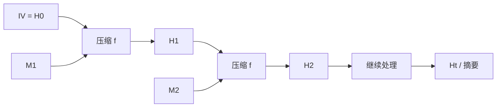
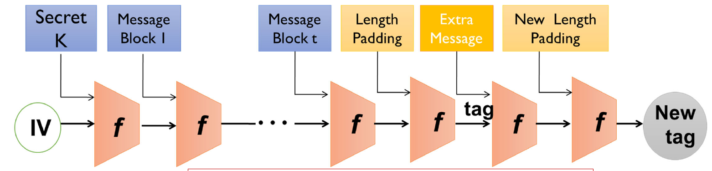
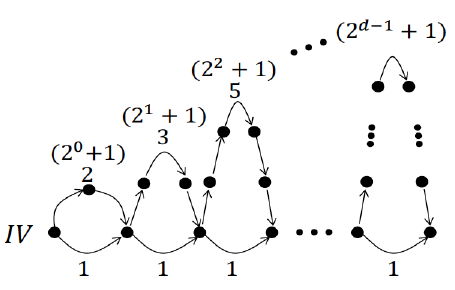
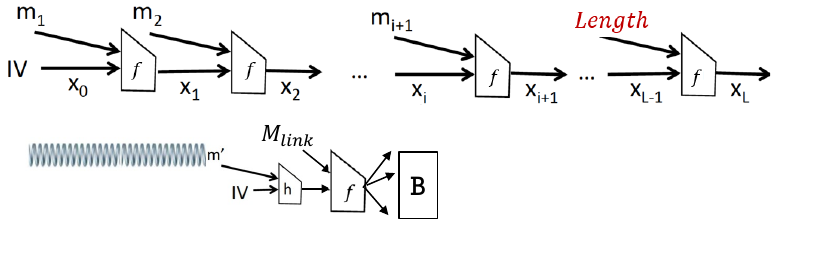
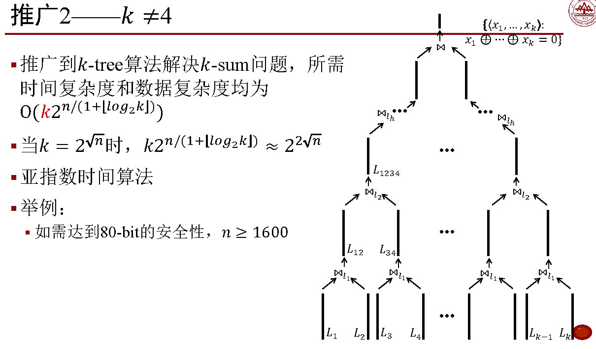
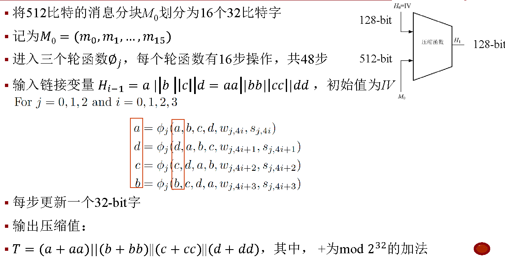
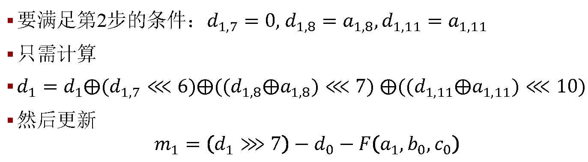

# 杂凑函数

## 1. 杂凑函数做什么

杂凑函数（Hash 函数）将任意长度的消息映射为固定长度的杂凑值，也叫摘要：

$$
H:\{0,1\}^*\longrightarrow\{0,1\}^n,\qquad M\longmapsto H(M).
$$

消息长度可以变化，输出始终为 $n$ 比特；同一条消息每次计算得到相同的摘要。杂凑函数本身没有密钥。

输入空间远大于输出空间，所以一定存在不同消息 $M,M'$ 使 $H(M)=H(M')$，这叫**碰撞**。抗碰撞安全要求攻击者难以找到这样的消息对。

### 杂凑值能提供什么？

- **完整性检查：** 若可信渠道提供了文件的正确摘要，就可以比较下载文件的摘要，发现文件是否被改变。
- **数字签名：** 通常先计算消息摘要，再按签名方案签名，使签名运算处理固定长度的值。
- **不能单独证明来源：** 杂凑函数没有密钥，任何人都能给自己修改后的消息重新计算摘要。如果消息和摘要都可被替换，单凭摘要无法认证发送者；消息认证需要 MAC 或数字签名等机制。

## 2. 三种安全性质与攻击目标

| 性质 | 给定条件 | 攻击者的目标 | 谁能选择消息？ |
| --- | --- | --- | --- |
| 抗原像 | 指定目标值 $y$ | 找到 $M$，使 $H(M)=y$ | 可选择 $M$，但目标 $y$ 已固定 |
| 抗第二原像 | 指定消息 $M$ | 找到 $M'\ne M$，使 $H(M')=H(M)$ | $M$ 已固定，只选择 $M'$ |
| 抗碰撞 | 给定杂凑算法 | 找到 $M\ne M'$，使 $H(M)=H(M')$ | 两条消息都可由攻击者选择 |

**例子：**

- 给定一段摘要，找一条能产生它的消息：原像。
- 给定一份已经确定的合同，找另一份内容不同但摘要相同的合同：第二原像。
- 自己设计两份不同合同，让它们的摘要相同：碰撞。

碰撞问题给攻击者的选择空间更大，不能把“找到任意碰撞”直接说成“可以针对任意指定文件找到第二原像”。

## 3. 通用攻击和理想复杂度

把不同消息的 $n$ 比特输出看作独立均匀随机值，有 $2^n$ 种可能输出。以下复杂度的单位是**杂凑函数求值次数**。

### 3.1 原像和普通第二原像：固定目标

每试一条新消息，命中固定目标摘要的概率为 $2^{-n}$。试 $q$ 条不同消息，至少命中一次的概率为

$$
P_{\mathrm{命中}}=1-(1-2^{-n})^q.
$$

$q$ 很小时约为 $q/2^n$；取 $q=2^n$ 时约为 $1-e^{-1}\approx63.2\%$。因此原像和普通固定目标的第二原像搜索工作量约为 $2^n$。

工作量按达到常数成功率计量，原像和第二原像攻击的 $2^n$ 次试验也采用这一口径。原像问题的目标值取自实际输出。

### 3.2 碰撞：生日攻击

生成 $q$ 条不同消息，每个新杂凑值都可以与此前所有杂凑值比较。$q$ 条消息共有 $q(q-1)/2$ 对，因此碰撞概率近似为

$$
P_{\mathrm{碰撞}}\approx1-\exp\!\left(-\frac{q(q-1)}{2^{n+1}}\right).
$$

令概率约为 $50\%$，得到 $q\approx1.177\cdot2^{n/2}$。所以碰撞搜索的通用工作量为 $2^{n/2}$ 量级。若当前没有找到，就继续计算并查表；已经生成的结果可以继续使用。

例如 $n=64$ 时，$2^{32}$ 条消息的碰撞概率约为 $39.3\%$；约 $1.177\cdot2^{32}$ 条时达到 $50\%$。用哈希表保存结果的基本实现还需要 $2^{n/2}$ 量级的存储和表操作。完整推导见 [生日攻击与广义生日攻击](生日攻击与广义生日攻击.md)。

| 攻击目标 | 理想通用工作量 | 主要原因 |
| --- | --- | --- |
| 原像 | $2^n$ | 新输出匹配固定目标 |
| 普通第二原像 | $2^n$ | 新输出匹配指定消息的摘要 |
| 碰撞 | $2^{n/2}$ | 两条消息都可选择，候选对数约为样本数的平方 |

这些是按理想随机输出估计的通用基准。利用具体结构时，第二原像或碰撞的成本可能不同；分组长度、消息长度、存储和攻击者能力也要分别说明。

## 4. Merkle–Damgård 迭代结构

MD 结构把处理任意长度消息的问题转化为反复调用固定输入长度的压缩函数。

### 4.1 一块一块计算

设消息先填充并分成 $b$ 比特分组 $M_1,\ldots,M_t$。压缩函数接受一个 $n$ 比特链值和一个消息分组，输出新的 $n$ 比特链值：

$$
f:\{0,1\}^n\times\{0,1\}^b\longrightarrow\{0,1\}^n.
$$

从固定初始值 $H_0=IV$ 开始，依次计算

$$
H_i=f(H_{i-1},M_i),\quad i=1,\ldots,t;
\qquad H(M)=H_t.
$$

每一步的 $H_i$ 是**中间链值**；最后一个 $H_t$ 是这里直接输出的摘要。真正计算时，每个 $M_i$ 都是填充后的分组，填充也要参与计算。

### 4.2 为什么末尾要编码长度？

MD 强化填充除了补齐分组，还会编码原始消息长度。它让填充后的完整消息结构包含长度信息。不同长度的消息使用不同的长度编码；即使中间链值相同，后续仍要处理各自的填充块。

因此做路径拼接时，除了检查链值相同，还要检查**后缀和最终填充是否一致**。常用方法是让两条消息的总长度一致，再连接相同的后缀。

**填充小例子：** 假设某教学构造的分组长为 16 比特，长度字段为 8 比特，填充规则为“先补 $1$，再补若干个 $0$，最后附上原消息长度”。原消息 $M=10110$ 长 5 比特，长度编码为 $00000101$，故填充后的一块是

$$
\underbrace{10110}_{M}\parallel\underbrace{1\,00\,00000101}_{\operatorname{pad}(M)}.
$$

总长度为 $5+1+2+8=16$ 比特。这个例子展示长度如何进入最后一块；不同算法的分组长度和长度字段规则按各自定义处理。

### 4.3 中间状态相同为什么有用？

压缩函数是确定性的。如果两条消息处理到某个位置时链值相同，那么继续输入相同的后续分组，就会得到相同的后续链值：

$$
H_i=H'_j,\quad B\text{ 相同}
\quad\Longrightarrow\quad
f(H_i,B)=f(H'_j,B).
$$

这一点是多碰撞、长消息第二原像攻击以及若干 MAC 分析的基础。最终摘要相同还要结合消息长度与填充一起判断。

### 4.4 分组密码怎样构造压缩函数？

课件中的 Davies–Meyer 形式，以消息分组 $M_i$ 作为分组密码的密钥、链值 $H_{i-1}$ 作为输入，并将加密结果与原链值异或：

$$
H_i=f(H_{i-1},M_i)=E_{M_i}(H_{i-1})\oplus H_{i-1}.
$$

这里消息分组与分组密码密钥的长度按该构造匹配，异或输入链值称为**前馈**。给定 $M_i$，令 $H_{i-1}=E_{M_i}^{-1}(0)$，就有 $H_i=H_{i-1}$；这样的状态称为固定点。它可用于调整某些攻击中路径的长度，详见 [第二原像攻击](第二原像攻击.md)。

## 5. 长度扩展攻击

### 5.1 为什么知道摘要就能继续？

对直接输出完整末尾链值的 MD 构造，$H(M)$ 就是处理完 $M$ **及其原填充**后的状态。攻击者知道该摘要和原消息长度后，可以把摘要当作继续迭代的起点，计算

$$
H\bigl(M\parallel\operatorname{pad}(M)\parallel X\bigr).
$$

新计算还要按扩展后的总长度处理最终填充。上式中间包含原填充，通常不等于 $H(M\parallel X)$。

### 5.2 密钥前缀 MAC 的例子

假设系统错误地使用

$$
T=H(K\parallel M)
$$

作为认证标签。攻击者拿到消息 $M$ 和标签 $T$，并知道或猜测 $|K|$。令 $L=|K|+|M|$，就能计算 $K\parallel M$ 的填充字节 $\operatorname{pad}_L$；再以 $T$ 为链值，继续处理追加内容 $X$，得到

$$
T'=H(K\parallel M\parallel\operatorname{pad}_L\parallel X).
$$

攻击者提交的新消息是 $M'=M\parallel\operatorname{pad}_L\parallel X$，标签是 $T'$。验证方计算 $H(K\parallel M')$ 时，处理的正是上式，因此会接受这个标签。

*图源：第 13 章消息认证码课件。*

对于直接输出完整末尾链值、且验证方接受填充字节的 MD 前缀 MAC，攻击者从摘要继续计算即可伪造，无需恢复 $K$。HMAC 的构造与原理见 [消息认证码](../08-消息认证/消息认证码.md)。

## 6. 长消息第二原像攻击

目标是：给定 $M$，找到不同的 $M'$，使 $H(M')=H(M)$。一般的随机搜索约需 $2^n$ 次求值；MD 的长消息结构能提供多个可供桥接的中间状态。

### 6.1 可扩展消息

可扩展消息是**从同一初始状态出发、长度不同但到达同一个中间链值**的一族消息块序列。通过逐级构造短路径和长路径，可以选择不同长度，同时保持共同终点 $H_{\mathrm{exp}}$。

*图源：第 12.2 节课件。*

### 6.2 桥接并对齐长度

设目标消息处理到第 $i$ 个分组后的状态为 $H_i$。寻找桥接分组 $B$，使

$$
f(H_{\mathrm{exp}},B)=H_i.
$$

再选长度为 $i-1$ 块的可扩展前缀，接上 $B$ 和目标消息从第 $i+1$ 块开始的后缀。两条消息在处理到第 $i$ 块时链值相同，后缀相同；如果总长度也相同，最终长度填充一致，摘要就相同。最后确认新消息与原消息不同。

*图源：第 12.2 节课件。*

设有约 $2^d$ 个可接入的不同目标中间状态，一次随机桥接命中它们之一的概率约为 $2^{d-n}$，桥接工作量约为 $2^{n-d}$ 次压缩计算。课件模型的总工作量约为

$$
d2^{n/2}+2^{n-d}+2^d,
$$

分别对应构造各级碰撞、桥接搜索，以及长路径构造和目标状态处理。详细构造和长度范围见 [第二原像攻击](第二原像攻击.md)。

## 7. 广义生日攻击：从 2-SUM 到 4-tree

普通生日攻击找两个输出相等；广义生日问题则从多个列表各选一项，让它们的和达到指定目标。以异或 4-SUM 为例：

$$
x_1\oplus x_2\oplus x_3\oplus x_4=0,\qquad x_i\in L_i.
$$

4-tree 先将 $L_1,L_2$ 和 $L_3,L_4$ 分别配对，筛选使每组异或值的低 $\ell$ 位为零；再匹配两组异或值的剩余高位，回溯得到四个原始元素。

*图源：第 12.3.1 节课件，第 20 页；图示为多列表树的推广。*

当四表均可提供独立均匀的 $n$ 比特候选、选取平衡参数 $\ell=n/3$ 时，每个输入表和中间表约有 $2^{n/3}$ 项，时间与空间为 $2^{n/3}$ 量级。这个复杂度适用于相应的多列表求和问题；普通杂凑碰撞的生日基准仍为 $2^{n/2}$。

更一般地，若每个输入表有 $2^x$ 项，低 $\ell$ 位相等的概率为 $2^{-\ell}$，则每张中间表的期望项数为 $2^{2x-\ell}$；两中间表再匹配剩余 $n-\ell$ 位，最终期望解数为 $2^{4x-\ell-n}$。取 $x=\ell=n/3$，输入表、中间表规模平衡，期望得到约 1 个解。

课件的 AdHash 例子把各消息块的杂凑值作模加；当攻击者能为各位置生成候选块时，寻找目标杂凑值可转化为多列表模加问题。算法、参数推导及模加例子见 [生日攻击与广义生日攻击](生日攻击与广义生日攻击.md)。

## 8. 具体杂凑函数的碰撞：比特追踪与消息修改

通用生日攻击把杂凑值当作随机结果；结构攻击研究压缩函数内部运算，主动构造更容易碰撞的消息对。课件以 MD4 为例。

### 8.1 MD4 的压缩过程

MD4 将填充后的消息分为 512 比特的分组。每个分组拆为 16 个 32 比特消息字；128 比特链值拆为四个 32 比特状态字。压缩函数共三轮、每轮 16 步，每一步使用布尔函数、模 $2^{32}$ 加法、循环移位和消息字更新状态。

*图源：第 12.3.2 节课件。*

### 8.2 比特追踪

选取有差异的消息对，逐步分析各状态字的比特差异，寻找能使最终状态差分消失的路线。重点看：

- **布尔函数：** 输出差分取决于各输入比特及其差分；给输入施加条件，可以控制差分是否传出。
- **模加：** 某一位的差异会通过进位影响更高位，分析时要逐位追踪进位。
- **循环移位：** 改变差异所在位置，不改变比特值本身。

例如 MD4 第一轮使用 $F(X,Y,Z)=(X\land Y)\lor(\neg X\land Z)$。对每一位，若 $X=1$，输出取 $Y$；若 $X=0$，输出取 $Z$。因此固定或约束对应的 $X$ 位，就能控制这一位的输出跟随哪个输入；具体差分还要结合两条计算路径的输入值一起分析。

### 8.3 消息修改

先为目标差分路线列出需要满足的状态比特条件，再利用可选择的消息字调整中间状态，使更多条件主动成立；仍不满足的条件再通过生成候选和检查来处理。最终应实际计算完整杂凑，确认两条消息不同且摘要相同。

*图源：第 12.3.2 节课件。详细路线和单步反解见 [具体杂凑函数的碰撞攻击](具体杂凑函数的碰撞攻击.md)。*

## 9. 考前对照

| 问题 | 关键回答 |
| --- | --- |
| 给定摘要找消息、给定消息找同摘要消息、自己找一对同摘要消息？ | 分别是原像、第二原像、碰撞 |
| 为什么碰撞需要约 $2^{n/2}$ 个消息？ | $q$ 个消息可以组成约 $q^2/2$ 对 |
| 长度扩展得到的是哪条消息的摘要？ | $M\parallel\operatorname{pad}(M)\parallel X$，不是直接的 $M\parallel X$ |
| 强化 MD 的第二原像为什么需要可扩展消息？ | 在桥接到目标中间状态后，使新旧消息长度与填充对齐 |
| 4-tree 为什么先筛低位？ | 控制中间表规模，再匹配剩余高位 |
| MD4 的消息修改有什么作用？ | 利用消息字自由度主动满足差分路线中的状态条件 |

## 相关笔记

- [密码分析学概述](../01-基础与模型/密码分析学概述.md)
- [攻击思想](../01-基础与模型/攻击思想.md)
- [第二原像攻击](第二原像攻击.md)
- [生日攻击与广义生日攻击](生日攻击与广义生日攻击.md)
- [具体杂凑函数的碰撞攻击](具体杂凑函数的碰撞攻击.md)
- [消息认证码](../08-消息认证/消息认证码.md)
