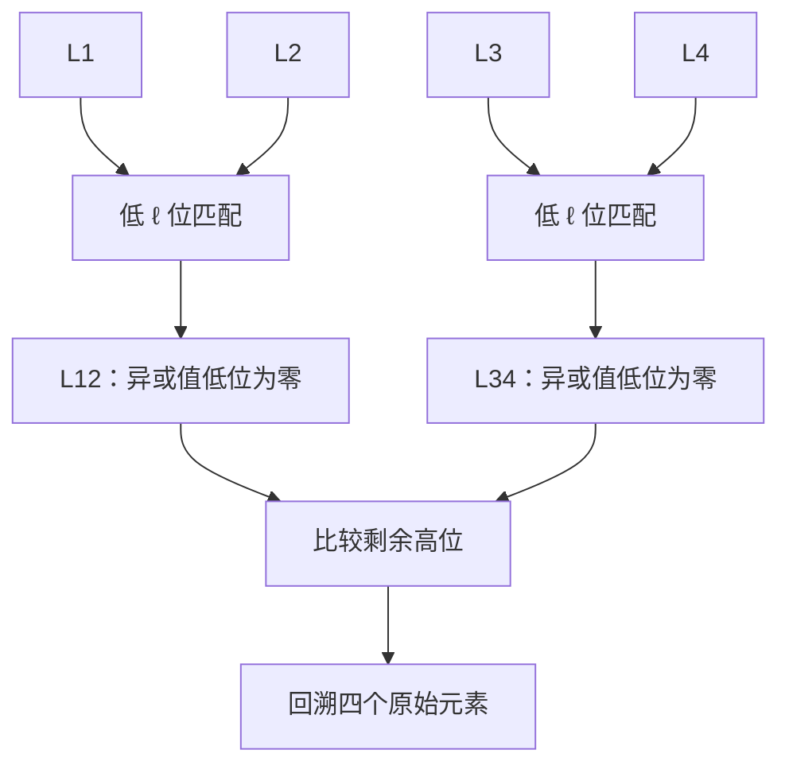
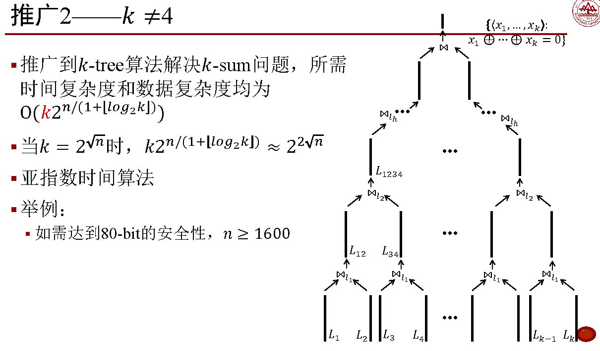

# 生日攻击与广义生日攻击

## 1. 生日问题与碰撞概率

### 1.1 攻击要找什么？

生日攻击的目标是找出**任意两条不同的消息**，使它们的杂凑值相同：

$$
M\ne M',\qquad h(M)=h(M').
$$

攻击者可以自己选两条消息，不需要先指定其中一条，也不需要先指定杂凑值。这正是它与第二原像攻击的区别。

先假设不同消息的杂凑值像独立均匀的随机数一样分布。若杂凑值长 $n$ 比特，可能的输出总数为

$$
N=2^n.
$$

问题变成：从 $N$ 个可能的输出中随机抽取 $m$ 次，至少出现一对相同值的概率是多少？

### 1.2 先算“全不相同”，再算“至少碰撞一次”

直接算各种碰撞情况比较麻烦。先考虑相反的事件：$m$ 个输出全都不相同。依次加入消息：

| 第几个输出 | 要避开的已有值 | 不发生碰撞的概率 |
| --- | --- | --- |
| 第 1 个 | 没有 | $1$ |
| 第 2 个 | 第 1 个输出，共 1 个 | $(N-1)/N$ |
| 第 3 个 | 前 2 个输出，共 2 个 | $(N-2)/N$ |
| 第 $i+1$ 个 | 前 $i$ 个输出 | $(N-i)/N$ |

把每一步**在此前都没有碰撞的条件下**的概率相乘：

$$
P_{\mathrm{全不同}}
=1\cdot\frac{N-1}{N}\cdot\frac{N-2}{N}\cdots\frac{N-(m-1)}{N}
=\prod_{i=0}^{m-1}\left(1-\frac{i}{N}\right).
$$

这里按 $m\le N$ 写；若 $m>N$，由抽屉原理必然碰撞。因为“全不同”和“至少一对碰撞”互为补事件，所以

$$
P_{\mathrm{碰撞}}=1-P_{\mathrm{全不同}}.
$$

**生日例子：** 假设 365 天等概率且各人生日独立，23 人生日全不同的概率为 $\prod_{i=0}^{22}(1-i/365)$，因此至少两人生日相同的概率约为 $50.73\%$。这里比较的是**任意两人**，不只是某个人与其他人的生日。

### 1.3 碰撞概率的近似式

当 $m\ll N$ 时，用 $\ln(1-x)\approx-x$：

$$
\begin{aligned}
\ln P_{\mathrm{全不同}}
&=\sum_{i=0}^{m-1}\ln\left(1-\frac{i}{N}\right)\\
&\approx-\sum_{i=0}^{m-1}\frac{i}{N}
=-\frac{m(m-1)}{2N}.
\end{aligned}
$$

两边取指数，再代入 $N=2^n$，得到常用公式：

$$
\boxed{P_{\mathrm{碰撞}}\approx
1-\exp\!\left(-\frac{m(m-1)}{2\cdot2^n}\right)}.
$$

这里 $m(m-1)/2$ 恰好是 $m$ 个输出能组成的无序对数。每一对相等的概率为 $1/N$，所以**碰撞对数的期望**为

$$
\mathbb E[\text{碰撞对数}]=\binom m2\frac1N
=\frac{m(m-1)}{2N}.
$$

这也解释了为什么只需大约 $\sqrt N$ 个输出：因为 $m$ 个输出可以组成约 $m^2/2$ 对。注意期望碰撞对数和“至少发生一次碰撞”的概率是两个不同的量；概率用上面的 $1-e^{-\cdots}$ 计算。

### 1.4 需要多少个消息？

让碰撞概率约为 $1/2$，则

$$
1-e^{-m(m-1)/(2N)}\approx\frac12
\quad\Longrightarrow\quad
m\approx\sqrt{2N\ln2}
\approx1.177\cdot2^{n/2}.
$$

因此，找任意碰撞所需的消息数为 **$2^{n/2}$ 量级**。其中 $1.177$ 是把成功概率指定为约 $50\%$ 时的系数，写大 $O$ 量级时通常省略。

**64 位例子：** $n=64$，如果选 $m=2^{32}$ 条不同消息，则

$$
P_{\mathrm{碰撞}}\approx1-e^{-1/2}\approx39.3\%.
$$

要达到约 $50\%$，需要约 $1.177\cdot2^{32}$ 条。课件用 $2^{32}$ 表示生日攻击的量级，约 $50\%$ 成功率对应上面的 $1.177$ 系数。

**换一个便于手算的例子：** $n=16$，取 $m=256=2^8$ 条不同消息，碰撞概率约为 $39.3\%$；取 302 条时，按精确乘积计算约为 $50.07\%$。

### 1.5 怎样实施生日攻击？

对一个 $n$ 比特杂凑函数：

1. 选择一条此前没用过的消息 $M_i$，计算 $y_i=h(M_i)$。
2. 在以杂凑值为索引的表中查找 $y_i$。
3. 如果已有另一条消息 $M_j$ 对应同一个 $y_i$，就输出 $M_i,M_j$：它们不同，但杂凑值相同。
4. 如果没有，就把 $(y_i,M_i)$ 存表，继续生成消息。

哈希表的插入和查找按期望常数时间计算；查表时要保存或能恢复原消息，才能最后输出碰撞对。达到常数成功概率时，基本实现的资源为：

| 资源 | 数量级 | 解释 |
| --- | --- | --- |
| 杂凑计算 | $O(2^{n/2})$ 次 | 对不同消息分别求值 |
| 表操作 | $O(2^{n/2})$ 次 | 每次插入或查找按期望 $O(1)$ 计算 |
| 存储 | $O(2^{n/2})$ 条 | 保存杂凑值及对应消息或可恢复信息 |

### 1.6 为什么原像和第二原像不是 $2^{n/2}$？

| 任务 | 已经固定什么 | 攻击者需要找到什么 | 理想模型下的通用量级 |
| --- | --- | --- | --- |
| 原像 | 杂凑值 $y$ | 任意 $M$，使 $h(M)=y$ | $2^n$ 次求值 |
| 第二原像 | 一条消息 $M$ | $M'\ne M$，使 $h(M')=h(M)$ | 一般为 $2^n$ 次求值 |
| 碰撞 | 不固定任何一方 | 任意 $M\ne M'$，使 $h(M)=h(M')$ | $2^{n/2}$ 次求值 |

原像和第二原像都有一个**固定目标值**：每试一个新消息，只有一次机会与目标匹配，成功概率约为 $2^{-n}$。碰撞攻击则允许每个新输出和此前所有输出比较，候选对数随消息数平方增长。

## 2. 从 2-SUM 到 4-SUM

### 2.1 先看 2-SUM：两个列表找相同值

有两个列表 $L_1,L_2$，其中每个元素是 $n$ 比特，目标是各选一个元素，使

$$
x_1\oplus x_2=0,\qquad x_1\in L_1,\ x_2\in L_2.
$$

由于 $x_1\oplus x_2=0$ 等价于 $x_1=x_2$，2-SUM 就是**找出同时出现在两个列表中的值**。

例如 $L_1=\{001,100,111\}$，$L_2=\{010,100,110\}$。两个列表都有 $100$，因此 $100\oplus100=000$，找到一个解。

可以先将 $L_1$ 中的值存入哈希表，再逐个拿 $L_2$ 的值查表。若各有 $a$ 个元素，两表共有 $a^2$ 个跨表候选对；每一对相等的概率为 $2^{-n}$，所以匹配对数的期望为

$$
a^2\cdot2^{-n}.
$$

令期望约为 1，得到 $a\approx2^{n/2}$。在哈希表查找模型下，读入两表、建表和查表的时间与存储均为 $O(2^{n/2})$ 量级。

**与前面的生日攻击有什么关系？** 普通生日攻击在同一批输出中寻找任意一对相同值；这里限定一项来自 $L_1$、另一项来自 $L_2$。两者都利用候选对数随样本数平方增长，因此都有 $2^{n/2}$ 的数量级。

### 2.2 4-SUM：四个列表各选一项

广义生日问题把两个列表推广到多个列表。课件先讨论 **4-SUM**：从四个独立随机列表中各选一项，满足

$$
x_1\oplus x_2\oplus x_3\oplus x_4=0,
\qquad x_i\in L_i.
$$

比如 $x_1=0011,x_2=0101,x_3=0110,x_4=0000$ 时，四项异或为零。

假设每个列表各有 $2^x$ 项，每项都是均匀随机的 $n$ 比特值。四个列表各选一项，共有 $2^{4x}$ 个四元组；每个四元组异或为零的概率为 $2^{-n}$。所以所有四元组中，**期望解数**为

$$
2^{4x}\cdot2^{-n}=2^{4x-n}.
$$

令这个期望为 1，得到 $x=n/4$。也就是说，四表各有约 $2^{n/4}$ 项时，所有四元组中已经有常数量级的期望解。

这些解分布在 $2^n$ 个四元组中。**$2^{n/4}$ 是输入列表规模，搜索时间由匹配方法决定。** 接下来设计高效的搜索方法。

#### 为什么 $2^{n/4}$ 不是 4-tree 的搜索时间？

四表各有 $2^{n/4}$ 项，四元组共 $2^n$ 个，每个四元组成为解的概率为 $2^{-n}$，所以期望解数为 1。这个计算回答的是：**候选组合中期望有多少个解**。

要实际找到解，可以先写成

$$
x_1\oplus x_2=x_3\oplus x_4.
$$

直接生成两边所有的两两异或值，再用散列表或排序匹配。每边需要生成的结果数为

$$
2^{n/4}\cdot2^{n/4}=2^{n/2}.
$$

所以，即使四张输入表各只有 $2^{n/4}$ 项，**直接两组匹配的时间和中间表空间仍为 $2^{n/2}$ 量级**。4-tree 进一步筛选中间结果，将工作量降到 $2^{n/3}$ 量级。

| 方法 | 每张输入表 | 每张中间表的期望大小 | 最终期望解数 |
| --- | --- | --- | --- |
| 不筛选，直接两组匹配 | $2^{n/4}$ | $2^{n/2}$ | $1$ |
| 4-tree，取 $x=\ell=n/3$ | $2^{n/3}$ | $2^{n/3}$ | $1$ |

4-tree 增大输入表，是为了在第一层筛掉部分组合之后，仍保留常数量级的期望解。$2^{n/4}$ 对应解的**存在规模**，$2^{n/3}$ 对应平衡 4-tree **寻找解的时间和空间规模**。

### 2.3 为什么不直接要求两组各自异或为零？

把目标分成两半，可以写成

$$
x_1\oplus x_2=x_3\oplus x_4.
$$

一种简单但过强的做法是分别要求 $x_1\oplus x_2=0$ 和 $x_3\oplus x_4=0$。它当然能得到解，但每一组都要解决一个 $n$ 比特的 2-SUM，列表长度约需 $2^{n/2}$，比 $2^{n/4}$ 大得多。

4-tree 的改进是：**先只要求两组的部分比特为零，再让两组剩下的比特相等。** 不要求两组的整个异或值各自为零。

## 3. 4-tree：分两层匹配

### 3.1 第一层：各自配对，只筛选低位

令 $\operatorname{low}_\ell(x)$ 表示 $x$ 的最低 $\ell$ 位，设每个原始列表有 $2^x$ 项。

把 $L_1,L_2$ 中低 $\ell$ 位相等的元素配对，计算异或并保存来源，形成 $L_{12}$；对 $L_3,L_4$ 同样操作形成 $L_{34}$：

$$
\begin{aligned}
L_{12}&=\{(x_1\oplus x_2,x_1,x_2):\operatorname{low}_\ell(x_1)=\operatorname{low}_\ell(x_2)\},\\
L_{34}&=\{(x_3\oplus x_4,x_3,x_4):\operatorname{low}_\ell(x_3)=\operatorname{low}_\ell(x_4)\}.
\end{aligned}
$$

因为相同的位异或后为零，两个中间表的每个**异或值**都满足

$$
\operatorname{low}_\ell(x_1\oplus x_2)=0,
\qquad
\operatorname{low}_\ell(x_3\oplus x_4)=0.
$$

$x_1$ 和 $x_2$ 的低位彼此相等，因此异或后低位为零；中间表项保存原始元素，供最后回溯四元组。

### 3.2 第二层：匹配剩余位，再回溯

记 $u=x_1\oplus x_2$、$v=x_3\oplus x_4$。目标等价于 $u\oplus v=0$，也就是 $u=v$。

第一层已经使 $u,v$ 的低 $\ell$ 位都为零；所以第二层只需比较剩余的高 $n-\ell$ 位。找到 $u=v$ 后，根据两条中间表项保存的来源，回溯得到 $x_1,x_2,x_3,x_4$。

*图源：第 12.3.1 节，第 20 页；课件将四表方法推广为多层树。*

### 3.3 一个具体的手算例子

设每个元素为 4 比特，第一层匹配低 2 位：

$$
\begin{aligned}
L_1&=\{0000,0101,1110\}, &L_2&=\{0100,1011,1101\},\\
L_3&=\{0010,0011,1100\}, &L_4&=\{0001,1000,1111\}.
\end{aligned}
$$

先对 $L_1,L_2$ 配对：$0000$ 与 $0100$ 低两位都是 $00$，异或得到 $0100$；$0101$ 与 $1101$ 低两位都是 $01$，异或得到 $1000$。同样处理 $L_3,L_4$，得到：

| 中间表 | 异或值 | 来源配对 |
| --- | --- | --- |
| $L_{12}$ | $0100$ | $0000,0100$ |
| $L_{12}$ | $1000$ | $0101,1101$ |
| $L_{34}$ | $0100$ | $1100,1000$ |
| $L_{34}$ | $1100$ | $0011,1111$ |

第二层找到两个表中相同的异或值 $0100$，回溯得到

$$
(x_1,x_2,x_3,x_4)=(0000,0100,1100,1000).
$$

验证：$0000\oplus0100\oplus1100\oplus1000=0000$。这里两组异或值都是 $0100$，**并不是两组各自都异或为零**。

第一层是主动筛选，因此本次 4-tree 找到的是原 4-SUM 解的一部分。例如 $(0000,1011,0011,1000)$ 也满足四项异或为零，但两组异或值都是 $1011$，低两位不为零，所以未被这次筛选保留。若同一个中间值有多种来源，要保留对应的来源，才能回溯不同候选。

### 3.4 中间表和最终解有多少？

四个原始列表各有 $2^x$ 项。先看 $L_1,L_2$：

- 可能的配对数：$2^x\cdot2^x=2^{2x}$。
- 两项低 $\ell$ 位相等的概率：$2^{-\ell}$。
- 因此 $L_{12}$ 的期望项数：$2^{2x-\ell}$。

$L_{34}$ 同理。两中间异或值的低 $\ell$ 位都为零，高 $n-\ell$ 位匹配的概率为 $2^{-(n-\ell)}$，所以最终输出的期望个数为

$$
\underbrace{2^{2x-\ell}}_{L_{12}\text{ 大小}}
\cdot\underbrace{2^{2x-\ell}}_{L_{34}\text{ 大小}}
\cdot\underbrace{2^{-(n-\ell)}}_{\text{高位匹配概率}}
=2^{4x-\ell-n}.
$$

第一层可以按低位分桶或哈希连接：先处理两张输入表，再输出实际匹配对。期望成本是 $O(2^x+2^{2x-\ell})$，而不是不论输出多少都只算 $2^x$。第二层同样可用哈希匹配，并记录来源。

### 3.5 为什么取 $x=\ell=n/3$？

目标是：既要有常数量级的期望解，又希望列表不要太大。

**先看解数。** 要让 $2^{4x-\ell-n}\ge1$，需要

$$
4x-\ell-n\ge0,
\qquad\text{即}\quad \ell\le4x-n.
$$

**再看工作量。** 输入表有 $2^x$ 项，中间表期望有 $2^{2x-\ell}$ 项，主要成本的指数由较大者决定：

$$
\max(x,2x-\ell).
$$

中间表本身的确是 $2^{2x-\ell}$ 项。这里计算的是**准备输入和处理中间表的总成本**，按分桶并存表的实现约为

$$
2^x+2^{2x-\ell}\approx2^{\max(x,\,2x-\ell)}.
$$

例如 $x=10,\ell=6$，输入表有 $2^{10}$ 项、中间表期望有 $2^{14}$ 项，后者占主导；若 $x=10,\ell=14$，中间表只有 $2^6$ 项，但准备和处理输入仍需 $2^{10}$ 量级的工作。式中的 $\max$ 是取**指数中较大的一项**，相应成本还要以 2 为底。

由上面的条件 $\ell\le4x-n$，可知 $2x-\ell\ge n-2x$。因此主要成本的指数至少为 $\max(x,n-2x)$：当 $x$ 逐渐增大时，第一项增大、第二项减小，两者相等时取得最小值：

$$
x=n-2x\quad\Longrightarrow\quad x=\frac n3.
$$

取 $\ell=x=n/3$，恰好满足解数条件，也使输入表和中间表都约有 $2^{n/3}$ 项。最终期望解数约为 1。因此平衡 4-tree 的数据、时间和空间均为

$$
O(2^{n/3})
$$

量级。实际按比特数取整；这里的时间采用哈希匹配并计入生成的中间项，比较排序还会有排序开销。

### 3.6 复杂度数值例子

设 $n=12$，每个列表 $2^4=16$ 项，第一层匹配低 $\ell=4$ 位：

1. 两个输入表共有 $16^2=256$ 对，低位相等的概率为 $2^{-4}=1/16$，所以每个中间表期望有 $256/16=16$ 项。
2. 两个中间表各约 16 项，剩余高 8 位相等的概率为 $2^{-8}$，因此最终解数期望为 $16\cdot16/2^8=1$。
3. 找到匹配后，按来源回溯四个原始元素；没有匹配时，换新列表重复。

## 4. 推广：目标值、更多列表和其他运算

### 4.1 目标值不为零

如果要求

$$
x_1\oplus x_2\oplus x_3\oplus x_4=c,
$$

把第四表的每一项替换成 $x'_4=x_4\oplus c$，就得到零目标问题：

$$
x_1\oplus x_2\oplus x_3\oplus x'_4=0.
$$

求出 $x'_4$ 后，通过 $x_4=x'_4\oplus c$ 找回原表元素；实施时也可以在新表项中直接保存原来的 $x_4$。

### 4.2 从 4-tree 推广到 $k$-tree

当 $k=2^h$ 时，可以把 $k$ 个列表两两合并，形成一棵 $h$ 层树。每层继续筛选一组新的比特，使中间表保持在可处理的规模，最后匹配剩余比特。

取 $b=n/(h+1)$（先忽略取整），每个原始表约有 $2^b$ 项。在均匀随机模型下：

- 前 $h-1$ 层每次筛去一组 $b$ 比特，每张中间表仍约有 $2^b$ 项。
- 最后两表已经处理过 $(h-1)b$ 位，剩下 $n-(h-1)b=2b$ 位需要匹配；两表各 $2^b$ 项，期望得到约 1 个解。
- 因此总数据和时间量级为

$$
O\!\left(k\,2^{n/(1+\log_2 k)}\right),
$$

空间由同时保存的列表和回溯信息决定。

**8-tree 例子：** $k=8=2^3$，所以 $h=3$、$b=n/4$。八张输入表各有 $2^{n/4}$ 项；第一层筛去 $n/4$ 位，第二层再筛去 $n/4$ 位，最后两张中间表比较剩余 $n/2$ 位。前两层各表保持约 $2^{n/4}$ 项，最终期望约有一个解。

### 4.3 把异或换成模加

如果目标是

$$
x_1+x_2+x_3+x_4\equiv0\pmod{2^n},
$$

两项和为零的条件变成 $x+y\equiv0$，即 $y\equiv-x$；因此第一层应找**互为相反数的低位**，不再是找低位相等：

$$
x_2\equiv-x_1\pmod{2^\ell},\qquad
x_4\equiv-x_3\pmod{2^\ell}.
$$

计算完整的中间模和值 $u=(x_1+x_2)\bmod2^n$ 和 $v=(x_3+x_4)\bmod2^n$，保留进位的影响。第二层找 $v\equiv-u\pmod{2^n}$。

**小例子：** $n=4,\ell=2$，取 $(x_1,x_2)=(3,1)$、$(x_3,x_4)=(15,13)$。前一组模 16 的和为 $4$，后一组为 $12$；二者低 2 位均为零，且 $4+12\equiv0\pmod{16}$。所以这四项满足目标。模加匹配使用互为相反数的值，并计入进位。

### 4.4 广义生日问题怎样用于杂凑函数？

课件举的 AdHash 结构把消息分成多个块，并将各块的杂凑结果相加：

$$
\operatorname{AdHash}(M)=\sum_{i=1}^{k}h(i,M_i)\pmod m.
$$

给定目标值 $H$，如果攻击者可以为每个位置生成多种候选消息块，就能得到多个列表：第 $i$ 个列表存放不同候选块对应的 $h(i,M_i)$。寻找原像转化为：从每张表各选一项，使这些项之和等于 $H\pmod m$；找到后再沿表项找回对应的消息块。

这说明广义生日攻击利用的是**具体构造中的多列表求和结构**。普通 $n$ 比特杂凑的任意碰撞仍以 $2^{n/2}$ 为通用生日攻击基准，不能把 4-tree 的 $2^{n/3}$ 直接套到它上面。

相关笔记：[杂凑函数](杂凑函数.md)、[具体杂凑函数的碰撞攻击](具体杂凑函数的碰撞攻击.md)。
