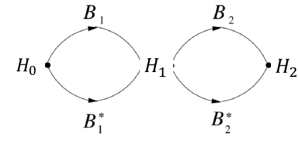
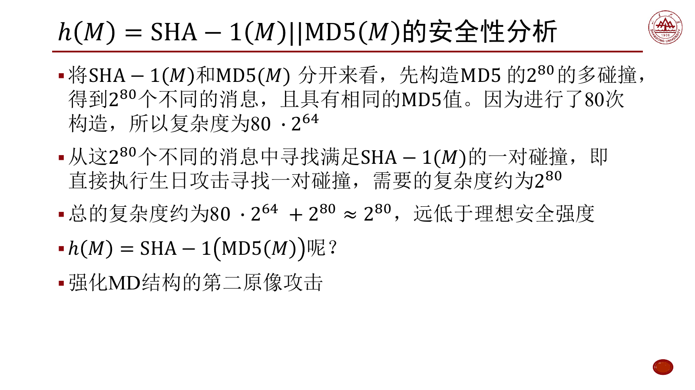
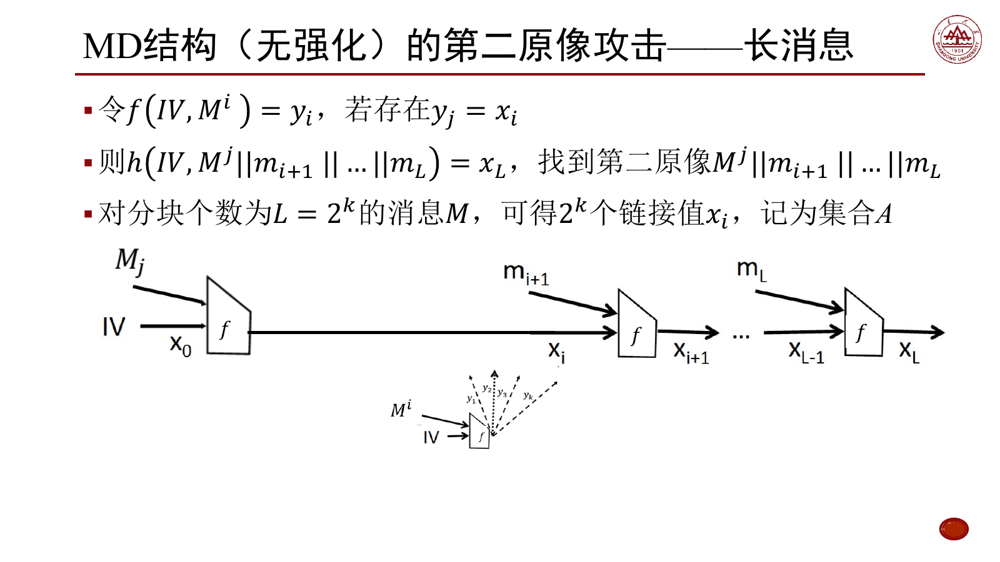
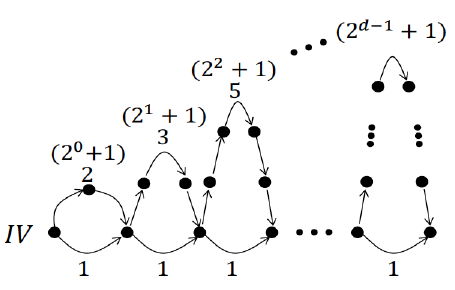
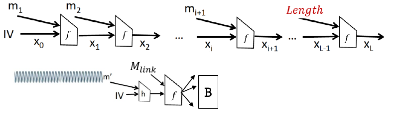

# MD 结构的第二原像攻击

给定消息 $M$，第二原像攻击要找到 **不同的消息** $M'\ne M$，使 $h(M')=h(M)$。攻击者不能自己任选两条消息，因此它与寻找任意一对碰撞不同。对理想 $n$ 位杂凑函数，通常需要约 $2^n$ 次试验才能找到给定消息的第二原像。

本节利用 Merkle–Damgård（MD）迭代结构分析**长消息**。下面用 $f$ 表示压缩函数，链接值为 $n$ 位，消息分组为 $b$ 位：

$$
H_0=IV,\qquad H_i=f(H_{i-1},M_i).
$$

每次迭代只取决于当前链接值和当前分组。一旦两条计算路径到达同一链接值，之后输入完全相同的分组时，状态就会一直相同。**相同的后续处理包括相同的填充及长度编码。**

可以把攻击想成先找到一条不同的路径，让它在某个中间状态与目标路径汇合；汇合后再走相同的后缀。攻击需要回答三个问题：**怎样到达同一状态、怎样控制消息长度、需要多少次压缩计算**。

## 先理解多碰撞

从相同状态 $H_0$ 找到两个不同分组 $B_1,B_1^*$，使其输出都为 $H_1$；再从 $H_1$ 找到两个分组 $B_2,B_2^*$，使其输出都为 $H_2$。两级各选一种，共得到四个等长消息，都到达 $H_2$：



图来自第 12.2 节课件第 4 页。以此类推，找到 $t$ 级独立的分组碰撞即可组合出 $2^t$ 条消息。若每级压缩函数碰撞采用生日搜索，工作量约为 $t2^{n/2}$ 次压缩计算，而非分别生成 $2^t$ 条消息所需的计算量。这些消息等长，追加相同填充后即可得到完整杂凑函数的多碰撞。

### 为什么两个两碰撞可以组成四碰撞？

第一级从同一个 $H_0$ 出发，找到两个不同的分组 $B_1,B_1^*$：

$$
f(H_0,B_1)=f(H_0,B_1^*)=H_1.
$$

第二级只需要从同一个 $H_1$ 再找一对 $B_2,B_2^*$，使它们都到达 $H_2$。因此下列四条消息都走到 $H_2$：

$$
B_1\parallel B_2,\quad B_1\parallel B_2^*,\quad
B_1^*\parallel B_2,\quad B_1^*\parallel B_2^*.
$$

每一级的两种选择都能与其他级组合：$t$ 级就有 $2^t$ 种等长路径。每一级只需做一次普通碰撞搜索；链值是 $n$ 比特时，每次搜索约 $2^{n/2}$ 次压缩计算，故 $t$ 级总共约 $t2^{n/2}$ 次。

这里 $t2^{n/2}$ 是**构造可组合路径的成本**；如果要求逐条输出全部 $2^t$ 条消息，输出本身还需要相应的时间和空间。

## 应用：SHA-1 和 MD5 拼接的碰撞




设

$$
h(M)=\operatorname{SHA1}(M)\parallel\operatorname{MD5}(M).
$$

要找到 $M\ne M'$ 使 $h(M)=h(M')$，两部分都必须相同：

$$
\operatorname{SHA1}(M)=\operatorname{SHA1}(M'),\qquad
\operatorname{MD5}(M)=\operatorname{MD5}(M').
$$

课件的思路是：**先构造一大批 MD5 相同的消息，再在这批消息中找 SHA-1 碰撞。**

### 第一步：构造 $2^{80}$ 条 MD5 多碰撞消息

MD5 的链值为 128 位。利用上一节的逐级构造，在第 $i$ 级从同一个链值 $H_{i-1}$ 出发，找两个不同消息块 $B_i,B_i^*$，使

$$
f(H_{i-1},B_i)=f(H_{i-1},B_i^*)=H_i.
$$

做 80 级，每一级二选一，可以组合成 $2^{80}$ 条不同的 80 块消息。它们经过所有消息块后到达同一个 MD5 链值，且长度相同，最终填充也相同，所以最终 MD5 值都相等。

采用生日搜索估算，每一级碰撞约需 $2^{128/2}=2^{64}$ 次 MD5 压缩函数计算，80 级的构造成本约为

$$
80\cdot2^{64}.
$$

保存每一级的两个块，就能用 80 次二选一描述全部 $2^{80}$ 条消息；这个数是**多碰撞结构的构造成本**。下一步仍要读取或生成候选消息并计算 SHA-1。

### 第二步：在这些消息中搜索 SHA-1 碰撞

对多碰撞中的消息计算 SHA-1，寻找两个相同输出。SHA-1 摘要为 160 位，生日攻击所需的候选数约为

$$
2^{160/2}=2^{80}.
$$

找到不同消息 $M_i,M_j$ 满足 $\operatorname{SHA1}(M_i)=\operatorname{SHA1}(M_j)$ 时，它们已经具有相同 MD5 值，因此

$$
h(M_i)=h(M_j).
$$

在 SHA-1 输出近似独立均匀的模型下，检查 $2^{80}$ 条消息至少出现一次碰撞的概率约为 $1-e^{-1/2}\approx39.3\%$。没有命中时可以增加碰撞级数、扩大候选集合；例如 81 级提供 $2^{81}$ 条候选，对应的概率约为 $1-e^{-2}\approx86.5\%$。

### 第三步：合计时间与存储

课件分别按 MD5 压缩函数计算和 SHA-1 完整消息求值计数：

$$
80\cdot2^{64}+2^{80}\approx2^{80}.
$$

这里 $80\cdot2^{64}\approx2^{70.32}$，因此 SHA-1 搜索是主项。直接存表搜索需要约 $2^{80}$ 条 SHA-1 摘要及对应消息选择信息，并需要相应的表操作。

两项的**单位不同**：每条候选消息由 80 个分组构成。如果每条 SHA-1 都从头计算，约需 $80\cdot2^{80}$ 次分组压缩；按二叉路径遍历并复用共同前缀的 SHA-1 状态，可以把处理所有候选的压缩调用压到 $O(2^{80})$ 量级。最终仍须处理搜索到的候选和查表。

### 与理想杂凑及嵌套构造对比

拼接输出长度为 $160+128=288$ 位。一个理想的 288 位随机杂凑函数，普通生日碰撞工作量约为 $2^{144}$；课件的结构攻击量级约为 $2^{80}$。

如果改为嵌套构造

$$
g(M)=\operatorname{SHA1}(\operatorname{MD5}(M)),
$$

只要找到 $\operatorname{MD5}(M)=\operatorname{MD5}(M')$，外层 SHA-1 的输入相同，输出必然相同。因此按 MD5 的通用生日估计，约 $2^{64}$ 次 MD5 求值就能找到 $g$ 的碰撞。

| 构造 | 要得到碰撞 | 课件的通用生日模型 |
| --- | --- | --- |
| $\operatorname{SHA1}(M)\parallel\operatorname{MD5}(M)$ | 两种摘要同时相同 | MD5 多碰撞加 SHA-1 搜索，约 $2^{80}$ 量级 |
| $\operatorname{SHA1}(\operatorname{MD5}(M))$ | 内层 MD5 相同即可 | 约 $2^{64}$ 次 MD5 求值 |
| 理想 288 位杂凑 | 找任意一对相同输出 | 约 $2^{144}$ 次求值 |

这些是课件用于比较结构的通用生日模型，计算单位与概率按上面说明；MD5 和 SHA-1 的具体结构还可用于设计专门攻击。

## 没有长度强化时：利用多个目标中间值

这类攻击针对一条**已给定的长消息** $M$，寻找 $M'\ne M$ 使 $h(M')=h(M)$。思路是先让新消息到达原消息的某个**中间链值**，再接上原消息对应的后缀。



*图源：《第12.2节 第二原像攻击》，第 7 页。*

### 1. 课件中的符号与原消息路径

把原消息分为 $L$ 个分组：

$$
M=m_1\parallel m_2\parallel\cdots\parallel m_L.
$$

原消息的每一步由压缩函数计算：

$$
x_0=IV,\qquad x_i=f(x_{i-1},m_i),\qquad i=1,\ldots,L.
$$

| 符号 | 含义 |
| --- | --- |
| $m_i$ | 已给定消息 $M$ 的第 $i$ 个分组 |
| $x_i$ | 从 $IV$ 开始处理完 $m_i$ 后的中间链值 |
| $M^j$ | 攻击者试验的第 $j$ 个**候选分组**；上标只是编号 |
| $y_j$ | 候选分组的输出 $f(IV,M^j)$ |
| $i,j$ | $i$ 是原路径中的位置，$j$ 是候选分组编号 |
| $x_L$ | 原路径处理到最后的链值 |

原消息与压缩函数都是已知的，所以可以从 $IV$ 自己算出每个 $x_i$。课件图中的 $M_j$ 与式子的 $M^j$ 都表示候选分组；下文统一写 $B$。

```text
原消息路径：

        m₁        m₂                      mᵢ       mᵢ₊₁            mL
         ↓         ↓                       ↓          ↓               ↓
IV ───→ f ──→ x₁ ──→ f ──→ x₂ ──→ ... ──→ xᵢ ─────→ ... ──────────→ xL
```

下文用课件的模型：对完整分组计算迭代值；若另有末尾处理，两条消息采用相同的后续填充分组。$x_L$ 表示处理到该共同终点的状态。

### 2. 找到一个连接点，再接原消息的后缀

不断选新的候选分组 $B$，从 $IV$ 计算

$$
y=f(IV,B).
$$

只要某次命中原路径的一个状态，即

$$
f(IV,B)=x_i,
$$

就可以把 $B$ 接到原消息 $x_i$ 后面的分组之前：

$$
\boxed{M'=B\parallel m_{i+1}\parallel\cdots\parallel m_L.}
$$

```text
原消息：IV ── m₁ ── ... ── mᵢ ──→ xᵢ ── mᵢ₊₁ ── ... ── mL ──→ xL
                                      ↑
新消息：IV ────────── B ──────────────┘
```

为什么之后一定一样？两条路径进入后缀时状态同为 $x_i$，下一块同为 $m_{i+1}$，所以都算出

$$
f(x_i,m_{i+1})=x_{i+1}.
$$

继续处理相同的后缀，状态依次都为 $x_{i+2},\ldots,x_L$。最后检查 $M'\ne M$，并对两条完整消息计算杂凑值验证。

**具体例子：** $M$ 有 8 个分组，试出 $f(IV,B)=x_5$，则

$$
M'=B\parallel m_6\parallel m_7\parallel m_8.
$$

原消息处理 5 块到 $x_5$；新消息处理一块 $B$ 就到 $x_5$。之后两边同样处理 $m_6,m_7,m_8$。新消息共 4 块，原消息 8 块，因而二者不同。若命中第一个状态，需排除 $B=m_1$ 这种得到原消息本身的平凡情况。

### 3. 为什么长消息会减少搜索？

设链值为 $n$ 比特，共有 $2^n$ 种可能状态。如果只指定要命中一个 $x_i$，一次随机试验的成功概率约为 $2^{-n}$。

长消息给出了很多可用的目标：

$$
A=\{x_1,x_2,\ldots,x_L\}.
$$

只要 $y=f(IV,B)$ 命中其中**任意一个**，就可以接相应后缀。设 $A$ 中有 $D$ 个不同且可用的状态，随机输出模型下，一次试验的命中概率是

$$
p=\frac{D}{2^n}.
$$

课件取 $L=2^k$，并按约有 $D=2^k$ 个不同目标估计：

$$
p\approx\frac{2^k}{2^n}=2^{k-n},\qquad
\text{期望试验次数}\approx\frac1p=2^{n-k}.
$$

若原路径中状态重复，按不同的可用状态数 $D$ 计算。搜索需要足够多可用的候选分组；若一次命中只产生原消息本身，就继续寻找非平凡命中。

**数字例子：** $n=16$、$k=4$，目标消息有 $L=2^4=16$ 个分组。假设它提供 16 个不同可用状态，则一次试验的命中概率为 $16/2^{16}=1/4096=2^{-12}$，期望约试 $2^{12}=4096$ 个候选分组。

“期望 4096 次”是平均工作量。在独立试验近似下，试 $q$ 次至少命中一次的概率为 $1-(1-p)^q$；取 $q\approx1/p$ 时约为 $1-e^{-1}\approx63.2\%$。若仍未命中，就继续试验。

### 4. 把算法和复杂度对应起来

1. **计算目标路径：** 顺序处理 $M$ 的 $L=2^k$ 个分组，得到并保存各个 $x_i$ 和对应位置 $i$。
2. **试验候选块：** 选一个 $B$，计算 $y=f(IV,B)$。
3. **查目标表：** 若 $y=x_i$，取出该位置；否则继续试其他候选块。
4. **构造并验证：** 输出 $B\parallel m_{i+1}\parallel\cdots\parallel m_L$，确认它与 $M$ 不同且最终摘要相同。

使用散列表时，每次查找的期望成本为常数。课件按压缩函数计算量估计：

| 阶段 | 工作量级 | 作用 |
| --- | --- | --- |
| 读取消息并建状态表 | $2^k$ | 计算原路径的中间状态 |
| 搜索连接块 | $2^{n-k}$ | 从 $IV$ 出发，命中任一可用状态 |
| 存储 | $2^k$ 项 | 保存状态及它们在原消息中的位置 |

因此总时间量级为

$$
T\approx2^k+2^{n-k}\approx\max(2^k,2^{n-k}).
$$

当 $k=n/2$ 时，两项都为 $2^{n/2}$。这是**长消息给出多个目标的一对多匹配**，不是从两批随机结果中各取一项的普通生日碰撞。

### 5. 为什么长度强化会挡住直接拼接？

如果命中 $x_i$，原消息有 $L$ 块，新消息有 $1+L-i$ 块。以 8 块的例子为例，原消息 8 块、新消息 4 块。

两条计算在 $x_i$ 汇合后，虽然使用相同的消息后缀，长度强化还会把**原消息长度**写进最终填充。原消息和新消息的长度不同，末尾长度编码就不同，因此不能仅凭中间链值相同断言最终摘要相同。

下面的**可扩展消息**就是解决方法：构造一组不同长度、却能到达同一中间链值的前缀；桥接时选取合适长度，使新消息和原消息的总长度对齐，再接相同后缀和填充。

## MD 强化与可扩展消息

MD 强化将原始消息长度编码进填充，确保不同长度的消息在末尾处理的分组不同。课件示例采用“先补零，再附加长度分组”的规则。攻击可以通过构造**可扩展消息**对齐长度。

可扩展消息是一族不同长度的分组序列，它们从同一初始状态出发，处理完各自分组后到达同一个**中间链接值**。攻击先接上桥接分组和后缀，使整个消息长度一致，再处理相同的 MD 强化填充。

构造方法：在第 $j$ 级，找到从当前状态出发、分别长为 1 和 $1+2^j$ 个分组的两条路径，使它们的终点相同，其中 $j=0,1,\ldots,d-1$。每级独立选短路径或长路径，最终得到长度覆盖

$$
d,\ d+1,\ \ldots,\ d+2^d-1
$$

的 $2^d$ 条路径，且全部到达同一状态 $H_\mathrm{exp}$。长路径可先走 $2^j$ 个固定分组，再与短路径做一次跨两组候选的生日碰撞搜索。各级的碰撞搜索约需 $d2^{n/2}$ 次压缩计算；构造长路径还需约 $2^d$ 次计算。



图来自第 12.2 节课件第 11 页。不同级选择的长短之差分别是 $1,2,4,\ldots$，其二进制组合覆盖所需的每一种长度。

### 一层可扩展路径怎样构造？

从某个共同状态 $G_j$ 出发，第 $j$ 级安排两条路径：

1. **短路径：** 枚举不同单分组 $B$，计算 $f(G_j,B)$，短路径长度为 1 块。
2. **长路径：** 先从 $G_j$ 固定走 $2^j$ 块，得到状态 $Q_j$；再枚举末尾分组 $B'$，计算 $f(Q_j,B')$，长路径长度为 $2^j+1$ 块。
3. 用生日式匹配寻找 $f(G_j,B)=f(Q_j,B')=G_{j+1}$。从 $G_j$ 选择短路径或长路径，最终都会到达同一个 $G_{j+1}$。

两侧各枚举约 $2^{n/2}$ 个末尾块，就有常数概率让两侧 $n$ 比特输出相遇。每一级重复这一过程，从而把不同长度的路径一层层拼接起来。

### 3 级例子：怎样得到 3 至 10 块？

取 $d=3$，三层的短路径都为 1 块，长短路径的长度差依次为 $1,2,4$ 块：

| 级数 | 短路径 | 长路径 | 选择长路径多出的块数 |
| --- | --- | --- | --- |
| $j=0$ | 1 | 2 | 1 |
| $j=1$ | 1 | 3 | 2 |
| $j=2$ | 1 | 5 | 4 |

三层全选短路径时长度为 3 块；每层选择长路径，相当于在 3 块的基础上分别加 $1,2,4$。这些增量的组合覆盖 $0$ 到 $7$，因此得到所有 $3,4,\ldots,10$ 块的路径，而且终点都是 $H_{\mathrm{exp}}$。

例如要选出 7 块，写成 $7=3+4$：前两级选短路径，最后一级选长路径，长度是 $1+1+5=7$ 块。路径长度不同，终点相同；此时它们是**中间状态相同**，尚未各自完成最终长度填充。

## 强化 MD 的长消息第二原像

设目标消息足够长，提供约 $2^d$ 个可用于接入的连续目标中间状态。其核心步骤：

1. 构造上面的可扩展消息，得到共同终点 $H_\mathrm{exp}$。
2. 枚举桥接分组 $B$，计算 $f(H_\mathrm{exp},B)$，直到命中目标的某个状态 $H_i$。约 $2^d$ 个目标下，随机模型中需要约 $2^{n-d}$ 次桥接尝试。
3. 因为桥接之后要与目标第 $i$ 块后的位置对齐，选择长度恰为 $i-1$ 块的可扩展前缀，再接 $B$ 与目标的后缀 $M_{i+1}\|\cdots\|M_L$。
4. 新旧消息分组总长度一致，后续填充也一致；验证新消息与目标不同，即得到第二原像。



例如可选择 $i=d+1,\ldots,d+2^d$ 的状态，以保证 $i-1$ 在可扩展前缀的长度范围内。课件采用目标长度达到约 $2^d+d+1$ 块的条件；目标必须具有对应的有效后缀和相同的消息长度编码。

### 数值例子：命中 $H_8$ 后怎样接？

设目标消息有 20 块，使用上面的 3 级可扩展消息，长度可选 3 至 10 块。若找到桥接块 $B$，使

$$
f(H_{\mathrm{exp}},B)=H_8,
$$

则需选 **7 块**前缀：前缀 7 块加上桥接块 1 块，恰好与原消息处理到 $H_8$ 时的 8 块对齐。然后接原消息第 9 至第 20 块：

$$
M'=\underbrace{P_7}_{7\text{ 块}}\parallel
\underbrace{B}_{1\text{ 块}}\parallel
\underbrace{M_9\parallel\cdots\parallel M_{20}}_{12\text{ 块}}.
$$

新消息总长 $7+1+12=20$ 块，与目标相同。两条路径到达 $H_8$ 后输入相同后缀，最终还使用同样的长度填充。若桥接命中 $H_2$，则需要 1 块可扩展前缀，但 1 不在 3 至 10 的范围中，不能按此拼接。

在理想压缩函数和充足消息空间的模型下，课件的总工作量约为

$$
d2^{n/2}+2^{n-d}+2^d.
$$

第一项来自构造各级碰撞，第二项来自桥接搜索，第三项包括长路径构造与目标状态处理的量级；还需存储目标状态表。该式计的是压缩函数计算，具体常数和存储方案依实现而异。当 $d=n/2$ 时，量级为 $n2^{n/2}$，即与生日搜索有相同的主指数，但仍多一个线性因子，且要求约 $2^{n/2}$ 块的极长目标消息。

把三项拆开记：$d$ 级各做约 $2^{n/2}$ 次碰撞搜索，得到 $d2^{n/2}$；约 $2^d$ 个目标状态让桥接尝试减少到 $2^{n-d}$；构造长路径、扫描目标消息还需约 $2^d$ 次。这里的单位是**压缩函数调用**，同时要存储可桥接的目标状态及其位置。

## 固定点构造

对于 Davies–Meyer 形式 $f(h,m)=E_m(h)\oplus h$，给定分组 $m$，可计算

$$
h=E_m^{-1}(0),\qquad f(h,m)=0\oplus h=h.
$$

这使 $h$ 成为该消息分组下的固定点：在此状态重复处理 $m$ 不改变链接值，从而可用不同重复次数调节路径长度。它需要压缩函数具有上述结构，并且相应分组密码可在给定密钥下求逆；不能假定任意压缩函数都有同样容易求得的固定点。

例如到达 $h$ 后，可以选择输入 1 次、2 次或更多次同一个 $m$，每次都仍然停在 $h$。找到固定点后，仍需构造一条从所需起点到达这个 $h$ 的路径，才能把它用于完整攻击。

## 考前快速对照

| 问题 | 关键点 |
| --- | --- |
| 第二原像与碰撞的区别？ | 目标消息已给定；碰撞的两条消息都可选择 |
| 多碰撞为什么能组合？ | 每一级的两条等长路径汇合到共同链值，选择可独立组合 |
| 长消息为什么有利于桥接？ | 存在多个可接入的中间状态，一次尝试命中任一个即可 |
| 为什么需要可扩展消息？ | 桥接后对齐目标路径所在位置，使总长度与最终填充一致 |
| 命中 $H_i$ 应选多长前缀？ | 选 $i-1$ 块，再接 1 块桥接和从 $M_{i+1}$ 开始的后缀 |

## 资料

- 课程课件《第 12.2 节 第二原像攻击》，第 2–13 页。
- 相关笔记：[杂凑函数](杂凑函数.md)、[生日攻击与广义生日攻击](生日攻击与广义生日攻击.md)。
