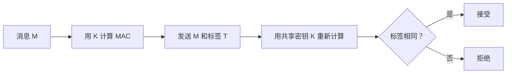
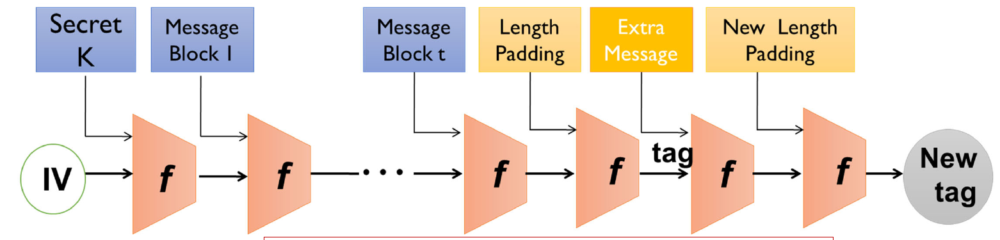
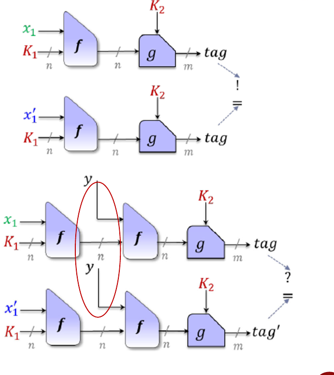
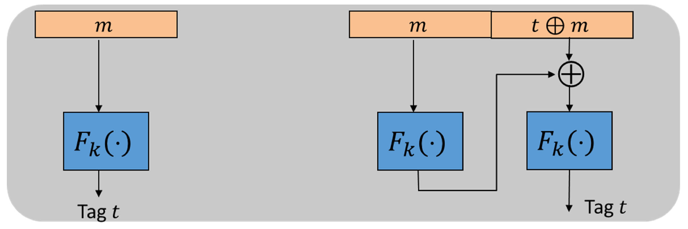
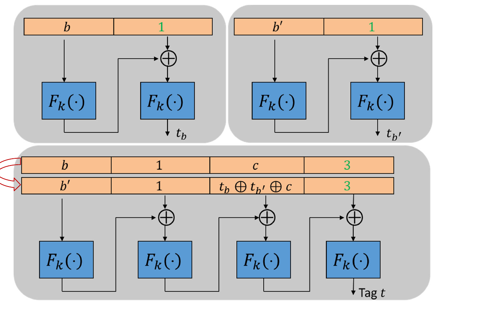

# 消息认证码

## 功能与安全属性

消息认证码（MAC）由共享秘密密钥的通信双方使用：发送方计算 $T=\operatorname{MAC}_K(M)$ 并发送 $(M,T)$，接收方用 $K$ 验证标签是否正确。它提供**消息完整性和来源认证**，可以基于分组密码或杂凑函数构造。

### 一次认证的流程

1. 双方事先共享密钥 $K$。发送方对消息 $M$ 计算标签 $T=\operatorname{MAC}_K(M)$。
2. 发送方发送 $(M,T)$；消息可以公开，密钥不能公开。
3. 接收方根据收到的消息计算 $T'=\operatorname{MAC}_K(M)$，比较 $T'$ 和收到的 $T$。相同则接受，不同则拒绝。

与普通杂凑值的区别：公开的 $H(M)$ 任何人都能计算；MAC 的标签依赖秘密密钥，攻击者修改消息后不能直接重算有效标签。这就是 MAC 可以用于认证的原因。

MAC 本身不提供保密性；持有同一个密钥的任何一方都能生成标签，所以它也不提供数字签名意义上的不可否认性。重放一个先前有效的消息和标签仍会通过验证，必须结合序号、随机数或时间戳等协议机制处理重放。

## 攻击手段与目标

- **已知消息攻击**：被动观察消息及其标签。
- **选择消息攻击**：主动向 MAC 接口查询所选消息的标签；自适应攻击可根据之前的结果选择后续消息。
- **区分攻击**：判断黑盒实现是目标 MAC 还是某个理想对象，例如随机函数。
- **恢复密钥**：求出可以用于生成有效标签的密钥。
- **伪造**：输出一个满足 $\operatorname{Vrfy}_K(M^*,T^*)=1$ 的新消息—标签对。标准存在性不可伪造模型要求 $M^*$ 没有被用于查询生成标签。

课件按攻击者能达到的目标由强到弱介绍：

1. **恢复密钥**：取得密钥后，可对任意消息生成标签。
2. **通用伪造**：无需恢复密钥，就能对任意指定的新消息生成有效标签。
3. **选择性伪造**：在获取查询结果前指定目标消息，再为它生成有效标签。
4. **存在性伪造**：构造至少一条新消息及其有效标签，消息的内容可由攻击者决定。

选择消息下的存在性不可伪造（EUF-CMA）要求有效率的攻击者即使可以查询所选消息的标签，也不能以显著概率完成上述存在性伪造。这是常用的 MAC 安全目标。

### 三类伪造怎么区分？

| 攻击结果 | 目标消息何时或由谁确定？ | 攻击者要完成什么？ |
| --- | --- | --- |
| 通用伪造 | 任意指定的一条新消息 | 能为指定消息产生有效标签 |
| 选择性伪造 | 查询标签前先选定一条目标消息 | 为这条事先选定的消息产生有效标签 |
| 存在性伪造 | 攻击者自行构造至少一条新消息 | 为其中一条新消息产生有效标签 |

例如攻击者能为任何新转账指令生成标签，属于通用伪造；先选定一条转账指令，再为它生成标签，是选择性伪造；只需构造出一条没查过标签、能通过验证的消息，即是存在性伪造。

**“新消息”指什么？** 攻击者查询过 $M_1,\ldots,M_q$ 的标签后，输出 $(M^*,T^*)$；成功要满足 $M^*\notin\{M_1,\ldots,M_q\}$ 且验证通过。把查询过的 $(M_i,T_i)$ 原样再发一遍是重放，不是这里定义的新消息伪造。

## 通用攻击与实现问题

设标签有 $t$ 位、密钥有 $k$ 位。对理想的 $t$ 位标签，盲猜一次的成功概率是 $2^{-t}$；若各次尝试独立且成功概率很小，$q$ 次在线验证尝试的成功概率约为 $q/2^t$。穷举标签的工作量量级为 $2^t$，但需要验证接口；协议中的限速和失败次数限制影响实际可尝试次数。

穷举 $k$ 位密钥需要约 $2^k$ 次离线计算：逐一试算候选密钥，用多组已知消息—标签对排除错误匹配。课件用 $\min(2^t,2^k)$ 概括通用攻击的量级，其中标签猜测计在线验证次数，密钥穷举计离线计算次数。

课件建议使用 128 位标签。验证时还应使用恒定时间的标签比较，避免因为逐字节比较的耗时差异泄露正确标签的信息。

**例：** 标签长 $t=64$ 比特，独立盲猜一次成功率为 $2^{-64}$；若允许约 $2^{20}$ 次独立验证机会，至少成功一次的概率近似为 $2^{20}/2^{64}=2^{-44}$。这里计算的是**在线标签猜测**次数，不是离线哈希或加密次数。

## 基于 Merkle–Damgård 结构的简单 MAC

Merkle–Damgård（MD）杂凑函数把消息分组迭代压缩，并进行包含消息长度的末尾填充。下面分析三种简单密钥拼接构造，攻击利用其**迭代链值**的性质。

### 密钥前缀：长度扩展伪造

课件的密钥前缀形式为 $\operatorname{MAC}_K(M)=h(K\|\operatorname{pad}_K\|M)$，其中 $\operatorname{pad}_K$ 表示密钥部分按构造需要使用的填充。也常见直接写作 $h(K\|M)$；下文将密钥和可能存在的密钥填充统一记为 $P$。

当输出的完整标签就是 MD 最终链值，且攻击者知道或猜对 $|P|$ 时：

1. 查询 $M$ 的标签 $T=h(P\|M)$。
2. 按 $|P\|M|$ 算出该次杂凑的末尾填充 $\operatorname{pad}(P\|M)$。
3. 把 $T$ 当作已处理过 $P\|M\|\operatorname{pad}(P\|M)$ 的链值，继续处理自选后缀 $S$，得到 $T^*$。
4. 输出新消息 $M^*=M\|\operatorname{pad}(P\|M)\|S$ 和 $T^*$，验证方计算 $h(P\|M^*)$，结果相同。

为什么第 3 步能够继续？原标签已经是 $P\|M$ **连同原填充**处理完后的内部链值；压缩函数只需要当前链值和后续分组。因此攻击者把 $T$ 作为起始链值，继续输入 $S$，并按已经处理的总长度补上新的最终填充。

用等式写出验证方实际计算的内容：

$$
\begin{aligned}
M^*&=M\|\operatorname{pad}(P\|M)\|S,\\
T^*&=h\bigl(P\|M\|\operatorname{pad}(P\|M)\|S\bigr)
    =h(P\|M^*).
\end{aligned}
$$

新消息里含有**原消息的填充**，因此不是直接把标签当成 $h(P\|M\|S)$。攻击过程中始终没有求出秘密密钥。

*课件第 8 页：获得原标签后，从该链值继续处理后缀。*

密钥长度未知时，逐一测试候选长度。上述构造要求应用接受含填充字节的消息；选择目标消息发生在查询之前时，还可构成课件所说的选择性伪造。

课件还给出区分攻击：对约 $2^{n/2}$ 个同长度消息查询 $n$ 位完整标签，按生日现象找一对标签碰撞；给两个消息加相同的 MD 填充和相同后缀后，前缀 MAC 的新标签仍相同。对于随机函数，不同新消息的标签再次碰撞的概率约为 $2^{-n}$。这里 $2^{n/2}$ 是**在线标签查询**量级，结论依赖完整链值可见、填充长度可确定及消息编码允许扩展。

### 密钥后缀：利用消息内部碰撞

密钥后缀形式为 $\operatorname{MAC}_K(M)=h(M\|K)$。它不受上面那种直接长度扩展伪造方式的影响，但如果能离线找到**等长、分组对齐的不同消息** $M,M'$，使处理完各自消息部分的内部链值相同，那么后续追加的 $K$ 及最终填充也相同，因此：

$$
\operatorname{MAC}_K(M)=\operatorname{MAC}_K(M').
$$

攻击者先离线找到这对消息，预先选 $M'$ 为伪造目标，再在线查询 $M$ 的标签 $T$，即可输出 $(M',T)$。在内部链值为 $n$ 位且可构造足够多候选消息的理想生日模型下，找碰撞约需 $2^{n/2}$ 次**离线**压缩或杂凑量级的工作，之后只需一次在线 MAC 查询。

在密钥加入前取得**链值碰撞**，并保持长度与分组边界一致，就有 $h(M\|K)=h(M'\|K)$。

把这个伪造拆成时间顺序：先在离线阶段构造 $M,M'$，使两者经过各自消息部分后链值都为 $H$；在线查询 $M$ 得到标签 $T$；由于两条路径从相同的 $H$ 接上相同 $K$ 和填充，$M'$ 的标签也为 $T$。因此输出 $(M',T)$，无需查询 $M'$。

### 密钥封装：内部碰撞与外部碰撞

课件还讨论示意构造 $h(K\|M\|K)$，将消息部分的迭代与最后的密钥处理抽象为 $f$ 和 $g$。**内部碰撞**指进入最后处理 $g$ 前的链值相同；**外部碰撞**只指最终标签相同。

对第一消息块 $x,x'$，若已知 $f(K_1,x)=f(K_1,x')$，那么附加同样的新后缀 $y$ 后两条计算的后续状态与标签仍相同。查询 $x\|y$ 的标签 $T$，就可用 $(x'\|y,T)$ 伪造，前提是后者尚未被查询。已知一对内部碰撞之后只需这一次查询；寻找碰撞的成本需要另算。

当末端 $g$ 对内部状态是置换时，最终标签相同意味着内部状态相同；如果 $g$ 把 $n$ 位状态压缩到 $m<n$ 位，观察到的标签碰撞也可能只是外部碰撞。可以对碰撞候选附加同一后缀并查询两个新标签：内部碰撞必然继续碰撞，而非内部碰撞在理想随机模型下再次碰撞的概率约为 $2^{-m}$。筛选已用过的消息不能再作为新消息伪造，可换一个尚未查询的后缀。

| 现象 | 中间链值 | 最终标签 | 接同一后缀后的结果 |
| --- | --- | --- | --- |
| 内部碰撞 | 相同 | 相同 | 后续状态继续相同，标签仍相同 |
| 外部碰撞 | 不一定相同 | 相同 | 不能仅凭原标签相同断言新标签相同 |

关键区别是：**内部碰撞保证后续处理从同一状态开始；外部碰撞只说明最后输出相等。**

*课件第 12 页：比较附加相同后缀前后的标签，辅助识别内部碰撞。*

课件在生日搜索与在线碰撞筛选模型下得到 $O(2^{n/2})$ 的复杂度；总成本包括寻找碰撞和筛选内部碰撞。HMAC 使用不同的内外层密钥填充值，结构见下节。

### HMAC 的内外两层

HMAC 的结构为

$$
\operatorname{HMAC}_K(M)
=H\bigl((K_0\oplus\mathrm{opad})\parallel
H((K_0\oplus\mathrm{ipad})\parallel M)\bigr).
$$

其中 $K_0$ 是处理到杂凑函数分组长度的密钥，$\mathrm{ipad},\mathrm{opad}$ 是两种固定填充值。先计算内层摘要，再用另一种密钥填充计算外层摘要。最终标签是外层结果，不是简单前缀 $H(K\parallel M)$ 的内部链值，因此上面的直接长度扩展伪造不能照搬。

## 基于分组密码：CBC-MAC / DAA

课件中的 DAA 采用 CBC 链式处理。对固定长度的完整分组消息 $M=m_1\|\cdots\|m_\ell$，令 $c_0=0$，并计算：

$$
c_i=E_K(c_{i-1}\oplus m_i),\qquad T=c_\ell.
$$

在标准安全模型中，基本 CBC-MAC 面向**固定且预先约定的消息长度**；如果直接允许不同长度，将出现伪造。

### 按分组计算示例

对三分组消息 $M=m_1\|m_2\|m_3$，链值依次为

$$
\begin{aligned}
c_1&=E_K(m_1),\\
c_2&=E_K(c_1\oplus m_2),\\
c_3&=E_K(c_2\oplus m_3),\qquad T=c_3.
\end{aligned}
$$

可以把每个 $c_i$ 看作处理完前 $i$ 个分组后的中间状态。最后的状态作为标签；同一个密钥、同一个中间状态再接相同后续分组，就会得到相同的后续状态。

### 可变长时的一次查询伪造

先查询单分组消息 $m$，得到 $t=E_K(m)$。然后构造两分组消息 $m\|(t\oplus m)$：第一轮输出 $t$，第二轮输入为 $t\oplus(t\oplus m)=m$，所以最终标签仍为 $t$。因此 $(m\|(t\oplus m),t)$ 是新消息的有效标签。

展开计算，验证方对伪造消息得到：

$$
\begin{aligned}
c_1&=E_K(m)=t,\\
c_2&=E_K\bigl(c_1\oplus(t\oplus m)\bigr)
    =E_K(m)=t.
\end{aligned}
$$

攻击者只查询过单分组 $m$，两分组消息 $m\|(t\oplus m)$ 是新消息；因此这是一次选择消息查询后的存在性伪造。

*课件第 15 页：两分组消息的第二轮输入与单分组消息的输入相同。*

### 处理变长消息

- **CMAC**：使用从主密钥派生的两个子密钥区分完整末块和需要填充的末块，最后再经过分组加密。按 [NIST SP 800-38B](https://csrc.nist.gov/pubs/sp/800/38/b/upd1/final)，非空消息的完整末块异或 $K_1$，不完整末块使用 `1` 后补 `0` 并异或 $K_2$；空消息也使用填充和 $K_2$。$K_1,K_2$ 从 $E_K(0^b)$ 通过有限域倍乘派生。课件第 16 页的子密钥公式有误，本节使用上述标准定义。
- **前缀消息长度**：把唯一编码的长度分组放在消息前，再进行 CBC-MAC。这样，不同长度的消息从第一分组起就被区分。
- **后缀消息长度**：仅在末尾追加长度并不足够。设单分组消息 $b,b'$ 的标签分别为 $t_b,t_{b'}$，即处理 $b\|1$ 与 $b'\|1$ 得到的链值。对任意分组 $c$，令 $c'=t_b\oplus t_{b'}\oplus c$，则三个消息分组 $b\|1\|c$ 与 $b'\|1\|c'$ 在处理第三分组时的输入相同，之后都追加相同长度编码 $3$，所以标签相同。查询前者标签即可伪造后者。

*课件第 18 页：两个三分组消息在末尾长度块之前合并到同一链值。*

前缀长度具体如何改变上面的攻击？单分组查询处理的是 $\operatorname{enc}(1)\|m$，两分组伪造处理的是 $\operatorname{enc}(2)\|m\|(t\oplus m)$。由于第一块就不同，不能再把单分组查询的标签 $t$ 当成伪造消息第一块后的链值，原来的等式失效。

## 考前对照

| 问题 | 应回答的关键点 |
| --- | --- |
| MAC 和普通杂凑有何区别？ | MAC 依赖共享密钥，提供完整性和来源认证 |
| 是否必须恢复密钥才能伪造？ | 不必；能对未查询的新消息生成有效标签即可 |
| 三类伪造怎样区分？ | 看能否处理任意目标、是否查询前指定目标，或只需找到一条新消息 |
| 前缀 MAC 长度扩展用到了什么？ | 完整输出链值、原填充及继续计算后缀 |
| CBC-MAC 可变长为什么可伪造？ | 利用已知标签构造下一分组，使新的分组密码输入重复 |
| 为什么 HMAC 与 $H(K\|M\|K)$ 不一样？ | HMAC 有分别使用 ipad 和 opad 的内外层结构 |

## 相关笔记

- [密码分析学概述](../01-基础与模型/密码分析学概述.md)
- [攻击思想](../01-基础与模型/攻击思想.md)
- [杂凑函数](../07-杂凑函数/杂凑函数.md)

来源：课程《第 13 章 消息认证码的安全性分析概述》，第 2–18 页；CMAC 标准细节见上方 NIST 文档。
