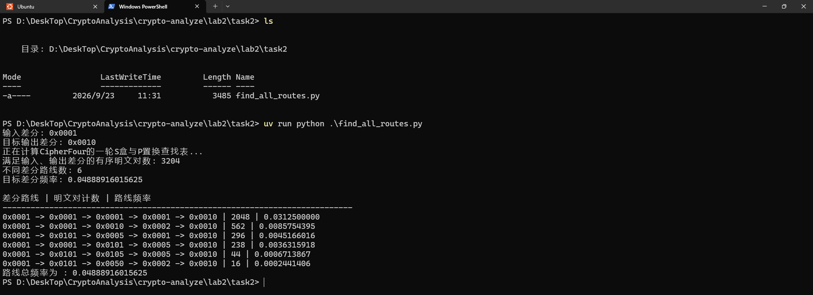
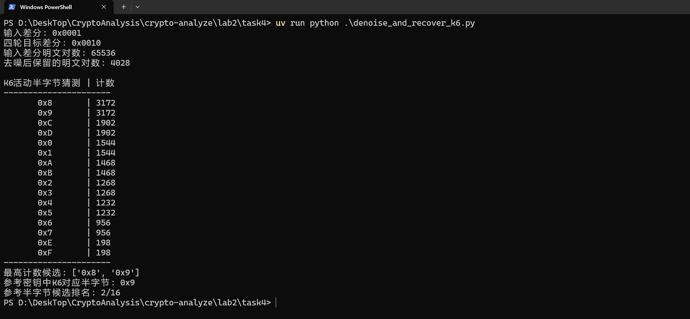

# 实验二：差分路径与密钥恢复

实验二把差分攻击串成了一条完整流程：**计算 DDT → 搜索路线与差分 → 验证固定密钥频率 → 筛选密文对 → 猜测末轮子密钥并计数**。最值得掌握的是每一步计算的对象，以及实验计数如何支持理论结论。

理论入口：[差分攻击](../../notes/03-差分分析/差分攻击.md) · [截断差分](../../notes/03-差分分析/截断差分.md) · [自动化区分器搜索](../../notes/09-自动化与拓展/自动化区分器搜索.md)

## 1. 从一个 S 盒开始：DDT 统计的是什么

实验使用 4 比特 S 盒，按输入 `0,…,F` 排列的输出为：

```text
S = [9, 8, 0, 1, E, B, C, D, 3, 2, 5, 7, F, A, 6, 4]
```

固定输入差分 $a$，遍历 $x\in\{0,\ldots,15\}$，统计

$$
b=S(x)\oplus S(x\oplus a).
$$

因此

$$
\operatorname{DDT}[a,b]
=\#\{x:S(x)\oplus S(x\oplus a)=b\},
\qquad
p(a\to b)=\frac{\operatorname{DDT}[a,b]}{16}.
$$

以 $a=1$ 为例，非零表项只有三个：

| 输出差分 $b$ | DDT 计数 | 概率 |
| --- | ---: | ---: |
| `1` | 8 | $1/2$ |
| `2` | 4 | $1/4$ |
| `5` | 4 | $1/4$ |

例如 $x=0$ 时，$S(0)\oplus S(1)=9\oplus8=1$。$x=1$ 又统计同一无序输入对的另一种顺序；DDT 的分母是全部 16 个 $x$，所以计数和分母的口径一致。

三个快速检查：每行计数之和为 16；$\operatorname{DDT}[0,0]=16$；非零输入差分的计数均为偶数，因为 $x$ 与 $x\oplus a$ 成对出现。

对应代码：[DDT.py](../../labs/lab2/task1/DDT.py)。

## 2. 最佳路线与最佳差分：程序到底取 max 还是求和

一个 16 比特差分包含四个半字节。四个 S 盒输出差分确定以后，先乘四个局部传播概率，再通过 P 置换得到下一轮差分。P 置换只搬动差分比特，不额外引入概率。

设一轮差分转移概率为 $R(u,v)$。两种搜索的核心区别是：

| 搜索目标 | 更新式 | 最终结果 |
| --- | --- | --- |
| 最佳单条路线 | $B_{r+1}(v)=\max_u B_r(u)R(u,v)$ | 一条具体中间差分序列 |
| 固定输入的差分分布 | $D_{r+1}(v)=\sum_u D_r(u)R(u,v)$ | 所有到达 $v$ 的路线概率之和 |

DDT 乘积模型对应独立均匀轮密钥下的平均差分传播概率。固定具体密钥时，实际频率由明文遍历得到。

### 2.1 一条路线的概率：沿途相乘

实验中的四轮路线

$$
\texttt{0001}\to\texttt{0001}\to\texttt{0001}
\to\texttt{0001}\to\texttt{0001}
$$

每轮概率均为 $1/2$，所以单条路线概率为

$$
p_{\mathrm{trail}}=(1/2)^4=1/16.
$$

而路线

$$
\texttt{0001}\to\texttt{0001}\to\texttt{0010}
\to\texttt{0002}\to\texttt{1001}
$$

四轮概率为 $1/2,1/4,1/2,3/8$，乘积是 $3/128$，不是 $2^{-5}$。原实验截图中整数化的对数显示会丢掉这个差别，计算题应保留真实乘积。

### 2.2 同一头尾差分：把路线贡献加起来

任务一选择的新四轮差分为

$$
\texttt{0001}\xrightarrow{4\text{轮}}\texttt{0010}.
$$

DDT 动态规划给出

$$
p_{\mathrm{DDT}}=0.0479736328125.
$$

任务二则遍历无轮密钥异或的四轮 SP 网络，即零轮密钥实例。它找到了 6 条实际出现的路线，共有 3204 个有序明文对命中，得到

$$
p_{K=0}=\frac{3204}{65536}=0.04888916015625.
$$

其中最多的一条是

$$
\texttt{0001}\to\texttt{0001}\to\texttt{0001}
\to\texttt{0001}\to\texttt{0010},
$$

计数为 2048，频率为 $2048/65536=1/32$。把六条路线的计数相加才得到 3204。



*图源：实验二任务二运行结果；这里的“路线频率”来自具体网络的明文遍历。*

对应代码：[最佳单条路线](../../labs/lab2/task1/find_best_route.py) · [差分概率求和](../../labs/lab2/task1/find_best_differential.py) · [实际路线枚举](../../labs/lab2/task2/find_all_routes.py)。

## 3. 密钥异或抵消，为什么不同密钥的频率还不同

一对状态使用相同密钥时，确实有

$$
(x\oplus k)\oplus(x'\oplus k)=x\oplus x'.
$$

但进入 S 盒的具体值变成了 $x\oplus k$ 与 $x'\oplus k$。第一轮后的值如何与后续轮的传播条件配合，会受到密钥影响。**差分不变，不等于每一对明文都沿原来的路线传播。**

任务三固定种子 `20261001`，生成五组轮密钥，每组都遍历全部 $2^{16}$ 个明文。目标仍是 `0001 → 0010`：

| 密钥组 | 命中有序对数 | 差分频率 |
| --- | ---: | ---: |
| 1 | 3144 | 0.0479736328 |
| 2 | 3124 | 0.0476684570 |
| 3 | 3120 | 0.0476074219 |
| 4 | 3196 | 0.0487670898 |
| 5 | 3018 | 0.0460510254 |
| 平均 | 3120.4 | 0.0476135254 |

这五组结果接近 DDT 模型的 $0.0479736328125$。由于每组已穷举全部明文，组间差异来自固定密钥下的真实传播差异，不是漏采明文造成的抽样误差。

对 16 比特随机置换，指定非零输出差分的平均概率为 $1/(2^{16}-1)$。约 $4.8\%$ 的目标差分显著高于这一基准，因此它可以作为四轮区分器。

对应代码：[五组密钥的全码本统计](../../labs/lab2/task3/test_differential_frequency.py)。

## 4. 从四轮区分器到五轮密钥恢复

### 4.1 先看最后一轮长什么样

统一将六个轮密钥记为 $K_0,\ldots,K_5$。前四轮都有 S 盒与 P 置换，第五轮没有 P 置换。记前四轮输出为 $U_4$，则

$$
C=S(U_4\oplus K_4)\oplus K_5.
$$

实验程序 `denoise_and_recover_k6.py` 按 $K_1,\ldots,K_6$ 编号；它的 `K6` 就是这里的末次白化密钥 $K_5$。

选择明文对 $P'=P\oplus\texttt{0001}$。四轮目标差分 `0010` 只有从左往右第 3 个半字节活跃，因此只猜这个位置的 4 比特白化密钥：

$$
h=(K_5\gg4)\mathbin{\&}\texttt{F}.
$$

其余三个位置的输入差分为零。对相同密文半字节，两次逆运算的差也恒为零，无法通过这个差分区分其密钥值。

### 4.2 去噪：在猜密钥之前筛掉明显错误的对

活跃 S 盒的输入差分是 `1`，查 DDT 得到输出差分只能是 `1、2、5`。于是正确对的最终密文差分必须满足

$$
C\oplus C'\in\{\texttt{0010},\texttt{0020},\texttt{0050}\}.
$$

其他密文对直接丢弃。通过筛选的对中仍有错误对，因为这些末轮输出差分也可以来自其他 S 盒输入差分。

实际码本包含 65536 个不同明文，配成 65536 个有序对；筛选后保留 **4028 个有序对**。去噪的作用是提高有效对比例，并减少后续的候选检验次数。

### 4.3 猜密钥：两边都先异或猜测，再过逆 S 盒

提取活跃密文半字节

$$
c=(C\gg4)\mathbin{\&}\texttt{F},\qquad
c'=(C'\gg4)\mathbin{\&}\texttt{F}.
$$

对每个 $h\in\{0,\ldots,15\}$ 检查

$$
S^{-1}(c\oplus h)\oplus S^{-1}(c'\oplus h)=1.
$$

成立就令候选 $h$ 的计数器加一。$K_4$ 在两边异或时抵消，因此不用猜它。



*图源：实验二任务四运行结果；图中采用从 1 开始的轮密钥编号。*

### 4.4 为什么 8 和 9 同分，而且增加同类数据也分不开

实测最高分为 3172，对应候选 $\{\texttt{8},\texttt{9}\}$。给定末次密钥为 `BA98`，目标半字节是 `9`。

原因是这个 S 盒满足如下判别对称性：

$$
S^{-1}(a)\oplus S^{-1}(b)=1
\iff
S^{-1}(a\oplus1)\oplus S^{-1}(b\oplus1)=1.
$$

因此对任意密文对，$h$ 与 $h\oplus1$ 的命中结果完全相同，所有候选都两两同分。这不是数据太少，而是当前差分方程只能区分 8 类候选。

**本实验把 16 个候选缩小为 2 个，获得了 3 比特的区分信息。** 要分开最后两个值，需要换用能够打破该对称性的差分条件，或结合其他密钥信息验证完整加密。

对应代码：[配对、去噪与半字节计数](../../labs/lab2/task4/denoise_and_recover_k6.py)。

## 5. 实验复杂度怎样算才不重复

设码本大小为 $N$，筛后有序对数为 $M$：

| 阶段 | 本实验的量 | 计算单位 |
| --- | ---: | --- |
| 获取码本 | $N=65536$ | 不同明文的密文 |
| 配对与筛选 | 65536 | 有序明文对 |
| 候选评分 | $16M=16\times4028=64448$ | 半字节差分判别 |
| 逆 S 盒查询 | $2\times64448=128896$ | 4 比特查表 |

攻击处理时间为 $O(N+16M)$，保存码本与筛选结果的空间为 $O(N)$。候选评分是局部运算，不能把 64448 次检验直接称为 64448 次完整五轮加密。

本实验已拥有完整的 $2^{16}$ 个明文码本。$P$ 与 $P\oplus1$ 都在其中，反向配对不会产生新明文。因此：

- 不同明文数是 $2^{16}$，不是 $2^{17}$。
- 有序对数是 $2^{16}$，不同无序对数是 $2^{15}$。
- 按无序对去重后，命中数、候选得分与评分时间均减半，频率和排序保持不变。

> **报告复习时统一使用本节口径：** 旧版任务四将两个方向的配对重复算成了新明文，并在一处逆 S 盒方程里漏写第一项的 $\oplus h$。上面的公式与计数已按现有代码和码本复核。

## 6. PHILOX 对照实验：从轮函数直接推出概率 1 差分

任务五实现的实验轮函数为

$$
L'=\operatorname{mulhi}_M(R),\qquad
R'=\operatorname{mullo}_M(R)\oplus L\oplus K,
$$

其中 $W=8$、$M=\texttt{9B}$、$K=\texttt{46}$。实验二与[实验三](03-线性分析与自动化建模.md)的代码对乘积高、低字的安排不同，使用了不同轮函数；本节按实验二给定的公式推导。

若输入差分为 $(\Delta L,0)$，两边的 $R$ 相同，乘积高、低字也相同，立即得到

$$
(\Delta L,0)\longrightarrow(0,\Delta L),\qquad p=1.
$$

一般情况下，输出差分为

$$
\begin{aligned}
\Delta L'&=\operatorname{mulhi}_M(R)\oplus\operatorname{mulhi}_M(R\oplus\Delta R),\\
\Delta R'&=\operatorname{mullo}_M(R)\oplus\operatorname{mullo}_M(R\oplus\Delta R)\oplus\Delta L.
\end{aligned}
$$

$L$ 与 $K$ 的具体值均被消去。因此固定输入差分后，只遍历 $2^8$ 个 $R$ 就能获得完整差分分布；原程序遍历全部 $2^{16}$ 个 $(L,R)$，每种 $R$ 的贡献重复 $2^8$ 次，所得概率相同。

实验将其与固定种子 `20261009` 生成的 16 比特随机置换进行对照：

| 输入差分 | 实验轮函数的不同输出差分数 | 最高概率 | 随机置换的不同输出差分数 | 最高频率 |
| --- | ---: | ---: | ---: | ---: |
| `(00,01)` | 59 | $1/16$ | 25796 | $12/65536$ |
| `(01,00)` | 1 | $1$ | 25824 | $12/65536$ |
| `(00,02)` | 68 | $1/16$ | 25725 | $12/65536$ |
| `(02,01)` | 59 | $1/16$ | 25789 | $12/65536$ |

可以从**目标差分概率**和**分布支持数**两方面观察结构：实验轮函数的输出差分集中，随机置换的输出差分分散。随机置换中“最高一项的频率”也不是理论平均值 $1/65535$；它是从很多项中选出的最大值。

对应代码：[实验轮函数统计](../../labs/lab2/task5/test_philox_differential.py) · [随机置换统计](../../labs/lab2/task5/compare_philox_random_permutation.py)。

## 7. 考前能独立回答这五问就掌握了主线

1. **DDT 的 8 表示什么？** 16 个输入值中有 8 个产生目标输出差分，概率为 $8/16$。
2. **路线搜索中的 max 换成求和意味着什么？** 从寻找最佳单条路线，变为累计同一头尾之间的全部路线贡献。
3. **为什么先去噪再猜密钥？** 密文差分的必要条件不依赖猜测，能先删除大量无用对，降低评分开销。
4. **高分为什么不等于唯一密钥？** 此 S 盒的判别具有 $h$ 与 $h\oplus1$ 的严格对称性。
5. **完整码本中的 65536 个有序对用了多少不同明文？** 65536 个；交换配对顺序只重复计数。

## 复现与材料

以下命令在仓库根目录运行，使用 Python 3 标准库，依次查看路线、固定密钥频率和候选排名：

```bash
python3 labs/lab2/task2/find_all_routes.py
python3 labs/lab2/task3/test_differential_frequency.py
python3 labs/lab2/task4/denoise_and_recover_k6.py
```

材料入口：[实验二目录](../../labs/lab2/) · [完整报告 PDF](../../labs/lab2/report/main.pdf) · [报告源文件](../../labs/lab2/report/main.tex)。本页的 DDT 表项、目标差分概率、路线计数、五组密钥频率、候选同分性质及 PHILOX 对照表均已通过代码或独立计算核对。
