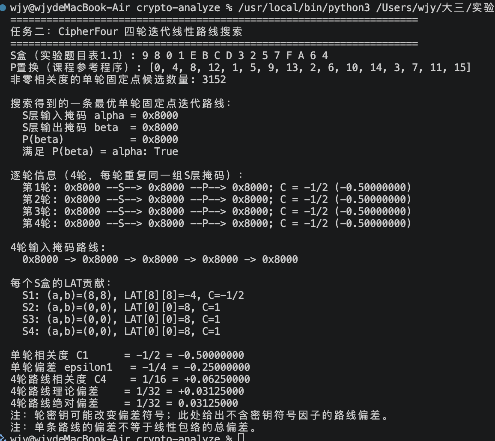
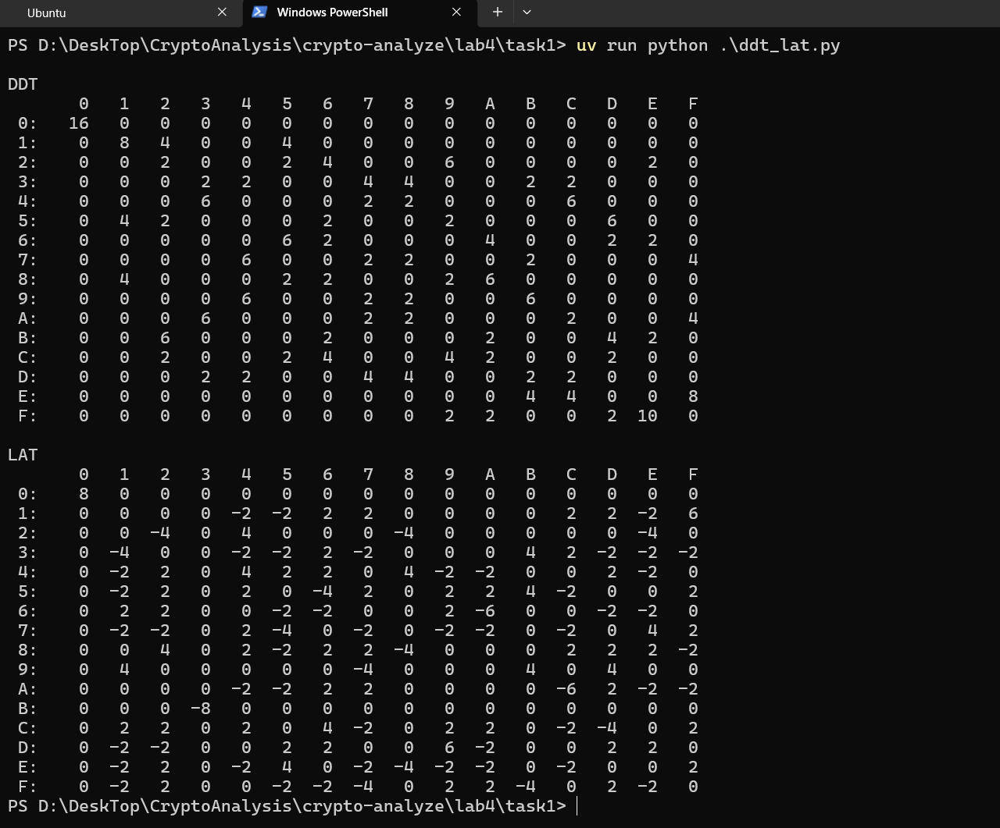

# 实验三、四：线性分析与自动化建模

实验三把“线性偏差”落实为查表、掩码传播与路线计算；实验四把这些传播关系写成约束，再用求解器搜索多轮路线。最值得带进考试的能力是：**能从表项算出概率和偏差，能写出一条排除约束，能复核程序输出的路线。**

| 实验 | 实际完成的内容 | 对应理论 |
| --- | --- | --- |
| 实验三 | 计算 LAT；搜索 CipherFour 四轮迭代路线；分析 PHILOX 一轮线性关系 | [线性分析](../../notes/04-线性分析/线性分析.md) |
| 实验四任务一 | 用四种方法编码 DDT/LAT 非零位置，并枚举全部合法点 | [自动化区分器搜索](../../notes/09-自动化与拓展/自动化区分器搜索.md) |
| 实验四任务二 | 搜索 CipherFour 六轮差分、线性路线，逐轮核对权重 | [差分攻击](../../notes/03-差分分析/差分攻击.md)、[线性分析](../../notes/04-线性分析/线性分析.md) |

本文使用实验三、四共同采用的 S 盒，输入依次为 `0` 到 `F`：

```text
输入：0 1 2 3 4 5 6 7 8 9 A B C D E F
输出：9 8 0 1 E B C D 3 2 5 7 F A 6 4
```

## 1. 实验三：把 LAT、概率、偏差和相关度分清

设输入掩码为 $a$、输出掩码为 $b$，统计

$$
N_0=\#\{x:a\cdot x\oplus b\cdot S(x)=0\}.
$$

实验代码保存的是**偏差计数表**：

$$
\mathrm{LAT}[a,b]=N_0-8.
$$

对这个四位 S 盒，四种量的换算为：

$$
p=\frac{N_0}{16},\qquad
\varepsilon=p-\frac12=\frac{\mathrm{LAT}[a,b]}{16},\qquad
C=2\varepsilon=\frac{\mathrm{LAT}[a,b]}8.
$$

Walsh 和则是 $W=2\mathrm{LAT}$，所以 $C=W/16$。**看见 LAT 的数值，先确认它存的是哪种量。**

| 掩码对 | LAT | 成立次数 $N_0$ | 概率 $p$ | 偏差 $\varepsilon$ | 相关度 $C$ |
| --- | ---: | ---: | ---: | ---: | ---: |
| $(0,0)$ | $8$ | $16$ | $1$ | $1/2$ | $1$ |
| $(8,8)$ | $-4$ | $4$ | $1/4$ | $-1/4$ | $-1/2$ |
| $(B,3)$ | $-8$ | $0$ | $0$ | $-1/2$ | $-1$ |

最后一行的含义是

$$
B\cdot x\oplus3\cdot S(x)=1
$$

对全部输入成立。负相关度表示等式更倾向于取 $1$，**绝对值大的负相关同样是强线性关系**。寻找强关系时按 $|C|$ 排序，同时保留正、负 LAT 表项。

源码：[LAT 计算](../../labs/lab3/code/task1.py)。

## 2. 四轮迭代路线：为什么得到 $1/32$？

### 2.1 先让路线闭合

CipherFour 一轮由四个并行 S 盒与比特置换 $P$ 组成。实验中 $P$ 是 $4\times4$ 比特矩阵的转置置换，满足 $P=P^{-1}=P^T$。

设 S 层输入掩码为 $\alpha$、输出掩码为 $\beta$。重复同一轮路线的条件是

$$
P(\beta)=\alpha.
$$

程序枚举全部 $2^{16}-1$ 个非零 $\alpha$，由 $\beta=P^{-1}(\alpha)$ 唯一确定输出掩码，再计算四个 S 盒相关度的乘积。它得到 **3152 个相关度非零的单轮固定点候选**，选出的路线是

$$
\mathtt{8000}\xrightarrow{S}\mathtt{8000}
\xrightarrow{P}\mathtt{8000}.
$$

这里的 `8000` 为十六进制，只有最高半字节的掩码为 $8$，其余三个半字节为 $0$。

### 2.2 再计算路线贡献

每轮的四个局部掩码对为 $(8,8),(0,0),(0,0),(0,0)$，因此

$$
C_1=\frac{-4}{8}\times\left(\frac88\right)^3=-\frac12.
$$

重复四轮后，不计密钥符号因子的这条路线相关度为

$$
C_{\text{trail}}=\left(-\frac12\right)^4=\frac1{16},
\qquad
\varepsilon_{\text{trail}}=\frac{C_{\text{trail}}}{2}=\frac1{32}.
$$

**最容易算错的是直接相乘偏差。** 单轮偏差是 $-1/4$，四个独立近似的偏差应为

$$
2^{4-1}\left(-\frac14\right)^4=\frac1{32},
$$

而不是 $(-1/4)^4$。用相关度相乘更省事。



图源：实验三报告中的固定点路线搜索结果，路线偏差为 $1/32$。

本程序搜索**单轮固定点重复四次**的路线，计算单条路线的贡献。完整头尾线性近似的相关度由连接相同头尾的全部路线合并得到。

源码：[四轮迭代路线搜索](../../labs/lab3/code/task2.py)；报告：[任务二推导](../../labs/lab3/report/content/task2/task2.tex)。

## 3. PHILOX：先用结构消掉一半掩码

实验取 $W=8$、$M=\mathtt{9B}$，一轮为

$$
L'=\operatorname{mullo}_8(R),\qquad
R'=\operatorname{mulhi}_8(R)\oplus L\oplus K.
$$

其中 $\operatorname{mullo}_8(R)$ 和 $\operatorname{mulhi}_8(R)$ 是 $R\times M$ 的低八位与高八位。这里采用实验三代码的轮函数；[实验二](02-差分路径与密钥恢复.md)的高、低字安排不同，两组结果分别对应各自的轮函数。

输入掩码 $\alpha=(\alpha_L,\alpha_R)$、输出掩码 $\beta=(\beta_L,\beta_R)$ 对应的表达式为

$$
\begin{aligned}
&\alpha_L\cdot L\oplus\alpha_R\cdot R
\oplus\beta_L\cdot L'\oplus\beta_R\cdot R'\\
={}&(\alpha_L\oplus\beta_R)\cdot L
\oplus\alpha_R\cdot R
\oplus\beta_L\cdot\operatorname{mullo}_8(R)
\oplus\beta_R\cdot\operatorname{mulhi}_8(R)
\oplus\beta_R\cdot K.
\end{aligned}
$$

若 $\alpha_L\ne\beta_R$，第一项是均匀输入 $L$ 的非零线性函数，取 $0,1$ 各一半，并与其他项独立，所以**整个表达式平衡，偏差为零**。

因此，搜索非零偏差只需考虑

$$
\boxed{\beta_R=\alpha_L}.
$$

这样就不用枚举所有 $2^{16}$ 个输出掩码，只需枚举 $\beta_L$ 的 $256$ 种取值；每个候选再遍历 $R$ 的 $256$ 种取值。固定密钥项 $\beta_R\cdot K$ 只翻转偏差符号。

实验在 $K=0$ 时得到各组输入的第一名：

| 输入掩码 $\alpha$ | 输出掩码 $\beta$ | 偏差 |
| --- | --- | ---: |
| $(\mathtt{00},\mathtt{01})$ | $(\mathtt{01},\mathtt{00})$ | $1/2$ |
| $(\mathtt{01},\mathtt{00})$ | $(\mathtt{5A},\mathtt{01})$ | $-0.14453125$ |
| $(\mathtt{00},\mathtt{02})$ | $(\mathtt{03},\mathtt{00})$ | $1/2$ |
| $(\mathtt{02},\mathtt{01})$ | $(\mathtt{B6},\mathtt{02})$ | $0.17578125$ |

第一行还能直接手算：$M$ 为奇数，$R\times M$ 的最低位就是 $R$ 的最低位，所以 $R_0=L'_0$ 恒成立，偏差为 $1/2$。第三行来自 $M\equiv3\pmod4$，乘积低两位满足 $L'_0=R_0$、$L'_1=R_1\oplus R_0$，因此 $R_1=L'_1\oplus L'_0$。

源码：[PHILOX 一轮线性分析](../../labs/lab3/code/task3.py)。

## 4. 实验四：把一个 S 盒变成二进制约束

### 4.1 先固定符号和位序

沿用实验报告修改后的符号：传播变量用 $x$，非法点集用 $Q$。

$$
x=(a_3,a_2,a_1,a_0,b_3,b_2,b_1,b_0)\in\{0,1\}^8,
\qquad Q=\{0,1\}^8\setminus V.
$$

$V$ 是合法传播点集。差分建模取 $\mathrm{DDT}[a,b]>0$ 的位置；线性建模取 $\mathrm{LAT}[a,b]\ne0$ 的位置。该 S 盒有 **72 个差分合法点、122 个线性合法点**，都包含未激活的 $(0,0)$。



本任务一的目标是**准确描述全部合法点**，目标函数设为 $0$；它没有按概率大小筛选路线。

### 4.2 四种方法分别在做什么？

**one-hot：从合法点中选一个。** 给每个 $v\in V$ 一个二进制变量 $\lambda_v$，写

$$
\sum_{v\in V}\lambda_v=1,\qquad
x=\sum_{v\in V}\lambda_vv.
$$

第一个等式选中唯一合法点，后八个坐标等式把它复制到 $x$。差分模型有 $8+72=80$ 个变量、$1+8=9$ 条等式。

**逐点排除：与每一个非法点至少差一位。** 对每个 $q\in Q$，写

$$
\sum_{j:q_j=0}x_j+\sum_{j:q_j=1}(1-x_j)\ge1.
$$

例如 $q=0000\,0001$ 是非法点，因为输入差分为零时输出差分必须为零。排除它只需

$$
x_1+x_2+x_3+x_4+x_5+x_6+x_7+(1-x_8)\ge1.
$$

在 $x=q$ 处左边为零；任意其他二进制点都至少有一项为一。这就是“恰好排除一个点”的证明。

**逻辑化简：把多个非法点合并排除。** 用 Espresso 将 $Q$ 化成若干含通配位的逻辑立方体，每个立方体对应一条约束。这里只计算固定位置的汉明距离，通配位置不参与求和。例如，零输入、输出最高位为一的 `0000 1---` 全部非法，可统一写成

$$
x_1+x_2+x_3+x_4+(1-x_5)\ge1.
$$

这一条约束同时排除八个点。

**凸包：用超平面围住合法点。** 先求 $\operatorname{conv}(V)$ 的等式和不等式，再限制 $x$ 为二进制。其关键性质是

$$
\operatorname{conv}(V)\cap\{0,1\}^8=V.
$$

程序进一步贪心选取每次能排除最多剩余非法点的不等式，直到所有非法点均被排除。筛选后保留的是同一组二进制合法点。

### 4.3 怎样检查模型没有漏点或多点？

报告记录的结果如下，“变量/约束/解”分别表示二进制变量数、显式线性约束数、合法解数：

| 方法 | DDT：变量/约束/解 | LAT：变量/约束/解 |
| --- | --- | --- |
| one-hot | $80/9/72$ | $130/9/122$ |
| 逐点排除 | $8/184/72$ | $8/134/122$ |
| 逻辑化简 | $8/36/72$ | $8/38/122$ |
| 凸包筛选 | $8/32/72$ | $8/28/122$ |

最直接的检查是遍历全部 $256$ 个二进制点，逐点判断：

$$
x\text{ 满足约束}\quad\Longleftrightarrow\quad(a,b)\in V.
$$

**模型验证要逐点比较解集。** 仓库中的凸包数据经筛选后得到 $32/28$ 条约束，逐点枚举得到 $72/122$ 个合法点，与 DDT/LAT 非零点集一致。

代码入口：[公共 DDT/LAT](../../labs/lab4/code/task1/ddt_lat.py)、[one-hot](../../labs/lab4/code/task1/one_hot/one_hot.py)、[逐点排除](../../labs/lab4/code/task1/point_exclusion/point_exclusion.py)、[逻辑化简](../../labs/lab4/code/task1/logic_minimization/logic_minimization.py)、[凸包筛选](../../labs/lab4/code/task1/convex_hull/convex_hull.py)。

## 5. 六轮搜索：为什么程序显示 $2^{-3}$，重算却不同？

**先核对搜索器怎样定义权重，再用 DDT/LAT 计算路线的概率与相关度。**

### 5.1 差分路线：六个 $1/2$ 相乘

平台找到六轮均为 $\mathtt{0001}\to\mathtt{0001}$ 的 S 层差分路线。最低位在置换中保持不动，且 $\mathrm{DDT}[1,1]=8$，所以每轮一个活跃 S 盒贡献 $8/16=1/2$：

$$
p_{\text{trail}}=\left(\frac12\right)^6=2^{-6}.
$$

这条路线按 DDT 重算的概率与平台显示值一致。

### 5.2 线性路线：把每个非零 LAT 项重新乘一次

平台输出的六轮路线如下。表中的输出均为 S 层输出；前五轮还要经过 $P$ 才到下一轮输入，第六轮末尾没有 $P$ 层。

| 轮 | S 层输入掩码 | S 层输出掩码 | 该轮相关度绝对值 |
| --- | --- | --- | --- |
| 1 | `DD0D` | `9909` | $(3/4)^3$ |
| 2 | `D00D` | `9009` | $(3/4)^2$ |
| 3 | `9009` | `1001` | $(1/2)^2$ |
| 4 | `0009` | `0001` | $1/2$ |
| 5 | `0001` | `000F` | $3/4$ |
| 6 | `1111` | `FFFF` | $(3/4)^4$ |

查 LAT 得 $C(D,9)=3/4$、$C(9,1)=1/2$、$C(1,F)=3/4$，总共有十个 $3/4$、三个 $1/2$，所以

$$
|C_{\text{trail}}|=\left(\frac34\right)^{10}\left(\frac12\right)^3
=\frac{59049}{8388608}\approx0.00703919.
$$

对应路线偏差绝对值为 $|C_{\text{trail}}|/2\approx0.00351959$，精确权重为

$$
-\log_2|C_{\text{trail}}|\approx7.1504.
$$

平台对局部权重采用向下取整：

$$
\widetilde w=\lfloor-\log_2|C|\rfloor.
$$

于是 $3/4$ 被记作权重 $0$，$1/2$ 被记作权重 $1$。整条路线的内部权重就是

$$
\widetilde W=10\times0+3\times1=3.
$$

因此平台显示的 $2^{-3}$ 是**整数化目标对应的指标**，该路线真实的相关度绝对值是 $0.00703919$。复习时应记住后者的查表乘积，并理解二者差异来自权重取整。

六轮路线逐轮满足 $P(\beta_r)=\alpha_{r+1}$。程序优化的是整数权重；按精确相关度寻找最优路线时，目标函数应使用精确权重。

来源：[实验四任务二报告与推导](../../labs/lab4/report/content/task2/task2.tex)、[差分配置](../../labs/lab4/code/task2/cipherfour_diff.txt)、[线性配置](../../labs/lab4/code/task2/cipherfour_linear.txt)、[平台原始输出](../../labs/lab4/result_of_task2/)。

## 6. 做题时直接套用的解答顺序

1. **LAT 题：** 写清计数表的定义，依次求 $N_0$、$p$、$\varepsilon$、$C$；保留正负号。
2. **路线题：** 核对 S 盒表项和轮间掩码连接，用相关度相乘，最后除以二得到偏差。
3. **建模题：** 定义 $x,V,Q$ 与位序，选一种方法写约束，再证明合法点全部保留、非法点全部排除。
4. **实验分析题：** 对照程序实际搜索范围、目标权重和原始 DDT/LAT，说明数值怎样得到。

实验三报告勘误：$(B,3)$ 的相关度为 $-1$；PHILOX 的平衡性来自独立均匀项与剩余函数的异或，结论针对完整表达式。

## 复现与继续阅读

在仓库根目录运行以下标准库程序，即可复现表项、四轮固定点路线和 PHILOX 结果：

```bash
python3 labs/lab3/code/task1.py
python3 labs/lab3/code/task2.py
python3 labs/lab3/code/task3.py
python3 -m labs.lab4.code.task1.ddt_lat
```

实验四四种建模方法的全解枚举使用 Gurobi；逻辑化简还使用 PyEDA，重新生成凸包数据使用 SageMath。相关依赖见 [任务一配置](../../labs/lab4/code/task1/pyproject.toml)。六轮路线由课程实验平台求解，仓库保存了配置与原始输出。

- [实验三报告 PDF](../../labs/lab3/report/main.pdf)
- [实验四报告 PDF](../../labs/lab4/report/main.pdf)
- [线性分析：堆积引理与 Matsui 密钥恢复](../../notes/04-线性分析/线性分析.md)
- [自动化区分器搜索：从局部传播到多轮约束](../../notes/09-自动化与拓展/自动化区分器搜索.md)
- [返回课程首页](../../README.md)
