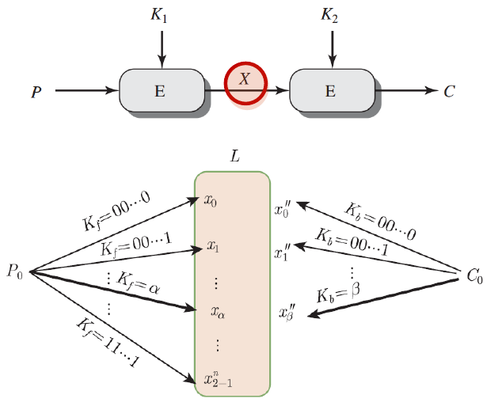
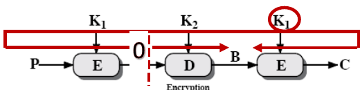
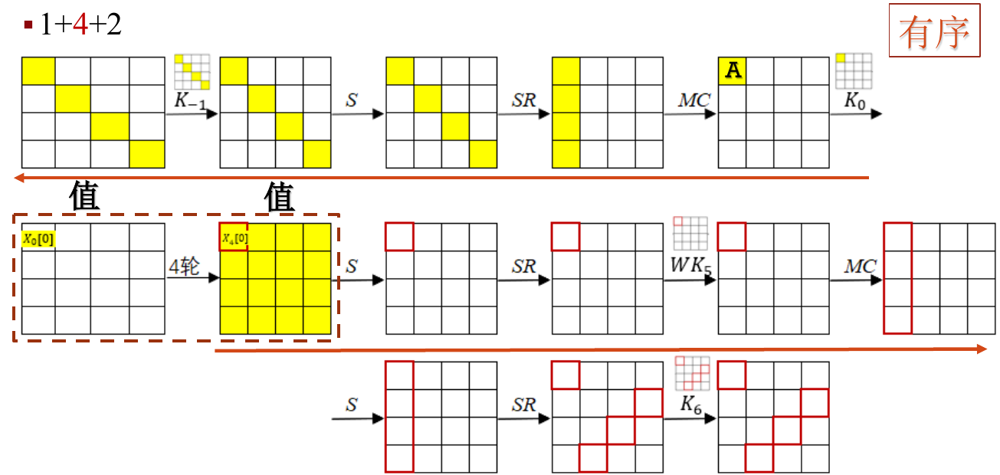

# 中间相遇攻击

中间相遇攻击（Meet-in-the-Middle，MITM）的核心是把计算切成两边：从明文向前算，从密文向后算，让两边在中间状态或其性质上相遇。正确密钥必须满足相遇条件；不满足的候选密钥可以排除。

攻击能否省时间，关键在于**两边所需的密钥能否分开猜测**，以及中间条件能排除多少错误候选。它通常用存储空间换取计算时间；相遇并不自动证明密钥正确，仍要用其他明密文对验证。

## 双重 DES：中间状态值相遇

双重加密使用两个独立的 56 位密钥：

$$
C=E_{K_2}(E_{K_1}(P)),\qquad E_{K_1}(P)=X=D_{K_2}(C).
$$

上图来自第 6 章课件第 7 页。原笔记中的示意图：

已知一对 $(P,C)$ 时，攻击者：

1. 穷举 $K_1$，计算 $X=E_{K_1}(P)$，将 $(X,K_1)$ 存表，按 $X$ 索引。相同 $X$ 对应的所有密钥都要保留。
2. 穷举 $K_2$，计算 $D_{K_2}(C)$ 并查表；每次相等都得到一个候选密钥对。
3. 用另一对不同明密文验证候选；若还有多个候选，继续验证。

为什么第一次相遇仍有很多候选？密钥对约 $2^{112}$ 个；在理想化随机模型中，错误密钥对在一个 64 位中间值上匹配的概率约为 $2^{-64}$。因此错误候选期望数约为

$$
2^{112}\cdot 2^{-64}=2^{48}.
$$

第二对明密文进一步过滤后，错误候选期望数约为 $2^{48}2^{-64}=2^{-16}$；正确密钥仍会通过。因此两对一般足够，但这是概率估算，不保证每次只剩一个候选。

- **数据**：约两对已知明密文。
- **时间**：首次建表和查表约 $2^{57}$ 次 DES 运算；复筛约 $2\cdot2^{48}$ 次，前者占主项，即约 $2^{56}$ 次双重 DES 运算。
- **存储**：约 $2^{56}$ 条表项。仅计算 64 位中间值约为 $2^{62}$ bit；实际还要存储对应密钥及索引。

虽然双重 DES 的密钥对有 112 位，攻击的主要计算量只有约 $2^{57}$ 次单 DES 运算，代价是巨大的存储。这里使用的是独立密钥和随机匹配近似，不能将其直接套到所有多重加密方案。

## 一般的值相遇与部分匹配

将算法分为 $C=E_1(E_0(P))$。把猜测的密钥位划分为：向前专用 $K_f$、向后专用 $K_b$、两边共同使用 $K_j$；三组按其不同密钥位计数。对每个 $K_j$，分别枚举 $K_f$ 和 $K_b$，计算并匹配中间值。

若中间状态为 $n$ 位，匹配全部 $n$ 位时，错误候选数近似为 $2^{k-n}$，其中 $k=|K_f|+|K_b|+|K_j|$。如果只能比较其中 $\ell<n$ 位，首次错误候选数近似为 $2^{k-\ell}$。部分匹配降低了两边计算相遇信息的要求，但过滤能力也下降；后续明密文对需要能独立提供新的有效约束。

若向前、向后计算分别占完整算法的比例为 $r_f/r$、$r_b/r$，课件给出的初筛量约为

$$
2^{|K_j|}\left(2^{|K_f|}\frac{r_f}{r}+2^{|K_b|}\frac{r_b}{r}\right).
$$

复筛和最终验证另计；存储较小一侧的表时，表项数约为 $\min(2^{|K_f|},2^{|K_b|})$。这些表达式依赖密钥划分、匹配值分布和计算代价模型；相关子密钥不能当作独立密钥位重复计数。

## 拼切技术：2K3DES

2K3DES 使用相同的 $K_1$ 位于首尾：

$$
C=E_{K_1}(D_{K_2}(E_{K_1}(P))).
$$

直接在普通中间点切开时，两侧都依赖 $K_1$，不再像双重 DES 那样独立。拼切（splice-and-cut）选定一个中间值 $A=0$，借助选择明文把两端连接：

课件第 13 页。先对每个 $K_2$ 存储 $(D_{K_2}(0),K_2)$。然后对每个猜测的 $K_1$：

1. 令 $P=D_{K_1}(0)$，向加密服务查询该明文得到 $C$。
2. 计算 $B=D_{K_1}(C)$ 并查表。对于正确的 $K_1$，确有

$$
D_{K_1}(C)=D_{K_2}(0).
$$

3. 对每个匹配的密钥对，用另外的明密文验证。

该课件模型下，时间、选择明文数和表项数均为 $O(2^{56})$；约有 $2^{48}$ 个错误候选需要复筛。这里的选择明文可能是巨大的代价，不能把该结论直接理解为已知明文攻击。拼切在此通过固定内部状态构造独立的计算与查表条件。

## 集合映射相遇：约简轮 AES 的例子

相遇对象不一定是单个值，也可以是**一组输入和输出之间的映射**。课件用 256 个 AES 状态组成集合：第 0 字节遍历 $0,\ldots,255$，其余字节固定。记第 $i$ 轮后的状态为 $X_i$，观察有序映射 $X_0[0]\mapsto X_4[0]$。

按课件的约简轮模型，经过传播，决定该四轮映射的参数可由 25 个字节描述，因此映射最多 $2^{200}$ 种。一般的 256 项、每项 8 位的有序表共有 $2^{2048}$ 种。预计算所有可能的 AES 映射，观察到的映射若不在表中即可排除该模型；随机函数的表落入其中的概率至多约 $2^{200-2048}$。这是把映射按随机函数模型估算，具体密码中参数也可能产生重复映射。

将该四轮区分器前接一轮、后接两轮，课件展示七轮 AES-256 的 $1+4+2$ 思路：猜测首尾有关密钥字节，分别构造区分器输入顺序和部分解密后的输出，查预计算映射表；不匹配便排除猜测，匹配后还要恢复和验证剩余密钥。

课件第 27 页。其单个映射表的示例估计为预计算 $2^{208}$ 次目标字节计算、存储 $2^{208}$ 字节，在线约 $2^{88}$ 次部分解密、$2^{32}$ 个选择明文。这些是课件规定的约简轮模型及工作量单位，并不是对完整 AES-256 的攻击结论。

后续改进可以使用输出相对某个基准的异或差，消去一个固定加法密钥字节，从而减少预计算规模；也可调整相遇位置、改变有序映射的表示或利用密钥编排关系。相关集合性质可参照 [Square 攻击](Square攻击.md)，但这里筛选的是可能的映射关系。

## 资料

- 课程课件《第 6 章 中间相遇攻击》，第 3、6–14、17–34 页。
- 相关笔记：[穷举攻击](穷举攻击.md)、[攻击思想](攻击思想.md)。
