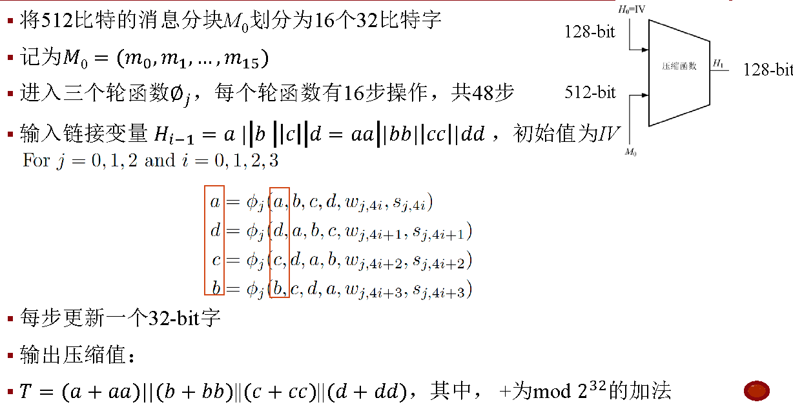
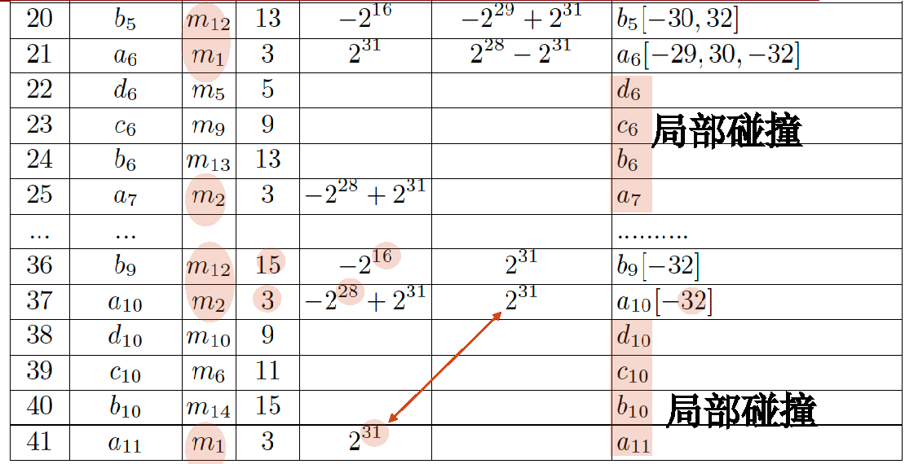
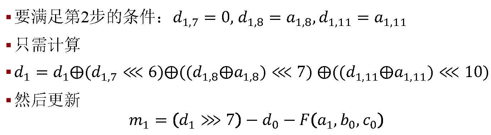

# 具体杂凑函数的碰撞攻击

## 1. 利用结构寻找碰撞

[生日攻击](生日攻击与广义生日攻击.md)把杂凑函数视为随机映射，寻找任意碰撞需要约 $2^{n/2}$ 次计算。针对具体算法时，还可以研究压缩函数的布尔运算、模加、循环移位与消息调度，主动构造一对差分沿预定路线传播的消息，使最终输出相同。课件以 **MD4** 为例，介绍比特追踪、充分条件与消息修改。

## 2. MD4 结构和碰撞目标

MD4 填充消息并附加长度，再以 512 比特为一块迭代压缩；链接状态为 128 比特，拆成四个 32 比特字 $(a,b,c,d)$。每块消息拆为 $m_0,\ldots,m_{15}$，压缩函数有三轮、每轮 16 步，共 48 步。每步用一个消息字、布尔函数、模 $2^{32}$ 加法和循环移位更新一个状态字。[RFC 1320](https://www.rfc-editor.org/rfc/rfc1320) 给出了完整算法。

*图源：第 12.3.2 节，第 3 页。*

设输入链接值为 $(aa,bb,cc,dd)$，48 步后的状态为 $(a,b,c,d)$，输出是逐字前馈相加：

$$
T=(a+aa)\parallel(b+bb)\parallel(c+cc)\parallel(d+dd),
$$

其中加法按 $2^{32}$ 取模。若两个不同消息块从同一个链接值开始，则其压缩输出相同当且仅当最终四个状态字分别相同。对同长度的两条消息，若它们在同一位置产生相同链接值、之后的块及填充相同，最终杂凑值也相同。课件所讲的单消息块攻击即利用这个关系；消息长度填充不能省略。

MD4 输出为 128 比特，随机映射的生日攻击基准约为 $2^{64}$ 次求值。下面构造差分路线的目的，是利用 MD4 的结构降低找碰撞的工作量。

## 3. 用带符号比特差分描述传播

对同一状态字 $s,s'$，模减差分记为 $\Delta s=s'-s\pmod{2^{32}}$。模减差分没有直接记录每一位的变化：不同的位变化和进借位可能得到同一个模减差分。

课件还用带符号的比特差分：$s[j]$ 表示第 $j$ 位由 $0$ 变 $1$，$s[-j]$ 表示由 $1$ 变 $0$（课件位序为 1 至 32）。例如 $s[3,-1]$ 的模减差分为 $2^2-2^0$。已知所有带符号位差分可以计算模减差分；反过来通常不能唯一确定带符号位差分。

差分通过每一步时需要分别考虑：

- 布尔函数的输出差分：通过限制输入位，可让某些差分被消除，或让它们保持。
- 模加：进位可能把差分传到更高位，所以要约束参与运算的状态位。
- 循环移位：把差分的位置一起移动。

这些约束用来描述一条可行路线，而不是说任意消息对都会沿此路线传播。

## 4. MD4 的一条碰撞差分路线

设两消息块的字差分按 $\Delta m_i=m_i'-m_i\pmod{2^{32}}$ 定义。课件的例子选择

$$
\Delta m_1=2^{31},\qquad
\Delta m_2=2^{31}-2^{28},\qquad
\Delta m_{12}=-2^{16},\qquad
\Delta m_i=0\quad(i\notin\{1,2,12\}).
$$

两条计算从相同链接值开始，消息字差分在不同步被重复使用，在中间状态引入差分；路线要求这些差分最终消失，使输出状态再次相同。课件根据每步模减差分和符号差分画出轨迹，其中若干段形成**局部碰撞**：前面引入的状态差分在一段计算后消失，之后还可能由其他消息字再次引入差分。

*图源：第 12.3.2 节，第 13 页，截取路线续表。*

局部碰撞是中间状态在某一段重新一致，最终碰撞还要求后续所有步骤的差分也归零。选择差分位置时，要尽量让后期路线稀疏，因为后几步的条件更难靠修改消息直接控制。

## 5. 从路线推导充分条件

路线指定希望看到的每一步差分；为保证它成立，需要对输入消息和中间状态的位值列出充分条件。例如，如果第一轮布尔函数是

$$
F(X,Y,Z)=(X\land Y)\lor(\neg X\land Z),
$$

那么每个比特上 $X$ 决定输出来自 $Y$ 还是 $Z$。约束 $X,Y,Z$ 的对应位，就可能控制某个输入差分是否传到输出；随后还须考虑模加进位及移位。所有要求同时满足时，预定路线成立，最终产生压缩函数碰撞。条件是**充分**的：不满足某个条件不代表绝不可能通过其他路线碰撞。

课件的路线列出 122 个比特条件。如果粗略把它们视作独立、每个均以概率 $1/2$ 满足，则随机消息对沿该路线成功的概率估为 $2^{-122}$，相应平均需尝试约 $2^{122}$ 对，甚至劣于生日攻击。这只是独立性和均匀性下的估算；条件间可能相关，不能单凭“122 个条件”断言精确概率。

## 6. 消息修改：主动满足条件

### 单步消息修改

第一轮每个消息字首次使用时，可以先调整某个中间状态字，让它满足需要的位条件，再反解消息字。以课件的第二步为例：

$$
d_1=(d_0+F(a_1,b_0,c_0)+m_1)\lll7.
$$

调整 $d_1$ 的相关位后，可由该式反解

$$
m_1=(d_1\ggg7)-d_0-F(a_1,b_0,c_0)\pmod{2^{32}}.
$$

*图源：第 12.3.2 节，第 17 页，截取条件与反解公式。*

构造消息对时还必须维持选定的消息差分，并检查修改后的另一条计算是否仍满足路线。课件称第一轮条件经过这类修改后，例子中剩余 26 个尚需处理的条件；这一数量属于所选路线与修改方法。

### 多步消息修改

第二轮重新使用第一轮的消息字，修改其中一个字可能破坏已经满足的前面条件。多步修改同时调整若干消息字，用后续补偿保持先前状态或条件，并让新的第二轮条件成立；课件举例通过调整 $m_0$ 影响第二轮状态，再调整 $m_1,\ldots,m_4$ 保持第一轮相关状态。

课件给出经过消息修改后，构造的消息对满足碰撞的概率约为 $2^{-6}$ 到 $2^{-2}$。这是该路线和修改过程下的条件性或实验估计，不是 MD4 任意随机消息对的碰撞概率，也不是自动等同于完整攻击的总时间：生成候选、修改、检查及失败重试都有成本。

## 7. 攻击流程

1. 选择消息块差分，设计最终差分归零且后期条件较少的碰撞路线。
2. 逐步追踪差分，推导使该路线成立的位条件。
3. 选择消息并用单步、多步消息修改满足尽可能多的条件，同时维持消息对差分。
4. 对尚未强制满足的条件进行检查；不满足则换候选并重试。
5. 得到候选消息对后，实际计算完整杂凑值，确认消息不同且摘要相同。

相关笔记：[生日攻击与广义生日攻击](生日攻击与广义生日攻击.md)、[杂凑函数](杂凑函数.md)。
