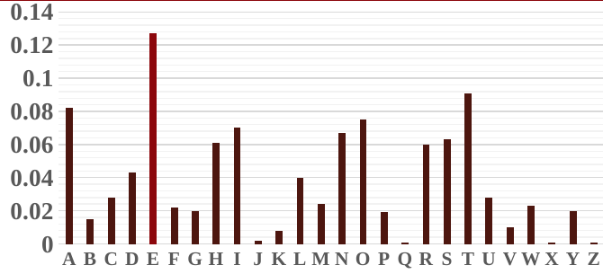

# 古典密码的安全性分析

## 凯撒密码：小密钥空间

把字母编码为 $0,\ldots,25$，加密为 $C=P+k\pmod{26}$。密钥只有 $26$ 个候选，逐个解密并检查文本是否通顺即可完成[穷举攻击](穷举攻击.md)。这里利用的是密钥空间小，与字母频率无关。

## 单表代换：保留频率形状

单表代换把每个字母固定映射到另一字母。字母名称变了，但频繁出现的字母仍频繁出现，双字母和常见词形也留下线索。课件第 3 页展示了英语字母的非均匀频率：

可以先统计密文中字母的出现次数，与目标语言的典型分布比较，再用双字母频率和词形修正候选映射。**频率高并不保证它一定对应 E**：短文本、不同语言或刻意改写的文本都可能改变分布，需结合上下文验证。

## 维吉尼亚密码：先找周期，再逐列分析

维吉尼亚密码使用周期性重复的密钥字母，每个位置做一次凯撒移位。它比单表代换更能掩盖整体字母频率，但相同密钥位置的字母仍受同一个位移控制。

1. **Kasiski 测试：** 找密文中重复的片段，计算它们起点之间的距离；若重复片段来自相同明文和相同密钥对齐，距离通常是密钥长度的倍数。多个距离的公因子给出候选周期。
2. **重合指数法：** 对候选周期 $l$，按位置模 $l$ 将密文分成 $l$ 列。若周期猜对，每列近似一段单表凯撒密文，其字母分布较不均匀。可用 $\mathrm{IC}=\sum_{a=0}^{25}f_a(f_a-1)/[N(N-1)]$ 量化两次不放回抽样恰好同字母的概率，其中 $f_a$ 是该列中字母 $a$ 的次数。
3. **恢复各列位移：** 对每列分别尝试 $26$ 个位移，用语言频率和解出的文本判断，再组合为周期密钥。

重复片段也可能偶然出现，密钥实际周期也可能短于写下的密钥长度，所以候选周期需要互相比较。课件把凯撒、单表代换和维吉尼亚密码放在一起，说明攻击要寻找与密码结构相匹配的不随机现象。

## 相关笔记

- [密码分析学概述](密码分析学概述.md)
- [攻击思想](攻击思想.md)
- [破解 Enigma 机](破解Enigma机.md)
