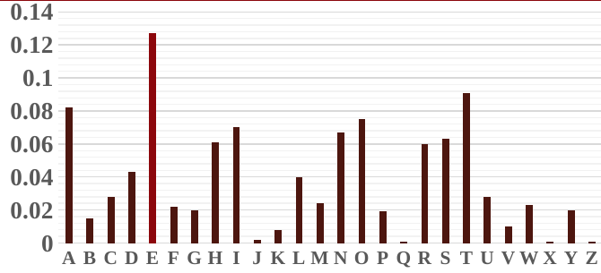

# 古典密码的安全性分析

## 凯撒密码：小密钥空间

把字母编码为 $0,\ldots,25$，加密为 $C=P+k\pmod{26}$。密钥只有 $26$ 个候选，逐个解密并检查文本是否通顺即可完成[穷举攻击](穷举攻击.md)。这里利用的是密钥空间小，与字母频率无关。

### 手算例子

取 $A=0,B=1,\ldots,Z=25$，设位移 $k=3$：

$$
C_i=(P_i+3)\bmod26,\qquad P_i=(C_i-3)\bmod26.
$$

于是 `HELLO` 加密为 `KHOOR`，例如 $H=7$ 经过位移得到 $K=10$。只有密文时，把 $k=0,1,\ldots,25$ 依次代入解密式，其中 $k=3$ 得到有意义的 `HELLO`。这里把不移动的 $k=0$ 也计作一个候选。

## 单表代换：保留频率形状

单表代换把每个字母固定映射到另一字母。字母名称变了，但频繁出现的字母仍频繁出现，双字母和常见词形也留下线索。课件第 3 页展示了英语字母的非均匀频率：

可以先统计密文中字母的出现次数，与目标语言的典型分布比较，再用双字母频率和词形修正候选映射。**频率高并不保证它一定对应 E**：短文本、不同语言或刻意改写的文本都可能改变分布，需结合上下文验证。

### 频率为什么保留下来？

设固定字母置换为 $\pi$，则每次明文字母 $a$ 出现时，密文对应位置都是 $\pi(a)$。因此

$$
\operatorname{count}_C(\pi(a))=\operatorname{count}_P(a).
$$

例如 `HELLO` 若按固定代换变成 `QWXXZ`，两个 `L` 都变成 `X`，所以重复位置和出现次数保留下来。整个置换理论上有 $26!$ 个候选，但不必逐一枚举：先利用单字母频率提出假设，再结合双字母、重复结构和上下文逐步修正。

**分析流程：** 统计密文各字母出现次数；给高频字母尝试常见明文字母；结合双字母和已知词形形成更多对应；检查代换是否一一对应，并解读较长文本验证候选。

## 维吉尼亚密码：先找周期，再逐列分析

维吉尼亚密码使用周期性重复的密钥字母，每个位置做一次凯撒移位。它比单表代换更能掩盖整体字母频率，但相同密钥位置的字母仍受同一个位移控制。

设密钥长度为 $l$，把字母也按 $A=0,\ldots,Z=25$ 编码，位置 $i$ 的加密和解密分别为

$$
C_i=(P_i+K_{i\bmod l})\bmod26,
\qquad
P_i=(C_i-K_{i\bmod l})\bmod26.
$$

例如明文为 `HELLO`、密钥为 `KEY`，重复后的密钥是 `KEYKE`，对应位移为 $10,4,24,10,4$。逐位相加得到密文 `RIJVS`。同一个明文字母 `L` 在两个位置分别使用不同密钥字母，所以可以加密为不同的字母。

1. **Kasiski 测试：** 找密文中重复的片段，计算它们起点之间的距离；若重复片段来自相同明文和相同密钥对齐，距离通常是密钥长度的倍数。多个距离的公因子给出候选周期。
2. **重合指数法：** 对候选周期 $l$，按位置模 $l$ 将密文分成 $l$ 列。若周期猜对，每列近似一段单表凯撒密文，其字母分布较不均匀。可用 $\mathrm{IC}=\sum_{a=0}^{25}f_a(f_a-1)/[N(N-1)]$ 量化两次不放回抽样恰好同字母的概率，其中 $f_a$ 是该列中字母 $a$ 的次数。
3. **恢复各列位移：** 对每列分别尝试 $26$ 个位移，用语言频率和解出的文本判断，再组合为周期密钥。

### 周期为什么能被找出来？

若密钥周期为 $l$，位置 $i$ 和 $i+l$ 使用同一个密钥字母。按位置模 $l$ 分列后，每列都由一个固定的凯撒位移加密，故该列仍保留明文频率的形状。猜错周期时，同一列会混入多个不同位移，频率往往更接近均匀分布。

**Kasiski 数值例子：** 两组密文重复片段的起点距离分别为 $12$ 和 $18$。若它们来自同一明文片段在相同密钥对齐下的重复，这些距离都应是周期的倍数；$\gcd(12,18)=6$，于是 $2,3,6$ 都是值得检验的候选周期。选取其中一个周期后，还要通过分列统计和解密判断。

**重合指数怎么算？** 一列含 $N$ 个字母，其中字母 $a$ 出现 $f_a$ 次。按顺序不放回抽两次，共有 $N(N-1)$ 种位置选择；恰好同为 $a$ 的位置选择有 $f_a(f_a-1)$ 种。对所有字母求和：

$$
\mathrm{IC}=\frac{\sum_a f_a(f_a-1)}{N(N-1)}.
$$

例如列 `AABBCD` 含 $N=6$ 个字母，$A,B$ 均出现两次，$C,D$ 各一次，则 $\mathrm{IC}=(2\cdot1+2\cdot1)/(6\cdot5)=2/15$。理想均匀的 26 字母分布的重合概率为 $1/26\approx0.0385$；普通英语的经验值通常更高，常以约 $0.065$ 作参考。实际样本越短，测出的数值波动越明显。

重复片段也可能偶然出现，密钥实际周期也可能短于写下的密钥长度，所以候选周期需要互相比较。课件把凯撒、单表代换和维吉尼亚密码放在一起，说明攻击要寻找与密码结构相匹配的不随机现象。

## 三种方法如何比较？

| 密码 | 加密方式 | 主要攻击线索 |
| --- | --- | --- |
| 凯撒 | 全部字母使用同一个位移 | 密钥只有 26 个，可直接穷举 |
| 单表代换 | 每个字母使用固定的一一对应映射 | 单字母频率、重复位置和词形被保留 |
| 维吉尼亚 | 不同位置使用周期性重复的位移 | 先估计周期，再对每列做频率分析 |

## 相关笔记

- [密码分析学概述](密码分析学概述.md)
- [攻击思想](攻击思想.md)
- [破解 Enigma 机](破解Enigma机.md)
