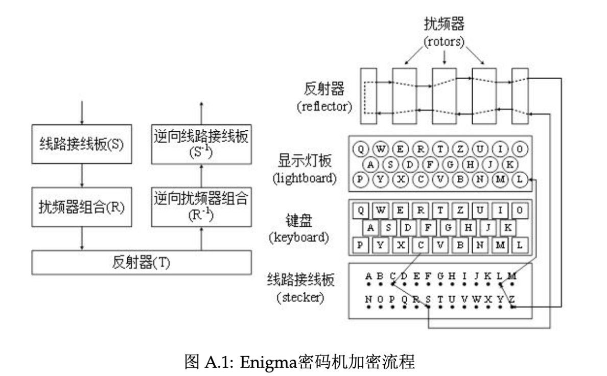
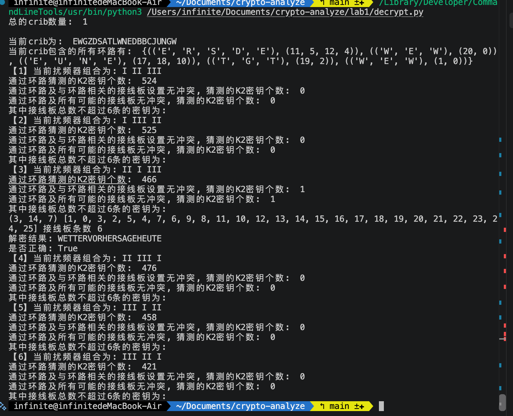

# 实验一复习：Enigma 与已知明文

> **这次实验最值得记住的结论：**利用已知明密文形成的环路，先筛选转子设置，再恢复接线板，把一个庞大的联合搜索拆成较小的搜索与约束传播。

理论对应：[破解 Enigma 机](../破解Enigma机.md) · [攻击思想](../攻击思想.md) · [穷举攻击](../穷举攻击.md)。

## 1. 从加密实现理解可利用的性质



设接线板为 $S$，第 $i$ 个字符经过转子和反射器的内部变换为 $F_i$。一次加密为

$$
C_i=S(F_i(S(P_i))),\qquad S^2=\operatorname{id},\quad F_i^2=\operatorname{id}.
$$

接线板的每条连线交换两个字母，反射器也交换成对字母，因此相同状态下再次进行同一变换可以解密。同时，反射器没有不动点，所以 **Enigma 不会把一个字母加密成它自己**。猜测一段明文在密文中的位置时，只要某列出现 $P_i=C_i$，这个对齐位置就被排除。

实验一采用给定的教学转子与转动规则：先处理字符，再转动快速转子；每处理 26 个字符中速转子转一次，每处理 $26^2$ 个字符慢速转子转一次。[`encrypt.py`](../lab1/encrypt.py) 中对应 `encrypt()` 和 `updateRotor()`。

| 配置 | 本实验取值 |
| --- | --- |
| 转子顺序，快速到慢速 | $(I,II,III)$ |
| 初始位置 | $(8,9,10)$，字母按 $A=0$ 编号 |
| 接线板 | $(AV)(BS)(CG)(MN)(OX)$ |
| 明文与密文 | `WETTER` → `TWNVCX` |

这个短样例已用仓库中的加密函数重新计算，结果与报告一致。解密时要把机器恢复到同一个初始状态，再输入密文；不能接着已经转过的状态直接计算。

## 2. 真实实验数据怎样变成环路？

任务二给出 21 个字符的已知明密文，并规定中速、慢速转子不转动：

```text
明文：WETTERVORHERSAGEHEUTE
密文：EWGZDSATLWNEDBBCJUNGW
```

把每个不同字母作为顶点，把第 $i$ 列的明文字母和密文字母连成一条标记为 $i$ 的边，得到 **menu 图**。边能双向使用，因为固定状态的 Enigma 变换是自身的逆。程序的 `build_graph()` 因此添加两个方向的邻接关系。

从实际数据取出三列，便得到一个闭环：

| 位置，从 1 开始 | 明文 | 密文 | 约束 |
| --- | --- | --- | --- |
| 18 | E | U | $S(U)=F_{18}(S(E))$ |
| 19 | U | N | $S(N)=F_{19}(S(U))$ |
| 11 | E | N | $S(E)=F_{11}(S(N))$，沿这条边反向走 |

于是 $E\to U\to N\to E$ 对应

$$
S(E)\xrightarrow{F_{18}}S(U)
\xrightarrow{F_{19}}S(N)
\xrightarrow{F_{11}}S(E).
$$

令 $x=S(E)$，得到只涉及转子设置与一个未知字母的方程：

$$
\boxed{F_{11}\circ F_{19}\circ F_{18}(x)=x.}
$$

**未知的整张接线板被压缩成了一个字母 $x$。** 对某个候选转子设置，依次尝试 26 个 $x$；如果没有一个能回到自己，该设置就不可能正确。

代码的位置从 0 开始，因此同一个环路在程序里使用索引 `17, 18, 10`。第 $i$ 个字符的快速转子位置按代码约定为 $(s_0-(i-1))\bmod26$；这与数组旋转方向相配套。

## 3. 从环路继续恢复接线板

只检查“能回到自身”还不够。每个通过环路的起始字母都会推导出若干接线，接线必须同时满足：

1. 同一个字母只能对应一个字母。
2. 若 $S(A)=B$，必须同时有 $S(B)=A$。
3. 本实验最多允许六条连线；未接线字母可以映射为自身。

继续利用已知明密文，把已有的接线传播到其他字母。例如已知 $S(E)$，第 5 列的 $E\to D$ 就给出 $S(D)=F_5(S(E))$。有冲突时立即排除候选，最后用全部 21 列重新加密或解密验证。

报告得到的设置为

$$
K_2=((3,14,7),(II,I,III)),\qquad
S=(AB)(CD)(EF)(GH)(IJ)(KL).
$$

把这一设置代入上一节的实际环路，可以手算检查的中间字母为

$$
\underbrace{F}_{S(E)}
\xrightarrow{F_{18}}
\underbrace{U}_{S(U)}
\xrightarrow{F_{19}}
\underbrace{N}_{S(N)}
\xrightarrow{F_{11}}
\underbrace{F}_{S(E)}.
$$

这三个内部变换及完整 21 字符的重新加密均已用 `crypt_once()` 核对。六条接线已经用满，因此其余字母均不接线。



报告截图中，转子顺序 $(II,I,III)$ 经过环路筛选还剩 **466** 个位置候选，加入接线板一致性后剩 **1** 个。这组数字说明：**环路提供筛选条件，接线的一致性负责进一步消除错误候选。** 截图记录的是原实验运行结果，本次补充复核了最终设置，未重新执行完整枚举。

## 4. 为什么比直接穷举有效？

若接线板恰有 $l$ 条连线，其数量为

$$
N_S(l)=\frac{26!}{(26-2l)!\,2^l l!}.
$$

这里 $2^l$ 去掉每对字母交换顺序造成的重复，$l!$ 去掉各条连线排列顺序造成的重复。最多六条线时应求和：

$$
N_S=\sum_{l=0}^{6}N_S(l)
=105\,578\,918\,576\approx2^{36.62}.
$$

三个固定转子的顺序和初始位置共有

$$
N_R=3!\times26^3=105\,456\approx2^{16.69}
$$

种，联合穷举约为 $N_SN_R\approx2^{53.31}$。环路攻击的第一步枚举 $N_R$ 个转子设置、26 个内部字母；若依次检查长度为 $\ell_1,\ldots,\ell_t$ 的环路，直接实现的内部变换次数按

$$
O\!\left(26N_R\sum_{j=1}^{t}\ell_j\right)
$$

计，再对通过筛选的候选求接线板。收益来自去掉了对 $N_S$ 张完整接线板的外层枚举。

任务三从四个转子里选三个并排序，转子部分改为 $P_4^3\times26^3$，完整密钥空间约 $2^{55.31}$。**它比三个固定转子的情形大四倍，即多两位穷举安全强度。**

报告的每秒 80,514 条是连续加密六字符消息的测量值；据此得到约 $1.75\times10^4$ 年的全空间估算。答题时要写明计量单位：连续加密吞吐量与“换一个密钥并完成验证”的速度是两种测量，本实验没有直接测量后者。

## 5. 考试可以怎样问？

**问：为什么找到一个环路后，不能立刻认定转子设置正确？**

答：错误设置也可能让某个字母回到自身。一个环路通过只说明该设置满足这一约束，还要检查多个环路导出的接线板是否一致，再验证全部明密文。

**问：只要明密文没有同字母对应，就证明猜中了明文位置吗？**

答：没有同字母对应只是通过第一轮排除；正确的对齐位置还必须满足转子与接线板的全部约束。

**问：为什么只需要猜 26 个内部字母，而不需要猜整个接线板？**

答：环路内相邻两次接线板相互抵消，只留下起点 $x=S(E)$。依次计算环路中的内部变换，就能检查起点是否回到自身。

## 实验出处

- [实验一报告 LaTeX 源文件](../lab1/report/main.tex)
- [实验原理与密钥空间公式](../lab1/report/content/2principle.tex)
- [任务二：环路筛选与密钥恢复](../lab1/report/content/task2/task2.tex)
- [任务三：密钥空间与性能测量](../lab1/report/content/task3/task3.tex)
- [加密实现](../lab1/encrypt.py) · [menu、环路与接线板恢复实现](../lab1/decrypt.py)
