# 密码分析学期末复习总笔记

适用考试：2026 年 11 月 18 日期末闭卷笔试。按教学大纲的八章内容整理，重点掌握**攻击利用什么性质、怎样判断密钥、概率怎样计算、复杂度与什么比较**。

大纲第 18 页的拟定分值如下；具体试卷可随实际授课调整。

| 章节 | 拟定分值 | 必须能独立写出的内容 |
| --- | ---: | --- |
| [一 基本概念与模型](#一%20基本概念与攻击模型) | 5 | 攻击模型、区分器、密钥恢复、复杂度 |
| [二 Enigma](#二%20Enigma%20机的破解) | 5 | 密钥空间、不能自加密、crib 与环路 |
| [三 差分类](#三%20差分类攻击) | 25 | DDT、路线概率、计数与排除、四元组 |
| [四 线性类](#四%20线性类攻击) | 25 | LAT、掩码、偏差、算法 1／2、差分—线性 |
| [五 积分](#五%20积分分析与%20Square%20攻击) | 10 | A／C／B 传播、AES 三轮平衡、末轮恢复 |
| [六 中间相遇](#六%20中间相遇攻击) | 15 | 相遇方程、独立枚举、候选数量与资源 |
| [七 杂凑](#七%20杂凑函数安全性) | 10 | 生日与 4-tree、第二原像、MD4 消息修改 |
| [八 MAC](#八%20消息认证码) | 5 | 三种伪造目标、长度扩展与 CBC-MAC 伪造 |

差分、线性、积分、中间相遇合计占拟定分值的 75%。文末另有自动化建模要点、易错对照和公式速查。相关密钥攻击在大纲中属可调整内容、未单列在编题表中；若老师实际划入范围，再补充该部分。

快速跳转：[自动化建模](#九%20自动化搜索与实验原理) · [易混概念](#十%20易混概念与答题检查) · [公式速查](#十一%20考前公式速查)。

## 一 基本概念与攻击模型

### 1 算法公开 密钥保密

**Kerckhoffs 原则：** 假设攻击者知道算法与公开参数，安全性应依赖密钥保密。它不意味着各轮独立，也不意味着错误密钥必然服从某种随机分布；后两者是复杂度推导时另加的模型假设。

| 攻击模型 | 攻击者能获得什么 |
| --- | --- |
| 唯密文 | 密文 |
| 已知明文 | 已有的明文及对应密文 |
| 选择明文 | 自选明文并查询加密结果 |
| 选择密文 | 自选密文并查询解密结果 |
| 选择文本 | 同时具有选择明文和选择密文能力 |

“自适应”指后续查询可依赖此前的回答。普通差分通常使用选择明文，线性分析通常使用已知明文，经典飞去来器需要选择明文和自适应选择密文；增强飞去来器可只使用选择明文。

### 2 区分器怎样变成密钥恢复

**区分器**检测具体算法与随机置换的行为差别；**密钥恢复**求出部分或全部密钥。发现非随机现象，并不自动等于恢复全部密钥。

常见做法：先找中间若干轮的性质，再猜首尾少量子密钥，部分加解密到区分器的边界，依据统计或矛盾筛选候选，最后验证完整密钥。

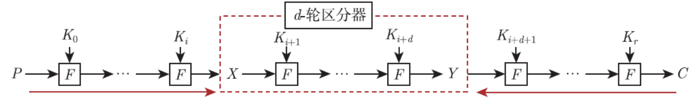

*图源：第 1 章课件第 36 页。图中的区分器只覆盖算法的一部分。*

三类典型判据要分清：高概率差分是“命中加分”，不可能差分是“触发禁忌则删除”，线性分析是“与一半相比有偏差”。它们可能都要猜末轮密钥，但判断方向不同。

### 3 复杂度必须统一对象和单位

每个攻击都要交代 **数据量 $D$、时间 $T$、存储 $M$、成功率 $P_s$**。时间要注明是 S 盒运算、轮函数计算还是完整加密；数据要注明明文条数、明文对数还是四元组数。

设完整密钥长为 $K$ 比特，分组长为 $n$ 比特。直接穷举量级为 $2^K$ 次完整加密；若找到正确密钥即停止且位置均匀，平均约 $2^{K-1}$ 次。比较攻击时应采用同一约定。

在理想随机密钥模型下，一个错误密钥匹配一组明密文的概率约为 $2^{-n}$。匹配 $r$ 组不同输入的明密文后，错误候选期望约为

$$
(2^K-1)2^{-rn}.
$$

注意：匹配第一组后，**再通过第二组的条件概率**约为 $2^{-n}$；从头看同时匹配两组的**联合概率**约为 $2^{-2n}$。

**例：** $K=80,n=64$，一组数据后约剩 $2^{16}$ 个错误候选，两组后约剩 $2^{-48}$ 个。后者是期望值，不是说存在“小数个密钥”。

> 比较“某攻击是否比穷举快”时，先问：它恢复的是完整 $K$ 比特密钥，还是只恢复末轮的 $k$ 比特子密钥？还要把剩余密钥的恢复、数据准备与候选验证计入总成本。

详见：[密码分析学概述](密码分析学概述.md)、[基本假设](基本假设.md)、[计算安全](计算安全.md)。

## 二 Enigma 机的破解

### 1 结构和两个可利用性质

信号经过“接线板 → 转子组 → 反射器 → 逆向转子组 → 接线板”。令接线板为 $S$，位置 $t$ 的转子组为 $R_t$，反射器为 $T$，则

$$
E_t=S^{-1}R_t^{-1}TR_tS.
$$

反射器满足 $T^{-1}=T$ 且无不动点，因此相同机器设置下加解密过程相同，并且**任何字母都不会加密为自身**。转子随输入步进，所以不能把整段消息当成一个固定单表替换。

### 2 密钥空间计算

- 从 $r$ 个不同转子中选 $s$ 个并排序：$r!/(r-s)!$。
- 每个转子有 26 个初始位置：$26^s$。
- 26 个字母中接 $\ell$ 对接线：$26!/((26-2\ell)!\,2^\ell\ell!)$。

题目若另计环设置、反射器选择等，再按给定的独立参数计数，不能把题目没计入的参数自行乘进去。

**例：** 5 选 3 并排序，只计初始位置，忽略环设置与接线板：

$$
5\times4\times3\times26^3=1\,054\,560.
$$

### 3 Crib 与环路如何减少搜索

Crib 是猜测的明文片段及其与密文的对齐位置。有位置出现明密文字母相同，就直接排除该对齐；没有出现相同字母，只说明它尚未被排除。

把 crib 的字母关系连成环路。设去掉接线板后的机器为 $A_t=R_t^{-1}TR_t$，则 $E_t=S^{-1}A_tS$。若环路经位置 $t_1,\ldots,t_j$ 从字母 $a$ 回到 $a$，就要求

$$
(A_{t_j}\cdots A_{t_1})(S(a))=S(a).
$$

所以可以先枚举转子设置，检查组合置换是否有相容的不动点；再据此求接线板，并检查接线冲突。**环路中间的接线板因素相消，使联合搜索可以拆开，但一次通过环路不代表设置正确。**

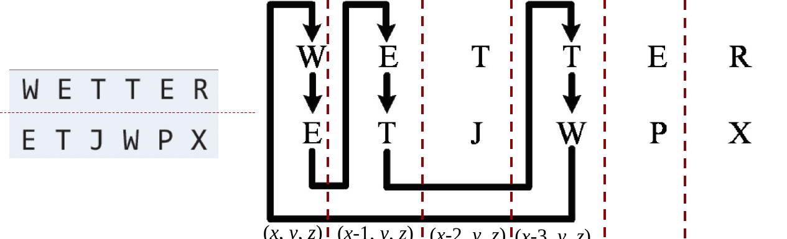

*图源：第 2 章课件第 29 页。环路还需与其他字母关系一起验证。*

简答可写成：**猜测 crib → 排除自加密位置 → 构造环路 → 筛转子设置 → 求接线板 → 完整验证。**

详见：[破解 Enigma 机](破解Enigma机.md)。

## 三 差分类攻击

### 1 普通差分：寻找偏多的差分，给密钥计数

**攻击对象是一对文本的差，核心判据是“某个差分出现得比随机情况更频繁”。** 通常使用选择明文：取 $P'=P\oplus\alpha$，观察经过若干轮后的差分是否为 $\beta$。

$$
DP_K(\alpha,\beta)=\Pr_P[E_K(P)\oplus E_K(P\oplus\alpha)=\beta].
$$

对随机 $n$ 比特置换、固定非零 $\alpha,\beta$，平均基准为 $1/(2^n-1)\approx2^{-n}$。这是完整输出差分的基准；若只检查部分比特，要按实际约束重新计算。

**三种部件的传播必须会写：**

- 相同密钥异或会抵消：$(x\oplus k)\oplus(x'\oplus k)=x\oplus x'$。
- 线性层 $y=Lx$ 精确传播差分：$\Delta y=L\Delta x$。它保持线性关系，不一定保持差分值不变。
- S 盒的传播由差分分布表 DDT 决定。对 $m$ 比特输入，

$$
\begin{aligned}
\operatorname{DDT}[a,b]&=\#\{x:S(x)\oplus S(x\oplus a)=b\},\\
DP_S(a,b)&=\frac{\operatorname{DDT}[a,b]}{2^m}.
\end{aligned}
$$

每行和为 $2^m$；$a=0$ 时仅 $b=0$ 的计数为 $2^m$；对非零 $a$，解按 $x,x\oplus a$ 配对，因此计数为偶数。双射 S 盒的非零输入差分不可能产生零输出差分。

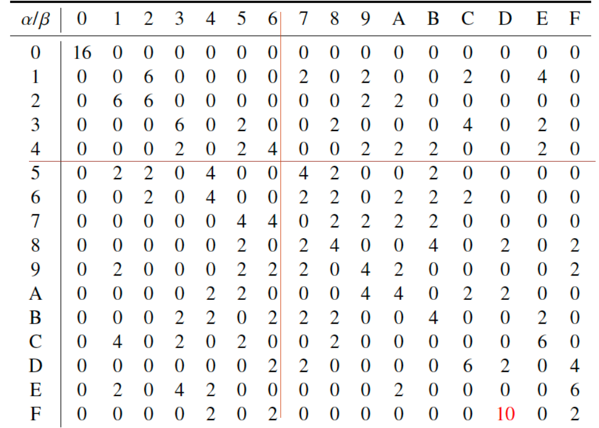

*图源：第 3.1 节《差分分析-1》，第 30 页。表中是计数，除以 16 才是概率。*

**手算例：** 课件中 $\operatorname{DDT}[\texttt{2},\texttt{2}]=6$，故概率为 $6/16$。考试给出 S 盒时，枚举所有 $x$，计算 $S(x)\oplus S(x\oplus a)$ 并计数；不能照抄另一个 S 盒的表。

### 2 差分路线与差分的区别

**差分路线**固定每一轮边界的差分；**差分**只固定头尾，允许经过不同中间状态差分。

- 单条路线：在轮密钥独立等模型下，通常用各活跃 S 盒传播概率的乘积估计。固定密钥下各步不一定独立，不能无条件相乘。
- 相同头尾的差分：不同中间差分序列对应互斥事件，应将各路线的真实概率相加。

CipherFour 课件给出四条同头尾路线，每条近似概率为 $(6/16)^4$，故这些路线的合计贡献约为

$$
4(6/16)^4\approx0.0791.
$$

“沿一条路线相乘，同头尾不同路线相加”是计算题的关键。**活跃 S 盒**指输入差分非零的 S 盒；若每个活跃 S 盒的概率至多为 $p_{\max}$，含 $a$ 个活跃 S 盒的路线在乘积模型下至多为 $p_{\max}^{a}$。

### 3 如何从区分器恢复密钥

将算法拆成“$r$ 轮高概率差分 + 末轮”，写出五步即可形成完整答案：

1. **采样：** 收集输入差分为 $\alpha$ 的明文对及其密文。
2. **预筛：** 利用末轮传播的必要条件，丢弃肯定不可能满足目标差分的数据对。
3. **猜测：** 枚举影响目标位置的末轮子密钥，部分解密密文。
4. **计数：** 若还原后的差分为 $\beta$，给该候选加一；统计全部数据后排序。
5. **验证：** 用额外明密文检验高分候选，继续恢复剩余密钥。

CipherFour 的末轮半字节检验形如

$$
S^{-1}(C_j\oplus\kappa)\oplus S^{-1}(C'_j\oplus\kappa)=\beta_j.
$$

**正确对**是确实命中内部目标差分的文本对；**正确密钥**是猜测值正确。二者不能混淆。正确密钥并不会让所有数据对都命中；错误密钥也可能偶然命中。

> 普通差分里，命中一次只增加证据，未命中一次不能删除密钥。错误候选通常接近随机基准，正确候选预期具有更多命中。

若采样 $N$ 对，目标差分概率 $p$，预筛保留比例 $\rho$，每个保留对平均给 $\eta$ 个候选加分，猜测 $k$ 比特，则课件的信噪比近似为

$$
\mathrm{SNR}\approx\frac{Np}{N\rho\eta/2^k}
=\frac{2^kp}{\rho\eta}.
$$

例如 $p\approx0.08,\rho\approx0.11,\eta\approx4,k=4$，得到约 $2.9$。该比值衡量信号相对平均噪声的强弱；成功率还受样本数、数据相关性和候选数量影响。数据量至少要让预期正确对数 $Np$ 足够大，不能把 $1/p$ 当成任何情况下都足够的精确数据复杂度。

### 4 截断差分：只规定一部分差分信息

截断差分研究一个差分集合。例如 $*0**$ 只规定第二位为零，其他位任意，代表八个具体差分。若星号定义为“任意值”，它包含零；若题目另用活跃符号表示“非零”，必须区分。

课件中输入差分 $\texttt{2}$ 经 S 盒只能输出 $\texttt{1},\texttt{2},\texttt{9},\texttt{A}$，这些值有共同的零比特，可以合并成一个截断模式。完整差分各自概率可能不高，共同模式的概率却可能为 $1$。经过下一轮时应先传播兼容的差分，再提取共同约束，不能把所有 $*$ 都擅自当成独立随机位。

**明文结构体**用较少查询制造大量数据对：固定其他位置，让一个 $m$ 比特位置遍历 $2^m$ 个值，可形成

$$
\binom{2^m}{2}\approx2^{2m-1}
$$

个无序对。例如活跃一个半字节产生 16 个明文、120 个对。不同对可共享明文，不能全当作独立试验；任意两对的非零差分值也不必相同。

恢复密钥时可在区分器首尾扩轮，猜首轮密钥筛出满足输入要求的对，再猜末轮密钥检验输出模式。若区分器是概率 $1$ 的必要条件，违反它可以排除候选；若只是较高概率事件，则仍应统计。因此**“截断”描述约束是否完整，不决定必须计数还是删除。**

### 5 不可能差分：触发禁忌就删除密钥

不可能差分满足 $\Pr[\alpha\to\beta]=0$。最典型的构造是**中间相错**：输入正向必然到达集合 $\mathcal A$，输出反向必然到达集合 $\mathcal B$，在同一轮边界证明

$$
\mathcal A\cap\mathcal B=\varnothing.
$$

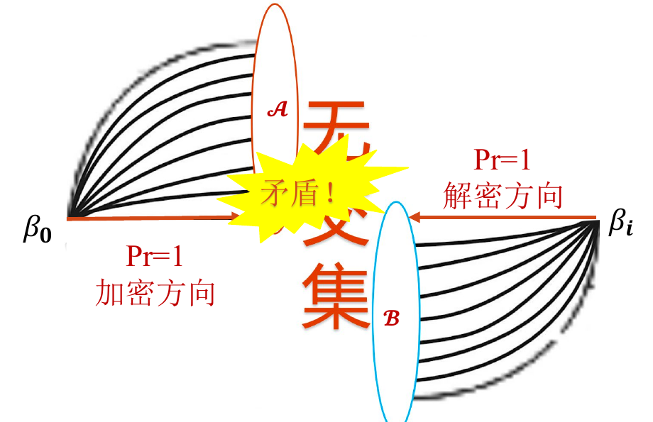

*图源：《不可能差分分析》，第 14 页。两个方向都要使用必然成立的传播约束。*

恢复步骤：扩展首尾轮 → 收集并过滤数据对 → 猜测边界子密钥 → 部分加解密 → **若得到被禁止的内部差分，则删除该候选**。没有触发矛盾仅表示暂未排除。

**Feistel 左右顺序易错点。** 若一轮定义为

$$
(L_i,R_i)=(R_{i-1},L_{i-1}\oplus F_i(R_{i-1})),
$$

且 $F_i$ 为双射，则课件五轮结论在轮内顺序下是

$$
(\alpha,0)\not\xrightarrow{5R}(0,\alpha),\qquad\alpha\ne0.
$$

正向两轮得到 $(\alpha,\beta)$，$\beta\ne0$；假设末端为 $(0,\alpha)$，反向三轮得到 $(\alpha\oplus\delta,\gamma)$，$\delta\ne0$，左半支矛盾。若末端额外交换后再记为密文，同一结论写成 $(\alpha,0)\not\to(\alpha,0)$。**先标明轮内顺序、末尾交换及逆函数返回顺序，再判断截图中的 $(0,\alpha)$ 是否写反。**

六轮例子的密文采用 $C=(R_6,L_6)$ 时，逆去末轮所得轮内状态为

$$
(L_5,R_5)=(C^L\oplus F_\kappa(C^R),C^R).
$$

因此预筛 $\Delta C^R=\alpha$ 后，若 $F_\kappa(C_i^R)\oplus F_\kappa(C_j^R)=\Delta C^L$，恰好得到禁忌 $(0,\alpha)$，应删除 $\kappa$。

**复杂度不能只看“排除得很快”。** 课件六轮例子设分组长 $b$、末轮子密钥长 $k$，每个结构体约有 $2^{b/2}$ 个明文，过滤后约 $2^{b/2-1}$ 对。独立近似下，一个结构体使错误候选留存比例约为 $e^{-1/2}$；$s$ 个结构体后约剩 $(2^k-1)e^{-s/2}$ 个。候选虽然递减，仍要遍历最初的 $2^k$ 个候选并处理数据对，课件模型约需 $2^{k+b/2+1.34}$ 次轮函数运算，若六次轮函数计作一次完整六轮加密，约为 $2^{k+b/2-1.24}$ 次完整加密。几何级数只改变常数因子，没有消除对 $k$ 的指数增长。这里 $k$ 是末轮子密钥长度，$K$ 才是完整密钥长度：若两者相同，直接穷举往往更便宜；若只恢复局部子密钥，应计入剩余密钥恢复成本后与 $2^K$ 比较。

### 6 飞去来器 增强飞去来器和矩形

把密码拆成两段：上段有 $\alpha\to\beta$、概率 $p$；下段有 $\phi\to\gamma$、概率 $q$。将连接线性层并入其中一段后，若 $\beta\ne\phi$，不能沿同一对文本直接串接；若把线性层 $A$ 单列，则串接条件是 $A\beta=\phi$。飞去来器用四个文本，让上段差分对应横边、下段对应竖边，在中间建立平行四边形关系。

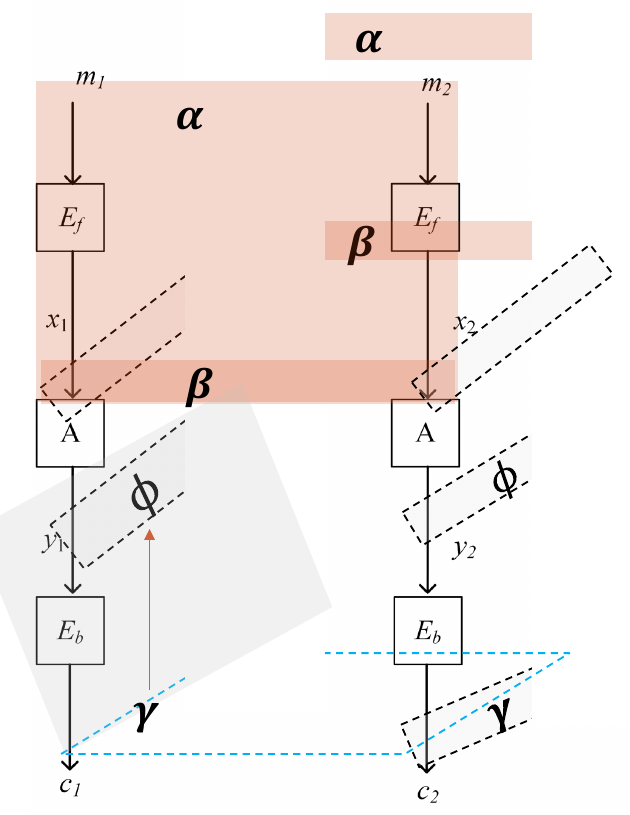

*图源：第 3.3 节《飞去来器攻击和矩形攻击》，第 6 页。线性或仿射连接层保持“四个状态异或为零”的关系。*

**经典飞去来器：** 选择 $P_1,P_2$ 使差分为 $\alpha$，取得 $C_1,C_2$；主动构造 $C_3=C_1\oplus\gamma,C_4=C_2\oplus\gamma$ 并查询解密；检查 $P_3\oplus P_4=\alpha$。它需要选择明文和选择密文能力。在两段差分适用且相关性可忽略的课件模型下，两次上段、两次下段的成功贡献约为 $p^2q^2$。

**增强飞去来器：** 只选两对输入差分均为 $\alpha$ 的明文，观察密文侧两个跨对差分是否均为 $\gamma$。由于无法主动构造密文，中间跨对差分还要偶然对齐，多出约 $2^{-n}$ 的代价。

下表取非零 $\alpha,\gamma$，只统计非退化四元组。经典版排除 $C_1\oplus C_2=\gamma$ 的情形，否则只是把原密文对交换后解密，会自动成功；增强版要求四个明文互不相同。

| 对一个候选四元组的模型 | 经典飞去来器 | 增强飞去来器 |
| --- | --- | --- |
| 具体密码成功概率近似 | $p^2q^2$ | $2^{-n}p^2q^2$ |
| 随机置换基准近似 | $2^{-n}$ | $2^{-2n}$ |
| 相对随机基准的概率比 | $2^np^2q^2$ | $2^np^2q^2$ |
| 查询能力 | 选择明文与选择密文 | 选择明文 |

“增强”不是说单个四元组更容易成功。准备 $N$ 个明文对，可以配出约 $\binom N2$ 个候选四元组，期望成功数约为 $\binom N2 2^{-n}p^2q^2$，借候选数的平方增长放大罕见事件，并降低对查询能力的要求。若解密查询可用，经典版未必更差。两者概率比相同也不代表数据、时间或存储相同。

**矩形攻击**进一步汇总相容的中间差分。常见独立近似下，令 $p_\beta=\Pr[\alpha\to\beta]$、$q_\phi=\Pr[\phi\to\gamma]$，用 $\widehat p^{\,2}=\sum_\beta p_\beta^2$、$\widehat q^{\,2}=\sum_\phi q_\phi^2$ 汇总贡献，形式类似 $2^{-n}\widehat p^{\,2}\widehat q^{\,2}$。这里先把相同头尾的路线合成差分概率，再对不同中间差分的概率分别平方求和；不能把不同中间差分概率全加起来再平方。共享中间状态带来的依赖与不相容性需要检查，$p^2q^2$ 不是无条件定理。

详见：[普通差分](差分攻击.md)、[截断差分](截断差分.md)、[不可能差分](不可能差分分析.md)、[飞去来器与矩形](飞去来器攻击.md)。

## 四 线性类攻击

### 1 掩码 偏差 相关度和 LAT

线性分析研究**比特的异或和是否有偏差**，通常使用已知明文。掩码 $a$ 指出选择哪些比特，内积定义为 $a\cdot x=\bigoplus_i a_ix_i$。例如 $a=101$ 表示取 $x_1\oplus x_3$。

对 S 盒研究 $a\cdot x\oplus b\cdot S(x)=0$，设成立输入数为 $N_0$，输入宽度为 $m$，则

$$
p=\frac{N_0}{2^m},\qquad
\varepsilon=p-\frac12,\qquad
c=2\varepsilon=2p-1.
$$

本笔记采用中心化 LAT：

$$
\begin{aligned}
\operatorname{LAT}[a,b]&=N_0-2^{m-1},\\
\varepsilon&=\frac{\operatorname{LAT}[a,b]}{2^m},\\
c&=\frac{\operatorname{LAT}[a,b]}{2^{m-1}}.
\end{aligned}
$$

有的材料把 $N_0$、Walsh 值 $2N_0-2^m$ 或相关度也称作 LAT；**先看定义再换算**。例如 4 比特 S 盒有 12 个输入满足等式，则 $p=3/4,\varepsilon=1/4,c=1/2$，此处 LAT 项为 4，Walsh 值为 8。负偏差同样有用，只是等式更倾向不成立。

双射 S 盒中，非零单侧掩码的线性比特均匀，故 $\operatorname{LAT}[a,0]=\operatorname{LAT}[0,b]=0$（$a,b\ne0$）；$(0,0)$ 是恒真式，没有攻击价值。若输入输出等宽且 $m\ge2$，此定义下 LAT 项为偶数。

### 2 掩码传播不能照抄差分传播

若 $y=Lx$，有

$$
b\cdot y=(L^{\mathsf T}b)\cdot x,
\qquad a=L^{\mathsf T}b.
$$

差分沿数据方向用 $L$ 传播；掩码的相容条件用转置 $L^{\mathsf T}$。密钥异或满足 $b\cdot(x\oplus k)=b\cdot x\oplus b\cdot k$，引入固定密钥奇偶项，不改变偏差绝对值。

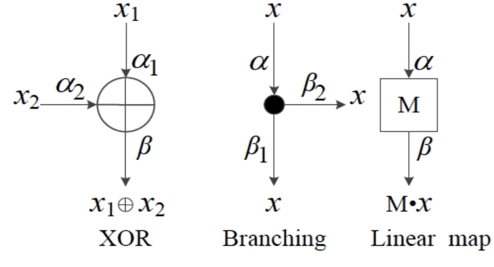

*图源：第 4.1 节《线性分析》，第 54 页。*

- 异或结点 $y=x_1\oplus x_2$：输出掩码 $b$ 分别传给两个输入。
- 复制结点 $x\mapsto(x,x)$：两个输出掩码 $b_1,b_2$ 在输入合并为 $b_1\oplus b_2$。
- S 盒：选择 LAT 非零的掩码对，并使相邻部件的中间掩码抵消。

### 3 堆积引理与线性包

对相互独立的二值误差 $Z_i$，设 $\Pr[Z_i=0]=1/2+\varepsilon_i$，则

$$
\varepsilon_{\oplus}=2^{s-1}\prod_{i=1}^s\varepsilon_i,
\qquad c_{\oplus}=\prod_{i=1}^sc_i.
$$

**手算例：** 两个独立近似的偏差都为 $1/4$，异或后偏差为 $2(1/4)^2=1/8$，等式成立概率为 $5/8$。若其中一个偏差为 $-1/4$，结果为 $-1/8$，概率为 $3/8$。不要把两个“成立概率”直接相乘当成异或结果的概率。

一条**线性路线**固定各层掩码；同头尾的所有路线构成**线性包**。路线贡献具有符号，固定密钥下整体相关度是各路线带符号贡献之和，可能相互增强或抵消；不能像非负的差分概率那样只把绝对值相加。应用堆积引理时还要说明独立性近似。

### 4 Matsui 算法 1：判断密钥奇偶位

设线性近似为 $a\cdot P\oplus b\cdot C=\theta(K)$，以概率 $p=1/2+\varepsilon$ 成立。统计 $N$ 组明密文中左侧为零的次数 $T$：

| 已知偏差符号 | $T>N/2$ | $T<N/2$ |
| --- | --- | --- |
| $\varepsilon>0$ | 猜 $\theta=0$ | 猜 $\theta=1$ |
| $\varepsilon<0$ | 猜 $\theta=1$ | 猜 $\theta=0$ |

统一记法：$(T-N/2)\varepsilon>0$ 时猜零，小于零时猜一；恰好相等则无法据此区分。算法 1 得到的是**一个密钥比特线性组合**，不一定是一个单独密钥位，更不是直接得到完整密钥。

下标例子应保持一致：若 $u=P\oplus k_0,v=C\oplus k_1$，把 $a\cdot u\oplus b\cdot v=0$ 展开，右侧就是 $a\cdot k_0\oplus b\cdot k_1$。

### 5 Matsui 算法 2：猜边界子密钥，比较偏离程度

用前 $r$ 轮近似攻击 $r+1$ 轮算法。对每个末轮子密钥候选 $\kappa$，部分解密得到 $Y_\kappa$，统计

$$
T_\kappa=\#\{i:a\cdot P_i\oplus b\cdot Y_{\kappa,i}=0\},
\qquad\text{评分}=|T_\kappa-N/2|.
$$

正确候选保留近似的偏差，计数可能高于或低于 $N/2$；未知密钥奇偶项决定方向。在错误密钥随机化近似下，错误候选更接近 $N/2$。因此**按绝对偏离排序，不能只找最大计数**；最终需额外验证并恢复剩余密钥。

频率的抽样波动约为 $O(N^{-1/2})$，要识别偏差 $|\varepsilon|$，固定成功率下通常需 $N=O(|\varepsilon|^{-2})$。这只是量级；候选数量、目标成功率、各样本依赖会影响常数和实际需求。朴素枚举 $k$ 比特候选的局部运算时间约为 $O(N2^k)$，数据复杂度与计算时间要分开写。

### 6 差分—线性：连接的是差分的掩码奇偶值

拆分 $E=E_1\circ E_0$。前段作用在一对明文上，产生中间差分 $\Delta X=X\oplus X'$；后段使用线性近似 $\lambda\cdot X\oplus\mu\cdot Y=0$，单次偏差为 $\varepsilon$。

接口需要的不是完整 $\Delta X$，而是

$$
\Pr[\lambda\cdot\Delta X=0]=\frac12+\varepsilon_d.
$$

将两次后段近似异或，中间项合成 $\lambda\cdot\Delta X$。若两个线性误差与接口奇偶误差可按独立模型处理，三项应用堆积引理得到

$$
\begin{aligned}
\Pr[\mu\cdot(Y\oplus Y')=0]&=\frac12+4\varepsilon_d\varepsilon^2,\\
\varepsilon_{\mathrm{DL}}&=4\varepsilon_d\varepsilon^2.
\end{aligned}
$$

两个典型情形必须区分：

- 截断差分保证 $\lambda\cdot\Delta X=0$：$\varepsilon_d=1/2$，故整体偏差为 $2\varepsilon^2$。
- 一条概率为 $p$ 的差分保证该奇偶值为零，并**额外假设其他情况奇偶均匀**：接口为零概率 $p+(1-p)/2=(1+p)/2$，故 $\varepsilon_d=p/2$，整体偏差为 $2p\varepsilon^2$。若保证奇偶为一，则符号反向。

例如接口恒为零、后段偏差 $\varepsilon=1/4$，整体偏差为 $1/8$、成立概率为 $5/8$。若只有概率 $p=1/4$ 的上述路线且其余情况均匀，则偏差为 $1/32$、概率为 $17/32$。

不能直接把任意完整差分的概率当成 $\varepsilon_d$；不同差分可能给出相同接口奇偶值。获得整体偏差后，统计输出差分的掩码奇偶值即可区分；恢复密钥则继续扩首尾轮并检验候选。数据量通常按 $|\varepsilon_{\mathrm{DL}}|^{-2}$ 估计。

详见：[线性分析](线性分析.md)、[差分—线性分析](差分-线性分析.md)。

## 五 积分分析与 Square 攻击

积分分析观察**一组明文经过加密后，在同一位置形成的多重集性质**。普通差分关注一对文本的差值；Square 则利用整组文本的异或和。

### 1 四种状态及传播规则

以下以一组 $256$ 个字节为例：

| 记号 | 含义 | 能否保证异或和为零 |
| --- | --- | --- |
| $A$：活跃 | $0,\ldots,255$ 恰好各出现一次 | 能 |
| $C$：常数 | $256$ 个值相同 | 能，因为出现偶数次 |
| $B$：平衡 | 全部值的异或和为 $0$，不要求遍历 | 能 |
| $?$：未知 | 没有足够信息确定上述性质 | 不能保证 |

$A$、$C$ 都蕴含平衡，但 $B$ 不一定是 $A$ 或 $C$；$?$ 也不代表异或和一定非零。这里的字节值来自**不同明文的同一位置**。

必须会用的传播规则：

- **固定密钥异或**：$A$ 仍为 $A$，$C$ 仍为 $C$；偶数个元素的 $B$ 仍为 $B$。
- **可逆字节 S 盒**：保持 $A$、$C$，但一般不保持只有 $B$ 的集合。
- **字节位置置换**：只移动性质所在的位置。
- **线性混合**：输入各位置都平衡，输出也平衡，因为可以交换线性运算与整组异或的顺序。
- **一个 $A$ 与若干 $C$ 组合**：若活跃字节的线性系数非零，仍为 $A$。多个 $A$ 混合通常只能保证 $B$；它们来自同一组明文，不能擅自当作互相独立。

### 2 为什么 AES 三轮后平衡

选择 $2^8=256$ 个明文，使一个字节遍历全部值，其余 $15$ 个字节固定。初始轮密钥异或不改变这个结构。

1. **第 1 轮后，一列四个 $A$。** 字节代换和行移位保持单个 $A$；列混合的每个输出是该 $A$ 的非零倍数异或常数，所以该列四个字节都遍历。
2. **第 2 轮后，十六个 $A$。** 字节代换保持遍历；行移位把四个 $A$ 分散到四列，每列一个；列混合又使每列四个字节都成为 $A$。
3. **第 3 轮后，十六个 $B$。** 字节代换保持十六个位置的遍历性，行移位只换位置；列混合把若干平衡字节序列线性组合，故每个输出位置仍平衡。此时不再保证遍历。

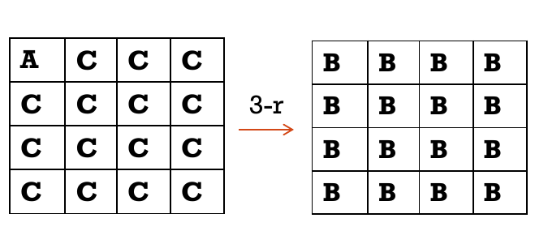

图源：《第5.1节 Square攻击》第 9 页。

记第 $i$ 个明文经三轮后的第 $j$ 个字节为 $Y_{i,j}$，则

$$
\bigoplus_{i=0}^{255}Y_{i,j}=0,\qquad j=0,\ldots,15.
$$

**答题要点：** 三轮平衡来自可逆代换保持遍历、线性层保持异或和；再过一轮非线性代换，单凭 $B$ 已不能继续推出平衡。

### 3 向后扩一轮恢复密钥

对**第 4 轮没有 MixColumns** 的四轮 AES，猜末轮一个密钥字节 $\kappa$，对每个密文做字节级部分解密：

$$
T_j(\kappa)=\bigoplus_{i=0}^{255}S^{-1}(C_{i,j}\oplus\kappa).
$$

行移位只决定它对应三轮输出的哪个位置，不影响平衡检验。正确密钥必有 $T_j(\kappa)=0$；非零即可删除候选，零则继续用其他结构检查。

在错误密钥随机化近似下，一个结构让错误字节候选通过的概率约为 $2^{-8}$。若 $s$ 个结构能近似独立过滤，一个字节的错误候选期望约为

$$
(2^8-1)2^{-8s}.
$$

一个结构后约剩一个错误候选，因此不能把首次通过直接当成密钥恢复成功。逐字节筛选后，仍需结合密钥编排与明密文验证。

**工作量例子：** 每个结构需要 $256$ 个选择明文；猜一个字节的 $256$ 个候选、对每个候选处理 $256$ 条数据，共约 $2^{16}$ 次逆 S 盒运算。处理 $16$ 个字节约 $2^{20}$ 次，不能写成同样次数的完整 AES 加密。若外加轮包含 MixColumns，需要先处理列混合及相关密钥依赖，不能直接套上述单字节式子。

详见：[Square 攻击](Square攻击.md)。

## 六 中间相遇攻击

中间相遇（MITM）把运算分为两段：从明文正向算，从密文反向算，在中间状态或某种关系上比较。它省时间的关键是**两边能分别枚举较小的未知量**，并用足够多的匹配信息排除错误组合；常以大量存储为代价。

### 1 双重 DES 必会推导

两个独立的 $56$ 位密钥满足

$$
C=E_{K_2}(E_{K_1}(P)),\qquad E_{K_1}(P)=D_{K_2}(C).
$$

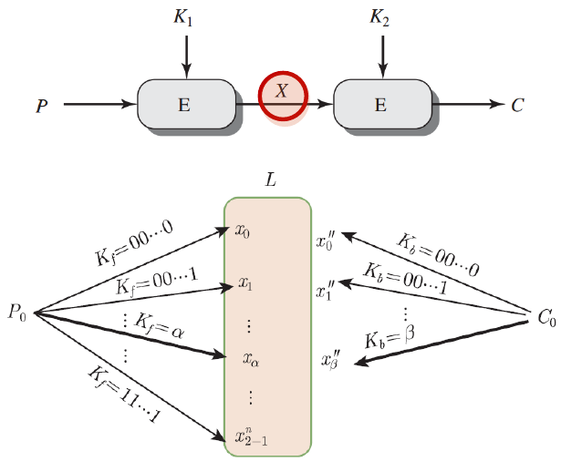

图源：《第6章 中间相遇攻击》第 7 页。

已知一对明密文 $(P,C)$：

1. 枚举 $2^{56}$ 个 $K_1$，存储 $(E_{K_1}(P),K_1)$，按中间值建表。同一个值对应多个密钥时全部保留。
2. 枚举 $2^{56}$ 个 $K_2$，计算 $D_{K_2}(C)$ 并查表。每次相等给出候选密钥对。
3. 用额外明密文验证候选。相遇只是必要条件，不能保证候选正确。

在理想随机匹配近似下，错误密钥对匹配一个 $64$ 位中间值的概率约为 $2^{-64}$。因此第一对数据后，错误候选期望数为

$$
2^{112}\cdot2^{-64}=2^{48}.
$$

第二对不同明密文再提供约 $64$ 位约束，错误候选期望降为

$$
2^{48}\cdot2^{-64}=2^{-16}.
$$

| 资源 | 数量及计量单位 |
| --- | --- |
| 数据 | 约两对已知明密文，必要时继续验证 |
| 初筛时间 | $2^{56}+2^{56}=2^{57}$ 次单 DES 运算 |
| 复筛时间 | 约 $2\cdot2^{48}$ 次单 DES 运算，低于初筛主项 |
| 存储 | 约 $2^{56}$ 条中间值及对应密钥的表项 |

**为什么强于穷举？** 直接枚举的是 $2^{112}$ 个密钥对；中间相遇分别做两个 $2^{56}$ 规模的列表。$112$ 位是密钥对的长度，不等于这种攻击下的时间安全强度。$2^{57}$ 次单 DES 约相当于 $2^{56}$ 次双重 DES；比较复杂度要先统一单位。

### 2 一般形式与部分比特匹配

设正向专用未知位为 $k_f$ 位，反向专用未知位为 $k_b$ 位，共同依赖 $k_j$ 位；三者按不同的独立密钥位计数。每固定一个共同猜测，就建立并匹配两个表。忽略每次局部计算代价的差别，初筛时间与存储约为

$$
T_{\mathrm{初筛}}\sim2^{k_j}(2^{k_f}+2^{k_b}),\qquad
M\sim2^{\min(k_f,k_b)}\text{ 条表项}.
$$

存储式假设共同猜测逐个处理、复用同一张表；密钥编排相关的轮密钥不能当成独立自由位重复计数。若只能比较 $\ell$ 位、总独立猜测位数 $k=k_f+k_b+k_j$，错误候选期望约为

$$
N_{\mathrm{错}}\approx2^{k-\ell}.
$$

少匹配一些位可能让两侧更容易独立计算，却会增加后续验证量。**总时间必须包括建表、查表、处理匹配项和复筛**；候选过多时，列举或验证候选反而成为主项。

**计算例子：** 两边各有 $32$ 位独立密钥，只匹配 $24$ 位。初筛约 $2^{33}$ 次局部计算，但错误候选约 $2^{64-24}=2^{40}$ 个，因此不能仅报 $2^{33}$ 的总时间。还需增加有效匹配信息，或计入处理这 $2^{40}$ 个候选的成本。

### 3 2K3DES 为什么要拼切

两密钥三重 DES 为

$$
C=E_{K_1}(D_{K_2}(E_{K_1}(P))).
$$

同一个 $K_1$ 出现在首尾，普通切分时两边密钥依赖重叠。课件的拼切方法固定内部值为 $0$：先对所有 $K_2$ 存储 $D_{K_2}(0)$；对每个 $K_1$ 猜测选择

$$
P=D_{K_1}(0),
$$

查询其真实密文 $C$，再计算 $D_{K_1}(C)$ 查表。猜对时，第一层输出确为 $0$，所以满足

$$
D_{K_1}(C)=D_{K_2}(0).
$$

这个模型需要约 $2^{56}$ 量级的计算、表项和**选择明文查询**。不能只比较时间而省略数据条件，也不能把它写成普通已知明文攻击。

### 4 AES 的集合映射相遇

相遇对象还可以是“$256$ 个输入对应的输出序列”。课件的约简轮 AES 示例从一个字节遍历、其余固定的集合出发，研究四轮后的一个输出字节如何随输入变化。

该有序映射受轮结构及有限参数约束，可能的映射远少于任意 $256$ 项字节表。攻击可先预计算允许的映射，再猜前后附加轮的相关子密钥，通过部分加密、部分解密构造映射并查表。**映射不在表中便排除猜测；在表中仍需验证。**

它与 Square 都可使用结构化明文集合，但检验条件不同：Square 检验异或和是否为零；映射相遇检验整组输入输出关系是否属于允许集合。课件的七轮 AES-256 例子采用 $1+4+2$ 结构，结论限于该约简轮模型，预计算、在线时间、数据与存储须分别计算。

详见：[中间相遇攻击](中间相遇攻击.md)。

## 七 杂凑函数安全性

### 1 三种目标与通用复杂度

设输出为 $n$ 比特。**先问哪一端被指定，再选复杂度公式。**

| 攻击目标 | 题目给定 | 攻击者寻找 | 理想模型下的工作量级 |
| --- | --- | --- | --- |
| 原像 | 摘要 $y$ | $H(M)=y$ 的消息 $M$ | $2^n$ |
| 第二原像 | 消息 $M$ | $M'\ne M$ 且 $H(M')=H(M)$ | 普通固定目标约 $2^n$ |
| 碰撞 | 无须指定消息或摘要 | 任意两个不同消息且摘要相同 | $2^{n/2}$ |

碰撞必然存在，安全性要求的是**难以找到碰撞**。长消息的第二原像攻击利用迭代结构，可能偏离上表的理想随机函数基准。

对 $q$ 个不同消息，假设输出独立且均匀，生日碰撞概率为

$$
P_{\mathrm{coll}}
=1-\prod_{i=0}^{q-1}(1-i/2^n)
\approx1-\exp\left(-\frac{q(q-1)}{2^{n+1}}\right).
$$

- $q=2^{n/2}$ 时，概率约为 $1-e^{-1/2}=39.3\%$。
- 达到约 $50\%$，需 $q\approx\sqrt{2\ln2}\,2^{n/2}\approx1.177\,2^{n/2}$。
- 直接存表法的时间、存储均为 $O(2^{n/2})$；这里讨论这种实现，不表示所有碰撞搜索都必须用同样多存储。

**小题：**64 比特杂凑值，取 $2^{32}$ 条消息，碰撞概率不是精确的 $1/2$，而是约 $39.3\%$；复杂度仍称 $2^{32}$ 量级。

### 2 广义生日与 4-tree

4-SUM 的目标是从四个列表各选一项，使

$$
x_1\oplus x_2\oplus x_3\oplus x_4=0,\qquad x_i\in L_i.
$$

四表各含 $2^x$ 个独立随机 $n$ 比特元素。4-tree 分两层处理：先合并 $L_1,L_2$ 以及 $L_3,L_4$，仅保留异或值低 $\ell$ 位为零的对；再匹配两中间表剩余的 $n-\ell$ 位。用分桶或排序找低位匹配，避免把所有原始对全部列出。

$$
\begin{aligned}
\text{每个中间表的期望大小}&=2^{2x-\ell},\\
\text{最终保留的期望解数}&=2^{4x-\ell-n}.
\end{aligned}
$$

平衡输入与中间表大小，取 $x=\ell=n/3$，得到常数量级的期望解数，时间与空间约为 $2^{n/3}$，忽略取整和排序等因子。期望解数为 1 不代表每次必成功。

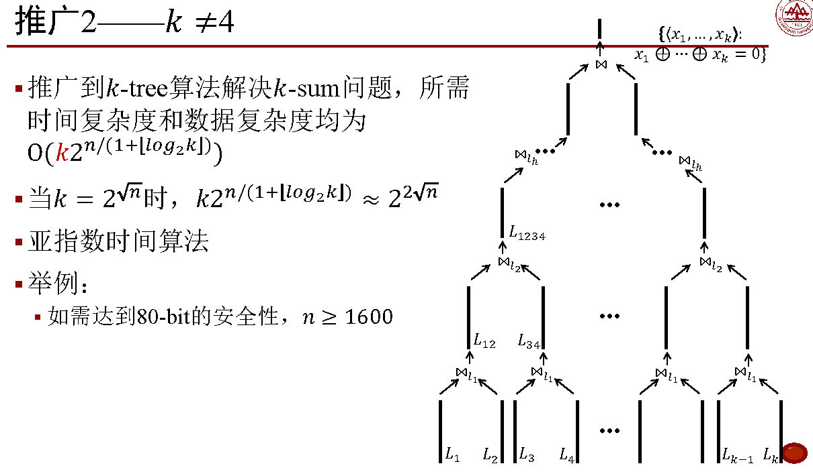

*课件第 12.3.1 节第 20 页；图中的四表子树对应 4-tree。*

**易错点：**四表各取 $2^{n/4}$ 项时，全部四元组的期望解数已约为 1，但这只是存在性估计，未给出寻找它的同量级算法。$2^{n/3}$ 适用于可生成足够独立随机候选的多列表问题，不能据此声称任意杂凑函数的普通碰撞都可在 $2^{n/3}$ 时间内求出。

### 3 MD 结构、长度扩展与多碰撞

MD 迭代结构为

$$
H_0=IV,\qquad H_i=f(H_{i-1},M_i).
$$

两条路径一旦在同一位置得到相同链值，后续处理相同分组就始终相同。**最终填充也属于后续分组**，长度不能忽略。

当摘要直接暴露完整末尾链值，且已知消息长度时，可以由 $H(M)$ 继续算出

$$
H(M\parallel\operatorname{pad}(M)\parallel X).
$$

这称为长度扩展；一般不能直接得到 $H(M\parallel X)$。MD 强化在填充中编码长度，**不等于阻止上述长度扩展**；截断摘要、额外最终处理等须另行分析。

多碰撞：从当前链值找两个不同分组但终点相同，再从这个共同终点重复。做 $r$ 级，每级二选一，得到 $2^r$ 条等长消息。每级采用生日搜索时，构造这些选择所需工作约为 $r2^{n/2}$ 次压缩计算；显式列出全部消息的成本另算。等长保证最后填充一致。

### 4 长消息第二原像与可扩展消息

目标消息有约 $2^d$ 块，因而提供约 $2^d$ 个可用的不同中间状态。随机试验一个新链值，命中其中任意一个的概率约为 $2^{d-n}$，预计桥接成本约为 $2^{n-d}$。

**没有长度强化：**若从 $IV$ 经新分组 $B$ 到达目标的 $H_i$，接上原后缀就可得到相同末尾状态。但新消息通常变短，不能把这一步原样用于带长度编码的情况。

**有长度强化：**先构造可扩展消息。第 $j$ 级提供长度分别为 $1$ 和 $1+2^j$ 的两条同终点路径，$j=0,\ldots,d-1$。各级选长或短，得到长度覆盖

$$
d,\ d+1,\ldots,d+2^d-1
$$

且终点均为 $H_{\mathrm{exp}}$ 的前缀族。它们拥有相同的**中间链值**，并不意味着分别独立填充后仍有相同完整摘要。

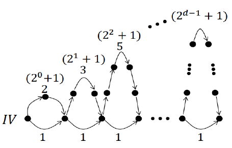

*课件第 12.2 节第 11 页。*

目标状态表只收录 $d+1\le i\le\min(L,d+2^d)$ 的 $H_i$，保证 $i-1$ 落在前缀可选长度内。接下来寻找桥接分组 $B$，使 $f(H_{\mathrm{exp}},B)=H_i$；选用长度恰为 $i-1$ 块的可扩展前缀，再接 $B$ 和原后缀 $M_{i+1}\parallel\cdots\parallel M_L$。这样接入位置和总长度都相同，最终填充也相同。最后核对 $M'\ne M$。

在理想压缩函数、足够可用且近似互异的目标状态等假设下，总工作量级为

$$
d2^{n/2}+2^{n-d}+2^d.
$$

三项依次对应构造各级碰撞、桥接尝试、长路径及目标状态处理；计量单位是压缩函数计算。存储还需考虑目标状态表。当 $d\approx n/2$ 时主指数接近生日搜索，但要求约 $2^{n/2}$ 块的极长目标消息，不能推广为普通短消息的第二原像成本。

### 5 MD4 碰撞：比特追踪与消息修改

MD4 的消息块为 512 比特，链值为 128 比特，由四个 32 比特字组成；压缩过程有三轮、每轮 16 步，包含布尔函数、模 $2^{32}$ 加法、循环移位，最后与输入链值逐字前馈相加。同一输入链值下，最终四字状态相同就使压缩输出相同。

碰撞构造的主线是：**选择消息差分 → 设计最终归零的状态差分路线 → 推出充分位条件 → 修改消息满足条件 → 验证完整碰撞。**

- **布尔函数：**第一轮 $F(X,Y,Z)=(X\land Y)\lor(\neg X\land Z)$，逐位由 $X$ 决定选 $Y$ 或 $Z$。限制对应位可控制差分是否传出。
- **模加：**进位影响更高位；不能把模减差分直接当作异或差分。带符号位变化比单个模减值包含更多信息。
- **循环移位：**移动比特位置；先确定进位造成的具体位变化，再追踪移位后的差分。
- **局部碰撞：**某一段引入的差分后来抵消，不等于已经完成整个压缩函数的碰撞。

单步消息修改利用第一轮消息字的自由度：例如

$$
d_1=(d_0+F(a_1,b_0,c_0)+m_1)\lll7,
$$

先调整 $d_1$ 使其满足位条件，再反解

$$
m_1=(d_1\ggg7)-d_0-F(a_1,b_0,c_0)\pmod{2^{32}}.
$$

多步修改则联动修改并补偿多个消息字，满足后轮条件同时尽量保留前轮条件。修改后必须维持消息对的规定差分并检查另一条计算路径。

课件的“122 个条件对应 $2^{-122}$”依赖各条件独立且均匀的粗略假设；消息修改后的成功概率是**构造出的候选对**的概率，不是随机消息对的碰撞概率，也不能忽略修改与检查成本。

进一步推导见：[生日攻击与广义生日攻击](生日攻击与广义生日攻击.md)、[第二原像攻击](第二原像攻击.md)、[具体杂凑函数的碰撞攻击](具体杂凑函数的碰撞攻击.md)。

## 八 消息认证码

### 1 安全目标与伪造类型

MAC 使用共享密钥验证消息完整性和来源，不提供消息保密性，也不具有数字签名意义上的不可否认性。重放有效消息不等于对新消息的伪造；防重放还需协议中的序号等机制。

| 目标 | 攻击者做到什么 |
| --- | --- |
| 通用伪造 | 不一定知道密钥，但能给任意指定的新消息生成有效标签 |
| 选择性伪造 | 在获取查询结果前指定目标消息，再为它生成有效标签 |
| 存在性伪造 | 至少找到一条未查询的新消息及其有效标签，内容可自由选择 |

**选择消息攻击是查询能力，选择性伪造是攻击目标，二者不能混淆。**EUF-CMA 要求攻击者即便能查询自选消息的标签，仍难以伪造未查询消息。恢复密钥是更强的结果，能区分某构造则未必能伪造。

若密钥 $k$ 位、标签 $t$ 位，通用穷举密钥量级为 $2^k$ 次离线计算；理想标签盲猜每次成功率 $2^{-t}$，$q$ 次独立在线尝试在小概率范围内约为 $q/2^t$。比较两种攻击时须区分在线验证次数与离线计算次数。

### 2 简单杂凑 MAC 的结构性问题

| 构造 | 核心漏洞与必要条件 |
| --- | --- |
| 密钥前缀 $H(K\parallel M)$ | 摘要为完整链值、密钥长度已知或猜对且编码允许扩展时，可做长度扩展 |
| 密钥后缀 $H(M\parallel K)$ | 先找等长、分组对齐消息的内部链值碰撞，追加同一密钥后标签相同 |
| 简单封装 $H(K\parallel M\parallel K)$ | 内部碰撞可沿相同后缀传播；最终标签碰撞未必就是内部碰撞 |

前缀伪造的正确写法是：已知 $T=H(K\parallel M)$，输出

$$
M^*=M\parallel\operatorname{pad}(K\parallel M)\parallel X,
$$

从链值 $T$ 继续处理 $X$，并按扩展后的总长度填充，得到其标签。原填充字节必须成为伪造消息的一部分。

后缀构造中，若离线找到 $M,M'$ 在加入 $K$ 之前的链值相同，查询 $M$ 的标签便可移用于未查询的 $M'$。典型理想生日模型成本约为 $2^{n/2}$ 次离线工作加一次在线查询。普通截断摘要相等不足以推出内部状态相等。

封装构造要区分内部与外部碰撞：内部状态相同则附加相同后缀后仍碰撞；仅最终短标签相同则未必如此。可用共同后缀查询来筛选候选，再换未查询的新后缀完成伪造，寻找及筛选成本另计。**这些简单拼接攻击不能直接套用于 HMAC。**

### 3 CBC-MAC 的变长伪造与 CMAC

CBC-MAC 使用固定零初值：

$$
c_0=0,\qquad c_i=E_K(c_{i-1}\oplus m_i),\qquad T=c_\ell.
$$

基本形式要求消息长度固定且预先约定。若直接支持可变长消息，查询一块 $m$ 得 $t=E_K(m)$，则新消息

$$
m\parallel(t\oplus m)
$$

的标签仍为 $t$，因为第二轮为 $E_K(t\oplus(t\oplus m))=E_K(m)=t$。这是存在性伪造，**不构成对严格固定长度版本的同一种攻击**。

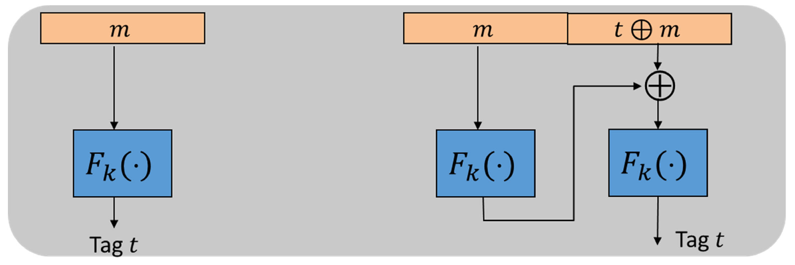

*课件第 13 章第 15 页。*

CMAC 区分末块情况：令 $L=E_K(0^b)$，通过有限域倍乘得到 $K_1=\operatorname{dbl}(L)$、$K_2=\operatorname{dbl}(K_1)$；倍乘实现为左移一位，并在原最高位为 1 时异或规定的约减常数。非空消息的完整末块异或 $K_1$，不完整末块先补 `1` 再补 `0`，异或 $K_2$。空消息也走填充分支。最后执行分组加密，可按要求截断标签。这里按 [NIST SP 800-38B](https://csrc.nist.gov/pubs/sp/800/38/b/upd1/final) 约定，避免沿用课件第 16 页的子密钥标注错误。

另一种思路是在前面加入无歧义的消息长度编码；只在末尾附加长度不自动保证安全，因为攻击者仍可能先让两条链在长度块之前相遇。

**闭卷自测：**说出前缀 MAC 伪造消息中为何必须保留旧填充；不看公式手推 CBC-MAC 的上述两分组伪造，并指出攻击成立的长度条件。完整推导见[消息认证码](消息认证码.md)。

## 九 自动化搜索与实验原理

闭卷复习要能解释“怎样把传播规律写成约束”，并能用小例核对正确性。

### 1 从表到合法传播点

对于一个 4 比特 S 盒，把输入输出坐标统一编码为

$$
x=(a_3,a_2,a_1,a_0,b_3,b_2,b_1,b_0)\in\{0,1\}^8.
$$

差分合法点取 DDT 非零位置；非零相关线性传播点取 LAT 非零位置，**负的 LAT 表项也要保留**。全零点表示未激活部件，局部模型通常保留；全局搜索时再排除输入全零等平凡解。

令合法点集为 $V$，非法点集为 $Q=\{0,1\}^8\setminus V$，与 lab4 报告的 $x,Q$ 记号一致。

| 方法 | 核心表达 | 要说明的正确性 |
| --- | --- | --- |
| one-hot | 每个 $v\in V$ 配一个二进制变量 $\lambda_v$，要求 $\sum_v\lambda_v=1$、$x=\sum_v\lambda_vv$ | 恰好选中一个合法点 |
| 逐点排除 | 对每个 $q\in Q$ 要求 $\sum_{q_j=0}x_j+\sum_{q_j=1}(1-x_j)\ge1$ | 只排除 $x=q$，其余二进制点满足 |
| 逻辑化简 | 用逻辑式刻画合法／非法赋值，再化为约束 | 化简前后接受的二进制点必须相同 |
| 凸包 | 写出 $\operatorname{conv}(V)$ 的等式、不等式，再要求 $x$ 为二进制 | 可行二进制点恰好是 $V$ |

**逐点排除例：** 排除 $q=(0,1,0)$，使用 $x_1+(1-x_2)+x_3\ge1$；只有 $x=q$ 时左边为零。

### 2 拼接多轮与验证

把 S 盒约束与异或、置换、线性层传播约束相连，固定边界条件，搜索可行路线或优化权重。差分路线常用权重 $-\log_2 p_i$ 相加；在线性单路线的乘积模型下，可用 $-\log_2|c_i|$ 相加，符号另行追踪。两种量不能混着用。

“活跃 S 盒最少”通常只是寻找高概率路线的起点：同样数量的活跃 S 盒可以选到不同概率／相关度的表项。

对每个 S 盒枚举全部 $2^8=256$ 个赋值，检查模型接受的点是否与目标表项完全一致；再验证多轮边界、概率和实际统计。**找不到解与证明无解不同：超时、启发式搜索失败都不是不可能差分的证明。** 若精确差分约束模型已证明无解，才可据此排除该边界；有解也可能仍需检查实际状态与密钥的一致性。

实验对照：[lab4 报告](lab4/report.pdf)。

## 十 易混概念与答题检查

| 易混处 | 应当怎样区分 |
| --- | --- |
| 普通差分与不可能差分 | 高概率命中是正证据；触发零概率事件是反证，删除猜测 |
| 未出现与不可能 | 有限样本中零次不等于数学概率为零 |
| 截断差分与积分 | 前者描述一对状态的差分模式；后者描述一整个集合的取值或异或和 |
| 差分概率与线性偏差 | $p$ 是事件概率，$\varepsilon=p-1/2$ 是相对一半的偏离 |
| 线性偏差与相关度 | $c=2\varepsilon$；堆积时相关度直接相乘 |
| 增强飞去来器与经典飞去来器 | 查询模型与四元组构造不同，不能仅比较公式中的 $p^2q^2$ |
| 单条路线与所有路线 | 差分概率对互斥路线求和；线性包的带符号贡献可能相消 |
| 区分与密钥恢复 | 有区分器还需猜测边界子密钥、筛选、恢复其余密钥 |
| 中间相遇与中间相错 | 相遇找两侧相等的状态；相错证明两侧允许集合没有交集 |
| 碰撞与第二原像 | 碰撞可同时选两条消息；第二原像的目标消息已给定 |
| 长度扩展与碰撞 | 长度扩展是继续迭代算新摘要，本身不要求两条消息摘要相同 |
| 平衡 B 与活跃 A | A 说明取遍全部值；B 只说明异或和为零 |
| 复杂度较低与实际可行 | 还要看数据、存储、攻击模型及目标成功率 |

**简答题可用这一顺序组织：** 给出攻击模型和目标；定义内部可利用性质；说明采样与猜测步骤；写清计数／筛除判据；计算数据、时间和存储；注明独立性、随机密钥及轮数等条件。

**计算题交卷前检查：** 是计数还是归一化概率？是否少了 $1/2$ 或平方？指数中的密钥是主密钥还是子密钥？比较的是轮函数还是完整加密？是否把结构体产生的配对数当成查询数？

## 十一 考前公式速查

下面各式沿用相应章节的条件；概率乘积及随机候选估计一般需要独立或随机行为近似。

| 用途 | 公式或结论 |
| --- | --- |
| S 盒差分 | $p(a\to b)=\operatorname{DDT}[a,b]/2^m$ |
| 本笔记 LAT 约定 | $\operatorname{LAT}=N_0-2^{m-1}$，$\varepsilon=\operatorname{LAT}/2^m$，$c=2\varepsilon$ |
| 差分单路线 | $p_{\rm trail}\approx\prod_i p_i$ |
| 线性堆积 | $\varepsilon_{\rm total}=2^{r-1}\prod_i\varepsilon_i$，$c_{\rm total}=\prod_i c_i$ |
| 线性数据量级 | $N\asymp\varepsilon^{-2}$，目标成功率等影响常数 |
| 经典飞去来器 | $p^2q^2$，随机基准约 $2^{-n}$ |
| 增强飞去来器 | 单个候选四元组约 $2^{-n}p^2q^2$，随机基准约 $2^{-2n}$ |
| 差分—线性 | $\varepsilon_{\rm DL}\approx4\varepsilon_d\varepsilon^2$，$\varepsilon$ 为后段单次线性偏差 |
| Square 末轮检验 | 在相应末轮结构下，$\bigoplus_i S^{-1}(C_i[j]\oplus k)=0$ |
| 双重 DES 相遇 | $E_{K_1}(P)=D_{K_2}(C)$；时间约 $2^{57}$ 次 DES，存储约 $2^{56}$ 项 |
| 两列表随机匹配 | 列表长 $N_1,N_2$，比对 $t$ 比特，错误匹配期望约 $N_1N_2/2^t$ |
| 生日概率 | $P_{\rm coll}\approx1-\exp[-N(N-1)/2^{n+1}]$ |
| 理想 $n$ 比特杂凑 | 碰撞约 $2^{n/2}$；原像、一般第二原像约 $2^n$ |
| 平衡 4-tree | 四个可生成的随机列表各长约 $2^{n/3}$，时间和存储约 $2^{n/3}$ 量级 |
| MAC 独立盲猜 | $t$ 比特标签，$q$ 次独立机会：$1-(1-2^{-t})^q\approx q2^{-t}$，小概率时成立 |

## 资料与章节笔记

范围依据为用户提供的《教学大纲-密码分析学2026修订》PDF 第 6～18 页，其中第 18 页列考试形式与拟定编题分值。各节图源标注对应课件，图文件保存在 `assets/course-slides/`。

详细推导可按章节进入：[差分攻击](差分攻击.md)、[截断差分](截断差分.md)、[不可能差分分析](不可能差分分析.md)、[飞去来器攻击](飞去来器攻击.md)、[线性分析](线性分析.md)、[差分—线性分析](差分-线性分析.md)、[Square 攻击](Square攻击.md)、[中间相遇攻击](中间相遇攻击.md)、[杂凑函数](杂凑函数.md)、[第二原像攻击](第二原像攻击.md)、[生日与广义生日](生日攻击与广义生日攻击.md)、[具体杂凑碰撞](具体杂凑函数的碰撞攻击.md)、[消息认证码](消息认证码.md)。
