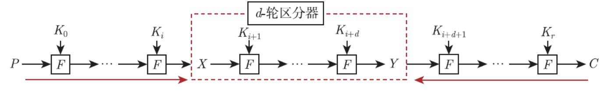

# 密码分析学概述

## 研究什么

密码学包括密码设计和密码分析。密码设计提出安全目标与算法，密码分析则在给定敌手能力和计算资源下，寻找算法与理想对象之间可利用的差异。本课程主要讨论对称密码、杂凑函数和消息认证码。

**安全属性**是希望算法具备的性质，**攻击目标**是分析者试图完成的任务。二者需要对应起来看：

| 对象 | 主要安全属性 | 常见攻击目标 |
| --- | --- | --- |
| 对称加密 | 机密性 | 区分、恢复部分或全部密钥 |
| 消息认证码 | 可认证性 | 伪造、恢复密钥 |
| 杂凑函数 | 原像、第二原像、碰撞抗性 | 找原像、第二原像或碰撞 |

“区分”是发现目标算法与随机函数或随机置换的行为不同。它通常是继续恢复密钥的起点，但区分成功本身不等于已经恢复密钥。具体攻击目标与敌手可获得的数据见[基本假设](基本假设.md)。

## 方法的三个层次

- **通用攻击：** 只依赖密钥长度、分组长度等参数，不利用内部结构，例如[穷举攻击](穷举攻击.md)、查表和时间—存储权衡。它们给出可达到的攻击复杂度上界。
- **结构分析：** 利用轮函数、S 盒和扩散层中的规律，例如[差分攻击](差分攻击.md)、[线性分析](线性分析.md)及[Square 攻击](Square攻击.md)。
- **实现分析：** 利用算法运行时的物理信息，例如时间、功耗或电磁泄漏。它针对具体实现。

评价一种方法时，要同时写清攻击目标、敌手能力、数据量、时间、存储和成功率；只报“需要多少次运算”不够。参见[计算安全](计算安全.md)。

## 区分器与密钥恢复

课件用“区分”和“分割”串起攻击设计：

1. 在若干轮中找到一个可观察的**不随机现象**，构造区分器。例如，某个差分传播概率明显大于随机置换的基线。
2. 从明文或密文向区分器的头尾做部分加密或解密，只猜测涉及的子密钥位，让区分器所需的中间状态变得可计算。
3. 对每个子密钥候选统计区分器是否成立。正确候选与错误候选的统计分布不同，据此筛选，再验证完整密钥。

*图源：第 1 章课件，第 36 页。两侧只需恢复与区分器头尾有关的状态。*

这个思路在[破解 Enigma 机](破解Enigma机.md)中表现为先用 crib 和环路筛转子，再确定接线板；在现代分组密码中则常表现为“中间若干轮区分器 + 两端部分密钥猜测”。

## 相关笔记

- [基本假设](基本假设.md)
- [计算安全](计算安全.md)
- [攻击思想](攻击思想.md)
- [对称加密算法](对称加密算法.md)
- [杂凑函数](杂凑函数.md)
- [消息认证码](消息认证码.md)
