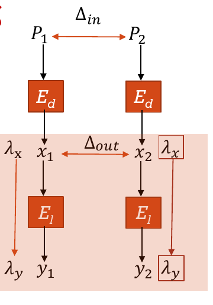

# 差分—线性分析

## 核心想法
前面已经说过找到一条多轮数高概率的差分路线、线性近似路线都并不容易，但是加密算法往往多个模块，找到短轮数高概率的路线还是比较容易的，这些路线不能浪费，我们适当分割就可以把这些路线拼在一起

老办法，我们还是对加密算法进行拆分，假设我们知道红色框内的差分路线，蓝色框内的线性近似路线，那么如何拼接呢

## Example

比如说我们有这么一个截断差分，第二个S盒全是不确定的，他会扩散到所有S盒的第二个bit，但是吧，第4，6，7bit都是0，那如果我们把输入掩码就选择4，6，7，那么$\lambda_x(x_1 \oplus x_2)= 0$是必然的

然后我们再把线性近似式写出来，因为掩码一样嘛，所以偏差也是一样的，然后利用堆积引理，就可以得到最后的概率

我们这样就把它们拼起来了

截断差分比较厉害的地方就是他可以直接造一个必然事件出来
但是吧，也不一定要截断差分，我们也可以找一些高概率的差分路线，那这概率就不是1了，我们也写成偏差的形式

然后通过堆积引理计算

$$
\Pr[\lambda_y\cdot(y_1\oplus y_2)=0]
=\frac12+4\varepsilon_d\varepsilon^2
$$

所以最终偏差的方向由 $\varepsilon_d$ 决定,我们这边都是假设独立的

还有一个值得注意的地方是，当我们看到一个事情发生的时候，要考虑他的多个原因

比如我们知道一个概率为p的差分路线，那你不能说只要得到最后这个结果，概率就是p吧，他可能有多条路线，比如这里假设其他路线随机置换，

如果这个路线发生了，那概率就是p，如果这个路线没有发生，也就是(1-p)/2,加起来是(1+p)/2

这是因为这个差分路线的线性近似式得到的是0，我们最后求的概率也是等于0，所以如果他发生概率就是1，如果不发生概率就是1/2，那如果这个差分路线的线性近似式等于1，那发生的时候，概率就是0，不发生的时候，概率就是1/2，这样会求出两个偏差，不过绝对值是一样的

如果线性近似式得到的是1，那就是负的

把这个值带进去就可以得到一个区分器

这里我们选择中点作为判定阈值

就当中点是交点吧，在左边就判定成cipherfour，在右边就判定为随机置换
假设各明密文对的统计结果近似独立，那么：
假设$H_0$是随机置换，$H_1$是Cipherfour算法
那么服从二项分布
$$T\mid H_0\sim B(N,\frac12)$$
$$T\mid H_1\sim B(N,\frac12-\delta)$$

由于 N很大，可以近似为正态分布。
$$
 T\mid H_0\sim N(\frac{N}{2},\frac{N}4)
$$
$$T\mid H_1\sim N(N(\frac{1}{2}-\delta),N(\frac{1}{4}-\delta^2))$$
对统计量 $X=T/N$，有：

$X\mid H_0\approx N\left(\frac12,\frac1{4N}\right)$

$X\mid H_1\approx N\left(\frac12-\delta,\frac{\frac14-\delta^2}{N}\right)$

成功率就是$\Phi(1)$
## 如何用于攻击

1. 寻找短轮数的高概率[差分或截断差分](截断差分.md)，以及后段高偏差[线性近似](线性分析.md)。
2. 检查连接处：前段输出差分在 $\lambda_x$ 下的奇偶分布，得到 $\varepsilon_d$，并估算或实测整体偏差。
3. 收集满足 $\Delta P$ 的明文对，统计 $\lambda_y\cdot(C_1\oplus C_2)$ 为 $0$ 的比例；显著偏离 $1/2$ 时可区分。
4. 要恢复密钥，可再扩展首尾轮，猜测少量子密钥，对部分加解密后的状态重复该统计检验。

数据量通常随 $|\varepsilon_{\mathrm{DL}}|^{-2}$ 增长；这是估计量级，实际还要考虑明文对的依赖、多个密钥候选和目标成功率。

## 易混点

- 差分段输出的是**一对状态的差**；线性段研究的是**单个状态的掩码奇偶值**。接口处要先计算 $\lambda_x\cdot\Delta X$。
- $\varepsilon_d$ 是该接口奇偶事件的偏差，不等于任意一条完整差分路线的概率。
- 两条线性近似的偏差平方来自异或两次近似；不能把它误写为 $p\varepsilon_l$。

来源：第4.6节课件第7—23页。
