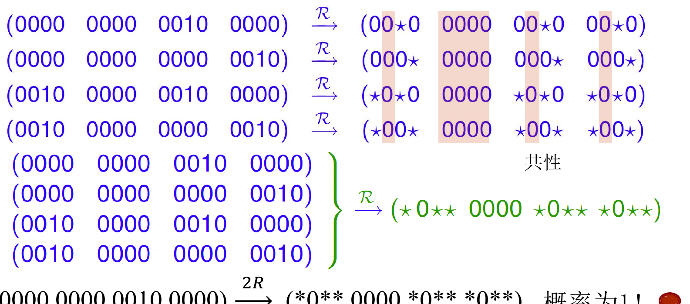

# 截断差分

## 为什么只跟踪部分比特

普通[差分攻击](差分攻击.md)指定完整的输入、输出差分；轮数增加后，单个完整差分的概率可能太低。

但有时候吧，虽然全部的差分的概率比较小

但是有可能某一位的差分是确定的，比如这里2过S盒会得到1，2，9，a，他们的第二位bit都是0，这个又是一个非随机现象

截断差分只要求某些位置取固定值，其他位置用 $*$ 表示“可为 0 或 1”。例如，$*0**$ 表示一个 4 比特差分的第二位为 0，其余位任意；它代表 8 个具体差分，而不是一个新比特值。

比如这个例子，0010过完S盒，除了第二个bit永远为0，其他都有可能为1，而其他位置都会被扩散到各个块的第三个bit，所以要截断每块的第三个bit
那我们可以继续这样下一轮吗

理论上来说是可以的，但是这样就截断的太多了
> **延长时不要过早截断。** 在某一轮得到模式后，下一轮应先枚举与它兼容的具体差分，经过 S 盒和线性层，再合并共同约束。直接把所有 $*$ 当作独立随机位传播，可能丢掉原本存在的相关性，也可能错误估计概率。
## CipherFour 中的传播

课件的 CipherFour S 盒满足：输入差分 $\texttt{2}$ 时，输出差分只可能是 $\texttt{1},\texttt{2},\texttt{9},\texttt{A}$。
那就是4种情况，就是图下这四种，2是第一行，1是第二行(0001的1传播到第四块的第3bit)，A是(1010,第三行),9就是（1001，第四行)
然后下一轮我们发现这四种情况，有相同的地方，提取出来

*图源：第 3.2 节课件，第 10 页。$*$ 是未固定的比特，蓝色各行的共同约束形成绿色模式。*

图中的例子在课件给定的轮结构下得到

$$
(0000\ 0000\ 0010\ 0000)
\xrightarrow{2R}
(*0**\ 0000\ *0**\ *0**),
$$

概率为 1。这个结论只保证带 $0$ 的位置，不能把 $*$ 任意改成某个固定值再声称概率仍为 1。

## 从区分器到密钥恢复
如果我们只有3轮的截断差分，怎么用来恢复5轮的cipherfour算法呢

我们可以把头尾都分开，头尾爆破k就行了

1. 选择符合输入集合的明文对或明文结构体，取得相应密文。

我们选择明文的时候，一般就搞一个活跃的半字节
比如这里让第三个半字节遍历全部，得到16个明文
然后任意两个明文差分，除了第三个半字节，其他就都是0
任意两个组对就是120对

2. 用若干轮后仍满足的截断模式构造区分器；必要时在头尾各扩展一轮。

计算筛选，要求过了一轮S盒之后差分为0010

理论上来说末尾这边也可以进行一波过滤，但是*0**的差分遍历所有
那就没办法

3. 猜测只影响被观察比特的子密钥，做部分加密或逆运算，检查候选能否使中间差分落在目标集合。

如果k0,2猜对了，那得到s对，然后我们从密文反推，经过一个S逆，得到的截断差分尾部，如果也是s对满足，对上了，那就都猜对了，就作为候选
但是如果k0,2猜错了，那就都有可能，也有可能被弄进候选

4. 对通过检验的候选继续使用其他结构体或明密文对验证。

课件中还用明文**结构体**一次产生多对可比较的明文，并在头部猜测少量密钥位筛出目标输入差分。结构体提高了可用对数，但同一结构体内的明文对并不完全独立，估算成功率时不能把它们简单当作独立样本。

## 相关笔记

- [差分攻击](差分攻击.md)
- [不可能差分分析](不可能差分分析.md)
- [飞去来器攻击](飞去来器攻击.md)
- [差分-线性分析](差分-线性分析.md)
