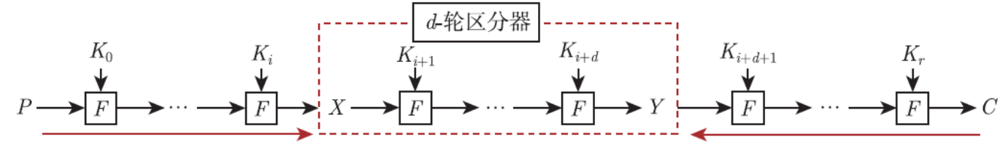

# 攻击思想

## 区分

### 不随机现象

不随机现象是一个可计算的观察量：它在具体密码与随机置换下的分布不同。例如固定输入差分对应指定输出差分的频率、某个线性等式成立的频率、明文结构加密后各字节的异或和。

### 区分攻击（区分器）

利用上述分布差异做假设检验，在可承受的数据与时间内区分具体密码和随机置换。区分器只说明行为不同，**不直接给出密钥**。

### 简单的统计模型

设观察事件 $A$ 在具体密码下发生的概率为 $p_E$，在随机置换下为 $p_R$。收集 $N$ 个样本，比较事件出现次数更接近 $Np_E$ 还是 $Np_R$。若样本可以近似看作独立，频率的自然波动量级为 $N^{-1/2}$，所以 $|p_E-p_R|$ 越小，通常需要越多数据。对真正的置换，多个不同输入的输出并非严格独立，估计样本量时还要考虑这一点。

### 一个区分器的具体例子

假设黑盒只能是目标密码或随机置换，观察事件 $A$：

$$
\Pr[A\mid\text{目标密码}]=\frac34,\qquad
\Pr[A\mid\text{随机置换}]\approx\frac12.
$$

收集 $N=100$ 个样本，记满足 $A$ 的次数为 $T$。目标密码下 $T$ 的期望为 75，随机置换下约为 50；可取中间值 62.5 作一个简单阈值：$T\ge63$ 判为目标密码，否则判为随机置换。

这是统计判断，不是每次都正确：两个分布有重叠，随机置换也可能偶然出现较大的 $T$。增加样本可以减少这种误判。若单样本近似独立、事件概率远离 0 和 1，固定判定成功率所需的样本量一般与概率差的平方成反比，即 $N$ 随 $|p_E-p_R|^{-2}$ 增长。

不同区分器的事件 $A$ 不一样：差分分析看指定输出差分是否出现，线性分析看掩码奇偶关系是否成立，积分分析看一组输出的异或和是否为零。均需先定义**一个统计样本**：例如在积分分析中，一整组结构化明文可以构成一次检验，不能直接把 256 个字节当成 256 次独立检验。

课程中的具体例子见[差分攻击](差分攻击.md)、[线性分析](线性分析.md)和[Square 攻击](Square攻击.md)。

## 分割

### 密码算法的分割

将算法的各个部件分开考虑，便于在较短轮数中发现不随机现象。

### 搜索空间的分割

将不随机现象转换为只与部分密钥比特有关的检验，再逐步缩小候选空间。

[中间相遇攻击](中间相遇攻击.md)也是一种分割：分别枚举加密前半段和解密后半段，比较中间状态，把两个密钥空间的联合搜索转化为建表与查表；实际成本还要计入存储和候选密钥复筛。

**分割的数量例子：** 设两个独立密钥部分各为 40 位，直接枚举密钥对要考虑 $2^{80}$ 种组合。如果两边能分别计算同一中间值，就可以先枚举 $2^{40}$ 个前向值建表，再枚举 $2^{40}$ 个反向值查表。这样初筛只需两侧各做一次枚举，同时需要约 $2^{40}$ 条表项；相遇后的错误候选仍要处理。具体推导见[中间相遇攻击](中间相遇攻击.md)。

### 密钥恢复攻击

课件给出“区分器 → 判定依据 → 局部密钥筛选”的一般模型：

1. 为中间 $d$ 轮构造区分器，明确输入条件、输出判据和随机基线。
2. 在区分器前后接上少量轮，找出从外部明密文计算区分器边界状态时必须猜测的**最小子密钥片段**。
3. 对每个候选片段做局部加密或逆运算，统计是否满足区分器判据，淘汰不相符的候选。
4. 用其他明文结构、额外明密文或穷举搜索验证剩余候选并恢复其余密钥。

例如五轮 [CipherFour 差分攻击](差分攻击.md)用四轮差分作核心，只猜末轮相关的子密钥片段；四轮 [Square 攻击](Square攻击.md)则用三轮平衡性质逐字节筛选末轮密钥。实际评价还要比较数据、时间、内存及成功概率，并与直接穷举的成本比较。

### 猜测、统计和验证分别在做什么？

以末轮子密钥为例，设只需猜 4 位，共有 16 个候选。攻击者依次对每个候选做部分解密，把还原出的中间值代入区分条件，记录每个候选的得分：

1. **猜测：** 一个候选只确定区分器边界所需的 4 位，不必立即枚举整个主密钥。
2. **统计：** 普通高概率差分中，一个数据对命中时为候选计数；处理大量数据后，按计数排序。一次未命中不能证明候选错误。
3. **排除：** 若使用的是已经严格证明的不可能差分，某候选使真实数据触发禁忌差分，就可以直接排除。
4. **验证：** 保留多个可能的子密钥，再结合密钥编排、剩余密钥枚举和其他明密文，判断完整密钥。

这种局部搜索是降低工作量的关键。但只恢复 4 位子密钥，并不意味着整个主密钥已经被恢复。

## 相关笔记

- [密码分析学概述](密码分析学概述.md)
- [计算安全](计算安全.md)
- [对称加密算法](对称加密算法.md)
- [差分攻击](差分攻击.md)
- [线性分析](线性分析.md)
- [中间相遇攻击](中间相遇攻击.md)
- [生日攻击与广义生日攻击](生日攻击与广义生日攻击.md)
