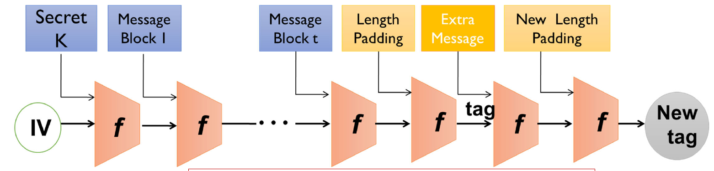
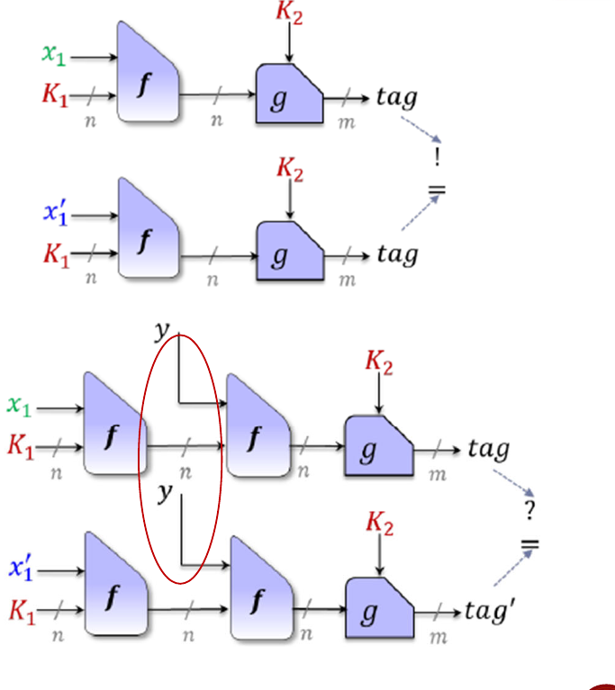
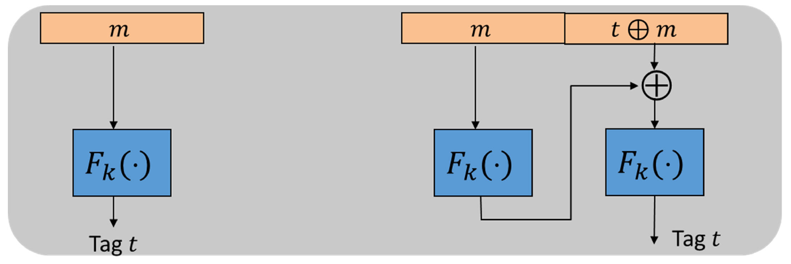
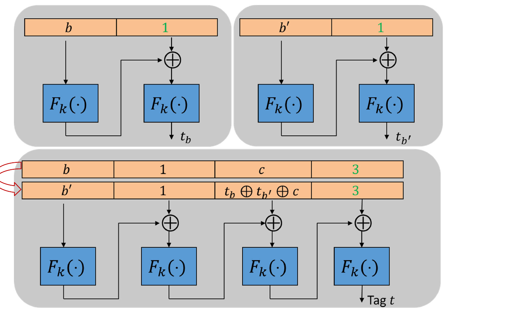

# 消息认证码

## 功能与安全属性

消息认证码（MAC）由共享秘密密钥的通信双方使用：发送方计算 $T=\operatorname{MAC}_K(M)$ 并发送 $(M,T)$，接收方用 $K$ 验证标签是否正确。它提供**消息完整性和来源认证**，可以基于分组密码或杂凑函数构造。

MAC 本身不提供保密性；持有同一个密钥的任何一方都能生成标签，所以它也不提供数字签名意义上的不可否认性。重放一个先前有效的消息和标签仍会通过验证，必须结合序号、随机数或时间戳等协议机制处理重放。

## 攻击手段与目标

- **已知消息攻击**：被动观察消息及其标签。
- **选择消息攻击**：主动向 MAC 接口查询所选消息的标签；自适应攻击可根据之前的结果选择后续消息。
- **区分攻击**：判断黑盒实现是目标 MAC 还是某个理想对象，例如随机函数。能区分并不自动意味着能伪造。
- **恢复密钥**：求出可以用于生成有效标签的密钥。
- **伪造**：输出一个满足 $\operatorname{Vrfy}_K(M^*,T^*)=1$ 的新消息—标签对。标准存在性不可伪造模型要求 $M^*$ 没有被用于查询生成标签；这不等同于重放已查询的消息。

课件按攻击者能达到的目标由强到弱介绍：

1. **恢复密钥**：取得密钥后，可对任意消息生成标签。
2. **通用伪造**：不一定知道密钥，但能对任意指定的新消息生成有效标签。
3. **选择性伪造**：在获取查询结果前指定目标消息，再为它生成有效标签。
4. **存在性伪造**：构造至少一条新消息及其有效标签，消息的内容可由攻击者决定。

选择消息下的存在性不可伪造（EUF-CMA）要求有效率的攻击者即使可以查询所选消息的标签，也不能以显著概率完成上述存在性伪造。这是常用的 MAC 安全目标。

## 通用攻击与实现问题

设标签有 $t$ 位、密钥有 $k$ 位。对理想的 $t$ 位标签，盲猜一次的成功概率是 $2^{-t}$；若各次尝试独立且成功概率很小，$q$ 次在线验证尝试的成功概率约为 $q/2^t$。穷举标签的工作量量级为 $2^t$，但需要验证接口；协议中的限速和失败次数限制影响实际可尝试次数。

穷举 $k$ 位密钥的量级为 $2^k$ 次离线计算：攻击者取得足够的已知消息—标签对后，逐一试算候选密钥，通常需要额外消息对排除偶然匹配。课件用 $\min(2^t,2^k)$ 概括通用攻击的量级，但要分别考虑在线查询、离线计算、标签截断和数据量；具体算法也可能存在更便宜的结构性攻击。

课件建议使用 128 位标签。验证时还应使用恒定时间的标签比较，避免因为逐字节比较的耗时差异泄露正确标签的信息。

## 基于 Merkle–Damgård 结构的简单 MAC

Merkle–Damgård（MD）杂凑函数把消息分组迭代压缩，并进行包含消息长度的末尾填充。下面的攻击利用**迭代链值**的性质，不代表所有 MAC 都有同样漏洞。

### 密钥前缀：长度扩展伪造

课件的密钥前缀形式为 $\operatorname{MAC}_K(M)=h(K\|\operatorname{pad}_K\|M)$，其中 $\operatorname{pad}_K$ 表示密钥部分按构造需要使用的填充。也常见直接写作 $h(K\|M)$；下文将密钥和可能存在的密钥填充统一记为 $P$。

当输出的完整标签就是 MD 最终链值，且攻击者知道或猜对 $|P|$ 时：

1. 查询 $M$ 的标签 $T=h(P\|M)$。
2. 按 $|P\|M|$ 算出该次杂凑的末尾填充 $\operatorname{pad}(P\|M)$。
3. 把 $T$ 当作已处理过 $P\|M\|\operatorname{pad}(P\|M)$ 的链值，继续处理自选后缀 $S$，得到 $T^*$。
4. 输出新消息 $M^*=M\|\operatorname{pad}(P\|M)\|S$ 和 $T^*$，验证方计算 $h(P\|M^*)$，结果相同。

*课件第 8 页：获得原标签后，从该链值继续处理后缀。*

如果密钥长度未知，可以在有限候选长度中逐一猜测；应用必须接受含填充字节的消息。标签截断或输出不是完整链值时，不能直接把所见标签当作完整内部状态。选择目标消息发生在查询之前时，上述方法还可构成课件所说的选择性伪造。

课件还给出区分攻击：对约 $2^{n/2}$ 个同长度消息查询 $n$ 位完整标签，按生日现象找一对标签碰撞；给两个消息加相同的 MD 填充和相同后缀后，前缀 MAC 的新标签仍相同。对于随机函数，不同新消息的标签再次碰撞的概率约为 $2^{-n}$。这里 $2^{n/2}$ 是**在线标签查询**量级，结论依赖完整链值可见、填充长度可确定及消息编码允许扩展。

### 密钥后缀：利用消息内部碰撞

密钥后缀形式为 $\operatorname{MAC}_K(M)=h(M\|K)$。它不受上面那种直接长度扩展伪造方式的影响，但如果能离线找到**等长、分组对齐的不同消息** $M,M'$，使处理完各自消息部分的内部链值相同，那么后续追加的 $K$ 及最终填充也相同，因此：

$$
\operatorname{MAC}_K(M)=\operatorname{MAC}_K(M').
$$

攻击者先离线找到这对消息，预先选 $M'$ 为伪造目标，再在线查询 $M$ 的标签 $T$，即可输出 $(M',T)$。在内部链值为 $n$ 位且可构造足够多候选消息的理想生日模型下，找碰撞约需 $2^{n/2}$ 次**离线**压缩或杂凑量级的工作，之后只需一次在线 MAC 查询。

这里需要的是密钥加入之前的**链值碰撞**及相容的长度与分组边界；仅知道某种截断输出的普通杂凑值相等，不能直接推出 $h(M\|K)=h(M'\|K)$。

### 密钥封装：内部碰撞与外部碰撞

课件还讨论示意构造 $h(K\|M\|K)$，将消息部分的迭代与最后的密钥处理抽象为 $f$ 和 $g$。**内部碰撞**指进入最后处理 $g$ 前的链值相同；**外部碰撞**只指最终标签相同。

对第一消息块 $x,x'$，若已知 $f(K_1,x)=f(K_1,x')$，那么附加同样的新后缀 $y$ 后两条计算的后续状态与标签仍相同。查询 $x\|y$ 的标签 $T$，就可用 $(x'\|y,T)$ 伪造，前提是后者尚未被查询。已知一对内部碰撞之后只需这一次查询；寻找碰撞的成本需要另算。

当末端 $g$ 对内部状态是置换时，最终标签相同意味着内部状态相同；如果 $g$ 把 $n$ 位状态压缩到 $m<n$ 位，观察到的标签碰撞也可能只是外部碰撞。可以对碰撞候选附加同一后缀并查询两个新标签：内部碰撞必然继续碰撞，而非内部碰撞在理想随机模型下再次碰撞的概率约为 $2^{-m}$。筛选已用过的消息不能再作为新消息伪造，可换一个尚未查询的后缀。

*课件第 12 页：比较附加相同后缀前后的标签，辅助识别内部碰撞。*

课件的 $O(2^{n/2})$ 结论对应其示意的生日搜索模型及在线碰撞筛选条件；一般情况下，标签位数、外部碰撞的数量和筛选成本都影响总复杂度。**HMAC 是经过内外层密钥处理的专门构造，不能把它等同于以上简单拼接形式或直接套用上述攻击。**

## 基于分组密码：CBC-MAC / DAA

课件中的 DAA 采用 CBC 链式处理。对固定长度的完整分组消息 $M=m_1\|\cdots\|m_\ell$，令 $c_0=0$，并计算：

$$
c_i=E_K(c_{i-1}\oplus m_i),\qquad T=c_\ell.
$$

在标准安全模型中，基本 CBC-MAC 面向**固定且预先约定的消息长度**；如果直接允许不同长度，将出现伪造。

### 可变长时的一次查询伪造

先查询单分组消息 $m$，得到 $t=E_K(m)$。然后构造两分组消息 $m\|(t\oplus m)$：第一轮输出 $t$，第二轮输入为 $t\oplus(t\oplus m)=m$，所以最终标签仍为 $t$。因此 $(m\|(t\oplus m),t)$ 是新消息的有效标签。

*课件第 15 页：两分组消息的第二轮输入与单分组消息的输入相同。*

### 处理变长消息

- **CMAC**：使用从主密钥派生的两个子密钥区分完整末块和需要填充的末块，最后再经过分组加密。按 [NIST SP 800-38B](https://csrc.nist.gov/pubs/sp/800/38/b/upd1/final)，非空消息的完整末块异或 $K_1$，不完整末块使用 `1` 后补 `0` 并异或 $K_2$；空消息也使用填充和 $K_2$。$K_1,K_2$ 从 $E_K(0^b)$ 通过有限域倍乘派生。课件第 16 页的子密钥公式与图中标注和标准有出入，应以标准为准。
- **前缀消息长度**：把唯一编码的长度分组放在消息前，再进行 CBC-MAC。这样不同长度消息从第一分组起就被区分；具体安全性仍依赖编码、长度边界和分组密码假设。
- **后缀消息长度**：仅在末尾追加长度并不足够。设单分组消息 $b,b'$ 的标签分别为 $t_b,t_{b'}$，即处理 $b\|1$ 与 $b'\|1$ 得到的链值。对任意分组 $c$，令 $c'=t_b\oplus t_{b'}\oplus c$，则三个消息分组 $b\|1\|c$ 与 $b'\|1\|c'$ 在处理第三分组时的输入相同，之后都追加相同长度编码 $3$，所以标签相同。查询前者标签即可伪造后者。

*课件第 18 页：两个三分组消息在末尾长度块之前合并到同一链值。*

## 相关笔记

- [密码分析学概述](密码分析学概述.md)
- [攻击思想](攻击思想.md)
- [杂凑函数](杂凑函数.md)

来源：课程《第 13 章 消息认证码的安全性分析概述》，第 2–18 页；CMAC 标准细节见上方 NIST 文档。
