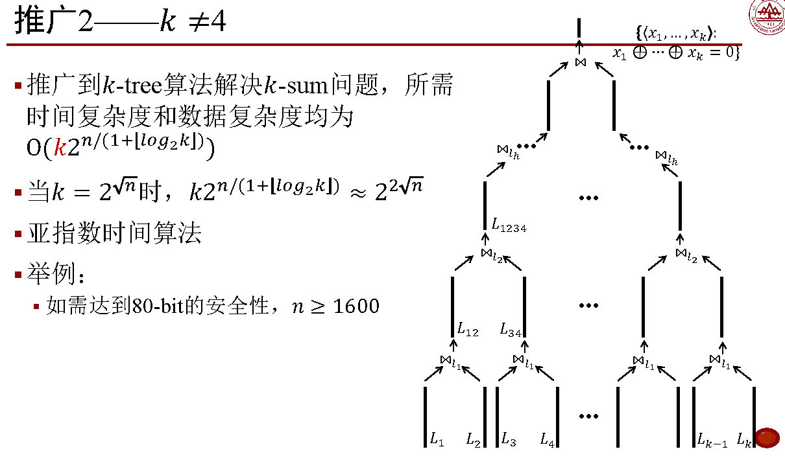

# 生日攻击与广义生日攻击

## 1. 生日问题与碰撞概率

生日攻击寻找的是**任意一对不同消息** $M\ne M'$，使 $h(M)=h(M')$。攻击者不必预先指定消息或杂凑值；这与给定消息再找第二原像不同。假设不同消息的 $n$ 比特杂凑值相互独立、均匀分布，记输出空间大小 $N=2^n$。对 $m$ 个不同消息，所有输出不同的概率和至少一对碰撞的概率分别为

$$
P_{\mathrm{distinct}}=\prod_{i=0}^{m-1}\left(1-\frac{i}{N}\right),\qquad
P_{\mathrm{coll}}=1-P_{\mathrm{distinct}}
\approx1-\exp\!\left(-\frac{m(m-1)}{2N}\right).
$$

近似适用于 $m$ 远小于 $N$ 的范围。令碰撞概率约为 $1/2$，得到 $m\approx\sqrt{2N\ln2}\approx1.177\cdot2^{n/2}$。例如 $n=64$ 时，取 $2^{32}$ 个消息的碰撞概率约为 $1-e^{-1/2}\approx39.3\%$；取约 $1.177\cdot2^{32}$ 个才约为 $50\%$。课件把 $2^{n/2}$ 称为约一半，是忽略常数的复杂度估计。

直接实现：不断生成不同消息、计算其杂凑值，并用哈希表保存“输出 → 消息”；新输出已存在时比较对应消息，得到碰撞。理想模型下达到常数成功概率需 $O(2^{n/2})$ 次求值和 $O(2^{n/2})$ 空间。理想的 $n$ 比特杂凑函数碰撞安全强度因此至多约 $n/2$ 比特；这不说明任何给定算法都能达到该上界。

## 2. 从 2-SUM 到 4-SUM

令 $L_1,L_2$ 为独立、均匀随机的 $n$ 比特值列表，寻找 $x_1\in L_1,x_2\in L_2$ 使 $x_1\oplus x_2=0$，即两表中找相同值。两表各有 $a$ 个元素时约有 $a^2$ 个跨表候选对，每对匹配概率为 $2^{-n}$，所以预计匹配数为 $a^2/2^n$。当 $a$ 达到 $2^{n/2}$ 数量级时，可望以常数概率找到匹配；排序或哈希实现约需同数量级的时间和空间。

广义生日问题把目标改为从 $k$ 个列表各选一个元素，使它们的异或为目标值。例如 **4-SUM**：

$$
x_1\oplus x_2\oplus x_3\oplus x_4=0,
\qquad x_i\in L_i.
$$

四表各有 $2^x$ 个随机元素时，全部四元组的期望解数为 $2^{4x-n}$。取 $x=n/4$ 已使期望解数约为 1，但这只说明**可能存在解**，不等于可以用 $2^{n/4}$ 时间找到它；实际算法还要构造和匹配候选。

## 3. 4-tree：分两层匹配

记 $\operatorname{low}_\ell(x)$ 为最低 $\ell$ 比特。对于四个长度均为 $2^x$ 的列表，先各自合并前两表和后两表，仅保留低 $\ell$ 位相等的对，并保存原元素以便回溯：

$$
\begin{aligned}
L_{12}&=\{(x_1\oplus x_2,x_1,x_2):\operatorname{low}_\ell(x_1)=\operatorname{low}_\ell(x_2)\},\\
L_{34}&=\{(x_3\oplus x_4,x_3,x_4):\operatorname{low}_\ell(x_3)=\operatorname{low}_\ell(x_4)\}.
\end{aligned}
$$

两个中间异或值的低 $\ell$ 位均为零。按剩余 $n-\ell$ 位匹配 $L_{12}$ 与 $L_{34}$ 的异或值，就得到目标四元组。通过哈希分桶或排序可以避免逐一枚举所有原始对；生成匹配对的开销仍要计入。

*图源：第 12.3.1 节，第 20 页；图示将 4-tree 推广为多层树。*

### 参数如何选

在均匀随机模型下，低位匹配概率为 $2^{-\ell}$，故每个中间表的期望大小约为 $2^{2x-\ell}$。再匹配剩余 $n-\ell$ 位，输出的期望个数约为

$$
2^{2x-\ell}\cdot2^{2x-\ell}\cdot2^{-(n-\ell)}
=2^{4x-\ell-n}.
$$

要有常数量级的期望输出，需要 $4x-\ell-n\ge0$。输入和中间表的主要工作量约为 $2^x+2^{2x-\ell}$；为了平衡这两项，取 $x=\ell=n/3$（忽略取整）。此时每表约 $2^{n/3}$ 个元素，中间表也约同样大，时间、数据和空间均约为 $O(2^{n/3})$，成功概率为常数量级。

这个算法以比 $2^{n/4}$ 更多的数据换取可操作的筛选方式；它依赖独立随机列表和能够生成足够元素。输出期望约为 1 并不意味着必然成功，重复运行可提高成功率。

## 4. 推广与适用范围

- 若目标为 $x_1\oplus\cdots\oplus x_4=c$，可先把第四表每项替换为 $x_4\oplus c$，再求零和。
- 当 $k=2^h$ 时，可递归合并列表，逐层固定部分比特。在理想随机列表及适当参数下，课件给出的数据和时间量级为 $O\!\left(k2^{n/(1+\log_2 k)}\right)$；空间也取决于同时保存的列表及回溯信息。原始算法与应用见 [Wagner 的广义生日问题论文](https://people.eecs.berkeley.edu/~daw/papers/genbday.html)。
- 对模 $2^n$ 加法，匹配时要找相反数而非相同值：$x+y\equiv0\pmod{2^n}$ 等价于 $x\equiv-y\pmod{2^n}$。层次筛选还须处理进位；不能把异或操作直接当作模加。
- 广义生日攻击解决的是**特定多列表求和问题**，不是对任意 $n$ 比特杂凑函数都能用 $2^{n/3}$ 找普通碰撞。只有具体结构能把目标转化为相应列表问题，并能生成所需独立候选时，复杂度才适用。

相关笔记：[杂凑函数](杂凑函数.md)、[具体杂凑函数的碰撞攻击](具体杂凑函数的碰撞攻击.md)。
