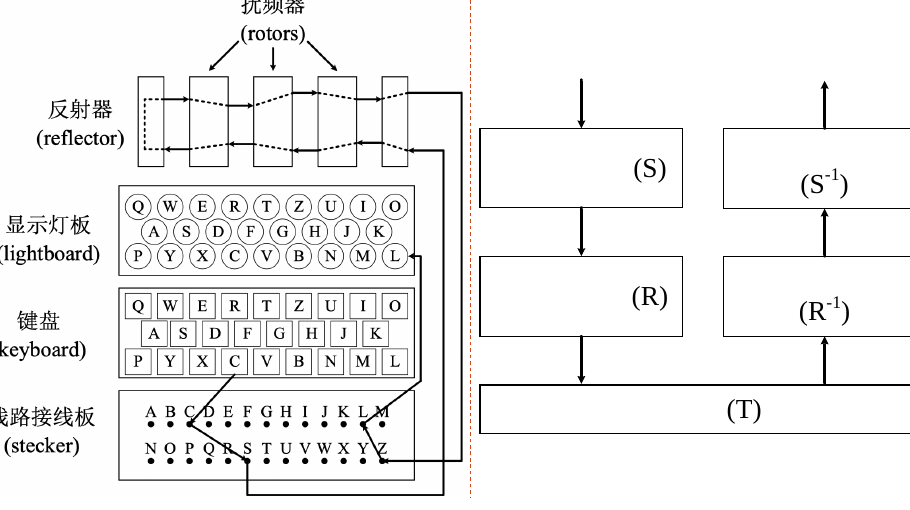
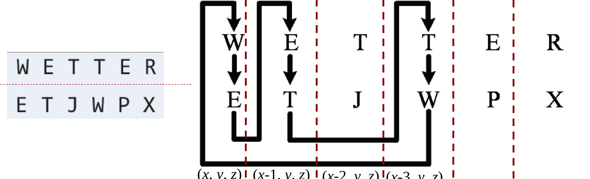

# 破解 Enigma 机

## 从机器结构看密钥

Enigma 逐字母加密。信号先经过接线板，再依次经过转子组、反射器，随后沿转子的逆向线路和接线板返回，最后点亮一个密文字母。每输入一个字母，转子状态会改变，所以同一个明文字母在不同位置通常得到不同密文。

*图源：第 2 章课件，第 9 页。图中的 $S$ 表示接线板，$R$ 表示当前转子组。*

若接线板置换为 $S$、当前转子置换为 $R_t$、反射器为 $T$，位置 $t$ 的加密可写成

$$
E_t=S^{-1}\circ R_t^{-1}\circ T\circ R_t\circ S.
$$

接线板交换成对字母，因此 $S^{-1}=S$。反射器也由互换的字母对构成，满足 $T^{-1}=T$ 且没有不动点。由此可见，加解密使用相同的机器设置；对同一位置，$E_t^{-1}=E_t$。

### 接线板

若 26 个字母中有 $l$ 对相连，先选出 $2l$ 个字母，再把它们两两配对，设置数为

$$
\binom{26}{2l}\frac{(2l)!}{2^l l!}
=\frac{26!}{(26-2l)!\,2^l l!}.
$$

课件将接线板设置记为 $K_1$。未连接的字母映射到自身；已经连接的两字母互换，不能与其他连接重复使用。

### 转子与反射器

每个转子的内部接线是固定置换。课件的简化模型以三个转子的起始位置作为 $K_2$，在转子型号和顺序固定时共有 $26^3$ 种。快速转子频繁转动，刻痕使其他转子随之转动，于是加密位置改变时，整机置换 $E_t$ 也改变。

反射器使信号返回。因为 $E_t$ 是无不动点置换 $T$ 的共轭，对任意字母 $a$ 都有 $E_t(a)\ne a$：**Enigma 不会把一个字母加密成它自己**。这是寻找明文片段的关键约束。

## 从密文寻找 crib

Crib 是猜测的明文片段及其在截获密文中的对应位置。天气报告中的固定词、通信格式或人工操作习惯都可能提供猜测。逐个移动猜测片段，只要出现某个位置“明文字母 = 密文字母”，便排除该对齐位置。通过这种方式得到的 crib 仍是候选，需要后续机器设置验证。

课件以 WETTER 与一段密文的对齐为例。某个可行对齐不仅满足“字母不加密为自身”，还可形成首尾相接的字母关系：

*图源：第 2 章课件，第 29 页。四列对应相邻的转子位置。*

## 环路如何分割搜索空间

如果直接枚举接线板和转子，必须同时检验 $K_1\times K_2$ 的组合。环路把两部分暂时分开：

1. 对每个候选转子设置 $K_2$，依照 crib 中各位置连接若干台处于相应转子状态的机器。
2. 从某个字母开始沿环路传递。若候选设置与真实设置相容，接线板的未知置换在闭合环路中会相互抵消，必须得到一致的“输入字母回到自身”的结果。
3. 用课件中的“亮灯测试”筛选候选转子设置，再由其他 crib 字母推导接线板连接。若一个字母被迫同时连接两个不同字母，就产生冲突并排除该候选。
4. 用更多 crib、其他环路和解出的明文验证余下设置。

一次亮灯并不能证明转子设置正确。课件给出的随机模型中，错误候选也出现至少一个亮灯位置的概率约为 $63.2\%$；这对应随机置换至少有一个不动点的概率。多个独立约束和接线冲突检查才能进一步降低误判。

## 攻击思路回顾

这次破解展示了[攻击思想](攻击思想.md)中的两步：先利用“不能加密为自身”定位可疑 crib，再利用环路把联合搜索拆成转子筛选与接线板求解。成功依赖可用的通信习惯、足够可靠的 crib，以及对候选设置的反复验证。

## 相关笔记

- [古典密码的安全性分析](古典密码的安全性分析.md)
- [攻击思想](攻击思想.md)
- [密码分析学概述](密码分析学概述.md)
