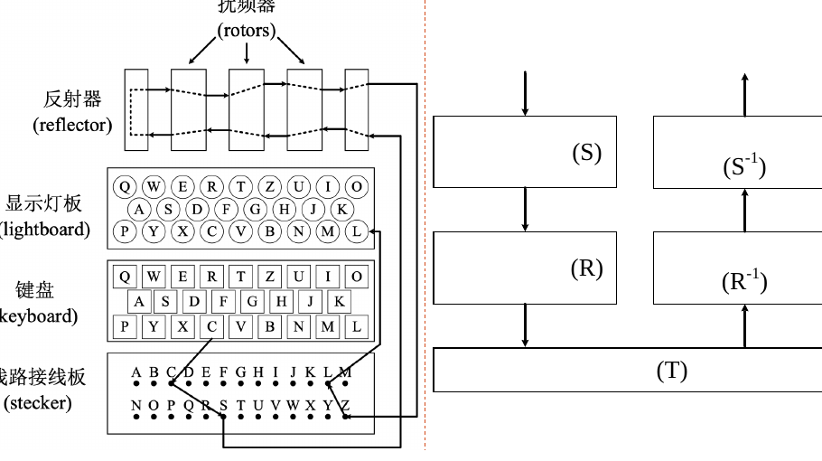
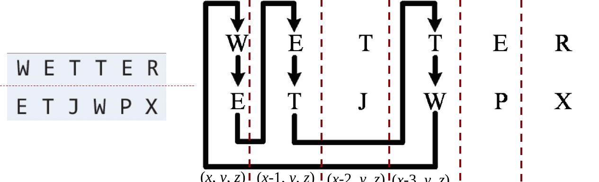

# 破解 Enigma 机

## 从机器结构看密钥

Enigma 逐字母加密。信号先经过接线板，再依次经过转子组、反射器，随后沿转子的逆向线路和接线板返回，最后点亮一个密文字母。每输入一个字母，转子状态会改变，所以同一个明文字母在不同位置通常得到不同密文。

*图源：第 2 章课件，第 9 页。图中的 $S$ 表示接线板，$R$ 表示当前转子组。*

若接线板置换为 $S$、当前转子置换为 $R_t$、反射器为 $T$，位置 $t$ 的加密可写成

$$
E_t=S^{-1}\circ R_t^{-1}\circ T\circ R_t\circ S.
$$

接线板交换成对字母，因此 $S^{-1}=S$。反射器也由互换的字母对构成，满足 $T^{-1}=T$ 且没有不动点。由此可见，加解密使用相同的机器设置；对同一位置，$E_t^{-1}=E_t$。

### 接线板

若 26 个字母中有 $l$ 对相连，先选出 $2l$ 个字母，再把它们两两配对，设置数为

$$
\binom{26}{2l}\frac{(2l)!}{2^l l!}
=\frac{26!}{(26-2l)!\,2^l l!}.
$$

课件将接线板设置记为 $K_1$。未连接的字母映射到自身；已经连接的两字母互换，不能与其他连接重复使用。

**例如 $l=10$：** 先从 26 个字母中选出 20 个，再把它们两两配成 10 对。代入公式得到 $150738274937250$ 种接线设置。除以 $2^{10}$ 是因为每对的两个字母交换顺序不产生新接线；除以 $10!$ 是因为 10 对连线的排列顺序也不产生新接线。

### 转子与反射器

每个转子的内部接线是固定置换。课件的简化模型以三个转子的起始位置作为 $K_2$，在转子型号和顺序固定时共有 $26^3$ 种。快速转子频繁转动，刻痕使其他转子随之转动，于是加密位置改变时，整机置换 $E_t$ 也改变。

以这个简化模型为例，三个起始位置各有 26 种可能，因此总数是 $26\times26\times26=17576$。如果额外要求从 5 个不同转子中选 3 个并排定顺序，则转子选择还要乘以 $5\times4\times3=60$；这个因子只有在转子选择和顺序也属于待猜设置时才计入。

课件用快转子、中转子、慢转子的转动解释多表代换：随着逐字输入，同一组内部连线在不同位置形成不同的字母置换。分析 crib 时，必须给每个字母位置使用对应的转子状态，不能让所有位置共用同一个 $R_t$。

反射器使信号返回。因为 $E_t$ 是无不动点置换 $T$ 的共轭，对任意字母 $a$ 都有 $E_t(a)\ne a$：**Enigma 不会把一个字母加密成它自己**。这是寻找明文片段的关键约束。

## 从密文寻找 crib

Crib 是猜测的明文片段及其在截获密文中的对应位置。天气报告中的固定词、通信格式或人工操作习惯都可能提供猜测。逐个移动猜测片段，只要出现某个位置“明文字母 = 密文字母”，便排除该对齐位置。通过这种方式得到的 crib 仍是候选，需要后续机器设置验证。

课件以 WETTER 与一段密文的对齐为例。某个可行对齐不仅满足“字母不加密为自身”，还可形成首尾相接的字母关系：

截获密文为 `AETJWPXER`，已猜测明文包含 `WETTER`。逐一比较四个对齐位置：

| 起始位置 | 对应密文 | 检查结果 |
| --- | --- | --- |
| 1 | `AETJWP` | 明文、密文第 2 位均为 E，第 3 位均为 T，排除 |
| 2 | `ETJWPX` | 六个对应位置都不同，可以保留 |
| 3 | `TJWPXE` | 六个对应位置都不同，可以保留 |
| 4 | `JWPXER` | 第 5 位均为 E，第 6 位均为 R，排除 |

“没有字母加密为自身”只是必要条件，因此剩下两个对齐都值得继续检验，不能直接认定其中任意一个一定正确。

*图源：第 2 章课件，第 29 页。六列对应连续的文字位置，环路使用第 1、2、4 列。*

### 怎样从 crib 找到环路？

对保留的第 2 个对齐，逐列写出关系：

| 位置 $t$ | 1 | 2 | 3 | 4 | 5 | 6 |
| --- | --- | --- | --- | --- | --- | --- |
| 明文 | W | E | T | T | E | R |
| 密文 | E | T | J | W | P | X |

第 1 列给出 $W\to E$，第 2 列给出 $E\to T$，第 4 列给出 $T\to W$，首尾连起来就是

$$
W\xrightarrow{t=1}E\xrightarrow{t=2}T\xrightarrow{t=4}W.
$$

第 3 列虽然没有用于这个环，也对应一个真实的转子步进位置；所以图上第 2 条边到第 4 条边之间跳过了一个位置，不能把第 4 列当作紧接第 2 列后的机器状态。第 3、5、6 列给出的 $T\leftrightarrow J$、$E\leftrightarrow P$、$R\leftrightarrow X$ 则可用于之后推导接线板设置。

## 环路如何分割搜索空间

如果直接枚举接线板和转子，必须同时检验 $K_1\times K_2$ 的组合。环路把两部分暂时分开：

1. 对每个候选转子设置 $K_2$，依照 crib 中各位置连接若干台处于相应转子状态的机器。
2. 从某个字母开始沿环路传递。若候选设置与真实设置相容，接线板的未知置换在闭合环路中会相互抵消，必须得到一致的“输入字母回到自身”的结果。
3. 用课件中的“亮灯测试”筛选候选转子设置，再由其他 crib 字母推导接线板连接。若一个字母被迫同时连接两个不同字母，就产生冲突并排除该候选。
4. 用更多 crib、其他环路和解出的明文验证余下设置。

一次亮灯并不能证明转子设置正确。课件给出的随机模型中，错误候选也出现至少一个亮灯位置的概率约为 $63.2\%$；这对应随机置换至少有一个不动点的概率。多个独立约束和接线冲突检查才能进一步降低误判。

### 环路怎样消去未知接线板？

令 $F_t=R_t^{-1}\circ T\circ R_t$ 表示**去掉接线板**后，第 $t$ 个位置的转子组与反射器共同形成的置换。因为接线板 $S^{-1}=S$，单个位置有

$$
E_t=S\circ F_t\circ S.
$$

对于上面的三条明密文关系，分别有

$$
E_1(W)=E,\qquad E_2(E)=T,\qquad E_4(T)=W.
$$

把三式依次复合，且每次用 $S\circ S=\operatorname{id}$ 抵消相邻的接线板：

$$
E_4\circ E_2\circ E_1
=S\circ F_4\circ F_2\circ F_1\circ S.
$$

由于环路要求左边把 $W$ 送回 $W$，令 $p=S(W)$，两边再作用一次 $S$，得到

$$
\boxed{(F_4\circ F_2\circ F_1)(p)=p.}
$$

这就是可用来筛选转子设置的条件。**接线板没有被求出**：它对环路的影响被收进了未知字母 $p=S(W)$。正确转子设置必须使复合置换至少存在这个不动点；我们可以不先猜整张接线板，而是检查 26 个可能的 $p$ 是否有任意一个回到自身。

### 亮灯测试怎样做？

1. 猜一个转子设置，按 crib 的第 1、2、4 个实际位置计算 $F_1,F_2,F_4$。
2. 分别把 $A,\ldots,Z$ 当成 $p$ 输入，依次经过 $F_1$、$F_2$、$F_4$，看输出是否等于原输入。
3. 若 26 个字母都不能回到自身，该设置与此 crib 环路矛盾，排除；若至少有一个回到自身，则保留设置及对应的 $p$。
4. 对保留的 $p$ 继续推导接线板。例如 $S(W)=p$ 后，由第 1 列求 $S(E)=F_1(p)$，由第 2 列再求 $S(T)=F_2(S(E))$。再用第 4 列检查是否返回 $p$。
5. 用剩余列推导更多连线，同时检查互换关系 $S(S(a))=a$、同一个字母不能连接两个不同字母、接线对数等条件。通过所有检查后，再用更多明密文验证。

例如若某候选强制 $S(W)=A$、$S(E)=A$，则两个不同字母都对应 A，违反接线板置换的一一对应性，可以排除这一候选。没有接线的字母允许映射为自身。

### 为什么错误设置也可能亮灯？

把错误设置得到的环路复合置换近似看作 26 个字母上的随机置换。设 $D_{26}$ 为没有不动点的置换数，那么

$$
\Pr[\text{至少一个不动点}]
=1-\frac{D_{26}}{26!}
=1-\sum_{j=0}^{26}\frac{(-1)^j}{j!}
\approx1-e^{-1}\approx63.2\%.
$$

所以亮灯只是“这个候选**没有被本环路排除**”：错误设置也经常能产生某个不动点。真正的筛选还要检查接线冲突、其他 crib 位置和更多环路。不同环路的约束可能相关，不能不加分析就把 $63.2\%$ 逐个相乘当成精确误判概率。

## 攻击思路回顾

这次破解展示了[攻击思想](攻击思想.md)中的两步：先利用“不能加密为自身”定位可疑 crib，再利用环路把联合搜索拆成转子筛选与接线板求解。成功依赖可用的通信习惯、足够可靠的 crib，以及对候选设置的反复验证。

## 相关笔记

- [古典密码的安全性分析](古典密码的安全性分析.md)
- [攻击思想](攻击思想.md)
- [密码分析学概述](密码分析学概述.md)

## 从实验复习

[实验一：Enigma 与已知明文](实验复习/01-Enigma与已知明文.md)用实际的 21 字符明密文逐列构造 $E\to U\to N\to E$ 环路，展示转子筛选、接线板恢复和最终密钥验证，并整理实验中的密钥空间计算。
