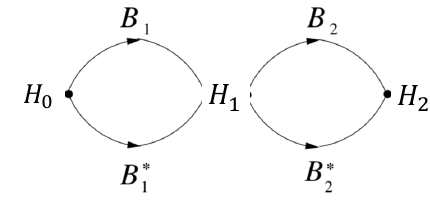
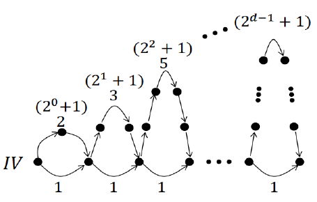
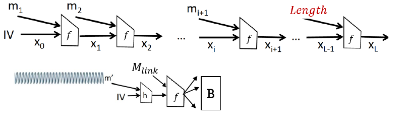

# MD 结构的第二原像攻击

给定消息 $M$，第二原像攻击要找到 **不同的消息** $M'\ne M$，使 $h(M')=h(M)$。攻击者不能自己任选两条消息，因此它与寻找任意一对碰撞不同。对理想 $n$ 位杂凑函数，通常需要约 $2^n$ 次试验才能找到给定消息的第二原像。

本节利用 Merkle–Damgård（MD）迭代结构分析**长消息**。下面用 $f$ 表示压缩函数，链接值为 $n$ 位，消息分组为 $b$ 位：

$$
H_0=IV,\qquad H_i=f(H_{i-1},M_i).
$$

每次迭代只取决于当前链接值和当前分组。一旦两条计算路径到达同一链接值，之后输入完全相同的分组时，状态就会一直相同。**填充及长度信息也属于后续处理**，不能仅凭前面状态相同就忽略它们。

## 先理解多碰撞

从相同状态 $H_0$ 找到两个不同分组 $B_1,B_1^*$，使其输出都为 $H_1$；再从 $H_1$ 找到两个分组 $B_2,B_2^*$，使其输出都为 $H_2$。两级各选一种，共得到四个等长消息，都到达 $H_2$：

图来自第 12.2 节课件第 4 页。以此类推，找到 $t$ 级独立的分组碰撞即可组合出 $2^t$ 条消息。若每级压缩函数碰撞采用生日搜索，工作量约为 $t2^{n/2}$ 次压缩计算，而非分别生成 $2^t$ 条消息所需的计算量。这里描述的同一状态碰撞是结构性质；消息要成为完整杂凑函数的多碰撞，还须保证末尾填充相同，例如这些消息长度相同。

## 没有长度强化时：利用多个目标中间值

设目标消息有 $L=2^k$ 个分组，计算并保存它的中间状态 $H_1,\ldots,H_L$。从 $IV$ 开始，试验新的单分组 $B$，计算 $Y=f(IV,B)$。若某次 $Y=H_i$，便可把 $B$ 接到原消息在第 $i$ 块之后的后缀前：

$$
M'=B\|M_{i+1}\|\cdots\|M_L.
$$

相遇后两条路径处理相同后缀，最终状态相同，只要 $M'\ne M$，便得到第二原像。随机模型下，一次试验约以 $2^k/2^n$ 的概率命中 $2^k$ 个互异目标状态，所以大约需要 $2^{n-k}$ 次试验。连同读取和存储目标状态，课件估计工作量为

$$
2^k+2^{n-k}\approx\max(2^k,2^{n-k}).
$$

计算依赖目标中间状态足够互异、试验近似均匀等假设。若重复状态较多，应按**不同目标状态的个数**计算。构造出的消息长度通常不同；当末尾编码原始长度时，两个消息的填充不再相同，这个直接拼接方法就不能直接使用。

## MD 强化与可扩展消息

MD 强化将原始消息长度编码进填充，确保不同长度的消息在末尾处理的分组不同。具体填充规则因算法而异；课件示例先补零再附加长度分组，不能当作所有 MD 算法的统一填充规则。攻击可以通过构造**可扩展消息**对齐长度。

可扩展消息是一族不同长度的分组序列，它们从同一初始状态出发，处理完各自分组后到达同一个**中间链接值**。注意：由于长度不同，各自再进行 MD 强化填充得到的完整杂凑值未必相同；攻击需要先接上桥接分组和后缀，再保证整个消息长度一致。

构造方法：在第 $j$ 级，找到从当前状态出发、分别长为 1 和 $1+2^j$ 个分组的两条路径，使它们的终点相同，其中 $j=0,1,\ldots,d-1$。每级独立选短路径或长路径，最终得到长度覆盖

$$
d,\ d+1,\ \ldots,\ d+2^d-1
$$

的 $2^d$ 条路径，且全部到达同一状态 $H_\mathrm{exp}$。长路径可先走 $2^j$ 个固定分组，再与短路径做一次跨两组候选的生日碰撞搜索。各级的碰撞搜索约需 $d2^{n/2}$ 次压缩计算；构造长路径还需约 $2^d$ 次计算。

图来自第 12.2 节课件第 11 页。不同级选择的长短之差分别是 $1,2,4,\ldots$，其二进制组合覆盖所需的每一种长度。

## 强化 MD 的长消息第二原像

设目标消息足够长，提供约 $2^d$ 个可用于接入的连续目标中间状态。其核心步骤：

1. 构造上面的可扩展消息，得到共同终点 $H_\mathrm{exp}$。
2. 枚举桥接分组 $B$，计算 $f(H_\mathrm{exp},B)$，直到命中目标的某个状态 $H_i$。约 $2^d$ 个目标下，随机模型中需要约 $2^{n-d}$ 次桥接尝试。
3. 因为桥接之后要与目标第 $i$ 块后的位置对齐，选择长度恰为 $i-1$ 块的可扩展前缀，再接 $B$ 与目标的后缀 $M_{i+1}\|\cdots\|M_L$。
4. 新旧消息分组总长度一致，后续填充也一致；验证新消息与目标不同，即得到第二原像。

例如可选择 $i=d+1,\ldots,d+2^d$ 的状态，以保证 $i-1$ 在可扩展前缀的长度范围内。课件采用目标长度达到约 $2^d+d+1$ 块的条件；目标必须具有对应的有效后缀和相同的消息长度编码。

在理想压缩函数和充足消息空间的模型下，课件的总工作量约为

$$
d2^{n/2}+2^{n-d}+2^d.
$$

第一项来自构造各级碰撞，第二项来自桥接搜索，第三项包括长路径构造与目标状态处理的量级；还需存储目标状态表。该式计的是压缩函数计算，具体常数和存储方案依实现而异。当 $d=n/2$ 时，量级为 $n2^{n/2}$，即与生日搜索有相同的主指数，但仍多一个线性因子，且要求约 $2^{n/2}$ 块的极长目标消息。

## 固定点构造

对于 Davies–Meyer 形式 $f(h,m)=E_m(h)\oplus h$，给定分组 $m$，可计算

$$
h=E_m^{-1}(0),\qquad f(h,m)=0\oplus h=h.
$$

这使 $h$ 成为该消息分组下的固定点：在此状态重复处理 $m$ 不改变链接值，从而可用不同重复次数调节路径长度。它需要压缩函数具有上述结构，并且相应分组密码可在给定密钥下求逆；不能假定任意压缩函数都有同样容易求得的固定点。

## 资料

- 课程课件《第 12.2 节 第二原像攻击》，第 2–13 页。
- 相关笔记：[杂凑函数](杂凑函数.md)、[生日攻击与广义生日攻击](生日攻击与广义生日攻击.md)。
