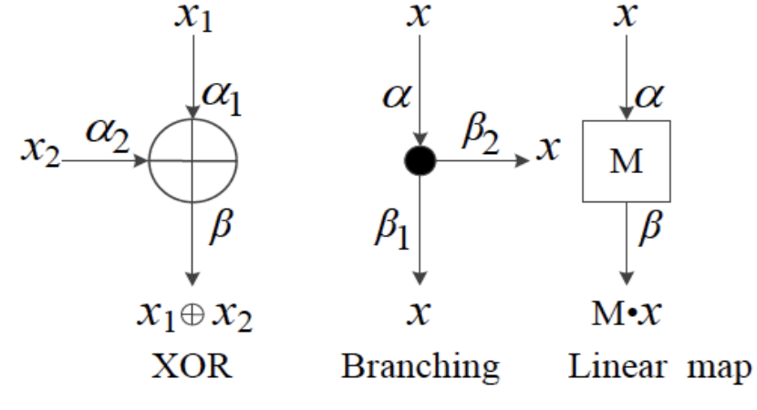

# 线性分析

## 核心问题

寻找明文、中间状态、密文和密钥比特之间有偏差的线性关系。若这种关系成立的概率明显偏离 $1/2$，就可以利用已知明密文对进行区分或密钥恢复。这里的“线性”指比特的异或关系，并不要求密码算法本身是线性的。

## 线性逼近、掩码与偏差

对比特向量 $a$ 和 $x$，定义二元域上的内积 $a\cdot x=\bigoplus_i a_i x_i$。掩码中为 $1$ 的位置表示选取相应比特参与异或。例如，$a=(1,0,1)$ 时，$a\cdot x=x_1\oplus x_3$。

设 $F:\mathbb F_2^m\to\mathbb F_2^n$，输入掩码为 $\alpha\in\mathbb F_2^m$，输出掩码为 $\beta\in\mathbb F_2^n$。研究的线性近似为

$$
\alpha\cdot x\oplus\beta\cdot F(x)=0.
$$

令 $p_{\alpha,\beta}=\Pr_x[\alpha\cdot x\oplus\beta\cdot F(x)=0]$，其中 $x$ 均匀取值。**带符号偏差**为 $\varepsilon_{\alpha,\beta}=p_{\alpha,\beta}-1/2$；衡量可利用程度时看 $|\varepsilon_{\alpha,\beta}|$。正偏差表示等式更常成立，负偏差表示更常不成立。

### 线性近似表（线性分布表，LAT）

对 S 盒 $S:\mathbb F_2^m\to\mathbb F_2^n$，先数使近似式为 $0$ 的**输入**个数：

$$
N_S(\alpha,\beta)
=\#\{x\in\mathbb F_2^m:\alpha\cdot x\oplus\beta\cdot S(x)=0\}.
$$

定义LAT

$$
\operatorname{LAT}_S(\alpha,\beta)
=N_S(\alpha,\beta)-2^{m-1},\qquad
\varepsilon_{\alpha,\beta}
=\frac{\operatorname{LAT}_S(\alpha,\beta)}{2^m}.
$$

> **为什么双射 S 盒的 LAT 元素是偶数？**

这个结论需要 $S:\mathbb F_2^m\to\mathbb F_2^m$ 为双射且 $m\ge 2$。

记 $f(x)=\alpha\cdot x\oplus\beta\cdot S(x)$。
LAT的每一项就是$N_s(\alpha,\beta)-2^{m-1}$，那他的奇偶性就取决于$N_s(\alpha,\beta)$的奇偶性，而它就是$f(x)=0$的x的个数，那这个个数很难判断，不过我们不需要知道他具体的个数，只要判定奇偶性，那我们知$f(x)$一共有$2^m$个，要么是0，要么是1，我们知道异或一个很好的性质就是可以检测里面1的个数的奇偶性，奇数个就是1，偶数个就是0

所以说这里的trick就是把所有$f(x)$异或起来
$$
\bigoplus_{x\in\mathbb F_2^m}f(x)
=\left(\bigoplus_x\alpha\cdot x\right)
\oplus\left(\bigoplus_x\beta\cdot S(x)\right).
$$
注意这里利用一个性质$\bigoplus_{x} x = 0$
因为总共有偶数个1
当 $\alpha\ne0$ 时，$\alpha\cdot x$ 中$x$恰有 $2^{m-1}$ 个 $1$；
$$
\bigoplus_x\alpha\cdot x = \alpha \bigoplus_x x = 0
$$
由于 $S$ 是双射，$\beta\cdot S(x)$ 在 $\beta\ne0$ 时也恰有 $2^{m-1}$ 个 $1$，在 $\beta=0$ 时有 $0$ 个。
所以
$$
\left(\bigoplus_x\beta\cdot S(x)\right) = \beta \bigoplus_x S(x) = 0
$$
所以式子右边为 $0$。
因此取值为 $1$ 的输入数为偶数；总输入数 $2^m$ 也是偶数，于是 $N_S(\alpha,\beta)$ 为偶数。再减去同样为偶数的 $2^{m-1}$，就得到 $\operatorname{LAT}_S(\alpha,\beta)$ 为偶数。

如果 $S$ 不是双射，LAT 元素就有可能是奇数。

## 多轮线性掩码如何传播

从一个 S 盒的 LAT 中选取有偏差的输入、输出掩码，再让相邻轮的掩码相容，便得到一条**线性路径**。

- **线性层：** 若 $y=Lx$，则 $\beta\cdot y=(L^{\mathsf T}\beta)\cdot x$，因此输出掩码 $\beta$ 对应的输入掩码是 $L^{\mathsf T}\beta$。这一关系精确成立。
- **轮密钥异或：** 若 $y=x\oplus k$，则 $\beta\cdot y=\beta\cdot x\oplus\beta\cdot k$。密钥贡献一个固定的奇偶项，不改变偏差的绝对值。
- **S 盒：** 选择非平凡且 $\operatorname{LAT}_S(\alpha,\beta)\ne0$ 的掩码对；$(\alpha,\beta)=(0,0)$ 虽有最大表值，却不给出可利用的关系。其余掩码对的偏差决定这一步的统计强度。经过多个 S 盒和轮后，要把中间状态的掩码配对，使它们在异或相加时抵消。

图中的局部规则可用内积直接检查：若 $y=x_1\oplus x_2$，输出掩码为 $\beta$，两个输入分支都承接 $\beta$；若把 $x$ 复制为两个分支，它们的输出掩码分别为 $\beta_1,\beta_2$，输入掩码就是 $\beta_1\oplus\beta_2$。这些是精确的线性关系，统计偏差只来自 S 盒等非线性部分。

线性近似式异或常数并不会影响偏差的绝对值，但是会导致偏差不确定，可能正，也可能负

那你说为什么线性近似式会出现常数，那基本都是因为轮数不够，比如R+1，有中间状态我们是未知的，需要通过密文和密钥恢复一轮，那这样就会引入K的式子，但是K的式子一般都是固定的常数

### 堆积引理

设 $X_1,\ldots,X_s$ 是**相互独立**的二值随机变量，$p_i=\Pr(X_i=0)$，带符号偏差为 $\varepsilon_i=p_i-1/2$。则

$$
\Pr(X_1\oplus\cdots\oplus X_s=0)
=\frac12+2^{s-1}\prod_{i=1}^s\varepsilon_i.
$$

## 从区分到密钥恢复

### Matsui 算法 1

我们就考虑一轮的线性近似式
$\alpha \cdot u \oplus \beta \cdot v$
但是中间状态我们不知道，我们拿到的是一组明密文，所以需要消除掉中间状态
$m\oplus k_0 = u$
$c \oplus k_1 = v$
那么代入就得到
$$
\alpha \cdot m \oplus \beta \cdot c = \alpha \cdot k_1 \oplus \beta \cdot k_2
$$
如果这个等式以概率p成立
那我们可以用极大似然法来得到密文的1bit信息
设对 $N$ 组已知明密文对，先初始化一个计数器$T_0 = 0$
对于每个密文，都计算
$b_i = \alpha \cdot m_i \oplus \beta c_i$
如果$b_i=0,T_0++$

若 $p>\frac{1}{2}$，线性近似式倾向于成立
如果$T_0>N/2$ ，那么猜测$\alpha \cdot k_1 \oplus \beta \cdot k_2 =0$
否则猜测为1

这里实际上T0应该是在pN附近，不过为了方便我们直接用$\frac{1}{2}$做判定条件就行了，因为肯定是一个大于1/2，一个小于1/2，不然的话你要判断离pN和(1-p)N哪个更近，这就太麻烦了

若 $p<\frac{1}{2}$，线性近似式倾向于不成立
$T_0<N/2$ ，那么猜测$\alpha \cdot k_1 \oplus \beta \cdot k_2 =1$
否则猜测为0

### 偏差与数据量

用 $N$ 组明密文对估计一个近似式成立的频率，抽样波动通常是 $O(N^{-1/2})$。要辨认量级为 $|\varepsilon|$ 的偏差，通常需要

$$
N\asymp|\varepsilon|^{-2}.
$$

这是固定区分成功率下的数量级估计；具体所需数据还受目标成功率、候选密钥数量以及近似模型影响。

### Matsui 算法 2：猜测末轮子密钥

通常情况下太长的轮数可能会导致偏差变小，我们可以拆成r+1轮，最后一轮爆破密钥，这样就可以得到少一轮的线性路线，这可能会有更大的偏差
假设我们得到一个路线
$$
\alpha \cdot m \oplus \beta \cdot y = \gamma \cdot k
$$
以概率$\frac{1}{2}+\frac{9}{32}$成立，这个y需要我们猜测k3来恢复
已知N个明密文，$d∙k_0⨁d∙k_1⨁d∙k_2$未知，但取值确定

用$T_0^i$记录每一个猜测$k_3^i$，求解出的N个$\alpha \cdot m \oplus \beta \cdot y = 0$的个数

如果$k_3^i$是正确的, $T_0^i取值趋近(1/2+9/32) N或(1/2−9/32)N$，如果$\gamma \cdot k= 0$,那就是前者，否则就是后者

$k_3$猜错⇒错误的$y^i$⇒随机的$d∙m⨁d∙y^i$,无法保留原偏差，$T_0^i$取值趋近N/2

我们先统计所有$k_r$对应的$T_0$,如果$k_3^i$是正确的, $T_0^i取值趋近(1/2+9/32) N或(1/2−9/32)N$，如果是错误的那就集中在$\frac{N}{2}$,所以说正确的密钥要么是最大，要么是最小的
所以最大最小都取，如果最大的离$\frac{N}{2}$更远，那说明最大的是正确的，而且可以知道密钥的式子为0，当然这是在偏差大于0的情况下，如果小于0，那就反过来了

两种算法都利用偏差：算法 1 直接推断密钥奇偶值；算法 2 将近似延伸到末轮之前，猜测末轮所需的部分子密钥并比较统计量。

## 相关笔记

- [攻击思想](攻击思想.md)
- [对称加密算法](对称加密算法.md)
- [差分攻击](差分攻击.md)
- [差分—线性分析](差分-线性分析.md)

## 参考资料

- [Mitsuru Matsui, Linear Cryptanalysis Method for DES Cipher（EUROCRYPT 1993）](https://doi.org/10.1007/3-540-48285-7_33)
- [Howard M. Heys, A Tutorial on Linear and Differential Cryptanalysis](https://www.engr.mun.ca/~howard/PAPERS/ldc_tutorial.pdf)
- [Tomer Ashur 与 Vincent Rijmen, On Linear Hulls and Trails](https://eprint.iacr.org/2016/088)
