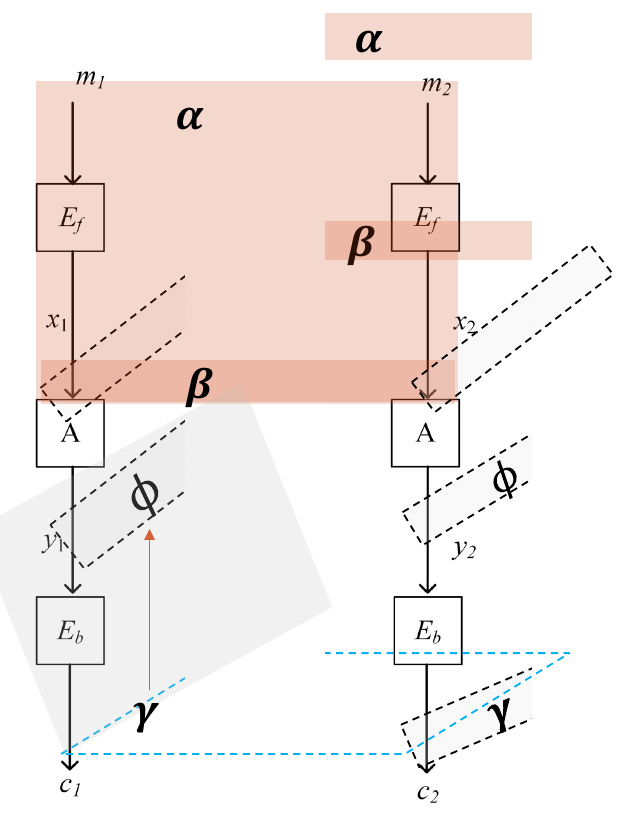

# 飞去来器攻击与矩形攻击

我们知道非线性变换会导致差分传播变化，而线性变换可以保持差分不变
那我们可能在第一个非线性变换有非常好的一个差分路线
在后面的非线性变换又有一个好的差分路线

但是连接处的差分不一样，连不起来，比如前面的是从$\alpha$到$\beta$,后面是从$\phi$到$\gamma$,那这两条路线合不在一起
那怎么充分利用呢
中间还是有一个线性层，他可以保持差分不变，那这个连接处能不能做一些文章
## 为什么要把两段短差分“错位”连接

普通[差分攻击](差分攻击.md)要沿同一对文本串接差分；如果前、后两段各有高概率差分，但它们在连接处的差分不相同，就无法直接串接。

飞去来器攻击改用**四个文本构成的四元组**：上段差分走横向，下段差分走纵向，让连接处形成平行四边形。课件把密码写成 $E=E_b\circ A\circ E_f$，其中连接层 $A$ 为线性或仿射变换。

## 经典飞去来器区分器

设前半部分存在 $\alpha\xrightarrow{E_f}\beta$，正向概率为 $p_1$；后续需要的反向差分 $\beta\xrightarrow{E_f^{-1}}\alpha$ 概率为 $p_2$。后半部分存在 $\gamma\xrightarrow{E_b^{-1}}\phi$，概率为 $q$。
构造过程如下：

1. 选择 $m_1,m_2$，使 $m_1\oplus m_2=\alpha$，并取得 $C_1=E(m_1),C_2=E(m_2)$。

我们确实构造了一组输入差分，这样用到了第一个差分，但是问题是，我们没办法控制他们的输出啊，输出差分又不一定是$\gamma$,那咋办呢，那就杀一个回马枪，
没错$c_1,c_2$的差分不是$\gamma$
你不是要和$c_1$差分为$\gamma$的输出吗，那我直接造一个
2. 选择新的密文 $C_3=C_1\oplus\gamma$、$C_4=C_2\oplus\gamma$
诶。我直接回头强行造一个$c_3$出来，那回头这条路线，就可以用输出那个差分路线了啊
同样$c_4$也是一样
然后我们都解密一下，这样就到了上一层

我们前面构造的输出差分都是$\gamma$,那么这边回到y，差分也应该都是$\phi$,当然这不是必然的，这是高概率的差分
诶，那我们发现这就构成了一个平行四边形，四个y异或起来等于0
那这一层是线性层，x异或起来也是0
那么也就是说，$x_3 \oplus x_4 = x_1 \oplus x_2$,那么也就是说，有很大的概率$m_3 \oplus m_4 =\alpha$,这可以作为一个区分器
3. 检查 $m_3\oplus m_4=\alpha$ 是否明显比随机置换更常发生。

若第一条上段差分、两条下段差分和返回时的上段差分均成立，连接处的四个状态就满足异或和为 $0$。线性或仿射层保持这一四元组关系，于是 $P_3\oplus P_4=\alpha$。在课件采用的独立性近似下，成功概率约为

$$
P_{\mathrm{boom}}\approx p_1p_2q^2.
$$

若两个方向的上段概率同为 $p$，即为 $p^2q^2$。对 $n$ 比特随机置换，检查非零指定差分的基准概率约为 $2^{-n}$；因此 $p^2q^2>2^{-n}$，等价于 $pq>2^{-n/2}$，是判断区分器是否有希望的粗略门槛。实际概率可能受路径相关性、连接处的差分分布影响，不能只凭乘积断言攻击成功。

所以这个p和q都有提升空间

咱们可以把多条路线都用上
## 增强飞去来器与矩形攻击
那前面飞去来器是有反向的，我能不能直接选择明文呢，这样只有正向的，也可以，我们直接选择两组

这时候平行四边形是自上而下的，前面是从下往上的

但是有个区别就是，最后我们是要分开的，所以这里有个随机的$2^{-n}$

前面为啥没有呢，因为前面$x_1 \oplus x_2$是已知的，但是在这里$y_1\oplus y_3$是不知道的

增强飞去来器把构造改成只选择明文：准备两对满足 $P_1\oplus P_2=P_3\oplus P_4=\alpha$ 的明文，观察密文中是否同时出现 $C_1\oplus C_3=\gamma$、$C_2\oplus C_4=\gamma$。中间四元组关系需要偶然对齐，所以在课件的简化模型下，具体密码的概率约为 $p^2q^2 2^{-n}$，随机置换约为 $2^{-2n}$。可通过准备许多明文对、寻找满足条件的四元组来放大信号。

两种公式都有 $p^2q^2$，但**每个四元组的原始成功概率不同**。经典攻击主动设定 $C_3=C_1\oplus\gamma$、$C_4=C_2\oplus\gamma$，使密文侧的两条竖边必然具有差分 $\gamma$；增强攻击只能选择两对明文，连接处的一条跨对差分还需偶然取到指定值 $\phi$，在课件的 $n$ 比特均匀近似下多出一次约 $2^{-n}$ 的代价。另一条跨对差分由平行四边形关系随之确定，因此不是再乘一次 $2^{-n}$。下表取 $p_1=p_2=p$。

| 对一个已选四元组 | 具体密码下 | 随机置换下 | 两者概率之比 |
| --- | ---: | ---: | ---: |
| 经典飞去来器 | $p^2q^2$ | $2^{-n}$ | $2^np^2q^2$ |
| 增强飞去来器 | $2^{-n}p^2q^2$ | $2^{-2n}$ | $2^np^2q^2$ |

所以它们在这个简化模型中有**相同的概率比与有用性门槛** $pq>2^{-n/2}$，但增强版单个四元组的命中概率、与随机置换的概率差，都低 $2^n$ 倍。若能使用经典攻击所需的选择密文查询，增强版未必更省数据。

**为什么还叫“增强”？** 取 $N$ 对输入差分为 $\alpha$ 的选择明文，可以从中选出约 $\binom N2$ 组“两对明文”，形成候选四元组。按上述近似，具体密码下期望命中数约为 $\binom N2p^2q^2 2^{-n}$，随机置换下约为 $\binom N2 2^{-2n}$。候选数随 $N$ 近似平方增长，使偶然发生的中间跨对匹配积累成可检测的信号；例如 $p=q=1$、$n=128$ 时，原论文用约 $2^{65}$ 对选择明文，预期得到约 $2$ 个中间匹配。“增强”指**放大罕见事件的可检测性**，并将攻击改为只需选择明文，不是提高单个四元组的成功概率。这些期望值基于简化的均匀与差分独立性假设，不能直接当作独立试验的成功概率。[原论文：Amplified Boomerang Attacks](https://www.schneier.com/wp-content/uploads/2016/02/paper-boomerang.pdf)

矩形攻击进一步**汇总多条可兼容差分路径**。例如上段不只允许一个 $\beta$，下段也不只允许一个 $\phi$；只要四元组在连接处满足所需的异或关系，它们都可能贡献成功概率。课件第13、18、20页用对差分概率求和的方式说明：只看单条最优路径可能低估区分能力。求和时仍需检查各路径的相关性，不能把不相容的路径机械相加。

矩阵攻击就是允许这一段差分不一样
## 与普通差分攻击的关系

| 方法 | 使用的文本 | 连接两段的方法 |
| --- | --- | --- |
| 普通差分 | 一对明密文 | 前段输出差分与后段输入差分相同 |
| 经典飞去来器 | 四个文本；可选择明文和密文 | 四元组在中间形成平行四边形 |
| 增强飞去来器／矩形 | 大量选择明文对，寻找四元组 | 利用偶然对齐，并汇总多条差分路径 |

延伸阅读：[截断差分](截断差分.md)、[不可能差分分析](不可能差分分析.md)、[差分—线性分析](差分-线性分析.md)。
